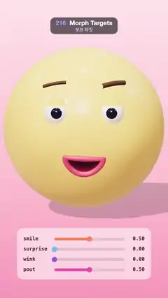

# 216 · Morph Targets · 모프 타깃



**EN** A round yellow face blends smile, surprise, wink and pout with morph targets while four sliders below show each weight crossfading.  
**KO** 동그란 노란 얼굴이 모프 타깃으로 미소, 놀람, 윙크, 뾰로통을 섞고, 아래 슬라이더 네 개가 각 가중치가 넘어가는 모습을 보여 준다.

[Video (mp4)](https://sueun-dev.github.io/motion-effects/videos/216-morph-targets.mp4) · [Code](../effects/216-morph-targets.js) · Animation & characters · 애니메이션·캐릭터

## Prompt (English)

```text
Create a "Morph Targets" motion effect: a cartoon face whose head, lips, mouth, brows and eyelids each store extra copies of their vertex positions (blend shapes), mixed on the GPU by four weights that a slider panel shows.

Look
- Head: a sphere of radius 3 (96 × 64), yellow #FFC857, physical material with sheen #FFE2A8 0.6 and clearcoat 0.3. Its targets: smile = both cheeks bulge 0.28 (Gaussian round (±1.4, −0.45, 2.4)); surprise = y × 1.06, x × 0.97; wink = the left cheek bulges 0.3; pout = the lower face narrows up to 7 %.
- Features sit on the front of the head: the point (x, y, √(9 − x² − y²)) pushed out along the normal by a lift; for the mouth parts of each shape also by that shape's cheek bulge, so the lips and the mouth ride the cheeks instead of being swallowed by them. Mouth outline: a closed curve of 64 points, a different curve per shape — neutral a thin lens 1.1 wide at y = −1.0; smile a wide U 1.9 wide with raised corners; surprise an upright oval 0.84 × 1.1 at y = −1.15 (lifted 0.22); wink a lopsided grin; pout a small ring of radius 0.2 pushed out 0.3. Upper and lower lip heights blend smoothly over the corners (smoothstep over sin a from −0.5 to 0.5) and the corners are opened by 0.2 · sin a, so every corner is rounder than the lip tube.
- Lips: a closed tube (radius 0.09) along the mouth curve, #E04F6B. Inside of the mouth: a ladder of 33 vertical rungs (6 rows each), each from the upper-lip point at angle a to the lower-lip point at −a, shrunk 7 % towards the mouth centre so its ends tuck under the lips; it fills the whole opening in every shape and every blend. Rows coloured from #3A0A1C at the top to a soft tongue red #A8394C (80 %) at the bottom. It is drawn after the head with the depth test off, then the lips over it, so the head can never show through the open mouth. Brows: tubes (radius 0.08) #5A3A22 over each eye — raised and arched for surprise, the winking side pulled down, knitted for pout.
- Eyes at (±0.95, 0.65): white balls (0.42) with dark pupils #1B1B2F (0.22, set 0.25 forward). Eyelids: sphere caps of radius 0.52, #F4B740, whose target goes from a thin cap (0.22π) to shut (0.8π). The left lid follows the wink weight plus 0.3 × smile (a happy squint); the right lid 0.3 × smile.
- Scene: vertical gradient #FFE5EC → #FFC2D1 (60 %) → #FB9EBB; key light #FFF1E0 (2.4) from (−5, 8, 9) with a soft shadow on a shadow-only floor (y = −3.9, opacity 0.18); hemisphere #FFFFFF / #E58FA8 (1.1); room environment 0.45. Camera 30° at (0, 0.4, 21) looking at (0, −1.4, 0); the face fills the upper middle.
- Slider panel drawn in 2D at the bottom: a 55 % white rounded rectangle (x 110, y 1470, 860 × 330, radius 36); four rows 66 px apart from y = 1540: the name in 32 px monospace #5B2A3D, a track from x = 350 to 800, a filled bar and knob (radius 17) in #FF8A5B smile, #5BC0EB surprise, #9B5DE5 wink, #F15BB5 pout, and the value with two decimals right-aligned at x = 930.

Motion (0–5 s), a = 2π · t / 5
- The four weights cross-fade round the loop: expression i is centred at 0.625 + 1.25 · i s; with x = the wrapped distance from that centre, weight = smoothstep(0.85, 0.4, |x|) — each holds for 0.8 s and fades for 0.45 s into the next (smile → surprise → wink → pout → smile). At 0 s the face is halfway from pout to smile, so the loop never stops.
- The whole face sways: turn 0.22 · sin a, tilt 0.05 · sin 2a, bob 0.12 · sin 2a.

Technique
- three.js: each part's geometry gets geometry.morphAttributes.position (and .normal) = the target geometries' attributes; every frame sets mesh.morphTargetInfluences from the same four weights. Every target of a part has the same vertex count and order (the mouth ladder too), so any blend of them stays a clean shape. The lips are TubeGeometry along a closed CatmullRomCurve3, with the same segment counts for every target so the vertices line up; the eyelid targets are SphereGeometry caps with different theta lengths.
- ACES Filmic tone mapping, PCF soft shadows; the panel is drawn with canvas 2D on top of the 3D frame.

Output and rules
- One self-contained HTML file with no external assets (three.js from a CDN is fine if you use it), drawing on a 1080 × 1920 canvas (9:16) scaled to fit the window.
- Write a function renderFrame(t) that draws the frame for time t in seconds, and preview it with requestAnimationFrame. Everything must be a pure function of t and fixed seeds: no Math.random(), Date or state carried between frames, so frame i = renderFrame(i / 30) can be exported to a 30 fps video.
- Loop seamlessly every 5 seconds: renderFrame(5) must look exactly like renderFrame(0).
- No flicker of any kind: no noise or grain that changes from frame to frame, no strobing or blinking, no z-fighting, no shimmering 1 px lines. Any grain or texture stays fixed to the screen or to the object.
- Keep the top 280 px free of important content (a title label goes there) and fill the whole frame with a designed background.
```

## 프롬프트 (한국어)

```text
"모프 타깃" 모션 효과를 만들어 줘: 만화 얼굴의 머리, 입술, 입 안, 눈썹, 눈꺼풀이 저마다 정점 위치의 사본(블렌드 셰이프)을 더 갖고 있고, GPU가 그것을 네 가중치로 섞으며, 슬라이더 패널이 그 가중치를 보여 주는 효과.

모양
- 머리: 반지름 3의 구(96 × 64), 노랑 #FFC857, 물리 기반 재질에 쉰 #FFE2A8 0.6, 클리어코트 0.3. 타깃: 미소 = 양 볼이 0.28 부푼다((±1.4, −0.45, 2.4) 둘레 가우시안); 놀람 = y × 1.06, x × 0.97; 윙크 = 왼쪽 볼이 0.3 부푼다; 뾰로통 = 얼굴 아래쪽이 최대 7 % 좁아진다.
- 이목구비는 머리 앞면에 놓는다: 점 (x, y, √(9 − x² − y²))을 법선 방향으로 띄움만큼 밀고, 입 부위는 그 모양의 볼 부풀림만큼 더 민다. 그래서 입술과 입이 볼에 묻히지 않고 볼을 타고 움직인다. 입 윤곽: 점 64개의 닫힌 곡선, 모양마다 다른 곡선 — 기본은 y = −1.0의 폭 1.1 얇은 렌즈; 미소는 입꼬리가 올라간 폭 1.9의 넓은 U; 놀람은 y = −1.15의 세로 타원 0.84 × 1.1(0.22 띄움); 윙크는 한쪽으로 치우친 웃음; 뾰로통은 반지름 0.2의 작은 고리를 0.3 앞으로. 윗입술과 아랫입술 높이는 입꼬리에서 부드럽게 섞이고(sin a가 −0.5~0.5인 구간을 smoothstep) 입꼬리를 0.2 · sin a만큼 벌려서, 모든 입꼬리가 입술 관보다 둥글다.
- 입술: 입 곡선을 따라가는 닫힌 관(반지름 0.09), #E04F6B. 입 안: 세로 가로대 33개(각 6줄)로 된 사다리. 가로대마다 각도 a의 윗입술 점에서 −a의 아랫입술 점까지 잇고, 입 중심 쪽으로 7 % 줄여서 끝이 입술 밑에 숨는다. 어느 모양, 어느 섞임에서도 입 안 전체를 채운다. 줄마다 색은 위쪽 #3A0A1C에서 아래쪽 부드러운 혀 빨강 #A8394C(80 %)로. 머리 다음에 깊이 검사 없이 그리고 그 위에 입술을 그려서, 벌린 입 사이로 머리가 비치지 않는다. 눈썹: 눈 위의 관(반지름 0.08) #5A3A22 — 놀람에는 높이 아치, 윙크에는 감는 쪽이 내려가고, 뾰로통에는 모인다.
- 눈은 (±0.95, 0.65): 흰 공(0.42)에 검은 눈동자 #1B1B2F(0.22, 0.25 앞). 눈꺼풀: 반지름 0.52의 구 조각, #F4B740, 타깃은 얇은 덮개(0.22π)에서 감은 상태(0.8π)까지. 왼쪽 눈꺼풀은 윙크 가중치 + 0.3 × 미소(웃으며 실눈), 오른쪽은 0.3 × 미소.
- 장면: 세로 그라디언트 #FFE5EC → #FFC2D1(60 %) → #FB9EBB; 키 라이트 #FFF1E0(2.4)가 (−5, 8, 9)에서 그림자만 보이는 바닥(y = −3.9, 불투명도 0.18)에 부드러운 그림자; 반구광 #FFFFFF / #E58FA8(1.1); 룸 환경맵 0.45. 카메라 30°, (0, 0.4, 21)에서 (0, −1.4, 0)을 본다. 얼굴이 위쪽 가운데를 채운다.
- 아래쪽에 2D로 그린 슬라이더 패널: 55 % 흰색 둥근 사각형(x 110, y 1470, 860 × 330, 반지름 36); y = 1540부터 66 px 간격으로 네 줄: 32 px 고정폭 글꼴 #5B2A3D의 이름, x = 350~800의 트랙, 채워진 막대와 손잡이(반지름 17)는 미소 #FF8A5B, 놀람 #5BC0EB, 윙크 #9B5DE5, 뾰로통 #F15BB5, 값은 소수 둘째 자리까지 x = 930에 오른쪽 정렬.

움직임 (0–5초), a = 2π · t / 5
- 네 가중치가 루프를 돌며 교차한다: 표정 i의 중심은 0.625 + 1.25 · i초, x = 중심에서 감아 돈 거리일 때 가중치 = smoothstep(0.85, 0.4, |x|) — 각각 0.8초 유지하고 0.45초에 걸쳐 다음으로 넘어간다(미소 → 놀람 → 윙크 → 뾰로통 → 미소). 0초에는 뾰로통에서 미소로 반쯤 넘어간 상태라 루프가 멈추지 않는다.
- 얼굴 전체가 흔들린다: 회전 0.22 · sin a, 기울기 0.05 · sin 2a, 위아래 0.12 · sin 2a.

기법
- three.js: 부위마다 geometry.morphAttributes.position(과 .normal)에 타깃 지오메트리의 속성을 넣고, 프레임마다 같은 네 가중치로 mesh.morphTargetInfluences를 정한다. 한 부위의 모든 타깃은 정점 수와 순서가 같아서(입 안 사다리도) 어떻게 섞어도 깔끔한 모양이 된다. 입술은 닫힌 CatmullRomCurve3를 따라가는 TubeGeometry이고, 모든 타깃의 분할 수를 같게 해서 정점이 맞물린다. 눈꺼풀 타깃은 theta 길이만 다른 SphereGeometry 조각.
- ACES Filmic 톤 매핑, PCF 소프트 그림자. 패널은 3D 프레임 위에 canvas 2D로 그린다.

출력과 규칙
- 외부 파일 없는 HTML 파일 하나(three.js를 쓴다면 CDN은 괜찮다). 1080 × 1920(9:16) 캔버스에 그리고 창 크기에 맞춰 보이게 한다.
- 시간 t(초)의 프레임을 그리는 renderFrame(t) 함수를 만들고, 미리보기는 requestAnimationFrame으로 돌린다. 모든 것은 t와 고정 시드만으로 정해진다: Math.random(), Date, 프레임 사이에 쌓이는 상태 금지. 그래야 i번째 프레임 = renderFrame(i / 30)으로 30fps 영상을 뽑을 수 있다.
- 5초마다 끊김 없이 반복: renderFrame(5)는 renderFrame(0)과 똑같아 보여야 한다.
- 어떤 깜빡임도 금지: 프레임마다 바뀌는 노이즈·그레인, 번쩍임·깜빡임, z-fighting, 반짝이며 떨리는 1px 선 모두 금지. 그레인·질감은 화면이나 물체에 고정한다.
- 위쪽 280px에는 중요한 내용을 두지 않고(제목 라벨 자리), 화면 전체를 디자인된 배경으로 채운다.
```
