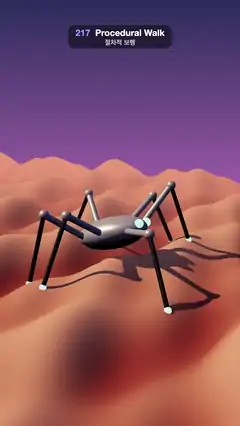

# 217 · Procedural Walk · 절차적 보행



**EN** A six-legged robot spider walks over sunset dunes; its IK legs lift and plant one stride ahead on glowing footholds as the body tilts with the ground.  
**KO** 다리 여섯 개 로봇 거미가 노을 진 모래 언덕을 걷고, IK 다리가 들렸다가 한 걸음 앞 빛나는 발판에 디디며 몸통은 땅을 따라 기운다.

[Video (mp4)](https://sueun-dev.github.io/motion-effects/videos/217-procedural-walk.mp4) · [Code](../effects/217-procedural-walk.js) · Animation & characters · 애니메이션·캐릭터

## Prompt (English)

```text
Create a "Procedural Walk" motion effect: a six-legged robot walks over bumpy ground with a tripod gait; no keyframes — every foot position is planned from the ground's height and every knee is solved with two-bone inverse kinematics each frame.

Look
- Ground: height h(x, z) = 0.38 sin(2πx / 6 + 0.8 sin 0.5z) + 0.22 sin(2πx / 4 + 1.3 + 0.7z) + 0.12 cos(2π · 5x / 12 − 0.9z); all x periods divide 12, so it repeats every 12 units. A smooth-shaded plane 48 × 40 (240 × 160 segments) with vertex colours from #9C4A3C in the hollows to #E8A27A on the crests.
- Robot: a metal shell #E8ECF2 (ellipsoid 1.35 × 0.55 × 0.9, metalness 0.6, roughness 0.3) over a dark belly #2E3440, two glowing cyan eyes #7DF9FF at the front. Six legs from hips at (±0.8 or 0, −0.05, ±0.5 / ±0.6): thigh 2.0 long (metal rod, radius 0.11), shin 2.4 long (dark rod, radius 0.075), a metal ball at each knee (0.17), a glowing cyan toe (0.12).
- Footholds: while a foot is in the air, a cyan ring (radius 0.3–0.42, no fog) lies on the ground slope where it will land, opacity 0.9 · sin(π · swing).
- Scene: sky gradient #2B2D5C → #B06AB3 → #FFB677, fog #E9967A from 18 to 45; sun #FFD6A5 (3.0) from 8 behind, 10 up, 6 to the side, following the robot, with a soft shadow (2048 map, bias −0.0004, normal bias 0.03); hemisphere #9FB4FF / #5A3A4A (1.1).
- Camera 42° at (x + 9.5 + 0.8 sin a, 6.6, 16.5) looking at (x + 0.3, 2.0, 0), where x is the robot's position: a three-quarter front view with dunes to the horizon at about 40 % height.

Motion (0–5 s), a = 2π · t / 5
- The body moves along +x at 2.4 units/s: exactly 12 (one ground period) per loop, so the last frame meets the first. Step period T = 1.25 s (4 steps per leg per loop), stride 3.0. Two tripods (front-left, middle-right, back-left and the mirror) are half a step apart.
- Foot i with gait offset o: c = t / T + o, n = floor(c), u = c − n. Planted while u < 0.5 at x₀ = 2.4 · (n + 0.25 − o) · T + foot offset, on the ground's height; for u ≥ 0.5 it swings to x₁ = x₀ + 3.0 with s = smoothstep(0.5, 1, u) and lifts 0.7 · sin(πs).
- The body rides 1.25 above the mean ground under it, bobs 0.06 twice per step, and tilts with 0.8 × the local slope front–back and side–side.

Technique
- three.js. Per leg each frame: hip = body matrix × local hip; d = toe − hip; in the vertical plane through both, elevation = atan2(d.y, r) + acos((L1² + D² − L2²) / (2 L1 D)) with D = |d| clamped to L1 + L2; knee = hip + L1 (cos e along the horizontal direction, sin e up). Rods are cylinders scaled to length and turned with setFromUnitVectors.
- The ground mesh is moved by whole periods (12) to stay under the robot; since the ground repeats, nothing jumps. The rings use polygon offset so the ground never cuts them.
- ACES Filmic tone mapping, PCF soft shadows.

Output and rules
- One self-contained HTML file with no external assets (three.js from a CDN is fine if you use it), drawing on a 1080 × 1920 canvas (9:16) scaled to fit the window.
- Write a function renderFrame(t) that draws the frame for time t in seconds, and preview it with requestAnimationFrame. Everything must be a pure function of t and fixed seeds: no Math.random(), Date or state carried between frames, so frame i = renderFrame(i / 30) can be exported to a 30 fps video.
- Loop seamlessly every 5 seconds: renderFrame(5) must look exactly like renderFrame(0).
- No flicker of any kind: no noise or grain that changes from frame to frame, no strobing or blinking, no z-fighting, no shimmering 1 px lines. Any grain or texture stays fixed to the screen or to the object.
- Keep the top 280 px free of important content (a title label goes there) and fill the whole frame with a designed background.
```

## 프롬프트 (한국어)

```text
"절차적 보행" 모션 효과를 만들어 줘: 다리 여섯 개 로봇이 세발 걸음새(삼각 보행)로 울퉁불퉁한 땅을 걷는다. 키프레임 없이 발 위치는 땅의 높이로 계획하고, 무릎은 프레임마다 두 마디 역운동학으로 푼다.

모양
- 땅: 높이 h(x, z) = 0.38 sin(2πx / 6 + 0.8 sin 0.5z) + 0.22 sin(2πx / 4 + 1.3 + 0.7z) + 0.12 cos(2π · 5x / 12 − 0.9z). x 방향 주기가 모두 12의 약수라 12마다 반복된다. 매끄럽게 음영진 48 × 40 평면(240 × 160분할), 정점 색은 골짜기 #9C4A3C에서 꼭대기 #E8A27A까지.
- 로봇: 금속 껍데기 #E8ECF2(타원체 1.35 × 0.55 × 0.9, 금속성 0.6, 거칠기 0.3) 아래 어두운 배 #2E3440, 앞쪽에 빛나는 하늘색 눈 두 개 #7DF9FF. 다리 여섯 개, 엉덩이는 (±0.8 또는 0, −0.05, ±0.5 / ±0.6): 허벅지 길이 2.0(금속 막대, 반지름 0.11), 정강이 2.4(어두운 막대, 반지름 0.075), 무릎마다 금속 공(0.17), 빛나는 하늘색 발끝(0.12).
- 발판: 발이 공중에 있는 동안 디딜 자리의 땅 경사면에 하늘색 고리(반지름 0.3–0.42, 안개 영향 없음)가 놓인다. 불투명도 0.9 · sin(π · 스윙).
- 장면: 하늘 그라디언트 #2B2D5C → #B06AB3 → #FFB677, 안개 #E9967A 18~45; 해 #FFD6A5(3.0)는 로봇을 따라가며 뒤 8, 위 10, 옆 6에서 비추고 부드러운 그림자(2048 맵, bias −0.0004, normal bias 0.03); 반구광 #9FB4FF / #5A3A4A(1.1).
- 카메라 42°, (x + 9.5 + 0.8 sin a, 6.6, 16.5)에서 (x + 0.3, 2.0, 0)을 본다(x는 로봇 위치): 비스듬한 앞쪽 시점, 지평선까지 모래 언덕이 이어지고 지평선은 높이 약 40 %.

움직임 (0–5초), a = 2π · t / 5
- 몸통이 +x로 초당 2.4씩 간다: 루프마다 정확히 12(땅 한 주기)라 마지막 프레임이 첫 프레임과 이어진다. 걸음 주기 T = 1.25초(루프마다 다리당 4걸음), 보폭 3.0. 두 삼각 조(왼앞·오른가운데·왼뒤와 그 반대)가 반 걸음 어긋난다.
- 걸음 오프셋 o인 발 i: c = t / T + o, n = floor(c), u = c − n. u < 0.5인 동안 x₀ = 2.4 · (n + 0.25 − o) · T + 발 오프셋에 땅 높이로 딛고 있고, u ≥ 0.5이면 s = smoothstep(0.5, 1, u)로 x₁ = x₀ + 3.0까지 휘둘러 가며 0.7 · sin(πs)만큼 들린다.
- 몸통은 발밑 땅 평균보다 1.25 위에 떠서, 걸음마다 두 번 0.06씩 출렁이고, 앞뒤·좌우 경사의 0.8배만큼 기운다.

기법
- three.js. 다리마다 프레임마다: 엉덩이 = 몸통 행렬 × 로컬 엉덩이; d = 발끝 − 엉덩이; 둘을 지나는 세로 평면에서 각도 e = atan2(d.y, r) + acos((L1² + D² − L2²) / (2 L1 D)), D = |d|를 L1 + L2로 제한; 무릎 = 엉덩이 + L1(수평 방향으로 cos e, 위로 sin e). 막대는 길이만큼 늘린 원기둥을 setFromUnitVectors로 돌린다.
- 땅 메시는 로봇 아래에 있도록 주기(12) 단위로 옮긴다. 땅이 반복되니 튀지 않는다. 고리는 polygon offset으로 땅에 묻히지 않게 한다.
- ACES Filmic 톤 매핑, PCF 소프트 그림자.

출력과 규칙
- 외부 파일 없는 HTML 파일 하나(three.js를 쓴다면 CDN은 괜찮다). 1080 × 1920(9:16) 캔버스에 그리고 창 크기에 맞춰 보이게 한다.
- 시간 t(초)의 프레임을 그리는 renderFrame(t) 함수를 만들고, 미리보기는 requestAnimationFrame으로 돌린다. 모든 것은 t와 고정 시드만으로 정해진다: Math.random(), Date, 프레임 사이에 쌓이는 상태 금지. 그래야 i번째 프레임 = renderFrame(i / 30)으로 30fps 영상을 뽑을 수 있다.
- 5초마다 끊김 없이 반복: renderFrame(5)는 renderFrame(0)과 똑같아 보여야 한다.
- 어떤 깜빡임도 금지: 프레임마다 바뀌는 노이즈·그레인, 번쩍임·깜빡임, z-fighting, 반짝이며 떨리는 1px 선 모두 금지. 그레인·질감은 화면이나 물체에 고정한다.
- 위쪽 280px에는 중요한 내용을 두지 않고(제목 라벨 자리), 화면 전체를 디자인된 배경으로 채운다.
```
