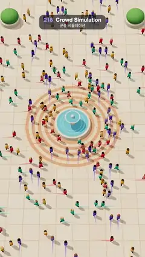

# 218 · Crowd Simulation · 군중 시뮬레이션



**EN** Hundreds of small walkers in four colour-coded streams cross a sunny plaza, swerving round each other and a fountain, each with a fading trail.  
**KO** 네 가지 색으로 나뉜 수백 명의 작은 보행자가 햇살 비친 광장을 가로지르며 서로와 분수를 비켜 가고, 지나온 길이 옅은 꼬리로 남는다.

[Video (mp4)](https://sueun-dev.github.io/motion-effects/videos/218-crowd-simulation.mp4) · [Code](../effects/218-crowd-simulation.js) · Animation & characters · 애니메이션·캐릭터

## Prompt (English)

```text
Create a "Crowd Simulation" motion effect: a top-down view of a sunny plaza where hundreds of small walkers in four colour-coded streams cross, steering around each other and around a fountain in the middle.

Look
- Camera: perspective, 30° vertical field of view, at (0, 56, 33) looking at (0, 0, 0.6), nearly straight down; the plaza fills the frame.
- Ground: a 44 × 60 plaza (texture at 64 px per unit): 2 × 2 sandstone slabs (hue 34–40, saturation 32 %, lightness 82–87 %, each slab a little different) with #CDBCA2 grout; round the fountain, ten concentric rings alternating #E9D6B8 and #D39A7A from radius 3.0 to 7.2, crossed by 48 radial joints.
- Fountain at the centre: a stone rim #E4DACB (radius 2.4–2.5, height 0.5), a water disc #58B7E0 with a slight blue glow, a pedestal with a bowl and a small white ball on top. Three thin white ripple rings spread over the water, one every 5/3 s, fading in and out.
- Four round stone planters with green shrub domes at (±9.6, ±18.6), radius 1.5.
- Walkers: a body capsule (radius 0.2, length 0.42) in the stream colour (west→east #FF5A5F, east→west #16BDB4, north→south #FFB400, south→north #7A6CF5, each ±6 % lightness), a skin-tone head (radius 0.15) with a hair cap, and two dark legs #3A3550.
- Behind each walker a ribbon trail over its last 1 s of path, on the ground, in its colour, widening and fading in towards the walker (opacity up to 0.8).
- Light: a warm sun #FFE2BF, intensity 2.6, from (−18, 34, −10) with soft 4096 shadow maps (long shadows), a hemisphere light #FFF4E6 / #9C8A74 at 1.5, ACES tone mapping.

Motion (0–5 s)
- 66 walkers: 20 walk west→east from x = −14 to +14 (random z within ±15, drifting up to ±3), 20 east→west, 13 north→south from z = −25 to +24 (random x within ±7) and 13 south→north. Preferred speed 2.5 units/s ±10 %.
- Each walker starts at its own fixed frame of the loop and walks for twice its crossing time, so it appears and disappears off screen. One that started more than 5 s ago is on screen again as its next copy, so the plaza always holds about 180 people.
- Walking: the legs swing ±0.55 rad with sin(distance walked / 0.62 · π) and the body bobs 0.04 units; each walker faces along its path (direction from 3 frames before to 3 frames after).

Technique
- The simulation runs once in setup. The walkers are simulated one after another in a shuffled order (seed 8): each is stepped from its start over its whole lifetime (2 sub-steps per frame) against the paths of the walkers already planned at the same frame of the loop (frame = (start + age) mod 150). Every finished path therefore repeats every 5 s by construction.
- Steering: relax towards the wanted velocity (straight at the exit; an obstacle within 7 units ahead bends the heading to pass beside it) with a 0.54 s time constant; for every neighbour within 6 units, the time-to-collision power-law force of Karamouzas et al. 2014 (k = 1.5, τ0 = 3 s, look-ahead 3 s, capped at 3 units/s²); a contact push of 60 × overlap below a 0.72 unit gap; a push out of the fountain and planters; speed capped at 1.3 × preferred; after each step the walker is moved out of any planned walker it overlaps. Three passes of [¼, ½, ¼] smoothing remove small kinks.
- Rendering: one InstancedMesh per body part; in each frame every walker is read from its path at (frame − start) mod 150 (plus 150 for a second copy).

Output and rules
- One self-contained HTML file with no external assets (three.js from a CDN is fine if you use it), drawing on a 1080 × 1920 canvas (9:16) scaled to fit the window.
- Write a function renderFrame(t) that draws the frame for time t in seconds, and preview it with requestAnimationFrame. Everything must be a pure function of t and fixed seeds: no Math.random(), Date or state carried between frames, so frame i = renderFrame(i / 30) can be exported to a 30 fps video.
- Loop seamlessly every 5 seconds: renderFrame(5) must look exactly like renderFrame(0).
- No flicker of any kind: no noise or grain that changes from frame to frame, no strobing or blinking, no z-fighting, no shimmering 1 px lines. Any grain or texture stays fixed to the screen or to the object.
- Keep the top 280 px free of important content (a title label goes there) and fill the whole frame with a designed background.
```

## 프롬프트 (한국어)

```text
"군중 시뮬레이션" 모션 효과를 만들어 줘: 햇살 비친 광장을 위에서 내려다보는 장면에서, 네 가지 색으로 나뉜 수백 명의 작은 보행자가 서로와 가운데 분수를 피해 가며 광장을 가로지르는 효과.

모양
- 카메라: 원근, 세로 시야각 30°, 위치 (0, 56, 33)에서 (0, 0, 0.6)을 본다. 거의 바로 위에서 내려다보고, 광장이 화면을 채운다.
- 바닥: 44 × 60 광장(텍스처는 단위당 64px). 2 × 2 사암 판석(색상 34–40, 채도 32 %, 명도 82–87 %, 판마다 조금씩 다름)과 #CDBCA2 줄눈. 분수 둘레에는 반지름 3.0부터 7.2까지 #E9D6B8과 #D39A7A가 번갈아 나오는 동심원 10개와 방사형 줄눈 48개.
- 가운데 분수: 돌 테두리 #E4DACB(반지름 2.4–2.5, 높이 0.5), 살짝 푸르게 빛나는 물 원반 #58B7E0, 받침 기둥과 그릇, 꼭대기의 작은 흰 공. 가는 흰 물결 고리 3개가 5/3초마다 하나씩 물 위로 퍼지며 나타났다 사라진다.
- (±9.6, ±18.6)에 반지름 1.5의 둥근 돌 화분과 초록 관목 돔 4개.
- 보행자: 흐름 색의 몸통 캡슐(반지름 0.2, 길이 0.42; 서→동 #FF5A5F, 동→서 #16BDB4, 북→남 #FFB400, 남→북 #7A6CF5, 각각 명도 ±6 %), 살색 머리(반지름 0.15)와 머리카락 캡, 어두운 다리 두 개 #3A3550.
- 보행자마다 뒤에 최근 1초 동안 지나온 길을 바닥에 리본 꼬리로 남긴다. 자기 색이고, 보행자 쪽으로 갈수록 넓어지고 진해진다(불투명도 최대 0.8).
- 조명: 따뜻한 해 #FFE2BF, 세기 2.6, 위치 (−18, 34, −10), 부드러운 4096 그림자 맵(긴 그림자). 반구광 #FFF4E6 / #9C8A74 세기 1.5, ACES 톤 매핑.

움직임 (0–5초)
- 보행자 66명: 20명은 x = −14에서 +14로 서→동(z는 ±15 안에서 무작위, 최대 ±3 비스듬히), 20명은 동→서, 13명은 z = −25에서 +24로 북→남(x는 ±7 안에서 무작위), 13명은 남→북. 원하는 속도 초당 2.5 ±10 %.
- 보행자마다 루프의 정해진 프레임에서 출발해 건너는 시간의 두 배 동안 걸으므로 화면 밖에서 나타나고 사라진다. 출발한 지 5초가 넘은 보행자는 다음 복사본으로 다시 화면에 있으니, 광장에는 늘 180명쯤이 있다.
- 걸음: 다리는 sin(걸은 거리 / 0.62 · π)로 ±0.55 rad 흔들리고 몸은 0.04 위아래로 들썩인다. 각 보행자는 경로 방향(3프레임 전에서 3프레임 뒤로)을 바라본다.

기법
- 시뮬레이션은 setup에서 한 번 돌린다. 보행자를 섞은 순서(시드 8)로 한 명씩 시뮬레이션한다: 출발점에서 수명 전체를 프레임당 2번의 하위 단계로 진행하되, 루프의 같은 프레임(프레임 = (출발 + 나이) mod 150)에 이미 계획된 보행자들의 경로를 상대로 피한다. 그래서 완성된 모든 경로가 저절로 5초마다 되풀이된다.
- 조향: 원하는 속도(출구를 향하고, 앞 7 안에 장애물이 있으면 옆으로 지나가도록 방향을 꺾음)로 0.54초 시상수로 다가간다. 6 안의 이웃마다 Karamouzas 외(2014)의 충돌까지 시간(time-to-collision) 거듭제곱 힘(k = 1.5, τ0 = 3초, 내다보기 3초, 최대 초당² 3). 간격 0.72보다 겹치면 60 × 겹친 양만큼 밀기, 분수·화분 밖으로 밀기, 속도는 원하는 속도의 1.3배까지. 매 단계 뒤에는 겹친 계획된 보행자 밖으로 옮긴다. 마지막에 [¼, ½, ¼] 다듬기를 세 번 해 작은 꺾임을 없앤다.
- 렌더링: 몸 부위마다 InstancedMesh 하나. 매 프레임 각 보행자를 경로의 (프레임 − 출발) mod 150 위치(두 번째 복사본은 +150)에서 읽는다.

출력과 규칙
- 외부 파일 없는 HTML 파일 하나(three.js를 쓴다면 CDN은 괜찮다). 1080 × 1920(9:16) 캔버스에 그리고 창 크기에 맞춰 보이게 한다.
- 시간 t(초)의 프레임을 그리는 renderFrame(t) 함수를 만들고, 미리보기는 requestAnimationFrame으로 돌린다. 모든 것은 t와 고정 시드만으로 정해진다: Math.random(), Date, 프레임 사이에 쌓이는 상태 금지. 그래야 i번째 프레임 = renderFrame(i / 30)으로 30fps 영상을 뽑을 수 있다.
- 5초마다 끊김 없이 반복: renderFrame(5)는 renderFrame(0)과 똑같아 보여야 한다.
- 어떤 깜빡임도 금지: 프레임마다 바뀌는 노이즈·그레인, 번쩍임·깜빡임, z-fighting, 반짝이며 떨리는 1px 선 모두 금지. 그레인·질감은 화면이나 물체에 고정한다.
- 위쪽 280px에는 중요한 내용을 두지 않고(제목 라벨 자리), 화면 전체를 디자인된 배경으로 채운다.
```
