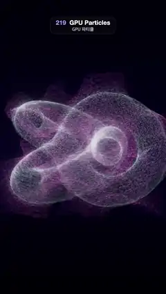

# 219 · GPU Particles · GPU 파티클



**EN** A quarter of a million glowing particles on a white trefoil knot stream off into swirling magenta smoke of fine silky streaks, then the knot gathers again.  
**KO** 흰 삼잎 매듭 위의 빛나는 입자 25만 개가 가는 실 같은 결의 자홍빛 연기로 흘러 나가 소용돌이치고, 매듭이 다시 모여 제 모양을 찾는다.

[Video (mp4)](https://sueun-dev.github.io/motion-effects/videos/219-gpu-particles.mp4) · [Code](../effects/219-gpu-particles.js) · Animation & characters · 애니메이션·캐릭터

## Prompt (English)

```text
Create a "GPU Particles" motion effect: a quarter of a million glowing particles that sit on a white trefoil knot are carried off by a swirling curl-noise flow into soft magenta smoke made of fine silky streaks, and the knot forms again.

Look
- Background: a vertical gradient #07051A at the top, #120A2E at 55 %, #040312 at the bottom.
- 250,000 particles sampled at random on the surface of a torus knot (radius 1.15, tube 0.36, p = 2, q = 3), seed 219. The knot is tilted −0.95 rad about x.
- Each particle is a soft round sprite, 5 px at the camera distance (scaled by 10 / depth), with a Gaussian falloff exp(−9 r²) to the sprite edge, drawn with additive blending and a low intensity (0.064 × colour, shared out over its trail), so many of them build up a smooth glow.
- Colour by how far a particle has drifted from its birth point d: on the knot an icy white (0.72, 0.93, 1.0) lit by a soft key from the upper left (0.3 + 0.7 · max(n · light, 0)); from d = 0.02 to 0.3 it turns magenta (1.0, 0.32, 0.78), and from d = 0.3 to 1.0 deep violet (0.32, 0.22, 1.0). Brightness varies ±20 % per particle and falls to 0.7× as d reaches 0.6.
- Bloom (strength 0.45, radius 0.6, threshold 0.2) and ACES tone mapping at exposure 1.1.
- Camera: perspective, 40° vertical field of view, at (0, 0, 10) looking at the origin.

Motion (0–5 s)
- Flow strength s(t) = (0.5 − 0.5 cos(2π t / 5))^1.2: 0 at 0 s and 5 s, 1 at 2.5 s.
- Every particle lives 2.5 s (its phase is a fixed random offset) and is born on its own spot of the knot. It rides the flow from its birth to now; as s grows the knot dissolves into swirling smoke, and as s falls new particles are born on the knot and the old ones fade, so the knot gathers again (crisp at about 1 s). Particles fade in over 0.35 s and out over the last 0.7 s of their life while the flow is on.
- The knot sways gently: 0.06 sin(2π t / 5) rad about y and about its own axis.

Technique
- All particle motion happens in the vertex shader; positions are a pure function of t.
- Velocity (in knot space) = s(time) · (0.16 · curl(0.6 q, time) + 0.08 · world up + 0.1 · the birth normal). curl is the curl of a vector potential made from three 3D simplex noise fields with analytic gradients; the fields drift on a circle of radius 0.6 once per 5 s, so the flow loops.
- Integration from birth to now in steps on a fixed 1/15 s clock shared by every particle (the first and last steps are partial), at most 40 steps; because every particle uses the same clock, particles in the same place move the same way.
- Long-exposure trail: the same points are drawn 12 times per frame, at t, t − 1/30, …, t − 11/30, with weights falling in a straight line from 12 to 1 (normalised to add up to 1). Draw k of this frame is exactly draw k − 1 of the previous frame, so as a particle moves on, its old spots only fade gently; the random grain stretches into fibres along the flow instead of sparkling. Additive blending into a half-float target, then bloom and output.

Output and rules
- One self-contained HTML file with no external assets (three.js from a CDN is fine if you use it), drawing on a 1080 × 1920 canvas (9:16) scaled to fit the window.
- Write a function renderFrame(t) that draws the frame for time t in seconds, and preview it with requestAnimationFrame. Everything must be a pure function of t and fixed seeds: no Math.random(), Date or state carried between frames, so frame i = renderFrame(i / 30) can be exported to a 30 fps video.
- Loop seamlessly every 5 seconds: renderFrame(5) must look exactly like renderFrame(0).
- No flicker of any kind: no noise or grain that changes from frame to frame, no strobing or blinking, no z-fighting, no shimmering 1 px lines. Any grain or texture stays fixed to the screen or to the object.
- Keep the top 280 px free of important content (a title label goes there) and fill the whole frame with a designed background.
```

## 프롬프트 (한국어)

```text
"GPU 파티클" 모션 효과를 만들어 줘: 흰 삼잎 매듭(트레포일) 위에 앉은 25만 개의 빛나는 입자가 소용돌이치는 컬 노이즈 흐름에 실려 가는 실 같은 결의 부드러운 자홍빛 연기로 흩어졌다가 매듭이 다시 생기는 효과.

모양
- 배경: 세로 그라디언트, 위 #07051A, 55 %에서 #120A2E, 아래 #040312.
- 토러스 매듭(반지름 1.15, 튜브 0.36, p = 2, q = 3) 표면에서 무작위로 뽑은 입자 250,000개(시드 219). 매듭은 x축으로 −0.95 rad 기울인다.
- 입자는 부드러운 둥근 스프라이트: 카메라 거리에서 5px(10 / 깊이로 크기 조절), 가장자리까지 가우스 감쇠 exp(−9 r²), 가산 혼합, 낮은 세기(색 × 0.064를 자기 꼬리에 나눠 씀). 많이 겹쳐 매끄러운 빛이 된다.
- 색은 태어난 자리에서 흘러간 거리 d로 정한다: 매듭 위에서는 왼쪽 위의 부드러운 키 라이트를 받은 얼음빛 흰색 (0.72, 0.93, 1.0)(0.3 + 0.7 · max(n · 빛, 0)); d = 0.02–0.3에서 자홍 (1.0, 0.32, 0.78)으로, d = 0.3–1.0에서 짙은 보라 (0.32, 0.22, 1.0)로 바뀐다. 입자마다 밝기 ±20 %, d가 0.6에 이르면 0.7배로 어두워진다.
- 블룸(세기 0.45, 반지름 0.6, 문턱 0.2)과 노출 1.1의 ACES 톤 매핑.
- 카메라: 원근, 세로 시야각 40°, 위치 (0, 0, 10)에서 원점을 본다.

움직임 (0–5초)
- 흐름 세기 s(t) = (0.5 − 0.5 cos(2π t / 5))^1.2: 0초와 5초에 0, 2.5초에 1.
- 입자는 각자 2.5초를 산다(시작 위상은 고정된 무작위 값). 매듭의 제자리에서 태어나 태어난 때부터 지금까지 흐름을 탄다. s가 커지면 매듭이 소용돌이 연기로 풀리고, s가 작아지면 새 입자가 매듭 위에서 태어나고 옛 입자는 사라져 매듭이 다시 모인다(1초쯤 가장 선명). 흐름이 켜져 있는 동안 입자는 0.35초에 걸쳐 나타나고 수명의 마지막 0.7초에 걸쳐 사라진다.
- 매듭은 살짝 흔들린다: y축과 자기 축으로 0.06 sin(2π t / 5) rad.

기법
- 입자의 움직임은 모두 버텍스 셰이더에서 계산하고, 위치는 t의 순수 함수다.
- 속도(매듭 공간) = s(시각) · (0.16 · curl(0.6 q, 시각) + 0.08 · 월드 위쪽 + 0.1 · 태어난 자리의 법선). curl은 해석적 기울기를 가진 3D 심플렉스 노이즈 세 개로 만든 벡터 퍼텐셜의 회전(curl)이다. 노이즈는 5초에 한 번 반지름 0.6의 원을 따라 움직여 흐름이 반복된다.
- 태어난 때부터 지금까지 모든 입자가 공유하는 1/15초 고정 시계로 적분한다(처음과 마지막 단계는 일부만), 최대 40단계. 모두 같은 시계를 쓰므로 같은 자리의 입자는 같은 쪽으로 움직인다.
- 장노출 꼬리: 같은 점들을 한 프레임에 12번, t, t − 1/30, …, t − 11/30에 그리고, 가중치는 12에서 1로 직선으로 줄어든다(합이 1이 되게 정규화). 이번 프레임의 k번째 그리기는 앞 프레임의 k − 1번째와 정확히 같아서, 입자가 지나간 자리는 부드럽게 옅어지기만 한다. 무작위 입자 결은 반짝이지 않고 흐름을 따라 실처럼 늘어난다. 하프 플로트 타깃에 가산 혼합한 뒤 블룸과 출력.

출력과 규칙
- 외부 파일 없는 HTML 파일 하나(three.js를 쓴다면 CDN은 괜찮다). 1080 × 1920(9:16) 캔버스에 그리고 창 크기에 맞춰 보이게 한다.
- 시간 t(초)의 프레임을 그리는 renderFrame(t) 함수를 만들고, 미리보기는 requestAnimationFrame으로 돌린다. 모든 것은 t와 고정 시드만으로 정해진다: Math.random(), Date, 프레임 사이에 쌓이는 상태 금지. 그래야 i번째 프레임 = renderFrame(i / 30)으로 30fps 영상을 뽑을 수 있다.
- 5초마다 끊김 없이 반복: renderFrame(5)는 renderFrame(0)과 똑같아 보여야 한다.
- 어떤 깜빡임도 금지: 프레임마다 바뀌는 노이즈·그레인, 번쩍임·깜빡임, z-fighting, 반짝이며 떨리는 1px 선 모두 금지. 그레인·질감은 화면이나 물체에 고정한다.
- 위쪽 280px에는 중요한 내용을 두지 않고(제목 라벨 자리), 화면 전체를 디자인된 배경으로 채운다.
```
