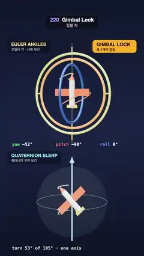

# 220 · Gimbal Lock · 짐벌 락



**EN** Three gimbal rings fold into one plane as Euler pitch hits −90° and the plane flips, while below, quaternion slerp turns it smoothly about one axis.  
**KO** 오일러 피치가 −90°에 닿자 짐벌 고리 둘이 한 평면으로 겹치고 비행기가 뒤집히는 동안, 아래의 쿼터니언 보간은 한 축으로 매끄럽게 돈다.

[Video (mp4)](https://sueun-dev.github.io/motion-effects/videos/220-gimbal-lock.mp4) · [Code](../effects/220-gimbal-lock.js) · Animation & characters · 애니메이션·캐릭터

## Prompt (English)

```text
Create a "Gimbal Lock" motion effect: the same two orientations of a toy plane are blended two ways, stacked one above the other: Euler angles in a three-ring gimbal (top), which locks and makes the plane flip, and a quaternion slerp (bottom), which turns it smoothly about one axis.

Look
- Background: a vertical gradient #10162B → #1B2444 → #0E1326, a neutral room environment map (intensity 0.8), a white key light 1.6 from (−4, 6, 8), ACES tone mapping.
- Camera: perspective, 30° vertical field of view, at (1.8, 1.4, 19.4) looking at the origin. Both rigs are turned 0.6 rad about y so they are seen from three-quarters.
- The plane (about 1.5 long): a cream capsule body #F5F2EA, a coral nose cone and coral wings #FF6B4A (1.5 × 0.04 × 0.3), a yellow tail plane and fin #FFC93C. Its nose points along local +z.
- Top rig, centred at y = 1.4: three metallic rings (tube 0.05, roughness 0.3, metalness 0.55): outer yaw ring, radius 1.62, green #5BD27A, in the xy plane, pinned top and bottom on a thin fixed green axle; middle pitch ring, radius 1.4, red #FF5A5F, in the xz plane, pinned left and right; inner roll ring, radius 1.18, blue #4C8DFF, in the yz plane, pinned front and back; gold pins. The plane sits inside the inner ring.
- Bottom rig, centred at y = −3.05: the same plane inside a faint glass ball (radius 1.45, opacity 0.1), with a glowing cyan axis rod and arrow (#7FF3FF) for the slerp rotation axis and a thin cyan circle round the ball perpendicular to it.
- In both rigs, thin tubes trace the whole path of the nose tip and the left wingtip from A to B (top: #FFE08A and #FF9A6B; bottom: #BDF6FF and #6FD3FF).
- Overlay: caption pills "EULER ANGLES / 오일러 각 · 선형 보간" (top left, y 300) and "QUATERNION SLERP / 쿼터니언 구면 보간" (y 1134); a monospace readout of yaw, pitch and roll under the top rig in green, red and blue; the line "turn N° of 105° · one axis" under the bottom rig; and an amber badge "GIMBAL LOCK / 축 2개가 겹침" at the top right that fades in when the pitch is within 14° of −90°.

Motion (0–5 s)
- Orientation A = (yaw −90°, pitch −45°, roll −90°), B = (yaw −15°, pitch −135°, roll 90°), Euler order yaw (y) → pitch (x) → roll (z).
- Blend k(t) = 0.5 − 0.5 sin(2π t / 5): halfway at 0 s, A at 1.25 s, halfway again at 2.5 s, B at 3.75 s.
- Top: the three angles are blended linearly and drive the rings. Halfway the pitch is exactly −90°: the yaw and pitch rings fold into the same plane and glow amber (emissive #FFB020, 0.75 × closeness), and the plane rolls through a needless flip (265° of turning for a 105° change).
- Bottom: slerp from A to B by k: a steady turn of up to 105° about one fixed axis.

Technique
- three.js groups nested yaw → pitch → roll for the gimbal; quaternions from the Euler angles (order YXZ) and Quaternion.slerp for the bottom rig; the slerp axis is the axis of qB · qA⁻¹.
- The traced paths are TubeGeometry along CatmullRom curves through 121 samples of each method.
- The overlay is 2D canvas drawing on top of the render.

Output and rules
- One self-contained HTML file with no external assets (three.js from a CDN is fine if you use it), drawing on a 1080 × 1920 canvas (9:16) scaled to fit the window.
- Write a function renderFrame(t) that draws the frame for time t in seconds, and preview it with requestAnimationFrame. Everything must be a pure function of t and fixed seeds: no Math.random(), Date or state carried between frames, so frame i = renderFrame(i / 30) can be exported to a 30 fps video.
- Loop seamlessly every 5 seconds: renderFrame(5) must look exactly like renderFrame(0).
- No flicker of any kind: no noise or grain that changes from frame to frame, no strobing or blinking, no z-fighting, no shimmering 1 px lines. Any grain or texture stays fixed to the screen or to the object.
- Keep the top 280 px free of important content (a title label goes there) and fill the whole frame with a designed background.
```

## 프롬프트 (한국어)

```text
"짐벌 락" 모션 효과를 만들어 줘: 장난감 비행기의 같은 두 방향을 두 가지 방법으로 섞어 위아래로 놓는다. 위는 세 고리 짐벌을 움직이는 오일러 각(잠기면서 비행기가 뒤집힘), 아래는 쿼터니언 구면 보간(한 축으로 매끄럽게 돎).

모양
- 배경: 세로 그라디언트 #10162B → #1B2444 → #0E1326, 중성 룸 환경맵(세기 0.8), 흰 키 라이트 1.6, 위치 (−4, 6, 8), ACES 톤 매핑.
- 카메라: 원근, 세로 시야각 30°, 위치 (1.8, 1.4, 19.4)에서 원점을 본다. 두 장치 모두 y축으로 0.6 rad 돌려 비스듬히 보이게 한다.
- 비행기(길이 약 1.5): 크림색 캡슐 몸통 #F5F2EA, 산호색 기수 원뿔과 날개 #FF6B4A(1.5 × 0.04 × 0.3), 노란 꼬리 날개와 수직 꼬리 #FFC93C. 기수는 로컬 +z를 향한다.
- 위 장치(중심 y = 1.4): 금속 고리 셋(튜브 0.05, 거칠기 0.3, 금속성 0.55). 바깥 요 고리는 반지름 1.62, 초록 #5BD27A, xy 평면, 위아래가 가늘고 고정된 초록 축에 꽂힘; 가운데 피치 고리는 반지름 1.4, 빨강 #FF5A5F, xz 평면, 좌우로 꽂힘; 안쪽 롤 고리는 반지름 1.18, 파랑 #4C8DFF, yz 평면, 앞뒤로 꽂힘. 핀은 금색. 비행기는 안쪽 고리 속에 있다.
- 아래 장치(중심 y = −3.05): 같은 비행기가 흐릿한 유리공(반지름 1.45, 불투명도 0.1) 안에 있고, 구면 보간의 회전축을 빛나는 하늘색 막대와 화살표(#7FF3FF)로, 그 축에 수직인 가는 하늘색 원으로 보여 준다.
- 두 장치 모두 A에서 B까지 기수 끝과 왼쪽 날개 끝이 지나는 길 전체를 가는 튜브로 그린다(위: #FFE08A, #FF9A6B / 아래: #BDF6FF, #6FD3FF).
- 오버레이: 설명 알약 "EULER ANGLES / 오일러 각 · 선형 보간"(왼쪽 위, y 300)과 "QUATERNION SLERP / 쿼터니언 구면 보간"(y 1134). 위 장치 아래에 요·피치·롤 값을 초록·빨강·파랑 고정폭 글꼴로, 아래 장치 아래에 "turn N° of 105° · one axis" 한 줄. 피치가 −90°에서 14° 안으로 들어오면 오른쪽 위에 호박색 배지 "GIMBAL LOCK / 축 2개가 겹침"이 서서히 나타난다.

움직임 (0–5초)
- 방향 A = (요 −90°, 피치 −45°, 롤 −90°), B = (요 −15°, 피치 −135°, 롤 90°), 오일러 순서는 요(y) → 피치(x) → 롤(z).
- 섞는 비율 k(t) = 0.5 − 0.5 sin(2π t / 5): 0초에 중간, 1.25초에 A, 2.5초에 다시 중간, 3.75초에 B.
- 위: 세 각을 선형으로 섞어 고리를 돌린다. 중간에서 피치가 정확히 −90°가 되면 요 고리와 피치 고리가 같은 평면으로 접혀 호박색으로 빛나고(발광 #FFB020, 가까운 정도 × 0.75), 비행기는 쓸데없이 뒤집힌다(105° 바뀌는 데 265° 회전).
- 아래: A에서 B로 k만큼 구면 보간: 고정된 한 축으로 최대 105°까지 일정하게 돈다.

기법
- 짐벌은 three.js 그룹을 요 → 피치 → 롤로 중첩. 아래 장치는 오일러 각(순서 YXZ)에서 만든 쿼터니언과 Quaternion.slerp. 구면 보간의 축은 qB · qA⁻¹의 축이다.
- 지나는 길은 방법마다 121개 표본을 지나는 CatmullRom 곡선을 따라 만든 TubeGeometry.
- 오버레이는 렌더 위에 2D 캔버스로 그린다.

출력과 규칙
- 외부 파일 없는 HTML 파일 하나(three.js를 쓴다면 CDN은 괜찮다). 1080 × 1920(9:16) 캔버스에 그리고 창 크기에 맞춰 보이게 한다.
- 시간 t(초)의 프레임을 그리는 renderFrame(t) 함수를 만들고, 미리보기는 requestAnimationFrame으로 돌린다. 모든 것은 t와 고정 시드만으로 정해진다: Math.random(), Date, 프레임 사이에 쌓이는 상태 금지. 그래야 i번째 프레임 = renderFrame(i / 30)으로 30fps 영상을 뽑을 수 있다.
- 5초마다 끊김 없이 반복: renderFrame(5)는 renderFrame(0)과 똑같아 보여야 한다.
- 어떤 깜빡임도 금지: 프레임마다 바뀌는 노이즈·그레인, 번쩍임·깜빡임, z-fighting, 반짝이며 떨리는 1px 선 모두 금지. 그레인·질감은 화면이나 물체에 고정한다.
- 위쪽 280px에는 중요한 내용을 두지 않고(제목 라벨 자리), 화면 전체를 디자인된 배경으로 채운다.
```
