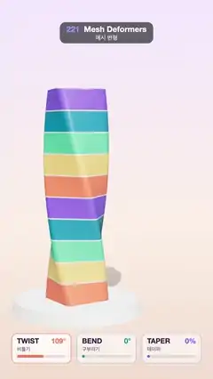

# 221 · Mesh Deformers · 메시 변형



**EN** A striped rounded column on a plinth is twisted 200°, bent 70° and tapered 55° by stacked deformers, holds the pose, then springs back straight.  
**KO** 받침 위의 줄무늬 둥근 기둥이 겹쳐 쌓은 변형기로 200° 비틀리고 70° 구부러지고 55% 가늘어진 뒤, 잠시 멈췄다가 곧게 돌아온다.

[Video (mp4)](https://sueun-dev.github.io/motion-effects/videos/221-mesh-deformers.mp4) · [Code](../effects/221-mesh-deformers.js) · Animation & characters · 애니메이션·캐릭터

## Prompt (English)

```text
Create a "Mesh Deformers" motion effect: a striped column is reshaped by three classic deformers stacked one on another (twist, bend, taper), switched on one after another, held, then released.

Look
- Background: a vertical gradient #F3E9FF → #FBEFE6 (60 %) → #F1DCCF; a shadow-only floor (opacity 0.18) and a white round plinth (radius 1.55–1.65, height 0.3).
- The column: a rounded square (1.24 wide, corner radius 0.2) extruded 5.2 tall in 200 thin slices, standing on the plinth. Ten horizontal bands from the bottom up cycle #FF7A59, #FFD166, #06D6A0, #118AB2, #7B61FF, with thin white seams between them (a band texture read by height). Material: physical, roughness 0.38, clearcoat 0.6.
- Light: a warm key #FFF4E8, intensity 2.4, from (−5, 9, 6) with soft shadows, a hemisphere light 0.6, a room environment map at 0.55, ACES tone mapping.
- Camera: perspective, 30° vertical field of view, 17.5 from the column at height 4.6, looking at (0.9, 3.0, 0); it sways around the column, azimuth −0.55 + 0.3 sin(2π t / 5) rad.
- Overlay: three white cards at the bottom (y 1690, 300 × 150 each): "TWIST 비틀기", "BEND 구부리기", "TAPER 테이퍼", each with its live value (degrees or %) in its colour (#FF7A59, #118AB2, #7B61FF), a progress bar, and an outline that brightens with the amount.

Motion (0–5 s), the loop starts 0.6 s into this timeline
- Twist switches on from 0.15 to 1.0 s, bend from 1.0 to 1.85 s, taper from 1.85 to 2.7 s (each with smoothstep); all three hold together; then all release together from 3.4 to 4.7 s.
- Meanwhile the column turns a quarter turn per loop on the plinth (it looks the same every 90°).

Technique
- Each frame, every rest vertex (x, y, z) with h = y / 5.2 goes through the stack: twist rotates it about the vertical axis by twist · 200° · h; taper scales x and z by 1 − taper · 0.55 · h; bend curls the column round an arc of total angle bend · 70°: radius R = 5.2 / θ, φ = h θ, x' = R − (R − x) cos φ, y' = (R − x) sin φ. The quarter-turn spin is applied before the deformers, so the bend always leans the same way.
- Positions are written back to the BufferGeometry and normals recomputed every frame (vertices welded, so the shading stays smooth).

Output and rules
- One self-contained HTML file with no external assets (three.js from a CDN is fine if you use it), drawing on a 1080 × 1920 canvas (9:16) scaled to fit the window.
- Write a function renderFrame(t) that draws the frame for time t in seconds, and preview it with requestAnimationFrame. Everything must be a pure function of t and fixed seeds: no Math.random(), Date or state carried between frames, so frame i = renderFrame(i / 30) can be exported to a 30 fps video.
- Loop seamlessly every 5 seconds: renderFrame(5) must look exactly like renderFrame(0).
- No flicker of any kind: no noise or grain that changes from frame to frame, no strobing or blinking, no z-fighting, no shimmering 1 px lines. Any grain or texture stays fixed to the screen or to the object.
- Keep the top 280 px free of important content (a title label goes there) and fill the whole frame with a designed background.
```

## 프롬프트 (한국어)

```text
"메시 변형" 모션 효과를 만들어 줘: 줄무늬 기둥에 고전적인 변형기 세 개(비틀기, 구부리기, 테이퍼)를 겹쳐 쌓아 하나씩 켜고, 잠시 유지했다가 놓아주는 효과.

모양
- 배경: 세로 그라디언트 #F3E9FF → #FBEFE6(60 %) → #F1DCCF. 그림자만 보이는 바닥(불투명도 0.18)과 흰 원형 받침(반지름 1.55–1.65, 높이 0.3).
- 기둥: 모서리가 둥근 정사각형(폭 1.24, 모서리 반지름 0.2)을 높이 5.2로 200조각 돌출해 받침 위에 세운다. 아래부터 가로 띠 10개가 #FF7A59, #FFD166, #06D6A0, #118AB2, #7B61FF 순으로 반복되고 띠 사이에 가는 흰 이음매(높이로 읽는 띠 텍스처). 재질: 물리 기반, 거칠기 0.38, 클리어코트 0.6.
- 조명: 따뜻한 키 라이트 #FFF4E8, 세기 2.4, 위치 (−5, 9, 6), 부드러운 그림자. 반구광 0.6, 룸 환경맵 0.55, ACES 톤 매핑.
- 카메라: 원근, 세로 시야각 30°, 기둥에서 17.5 떨어진 높이 4.6에서 (0.9, 3.0, 0)을 본다. 방위각 −0.55 + 0.3 sin(2π t / 5) rad로 기둥 둘레를 흔들린다.
- 오버레이: 아래쪽에 흰 카드 셋(y 1690, 각 300 × 150): "TWIST 비틀기", "BEND 구부리기", "TAPER 테이퍼". 각자 현재 값(도 또는 %)을 자기 색(#FF7A59, #118AB2, #7B61FF)으로, 진행 막대, 양에 따라 진해지는 테두리.

움직임 (0–5초), 루프는 이 시간표의 0.6초 지점에서 시작
- 비틀기는 0.15–1.0초, 구부리기는 1.0–1.85초, 테이퍼는 1.85–2.7초에 켜진다(각각 smoothstep). 셋이 함께 유지되다가 3.4–4.7초에 한꺼번에 풀린다.
- 그동안 기둥은 받침 위에서 루프마다 4분의 1바퀴 돈다(90°마다 같은 모양).

기법
- 매 프레임 모든 휴지 정점 (x, y, z)를 h = y / 5.2로 쌓인 변형기에 통과시킨다: 비틀기는 세로축 둘레로 비틀기 · 200° · h만큼 돌리고, 테이퍼는 x와 z를 1 − 테이퍼 · 0.55 · h배로 줄이고, 구부리기는 기둥을 전체 각 구부리기 · 70°의 호로 만다: 반지름 R = 5.2 / θ, φ = h θ, x' = R − (R − x) cos φ, y' = (R − x) sin φ. 4분의 1바퀴 회전은 변형기보다 먼저 적용해서 구부러지는 방향은 늘 같다.
- 위치를 BufferGeometry에 다시 쓰고 매 프레임 법선을 다시 계산한다(정점을 합쳐 두어 음영이 매끄럽다).

출력과 규칙
- 외부 파일 없는 HTML 파일 하나(three.js를 쓴다면 CDN은 괜찮다). 1080 × 1920(9:16) 캔버스에 그리고 창 크기에 맞춰 보이게 한다.
- 시간 t(초)의 프레임을 그리는 renderFrame(t) 함수를 만들고, 미리보기는 requestAnimationFrame으로 돌린다. 모든 것은 t와 고정 시드만으로 정해진다: Math.random(), Date, 프레임 사이에 쌓이는 상태 금지. 그래야 i번째 프레임 = renderFrame(i / 30)으로 30fps 영상을 뽑을 수 있다.
- 5초마다 끊김 없이 반복: renderFrame(5)는 renderFrame(0)과 똑같아 보여야 한다.
- 어떤 깜빡임도 금지: 프레임마다 바뀌는 노이즈·그레인, 번쩍임·깜빡임, z-fighting, 반짝이며 떨리는 1px 선 모두 금지. 그레인·질감은 화면이나 물체에 고정한다.
- 위쪽 280px에는 중요한 내용을 두지 않고(제목 라벨 자리), 화면 전체를 디자인된 배경으로 채운다.
```
