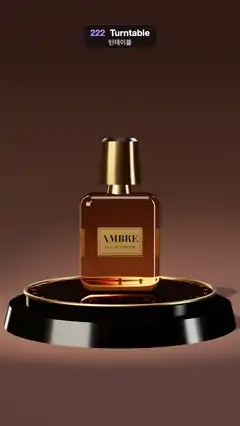

# 222 · Turntable · 턴테이블



**EN** An amber glass perfume bottle with a faceted gold cap turns once on a black mirror turntable, softbox strips sliding across the glass and gold.  
**KO** 각진 금빛 뚜껑의 호박색 유리 향수병이 검은 거울 턴테이블 위에서 한 바퀴 돌고, 소프트박스 빛줄기가 유리와 금 위를 미끄러진다.

[Video (mp4)](https://sueun-dev.github.io/motion-effects/videos/222-turntable.mp4) · [Code](../effects/222-turntable.js) · Camera & lens · 카메라·렌즈

## Prompt (English)

```text
Create a "Turntable" motion effect: a hero product shot. A glass perfume bottle turns once on a black mirror turntable in a warm studio, with softbox reflections sliding over the glass and the gold.

Look
- Studio: a seamless paper sweep #6B4C3E (a floor that curves up into a back wall with a 6-unit radius), background #1A120E. A warm spot #FFE6C9 from (−3.5, 9, 6) (cone 0.42 rad, penumbra 0.9) makes a pool of light and a soft shadow; a cool rim light #BFD8FF from behind on the right; a faint hemisphere light.
- Reflections come only from an environment map built from a dark room with three glowing softboxes: a big key (7 × 5) front left, a tall strip (1.3 × 9) on the right and another strip back left, plus a dim overhead panel.
- Podium: a fixed glossy black base (radius 2.05–2.15, height 0.4, clearcoat 1) and on it a turning disc (radius 1.75) whose top is a real planar mirror tinted #5E5A57, with a brushed gold rim ring and 24 small gold dots round the edge.
- Bottle: an amber glass body, a rounded box 1.45 × 1.8 × 0.8 (corner radius 0.24), physical material with transmission 1, thickness 0.9, roughness 0.03, ior 1.5, attenuation colour #F0A040 over 1.3, clearcoat 1; a gold collar; an octagonal faceted gold cap (radius 0.36–0.42, height 0.78, metalness 1, roughness 0.22) with a dark top; a gold foil label on the front reading "AMBRE" (serif) and "EAU DE PARFUM".
- Camera: perspective, 26° vertical field of view, at (0, 3.4, 17) looking at (0, 2.05, 0). ACES tone mapping at exposure 1.05.

Motion (0–5 s)
- The turntable, with the bottle on it, makes exactly one full turn in 5 s at a steady speed. The label comes round to the front, the softbox strips slide across the glass and the cap facets, and the bottle's reflection turns in the mirror.

Technique
- three.js: RoundedBoxGeometry for the body, MeshPhysicalMaterial transmission for the glass, Reflector (1024², 4× multisampling) for the mirror disc, and the studio environment rendered once through a PMREM generator.
- Soft shadow from the spotlight (PCF soft, 2048 map).

Output and rules
- One self-contained HTML file with no external assets (three.js from a CDN is fine if you use it), drawing on a 1080 × 1920 canvas (9:16) scaled to fit the window.
- Write a function renderFrame(t) that draws the frame for time t in seconds, and preview it with requestAnimationFrame. Everything must be a pure function of t and fixed seeds: no Math.random(), Date or state carried between frames, so frame i = renderFrame(i / 30) can be exported to a 30 fps video.
- Loop seamlessly every 5 seconds: renderFrame(5) must look exactly like renderFrame(0).
- No flicker of any kind: no noise or grain that changes from frame to frame, no strobing or blinking, no z-fighting, no shimmering 1 px lines. Any grain or texture stays fixed to the screen or to the object.
- Keep the top 280 px free of important content (a title label goes there) and fill the whole frame with a designed background.
```

## 프롬프트 (한국어)

```text
"턴테이블" 모션 효과를 만들어 줘: 히어로 제품 컷. 유리 향수병이 따뜻한 스튜디오의 검은 거울 턴테이블 위에서 한 바퀴 돌고, 소프트박스 반사가 유리와 금 위를 미끄러진다.

모양
- 스튜디오: 이음매 없는 종이 배경 #6B4C3E(바닥이 반지름 6으로 휘어 올라가 뒷벽이 됨), 배경색 #1A120E. 따뜻한 스포트라이트 #FFE6C9, 위치 (−3.5, 9, 6)(원뿔 0.42 rad, 반그림자 0.9)가 빛 웅덩이와 부드러운 그림자를 만든다. 오른쪽 뒤에서 차가운 림 라이트 #BFD8FF, 희미한 반구광.
- 반사는 어두운 방에 빛나는 소프트박스 셋을 둔 환경맵에서만 온다: 왼쪽 앞의 큰 키(7 × 5), 오른쪽의 세로 띠(1.3 × 9), 왼쪽 뒤의 또 하나의 띠, 그리고 희미한 천장 패널.
- 받침: 움직이지 않는 광택 검정 받침(반지름 2.05–2.15, 높이 0.4, 클리어코트 1). 그 위에 도는 원판(반지름 1.75): 윗면은 #5E5A57 빛이 도는 진짜 평면 거울이고, 솔질한 금 테두리와 가장자리의 작은 금 점 24개.
- 병: 호박색 유리 몸통, 둥근 상자 1.45 × 1.8 × 0.8(모서리 반지름 0.24), 물리 재질에 투과 1, 두께 0.9, 거칠기 0.03, 굴절률 1.5, 감쇠색 #F0A040 거리 1.3, 클리어코트 1. 금 목 고리, 팔각으로 각진 금 뚜껑(반지름 0.36–0.42, 높이 0.78, 금속성 1, 거칠기 0.22)과 어두운 윗면. 앞면에 "AMBRE"(세리프)와 "EAU DE PARFUM"이 적힌 금박 라벨.
- 카메라: 원근, 세로 시야각 26°, 위치 (0, 3.4, 17)에서 (0, 2.05, 0)을 본다. 노출 1.05의 ACES 톤 매핑.

움직임 (0–5초)
- 병을 올린 턴테이블이 5초에 일정한 속도로 정확히 한 바퀴 돈다. 라벨이 앞으로 돌아오고, 소프트박스 빛줄기가 유리와 뚜껑 면 위를 미끄러지고, 거울 속 병의 반사도 함께 돈다.

기법
- three.js: 몸통은 RoundedBoxGeometry, 유리는 MeshPhysicalMaterial 투과, 거울 원판은 Reflector(1024², 4× 멀티샘플), 스튜디오 환경은 PMREM 생성기로 한 번 렌더.
- 스포트라이트의 부드러운 그림자(PCF soft, 2048 맵).

출력과 규칙
- 외부 파일 없는 HTML 파일 하나(three.js를 쓴다면 CDN은 괜찮다). 1080 × 1920(9:16) 캔버스에 그리고 창 크기에 맞춰 보이게 한다.
- 시간 t(초)의 프레임을 그리는 renderFrame(t) 함수를 만들고, 미리보기는 requestAnimationFrame으로 돌린다. 모든 것은 t와 고정 시드만으로 정해진다: Math.random(), Date, 프레임 사이에 쌓이는 상태 금지. 그래야 i번째 프레임 = renderFrame(i / 30)으로 30fps 영상을 뽑을 수 있다.
- 5초마다 끊김 없이 반복: renderFrame(5)는 renderFrame(0)과 똑같아 보여야 한다.
- 어떤 깜빡임도 금지: 프레임마다 바뀌는 노이즈·그레인, 번쩍임·깜빡임, z-fighting, 반짝이며 떨리는 1px 선 모두 금지. 그레인·질감은 화면이나 물체에 고정한다.
- 위쪽 280px에는 중요한 내용을 두지 않고(제목 라벨 자리), 화면 전체를 디자인된 배경으로 채운다.
```
