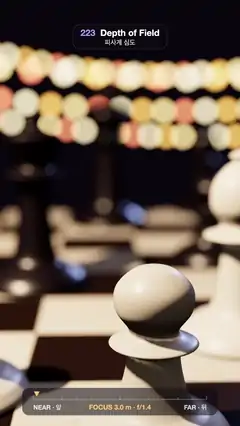

# 223 · Depth of Field · 피사계 심도



**EN** Focus racks from a white pawn in front to the black king at the back of a chessboard while fairy lights melt into big round bokeh discs.  
**KO** 체스판 앞의 흰 폰에서 뒤의 검은 킹으로 초점이 옮겨 갔다 돌아오고, 뒤편의 꼬마전구들이 크고 둥근 보케 원으로 번진다.

[Video (mp4)](https://sueun-dev.github.io/motion-effects/videos/223-depth-of-field.mp4) · [Code](../effects/223-depth-of-field.js) · Camera & lens · 카메라·렌즈

## Prompt (English)

```text
Create a "Depth of Field" motion effect: a rack focus across a chessboard, rendered like a real lens. The focus pulls from a white pawn in front to the black king at the back and returns, while warm fairy lights behind turn into large round bokeh.

Look
- A dark room #1B1420 (fog from 12 to 30 in the same colour). A chessboard 6.4 × 6.4 (cream #E9DCC4 and dark #2B1D16 squares, light clearcoat) turned 0.12 rad, running away from the camera.
- Pieces made on a lathe from smooth profiles: an ivory pawn at 3.0 in front, an ivory pawn at 3.4 and bishop at 4.4, an ebony queen at 5.6, an ebony pawn at 6.6, the ebony king (with a cross) at 8.4 and an ebony bishop at 9.4 (distances along the view). Ivory #F4EBDD and ebony #1E1822 are glossy but not mirror-sharp (roughness 0.35–0.4, clearcoat roughness about 0.3), so no highlight is a single bright pixel.
- Behind, four sagging strings of 22–30 fairy-light beads (radius 0.13, HDR glow ×8 in #FFB347, #FFD27F, #FF8A5C, #FFE3A8) 15–20 units away.
- Light: a warm spot #FFD9B0 from (−3.5, 6, 3) with soft shadows, a cool rim #9FB8FF from behind, a faint hemisphere light; ACES tone mapping.
- Camera: 34° vertical field of view, at (0.35, 1.55, 4.6) looking at (−0.35, 0.25, −3), drifting 0.12 sideways with sin(2π t / 5).
- Overlay: a dark pill at the bottom with a focus scale from "NEAR · 앞" to "FAR · 뒤", an amber marker for the focus, and "FOCUS 3.0 m · f/1.4".

Motion (0–5 s), the loop starts 0.1 s into this timeline
- Rack out from the pawn (3.0) to the king (8.4) over 1.2 s, hold, rack back over 1.2 s from 2.5 s, hold. The focus distance moves in diopters (1 / distance), like a focus ring, with smoothstep easing.

Technique
- Real lens depth of field by accumulation: every frame is the average of 256 renders from points on a round aperture of radius 0.06 (a Vogel spiral: radius sqrt((i + 0.5) / 256), angle i × golden angle; fixed, so nothing crawls). For each sample the camera is moved by (dx, dy) in its own plane and the frustum is sheared by −(dx, dy) · near / focus, so the focus plane lands on the same pixels; a sub-pixel jitter per sample gives anti-aliasing.
- Each sample renders into a half-float target and is added with weight 1/256 into a 32-bit float target (EXT_float_blend); the sum is drawn to the screen with tone mapping.

Output and rules
- One self-contained HTML file with no external assets (three.js from a CDN is fine if you use it), drawing on a 1080 × 1920 canvas (9:16) scaled to fit the window.
- Write a function renderFrame(t) that draws the frame for time t in seconds, and preview it with requestAnimationFrame. Everything must be a pure function of t and fixed seeds: no Math.random(), Date or state carried between frames, so frame i = renderFrame(i / 30) can be exported to a 30 fps video.
- Loop seamlessly every 5 seconds: renderFrame(5) must look exactly like renderFrame(0).
- No flicker of any kind: no noise or grain that changes from frame to frame, no strobing or blinking, no z-fighting, no shimmering 1 px lines. Any grain or texture stays fixed to the screen or to the object.
- Keep the top 280 px free of important content (a title label goes there) and fill the whole frame with a designed background.
```

## 프롬프트 (한국어)

```text
"피사계 심도" 모션 효과를 만들어 줘: 체스판을 가로지르는 초점 이동(랙 포커스)을 진짜 렌즈처럼 렌더한다. 초점이 앞의 흰 폰에서 뒤의 검은 킹으로 옮겨 갔다 돌아오고, 뒤편의 따뜻한 꼬마전구들이 크고 둥근 보케가 된다.

모양
- 어두운 방 #1B1420(같은 색 안개, 12에서 30). 6.4 × 6.4 체스판(크림 #E9DCC4와 어두운 #2B1D16 칸, 옅은 클리어코트)을 0.12 rad 돌려 카메라에서 멀어지게 놓는다.
- 말은 매끄러운 윤곽을 선반(lathe)으로 돌려 만든다: 맨 앞 3.0에 상아색 폰, 3.4에 상아색 폰과 4.4에 비숍, 5.6에 흑단 퀸, 6.6에 흑단 폰, 8.4에 흑단 킹(십자가 달림), 9.4에 흑단 비숍(시선 방향 거리). 상아 #F4EBDD와 흑단 #1E1822는 광택은 있지만 거울처럼 날카롭지 않게(거칠기 0.35–0.4, 클리어코트 거칠기 약 0.3) 해서 하이라이트가 한 픽셀짜리 점이 되지 않게 한다.
- 뒤쪽 15–20 거리에 처진 줄 네 개에 꼬마전구 구슬 22–30개씩(반지름 0.13, HDR 빛 ×8, #FFB347, #FFD27F, #FF8A5C, #FFE3A8).
- 조명: 따뜻한 스포트라이트 #FFD9B0, 위치 (−3.5, 6, 3), 부드러운 그림자. 뒤에서 차가운 림 #9FB8FF, 희미한 반구광. ACES 톤 매핑.
- 카메라: 세로 시야각 34°, 위치 (0.35, 1.55, 4.6)에서 (−0.35, 0.25, −3)을 보며, sin(2π t / 5)로 옆으로 0.12 흔들린다.
- 오버레이: 아래쪽 어두운 알약 안에 "NEAR · 앞"에서 "FAR · 뒤"까지의 초점 눈금, 초점 위치를 가리키는 호박색 표시, "FOCUS 3.0 m · f/1.4".

움직임 (0–5초), 루프는 이 시간표의 0.1초 지점에서 시작
- 폰(3.0)에서 킹(8.4)으로 1.2초 동안 초점 이동, 유지, 2.5초부터 1.2초 동안 되돌아오고, 유지. 초점 거리는 초점 링처럼 디옵터(1 / 거리)로 smoothstep 이징을 따라 움직인다.

기법
- 누적으로 만드는 진짜 렌즈 피사계 심도: 매 프레임은 반지름 0.06의 둥근 조리개 위 점들에서 렌더한 256장의 평균이다(보겔 나선: 반지름 sqrt((i + 0.5) / 256), 각도 i × 황금각; 고정이라 아무것도 기어 다니지 않음). 표본마다 카메라를 자기 평면에서 (dx, dy)만큼 옮기고 절두체를 −(dx, dy) · near / 초점거리만큼 기울여, 초점면이 같은 픽셀에 오게 한다. 표본마다 서브픽셀 흔들림을 줘 안티에일리어싱도 된다.
- 표본마다 하프 플로트 타깃에 렌더하고 32비트 플로트 타깃(EXT_float_blend)에 1/256 가중치로 더한다. 합을 톤 매핑해 화면에 그린다.

출력과 규칙
- 외부 파일 없는 HTML 파일 하나(three.js를 쓴다면 CDN은 괜찮다). 1080 × 1920(9:16) 캔버스에 그리고 창 크기에 맞춰 보이게 한다.
- 시간 t(초)의 프레임을 그리는 renderFrame(t) 함수를 만들고, 미리보기는 requestAnimationFrame으로 돌린다. 모든 것은 t와 고정 시드만으로 정해진다: Math.random(), Date, 프레임 사이에 쌓이는 상태 금지. 그래야 i번째 프레임 = renderFrame(i / 30)으로 30fps 영상을 뽑을 수 있다.
- 5초마다 끊김 없이 반복: renderFrame(5)는 renderFrame(0)과 똑같아 보여야 한다.
- 어떤 깜빡임도 금지: 프레임마다 바뀌는 노이즈·그레인, 번쩍임·깜빡임, z-fighting, 반짝이며 떨리는 1px 선 모두 금지. 그레인·질감은 화면이나 물체에 고정한다.
- 위쪽 280px에는 중요한 내용을 두지 않고(제목 라벨 자리), 화면 전체를 디자인된 배경으로 채운다.
```
