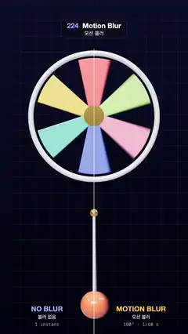

# 224 · Motion Blur · 모션 블러



**EN** A spinning six-blade pinwheel and a swinging ball, split down the middle: sharp single instants on the left, smeared by a 180° shutter on the right.  
**KO** 도는 여섯 날개 바람개비와 흔들리는 공을 가운데에서 나눠, 왼쪽은 한순간만 찍어 또렷하고 오른쪽은 180° 셔터로 번진다.

[Video (mp4)](https://sueun-dev.github.io/motion-effects/videos/224-motion-blur.mp4) · [Code](../effects/224-motion-blur.js) · Camera & lens · 카메라·렌즈

## Prompt (English)

```text
Create a "Motion Blur" motion effect: a split-screen comparison of the same scene. The left half shows single instants (no blur); the right half shows what a 180° film shutter records, the average of the motion while it is open.

Look
- Background: a dark navy gradient #1C1F3A → #0E1022 with a faint fixed grid (white 5 % lines every 45 px at half resolution).
- A pinwheel centred at y = 1.3: six flat paddle blades (narrow at the hub, 0.76 wide at the rim, length about 1.3, bevelled) in #FF5A5F, #FFC233, #2EC4B6, #5B7CFA, #FF8FAB, #9BE564, a white rim ring (radius 1.62) and a gold hub.
- Below it a pendulum: a gold pin at (0, −1.15), a white rod 2.3 long and a glossy orange ball #FF6B3D (radius 0.34).
- Light: a white key 2.2 from (−3, 5, 8), a soft blue ambient, a room environment map at 0.6, ACES tone mapping. Camera: perspective, 30°, at (0, 0, 16).
- Overlay: a thin white line down the middle (x = 540, from y 280), and captions at the bottom: left "NO BLUR / 블러 없음 / 1 instant" in #9FB4FF, right "MOTION BLUR / 모션 블러 / 180° · 1/60 s" in #FFC233.

Motion (0–5 s)
- Wheel angle = (20/6) turns × (t / 5 + (cos(2π t / 5) − 1) / 2π): it stops at 1.25 s and peaks at 480°/s at 3.75 s; 20 sixths of a turn per loop, so the six blades line up again.
- Pendulum angle = 1.15 sin(4π t / 5): two swings per loop, crossing the split.
- On the left the blades jump from frame to frame (stroboscopic, even appearing to slow or reverse); on the right they smear into coloured fans and the ball into a streak.

Technique
- The right half is the average of 32 renders at times t + ((k + 0.5) / 32 − 0.5) / 60, k = 0..31 (an open shutter of half a frame, centred on t), each drawn into a multisampled half-float target and added with weight 1/32 into a 32-bit float target.
- The left half is one render at t into a second target. Both halves go to the screen through the same tone-mapped quad, using a scissor test for each half, so they match exactly in colour.

Output and rules
- One self-contained HTML file with no external assets (three.js from a CDN is fine if you use it), drawing on a 1080 × 1920 canvas (9:16) scaled to fit the window.
- Write a function renderFrame(t) that draws the frame for time t in seconds, and preview it with requestAnimationFrame. Everything must be a pure function of t and fixed seeds: no Math.random(), Date or state carried between frames, so frame i = renderFrame(i / 30) can be exported to a 30 fps video.
- Loop seamlessly every 5 seconds: renderFrame(5) must look exactly like renderFrame(0).
- No flicker of any kind: no noise or grain that changes from frame to frame, no strobing or blinking, no z-fighting, no shimmering 1 px lines. Any grain or texture stays fixed to the screen or to the object.
- Keep the top 280 px free of important content (a title label goes there) and fill the whole frame with a designed background.
```

## 프롬프트 (한국어)

```text
"모션 블러" 모션 효과를 만들어 줘: 같은 장면을 화면을 나눠 비교한다. 왼쪽 절반은 한순간(블러 없음), 오른쪽 절반은 180° 필름 셔터가 기록하는 것, 즉 셔터가 열린 동안의 움직임의 평균.

모양
- 배경: 짙은 남색 그라디언트 #1C1F3A → #0E1022와 흐린 고정 격자(반 해상도에서 45px마다 5 % 흰 선).
- y = 1.3에 바람개비: 납작한 노 모양 날개 여섯 개(중심은 좁고 테두리 쪽 폭 0.76, 길이 약 1.3, 모서리 베벨) #FF5A5F, #FFC233, #2EC4B6, #5B7CFA, #FF8FAB, #9BE564, 흰 테두리 고리(반지름 1.62), 금색 허브.
- 그 아래 진자: (0, −1.15)의 금색 핀, 길이 2.3의 흰 막대, 광택 있는 주황 공 #FF6B3D(반지름 0.34).
- 조명: 흰 키 라이트 2.2, 위치 (−3, 5, 8), 은은한 파란 주변광, 룸 환경맵 0.6, ACES 톤 매핑. 카메라: 원근, 30°, 위치 (0, 0, 16).
- 오버레이: 가운데 가는 흰 세로선(x = 540, y 280부터), 아래쪽 설명: 왼쪽 "NO BLUR / 블러 없음 / 1 instant" #9FB4FF, 오른쪽 "MOTION BLUR / 모션 블러 / 180° · 1/60 s" #FFC233.

움직임 (0–5초)
- 바퀴 각 = (20/6)바퀴 × (t / 5 + (cos(2π t / 5) − 1) / 2π): 1.25초에 멈추고 3.75초에 초당 480°로 가장 빠르다. 루프마다 20/6바퀴라 날개 여섯이 다시 맞춰진다.
- 진자 각 = 1.15 sin(4π t / 5): 루프마다 두 번 흔들리며 가운데 선을 지난다.
- 왼쪽에서는 날개가 프레임마다 뚝뚝 건너뛰고(스트로보 효과, 느려지거나 거꾸로 도는 듯 보이기도 함), 오른쪽에서는 색 부채꼴로 번지고 공은 줄무늬가 된다.

기법
- 오른쪽 절반은 시각 t + ((k + 0.5) / 32 − 0.5) / 60(k = 0..31, t를 가운데 둔 반 프레임 동안 열린 셔터)의 렌더 32장의 평균이다. 각각 멀티샘플 하프 플로트 타깃에 그리고 32비트 플로트 타깃에 1/32 가중치로 더한다.
- 왼쪽 절반은 t에서 한 번 렌더한 두 번째 타깃. 두 절반 모두 같은 톤 매핑 사각형으로 반쪽씩 시저 테스트를 걸어 화면에 그려서 색이 정확히 같다.

출력과 규칙
- 외부 파일 없는 HTML 파일 하나(three.js를 쓴다면 CDN은 괜찮다). 1080 × 1920(9:16) 캔버스에 그리고 창 크기에 맞춰 보이게 한다.
- 시간 t(초)의 프레임을 그리는 renderFrame(t) 함수를 만들고, 미리보기는 requestAnimationFrame으로 돌린다. 모든 것은 t와 고정 시드만으로 정해진다: Math.random(), Date, 프레임 사이에 쌓이는 상태 금지. 그래야 i번째 프레임 = renderFrame(i / 30)으로 30fps 영상을 뽑을 수 있다.
- 5초마다 끊김 없이 반복: renderFrame(5)는 renderFrame(0)과 똑같아 보여야 한다.
- 어떤 깜빡임도 금지: 프레임마다 바뀌는 노이즈·그레인, 번쩍임·깜빡임, z-fighting, 반짝이며 떨리는 1px 선 모두 금지. 그레인·질감은 화면이나 물체에 고정한다.
- 위쪽 280px에는 중요한 내용을 두지 않고(제목 라벨 자리), 화면 전체를 디자인된 배경으로 채운다.
```
