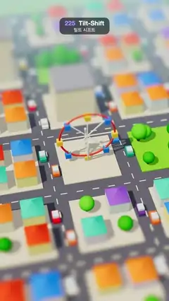

# 225 · Tilt-Shift · 틸트 시프트



**EN** A little 3D town of pastel houses, toy cars and a Ferris wheel turns into a tabletop model, sharp in a band across the middle and blurred above and below.  
**KO** 파스텔 집과 장난감 차, 대관람차가 있는 작은 3D 마을이 가운데 띠만 또렷하고 위아래가 흐려져 탁자 위 모형처럼 보인다.

[Video (mp4)](https://sueun-dev.github.io/motion-effects/videos/225-tilt-shift.mp4) · [Code](../effects/225-tilt-shift.js) · Camera & lens · 카메라·렌즈

## Prompt (English)

```text
Create a "Tilt-Shift" motion effect: a small 3D town seen from high up, sharp only in a horizontal band across the middle and increasingly blurred above and below, with boosted colour, so it reads as a tabletop miniature.

Look
- A 7 × 7 grid of blocks (6 units apart) on green ground #8DBF6E, with asphalt roads #5C5F6B 1.6 wide and dashed cream centre lines #F4E9C8. Sky colour #BFE3F2 (fog from 40 to 75).
- Blocks (seed 225): most hold four small houses (pastel walls #FFF4E0, #FCE1D4, #E4F1F7, #FFF0B8, #E9E1F7 and pyramid roofs #E4572E, #3A86FF, #2EC4B6, #FF8C42, #8E6CDB), some a block of flats with a grey roof, some are parks with round trees. The centre block holds a Ferris wheel: a red ring (radius 2.1) with eight white spokes and cabins alternating yellow #FFC93C and blue #3A86FF.
- 98 toy cars (a coloured body 0.5 × 0.26 × 0.95 with a pale cabin), two per block.
- Light: a sun #FFF1DC, intensity 2.6, from (−18, 30, 10) with 4096 soft shadows, a hemisphere light #FFFFFF / #7FA36B at 1.3, ACES tone mapping.
- Camera: perspective, 32° vertical field of view, at (−6, 30, 27) looking at (0, 0, −1).

Motion (0–5 s)
- Every car drives one lap of a rounded rectangle round its own block in the lane nearest that block (corner radius 0.7) per loop, so each road carries traffic both ways and no paths cross; the two cars on a block are half a lap apart.
- The Ferris wheel turns a quarter turn per loop with its cabins hanging level.

Technique
- Post-processing on a multisampled half-float target: a horizontal then a vertical Gaussian blur whose sigma depends only on the screen row: sigma = 15 px × smoothstep(150, 710, |row − 1080|), i.e. sharp within ±150 px of row 1080, fully blurred 710 px away. 37 taps per pass, spaced max(1, sigma / 6) px.
- The vertical pass also raises saturation by 1.35 (mix from luminance). Then tone mapping and output.

Output and rules
- One self-contained HTML file with no external assets (three.js from a CDN is fine if you use it), drawing on a 1080 × 1920 canvas (9:16) scaled to fit the window.
- Write a function renderFrame(t) that draws the frame for time t in seconds, and preview it with requestAnimationFrame. Everything must be a pure function of t and fixed seeds: no Math.random(), Date or state carried between frames, so frame i = renderFrame(i / 30) can be exported to a 30 fps video.
- Loop seamlessly every 5 seconds: renderFrame(5) must look exactly like renderFrame(0).
- No flicker of any kind: no noise or grain that changes from frame to frame, no strobing or blinking, no z-fighting, no shimmering 1 px lines. Any grain or texture stays fixed to the screen or to the object.
- Keep the top 280 px free of important content (a title label goes there) and fill the whole frame with a designed background.
```

## 프롬프트 (한국어)

```text
"틸트 시프트" 모션 효과를 만들어 줘: 높은 곳에서 본 작은 3D 마을이 가운데 가로 띠만 또렷하고 위아래로 갈수록 흐려지며, 색이 진해져 탁자 위 미니어처처럼 보이는 효과.

모양
- 초록 땅 #8DBF6E 위에 6 간격의 7 × 7 블록, 폭 1.6의 아스팔트 길 #5C5F6B와 크림색 점선 중앙선 #F4E9C8. 하늘색 #BFE3F2(안개 40에서 75).
- 블록(시드 225): 대부분 작은 집 네 채(파스텔 벽 #FFF4E0, #FCE1D4, #E4F1F7, #FFF0B8, #E9E1F7, 피라미드 지붕 #E4572E, #3A86FF, #2EC4B6, #FF8C42, #8E6CDB), 일부는 회색 지붕의 아파트 한 동, 일부는 둥근 나무가 있는 공원. 가운데 블록에는 대관람차: 빨간 고리(반지름 2.1), 흰 바퀴살 여덟 개, 노랑 #FFC93C와 파랑 #3A86FF가 번갈아 나오는 객차.
- 장난감 차 98대(색 차체 0.5 × 0.26 × 0.95와 옅은 색 객실), 블록마다 두 대.
- 조명: 해 #FFF1DC, 세기 2.6, 위치 (−18, 30, 10), 4096 부드러운 그림자, 반구광 #FFFFFF / #7FA36B 세기 1.3, ACES 톤 매핑.
- 카메라: 원근, 세로 시야각 32°, 위치 (−6, 30, 27)에서 (0, 0, −1)을 본다.

움직임 (0–5초)
- 차마다 루프 동안 자기 블록 둘레의 둥근 사각형(모서리 반지름 0.7)을 그 블록에 가까운 차선으로 한 바퀴 돈다. 그래서 길마다 양방향으로 차가 다니고 경로는 서로 겹치지 않는다. 한 블록의 두 차는 반 바퀴 떨어져 있다.
- 대관람차는 루프마다 4분의 1바퀴 돌고 객차는 수평을 유지한다.

기법
- 멀티샘플 하프 플로트 타깃에 후처리: 가로 다음 세로 가우스 블러, 시그마는 화면의 행에만 달렸다: 시그마 = 15px × smoothstep(150, 710, |행 − 1080|). 즉 1080행 ±150px 안은 또렷하고 710px 떨어지면 최대로 흐리다. 패스마다 탭 37개, 간격 max(1, 시그마 / 6)px.
- 세로 패스에서 채도도 1.35배로 올린다(휘도와 섞어서). 그다음 톤 매핑과 출력.

출력과 규칙
- 외부 파일 없는 HTML 파일 하나(three.js를 쓴다면 CDN은 괜찮다). 1080 × 1920(9:16) 캔버스에 그리고 창 크기에 맞춰 보이게 한다.
- 시간 t(초)의 프레임을 그리는 renderFrame(t) 함수를 만들고, 미리보기는 requestAnimationFrame으로 돌린다. 모든 것은 t와 고정 시드만으로 정해진다: Math.random(), Date, 프레임 사이에 쌓이는 상태 금지. 그래야 i번째 프레임 = renderFrame(i / 30)으로 30fps 영상을 뽑을 수 있다.
- 5초마다 끊김 없이 반복: renderFrame(5)는 renderFrame(0)과 똑같아 보여야 한다.
- 어떤 깜빡임도 금지: 프레임마다 바뀌는 노이즈·그레인, 번쩍임·깜빡임, z-fighting, 반짝이며 떨리는 1px 선 모두 금지. 그레인·질감은 화면이나 물체에 고정한다.
- 위쪽 280px에는 중요한 내용을 두지 않고(제목 라벨 자리), 화면 전체를 디자인된 배경으로 채운다.
```
