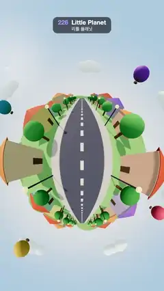

# 226 · Little Planet · 리틀 플래닛



**EN** A 360° street view folds into a tiny round planet: houses, trees and lamps rise over one side as the road rolls under you, balloons ringing the sky.  
**KO** 360° 거리 풍경이 작고 둥근 행성으로 접혀, 길이 발밑으로 굴러가는 동안 집·나무·가로등이 한쪽에서 솟아오르고 열기구가 하늘을 두른다.

[Video (mp4)](https://sueun-dev.github.io/motion-effects/videos/226-little-planet.mp4) · [Code](../effects/226-little-planet.js) · Camera & lens · 카메라·렌즈

## Prompt (English)

```text
Create a "Little Planet" motion effect: a full 360° view from a point above a street, re-projected stereographically from straight down, so the ground becomes a tiny round planet wrapped in sky. The camera rolls along the road, so the little world turns under it.

Look
- Planet centre at (540, 1060) px; the horizon is a circle of radius 430 px (2 × 215).
- Scene: green grass #86C06C, a road 5.2 wide #55596A with a dashed white centre line (a dash every 2 units), cream sidewalks 1.4 wide. Along both sides, repeating every 24 units: three houses per side (pastel walls #FFE0B5, #FFC2A8, #BDE3F5, #FFE58A, #D5C5F5, #B8EBD0, pyramid roofs #E4572E, #3A86FF, #2EC4B6, #FF8C42, #8E6CDB, 2.6–4.8 tall, 8.2–9 from the road centre, with a door to the street), a round tree and a street lamp with a glowing bulb.
- Sky: a gradient from pale #CFE5F5 at the horizon to blue (0.28, 0.55, 0.92) overhead, a small sun with a soft glow, a ring of soft green hills, seven puffy white clouds and four hot-air balloons (#FF5D73, #FFC145, #3FA7D6, #9B5DE5) bobbing 0.8 units.
- Light: a sun #FFF0D6, 2.4, with 4096 soft shadows, fixed in the world; a hemisphere light #EAF4FF / #7A9A5A at 1.6; ACES tone mapping.

Motion (0–5 s)
- The camera (height 3.4) moves 24 units down the road (one repeat of the street), so houses rise over the top of the little planet, sweep round its sides and sink at the bottom; the image is identical at 0 s and 5 s.
- The whole picture sways ±0.18 rad (sin(2π t / 5)) about the planet centre.
- Houses, trees and lamps shrink into the ground between 46 and 62 units away, so the world's edge stays tidy.

Technique
- A CubeCamera (1536² per face, half-float, mipmapped) renders the surroundings every frame.
- A full-screen shader maps each pixel to a direction: p = (pixel − centre) / 215, θ = 2 atan(|p| / 2) from straight down, φ = angle of p + sway; direction = (sin θ cos φ, −cos θ, −sin θ sin φ) (screen up = down the road), then samples the cube map (trilinear filtering keeps the squeezed edge smooth).
- Sky, hills, clouds, balloons, grass and road move with the camera; the road's dashes are a texture slid against it so they stay put in the world.

Output and rules
- One self-contained HTML file with no external assets (three.js from a CDN is fine if you use it), drawing on a 1080 × 1920 canvas (9:16) scaled to fit the window.
- Write a function renderFrame(t) that draws the frame for time t in seconds, and preview it with requestAnimationFrame. Everything must be a pure function of t and fixed seeds: no Math.random(), Date or state carried between frames, so frame i = renderFrame(i / 30) can be exported to a 30 fps video.
- Loop seamlessly every 5 seconds: renderFrame(5) must look exactly like renderFrame(0).
- No flicker of any kind: no noise or grain that changes from frame to frame, no strobing or blinking, no z-fighting, no shimmering 1 px lines. Any grain or texture stays fixed to the screen or to the object.
- Keep the top 280 px free of important content (a title label goes there) and fill the whole frame with a designed background.
```

## 프롬프트 (한국어)

```text
"리틀 플래닛" 모션 효과를 만들어 줘: 거리 위 한 점에서 본 360° 전체 풍경을 바로 아래를 중심으로 스테레오 투영해, 땅이 하늘에 둘러싸인 작고 둥근 행성이 되는 효과. 카메라가 길을 따라 굴러가서 작은 세계가 그 아래에서 돈다.

모양
- 행성 중심 (540, 1060)px, 지평선은 반지름 430px(2 × 215)의 원.
- 장면: 초록 풀밭 #86C06C, 폭 5.2의 길 #55596A와 흰 점선 중앙선(2마다 하나), 폭 1.4의 크림색 인도. 양쪽을 따라 24마다 되풀이: 한쪽에 집 세 채(파스텔 벽 #FFE0B5, #FFC2A8, #BDE3F5, #FFE58A, #D5C5F5, #B8EBD0, 피라미드 지붕 #E4572E, #3A86FF, #2EC4B6, #FF8C42, #8E6CDB, 높이 2.6–4.8, 길 중심에서 8.2–9, 길 쪽 문), 둥근 나무, 전구가 빛나는 가로등.
- 하늘: 지평선의 옅은 #CFE5F5에서 머리 위 파랑 (0.28, 0.55, 0.92)으로 가는 그라디언트, 부드럽게 빛나는 작은 해, 둥글게 둘러선 초록 언덕, 뭉게구름 일곱 개, 0.8씩 오르내리는 열기구 넷(#FF5D73, #FFC145, #3FA7D6, #9B5DE5).
- 조명: 세계에 고정된 해 #FFF0D6, 2.4, 4096 부드러운 그림자, 반구광 #EAF4FF / #7A9A5A 세기 1.6, ACES 톤 매핑.

움직임 (0–5초)
- 카메라(높이 3.4)가 길을 따라 24(거리 한 주기) 움직여, 집들이 작은 행성 위쪽으로 솟아올라 옆으로 돌고 아래쪽으로 가라앉는다. 0초와 5초의 그림이 같다.
- 그림 전체가 행성 중심 둘레로 ±0.18 rad(sin(2π t / 5)) 흔들린다.
- 집·나무·가로등은 46에서 62 떨어지는 사이에 땅속으로 작아져 세계의 가장자리가 깔끔하다.

기법
- CubeCamera(면당 1536², 하프 플로트, 밉맵)가 매 프레임 주변을 렌더한다.
- 전체 화면 셰이더가 각 픽셀을 방향으로 바꾼다: p = (픽셀 − 중심) / 215, 바로 아래에서 잰 θ = 2 atan(|p| / 2), φ = p의 각 + 흔들림; 방향 = (sin θ cos φ, −cos θ, −sin θ sin φ)(화면 위쪽 = 길 앞쪽). 그다음 큐브맵을 읽는다(삼선형 필터링으로 눌린 가장자리도 매끄럽다).
- 하늘·언덕·구름·열기구·풀밭·길은 카메라와 함께 움직이고, 길의 점선은 텍스처를 반대로 밀어 세계에 고정된 것처럼 보이게 한다.

출력과 규칙
- 외부 파일 없는 HTML 파일 하나(three.js를 쓴다면 CDN은 괜찮다). 1080 × 1920(9:16) 캔버스에 그리고 창 크기에 맞춰 보이게 한다.
- 시간 t(초)의 프레임을 그리는 renderFrame(t) 함수를 만들고, 미리보기는 requestAnimationFrame으로 돌린다. 모든 것은 t와 고정 시드만으로 정해진다: Math.random(), Date, 프레임 사이에 쌓이는 상태 금지. 그래야 i번째 프레임 = renderFrame(i / 30)으로 30fps 영상을 뽑을 수 있다.
- 5초마다 끊김 없이 반복: renderFrame(5)는 renderFrame(0)과 똑같아 보여야 한다.
- 어떤 깜빡임도 금지: 프레임마다 바뀌는 노이즈·그레인, 번쩍임·깜빡임, z-fighting, 반짝이며 떨리는 1px 선 모두 금지. 그레인·질감은 화면이나 물체에 고정한다.
- 위쪽 280px에는 중요한 내용을 두지 않고(제목 라벨 자리), 화면 전체를 디자인된 배경으로 채운다.
```
