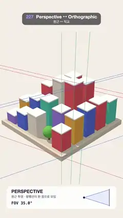

# 227 · Perspective ↔ Orthographic · 원근 ↔ 직교



**EN** A pastel block city swings from a 70° wide angle to a true isometric view and back; guide lines that converge on vanishing points turn parallel.  
**KO** 파스텔 블록 도시가 70° 광각에서 진짜 아이소메트릭 직교 시점으로 갔다 돌아오고, 소실점으로 모이던 안내선이 평행해진다.

[Video (mp4)](https://sueun-dev.github.io/motion-effects/videos/227-perspective-orthographic.mp4) · [Code](../effects/227-perspective-orthographic.js) · Camera & lens · 카메라·렌즈

## Prompt (English)

```text
Create a "Perspective ↔ Orthographic" motion effect: one projection with a knob s = 1 / camera distance morphs a block city from a 70° wide-angle perspective to a true orthographic isometric view and back, while guide lines through the block edges show parallel lines converging and then becoming parallel.

Look
- Background #F4EEE4. A base 10.6 × 10.6 (#E7DCCB, top #D8CDBB) holding a 5 × 5 grid of towers 1.5 wide, 2 apart (seed 227): heights 0.8 + 4.4 · exp(−((x − 1)² + (z + 1)²) / 16) + up to 1.4, colours #FF6B6B, #FFB84C, #4ECDC4, #5B7CFA, #A78BFA, #F7F3EA, each with a white roof slab; about one in seven cells is a round tree.
- Lambert materials (no specular, so the shading does not depend on the eye), a sun #FFF4E6, 2.2, from (−10, 20, 4) with 4096 soft shadows, a hemisphere light #FFFFFF / #C9B9A3 at 1.5.
- View direction: the isometric direction (1, 0.816, 1), centred on (0, 1.6, 0); the view half-height at the centre stays 13.4 units.
- Overlay guide lines (2.5 px), clipped between y 280 and 1620: through the front base corner and the top corners of the tallest and fourth-tallest towers, lines along x (red, rgba(239, 71, 111, 0.75)), z (blue, rgba(48, 102, 230, 0.75)) and y (green, rgba(28, 160, 110, 0.75)); a dot marks a vanishing point when it is on screen.
- A white panel at the bottom (y 1640–1840): "PERSPECTIVE · 원근 투영 · 평행선이 한 점으로 모임" or "ORTHOGRAPHIC · 직교 투영 · 평행선이 만나지 않음", "FOV 35.0°", and a side view of the viewing volume whose edges meet at the eye, which slides out of the box as the angle closes.

Motion (0–5 s)
- FOV(t) = 70° × (0.5 + 0.5 cos(2π t / 5 + π/2)): 35° at 0 s, 0° (orthographic) at 1.25 s, 70° at 3.75 s; s = tan(FOV / 2) / 13.4.
- At 70° the near tower looms and all three sets of lines rush to vanishing points; at 0° the city is flat isometric and every set is parallel.

Technique
- A custom projection matrix in a camera placed at the centre of the view: rows (1 / (K · aspect), 0, 0, 0), (0, 1 / K, 0, 0), (0, 0, −1 / R, s R), (0, 0, −s, 1) with K = 13.4, R = 14. w = 1 − s z makes it a perspective camera at distance 1 / s with the centre kept the same size (a dolly zoom); s = 0 is exactly orthographic, and the depth row keeps [−R, R] inside the clip range.
- Guide lines use the same matrix: a direction (w = 0) projects to its vanishing point, and the line through an anchor runs towards it (or stays parallel when w = 0).

Output and rules
- One self-contained HTML file with no external assets (three.js from a CDN is fine if you use it), drawing on a 1080 × 1920 canvas (9:16) scaled to fit the window.
- Write a function renderFrame(t) that draws the frame for time t in seconds, and preview it with requestAnimationFrame. Everything must be a pure function of t and fixed seeds: no Math.random(), Date or state carried between frames, so frame i = renderFrame(i / 30) can be exported to a 30 fps video.
- Loop seamlessly every 5 seconds: renderFrame(5) must look exactly like renderFrame(0).
- No flicker of any kind: no noise or grain that changes from frame to frame, no strobing or blinking, no z-fighting, no shimmering 1 px lines. Any grain or texture stays fixed to the screen or to the object.
- Keep the top 280 px free of important content (a title label goes there) and fill the whole frame with a designed background.
```

## 프롬프트 (한국어)

```text
"원근 ↔ 직교" 모션 효과를 만들어 줘: 손잡이 s = 1 / 카메라 거리 하나로 투영을 바꿔, 블록 도시가 70° 광각 원근에서 진짜 직교 아이소메트릭 시점으로 갔다 돌아오고, 블록 모서리를 지나는 안내선이 한 점으로 모였다가 평행해지는 효과.

모양
- 배경 #F4EEE4. 10.6 × 10.6 받침(#E7DCCB, 윗면 #D8CDBB) 위에 폭 1.5, 간격 2의 5 × 5 탑(시드 227): 높이 0.8 + 4.4 · exp(−((x − 1)² + (z + 1)²) / 16) + 최대 1.4, 색 #FF6B6B, #FFB84C, #4ECDC4, #5B7CFA, #A78BFA, #F7F3EA, 각각 흰 지붕판. 일곱 칸에 하나쯤은 둥근 나무.
- 램버트 재질(정반사가 없어 음영이 눈 위치에 달리지 않음), 해 #FFF4E6, 2.2, 위치 (−10, 20, 4), 4096 부드러운 그림자, 반구광 #FFFFFF / #C9B9A3 세기 1.5.
- 시선 방향: 아이소메트릭 방향 (1, 0.816, 1), 중심은 (0, 1.6, 0). 중심에서 보이는 높이의 절반은 늘 13.4.
- 오버레이 안내선(2.5px, y 280–1620 사이만): 받침 앞 모서리와 가장 높은 탑, 네 번째로 높은 탑의 위 모서리를 지나 x 방향(빨강 rgba(239, 71, 111, 0.75)), z 방향(파랑 rgba(48, 102, 230, 0.75)), y 방향(초록 rgba(28, 160, 110, 0.75)) 선. 소실점이 화면 안이면 점으로 표시.
- 아래쪽 흰 패널(y 1640–1840): "PERSPECTIVE · 원근 투영 · 평행선이 한 점으로 모임" 또는 "ORTHOGRAPHIC · 직교 투영 · 평행선이 만나지 않음", "FOV 35.0°", 그리고 보이는 공간을 옆에서 본 그림: 가장자리가 눈에서 만나고, 각이 좁아질수록 눈이 상자 밖으로 미끄러져 나간다.

움직임 (0–5초)
- FOV(t) = 70° × (0.5 + 0.5 cos(2π t / 5 + π/2)): 0초에 35°, 1.25초에 0°(직교), 3.75초에 70°. s = tan(FOV / 2) / 13.4.
- 70°에서는 앞의 탑이 크게 다가오고 세 방향 선이 모두 소실점으로 몰리며, 0°에서는 도시가 납작한 아이소메트릭이 되고 모든 선이 평행하다.

기법
- 시야 중심에 둔 카메라에 직접 만든 투영 행렬: 행 (1 / (K · 종횡비), 0, 0, 0), (0, 1 / K, 0, 0), (0, 0, −1 / R, s R), (0, 0, −s, 1), K = 13.4, R = 14. w = 1 − s z 덕분에 거리 1 / s의 원근 카메라가 되고 중심 크기는 유지된다(돌리 줌). s = 0이면 정확히 직교이고, 깊이 행은 [−R, R]을 클립 범위 안에 둔다.
- 안내선도 같은 행렬로 계산한다: 방향(w = 0)은 소실점으로 투영되고, 기준점을 지나는 선은 그쪽으로 향한다(w = 0이면 평행).

출력과 규칙
- 외부 파일 없는 HTML 파일 하나(three.js를 쓴다면 CDN은 괜찮다). 1080 × 1920(9:16) 캔버스에 그리고 창 크기에 맞춰 보이게 한다.
- 시간 t(초)의 프레임을 그리는 renderFrame(t) 함수를 만들고, 미리보기는 requestAnimationFrame으로 돌린다. 모든 것은 t와 고정 시드만으로 정해진다: Math.random(), Date, 프레임 사이에 쌓이는 상태 금지. 그래야 i번째 프레임 = renderFrame(i / 30)으로 30fps 영상을 뽑을 수 있다.
- 5초마다 끊김 없이 반복: renderFrame(5)는 renderFrame(0)과 똑같아 보여야 한다.
- 어떤 깜빡임도 금지: 프레임마다 바뀌는 노이즈·그레인, 번쩍임·깜빡임, z-fighting, 반짝이며 떨리는 1px 선 모두 금지. 그레인·질감은 화면이나 물체에 고정한다.
- 위쪽 280px에는 중요한 내용을 두지 않고(제목 라벨 자리), 화면 전체를 디자인된 배경으로 채운다.
```
