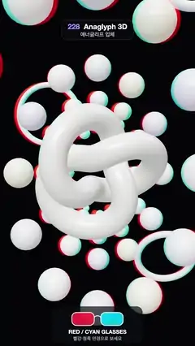

# 228 · Anaglyph 3D · 애너글리프 입체



**EN** A white knot floats on the screen plane while a helix of beads spirals out of the deep background and through it, edged in red and cyan.  
**KO** 흰 매듭은 화면 면에 떠 있고, 구슬 나선이 깊은 배경에서 나와 화면을 뚫고 다가오며 빨강·청록 테두리를 두른다.

[Video (mp4)](https://sueun-dev.github.io/motion-effects/videos/228-anaglyph-3d.mp4) · [Code](../effects/228-anaglyph-3d.js) · Camera & lens · 카메라·렌즈

## Prompt (English)

```text
Create an "Anaglyph 3D" motion effect: a red/cyan stereo image. The scene is rendered for a left and a right eye and merged, so objects behind the screen plane get red fringes on the left and cyan on the right, objects in front get them swapped, and objects on the plane have none.

Look
- Background #101219, a room environment map at 0.7, a white key 2.0 from (−4, 6, 10), ACES tone mapping.
- On the convergence plane (z = 0): a white torus knot #F2F0EA (radius 1.1, tube 0.36, p = 2, q = 3, roughness 0.3).
- A helix of 72 beads (icosahedron spheres, radius 0.42, tints #FFFFFF, #E9E4FF, #FFF2D9, #DDF3FF repeating) on an ellipse 2.2 wide and 3.3 tall, 12 beads per turn, 0.55 apart in depth, from z = −30 far behind to z = +9 in front of the screen.
- Four pale rings (#E8E6F0, tube 0.12) hanging at depths −8, −4, +2.5 and +4.
- Camera: perspective, 40° vertical field of view, 13 from the origin (focus 13).
- Overlay: a dark pill at the bottom (y 1700–1905) with a pair of red and cyan glasses, "RED / CYAN GLASSES" and "빨강·청록 안경으로 보세요".

Motion (0–5 s)
- The helix slides four beads towards the viewer per loop, turning a third of a turn with them; beads grow out of nothing far away (z from −27.8 to −24) and shrink away before they reach the camera (z from 6.5 to 9.6).
- The knot turns a third of a turn about its own axis (its 3-fold symmetry); the rings rock and spin.
- The viewpoint sways: x = 1.2 sin(2π t / 5), y = 0.5 sin(4π t / 5), always aimed at the origin.

Technique
- three's StereoCamera, eye separation 0.2, focus 13: two off-axis cameras whose frusta meet on the knot's plane, each rendered into a multisampled half-float target.
- Merge (half-colour anaglyph): red = luminance of the left image (0.299, 0.587, 0.114), green and blue = the right image's green and blue; then tone mapping and output.

Output and rules
- One self-contained HTML file with no external assets (three.js from a CDN is fine if you use it), drawing on a 1080 × 1920 canvas (9:16) scaled to fit the window.
- Write a function renderFrame(t) that draws the frame for time t in seconds, and preview it with requestAnimationFrame. Everything must be a pure function of t and fixed seeds: no Math.random(), Date or state carried between frames, so frame i = renderFrame(i / 30) can be exported to a 30 fps video.
- Loop seamlessly every 5 seconds: renderFrame(5) must look exactly like renderFrame(0).
- No flicker of any kind: no noise or grain that changes from frame to frame, no strobing or blinking, no z-fighting, no shimmering 1 px lines. Any grain or texture stays fixed to the screen or to the object.
- Keep the top 280 px free of important content (a title label goes there) and fill the whole frame with a designed background.
```

## 프롬프트 (한국어)

```text
"애너글리프 입체" 모션 효과를 만들어 줘: 빨강·청록 입체 그림. 장면을 왼눈과 오른눈으로 따로 렌더해 합치면, 화면 면보다 뒤의 물체는 왼쪽에 빨강, 오른쪽에 청록 테두리가 생기고, 앞의 물체는 그 반대이며, 면 위의 물체에는 테두리가 없다.

모양
- 배경 #101219, 룸 환경맵 0.7, 흰 키 라이트 2.0, 위치 (−4, 6, 10), ACES 톤 매핑.
- 수렴면(z = 0) 위에 흰 토러스 매듭 #F2F0EA(반지름 1.1, 튜브 0.36, p = 2, q = 3, 거칠기 0.3).
- 구슬 72개의 나선(정이십면체 구, 반지름 0.42, #FFFFFF, #E9E4FF, #FFF2D9, #DDF3FF 반복): 폭 2.2, 높이 3.3의 타원 위, 한 바퀴에 12개, 깊이 간격 0.55, 뒤쪽 z = −30부터 화면 앞 z = +9까지.
- 깊이 −8, −4, +2.5, +4에 걸린 옅은 고리 넷(#E8E6F0, 튜브 0.12).
- 카메라: 원근, 세로 시야각 40°, 원점에서 13(초점 13).
- 오버레이: 아래쪽 어두운 알약(y 1700–1905) 안에 빨강·청록 안경 그림, "RED / CYAN GLASSES", "빨강·청록 안경으로 보세요".

움직임 (0–5초)
- 나선은 루프마다 구슬 네 개만큼 보는 사람 쪽으로 미끄러지며 3분의 1바퀴 돈다. 구슬은 먼 곳(z −27.8에서 −24)에서 없던 데서 자라나고, 카메라에 닿기 전(z 6.5에서 9.6)에 작아져 사라진다.
- 매듭은 자기 축으로 3분의 1바퀴 돈다(3겹 대칭). 고리들은 흔들리며 돈다.
- 시점이 흔들린다: x = 1.2 sin(2π t / 5), y = 0.5 sin(4π t / 5), 늘 원점을 본다.

기법
- three의 StereoCamera, 눈 사이 거리 0.2, 초점 13: 절두체가 매듭의 면에서 만나는 비대칭 카메라 둘을 각각 멀티샘플 하프 플로트 타깃에 렌더한다.
- 합치기(하프 컬러 애너글리프): 빨강 = 왼쪽 그림의 휘도(0.299, 0.587, 0.114), 초록과 파랑 = 오른쪽 그림의 초록과 파랑. 그다음 톤 매핑과 출력.

출력과 규칙
- 외부 파일 없는 HTML 파일 하나(three.js를 쓴다면 CDN은 괜찮다). 1080 × 1920(9:16) 캔버스에 그리고 창 크기에 맞춰 보이게 한다.
- 시간 t(초)의 프레임을 그리는 renderFrame(t) 함수를 만들고, 미리보기는 requestAnimationFrame으로 돌린다. 모든 것은 t와 고정 시드만으로 정해진다: Math.random(), Date, 프레임 사이에 쌓이는 상태 금지. 그래야 i번째 프레임 = renderFrame(i / 30)으로 30fps 영상을 뽑을 수 있다.
- 5초마다 끊김 없이 반복: renderFrame(5)는 renderFrame(0)과 똑같아 보여야 한다.
- 어떤 깜빡임도 금지: 프레임마다 바뀌는 노이즈·그레인, 번쩍임·깜빡임, z-fighting, 반짝이며 떨리는 1px 선 모두 금지. 그레인·질감은 화면이나 물체에 고정한다.
- 위쪽 280px에는 중요한 내용을 두지 않고(제목 라벨 자리), 화면 전체를 디자인된 배경으로 채운다.
```
