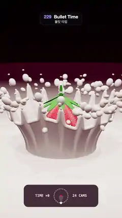

# 229 · Bullet Time · 불릿 타임



**EN** A strawberry hangs frozen in a crown of milk with 18 spiked tips and a dome of droplets while the camera glides around the splash.  
**KO** 우유에 떨어진 딸기가 18갈래 왕관 물보라와 공중의 물방울 속에 그대로 멈춰 있고, 카메라만 그 주위를 미끄러지듯 돈다.

[Video (mp4)](https://sueun-dev.github.io/motion-effects/videos/229-bullet-time.mp4) · [Code](../effects/229-bullet-time.js) · Camera & lens · 카메라·렌즈

## Prompt (English)

```text
Create a "Bullet Time" motion effect: one instant of a milk splash is frozen in mid-air while the camera travels around it, as if the shot were cut together from a ring of still cameras.

Look
- A strawberry dropped tip-first into milk, frozen at the moment of the crown splash:
  - The milk pool is a surface of revolution of the profile y(r) = −0.3·e^(−(r/0.7)²) + 0.07·e^(−((r − 1.05)/0.22)²) plus gentle ripples 0.035·sin(6.5r − 1.2) that fade outwards, out to r = 18: a small cavity, a raised lip, rings.
  - The crown wall rises from r = 0.95. For v from 0 (base) to 1 (rim): radius 0.95 + 0.4·v^1.8 + 0.08·v³·spike(θ), height v·rim(θ), with rim(θ) = 0.95 + 0.1·sin(3θ + 0.7) + 0.06·sin(6θ) + 0.34·spike(θ) and spike(θ) = (0.5 + 0.5·cos(18θ + 0.35·sin 3θ))^8, which gives 18 pointed tips. A tube of radius 0.045 runs along the rim as a thick bead.
  - Droplets: at every tip a bead of radius 0.055–0.09, stretched 1.35× along the spray direction, just leaving it, a small neck drop below it and sometimes a third drop; plus a frozen ballistic spray of 42 droplets per third of the circle (radial speed 1.2–3.6, upward speed 1.1–3.3, age 0.04–0.38 s under g = 9.8), each stretched along its velocity.
  - The whole splash is copied three times, 120° apart (three-fold symmetry).
  - The strawberry stands tip-down in the middle (centre y = 0.62, about 1.4 tall): a lathe body with a red gradient #7E0A1C → #D3122F → #E8324A, 13 rows × 18 columns of yellow seeds #F2D46B in darker pits, 9 green leaves #3E8E2E as flattened ellipsoids and a short stem.
- Milk: physical material #F7F1E8, roughness 0.42, clearcoat 0.4, double-sided.
- Background: a vertical gradient #12040A → #2E0918 → #5E1832; fog #4E142A from 11 to 22 units, so the pool melts into the dark.
- Lights: three identical warm spot lights #FFF1E4 (intensity 150, cone 0.4 rad, penumbra 0.8) at radius 5 and height 11, 120° apart, all with soft 2048 shadow maps; a hemisphere light #FFF4EE / #6A3040 at 1.1; an environment map made from a rose dome with three soft boxes, also 120° apart. ACES Filmic tone mapping, exposure 0.9.
- HUD at the bottom (centre y ≈ 1725): a dark rounded panel 660 × 196 px; a ring of 24 small dots (the camera rig seen from above), a red dot in its centre for the subject, a white marker for our camera at the bottom of the ring with a faint view wedge; "TIME ×0" on the left and "24 CAMS" on the right in 30 px monospace.

Motion (0–5 s), a = 2π · t / 5
- Nothing in the scene moves: time is stopped.
- The camera orbits at radius 10.4 with angle a / 3 (a third of a turn per loop), height 3.6 + 0.3·sin(a), always looking at (0, 1.05, 0), 30° field of view.
- The splash and the three lights repeat every 120°, so the last frame is the first frame: the loop is seamless and reads as an endless orbit.
- In the HUD, the ring of 24 dots turns under the fixed camera marker by 120° per loop (eight dot spacings), so it loops too.

Technique
- three.js: LatheGeometry for the pool and the strawberry, ParametricGeometry for the crown wall, TubeGeometry for the rim bead, one InstancedMesh for every droplet.
- A camera shutter: each frame averages 6 renders spread over one frame of camera motion, summed into a float render target and tone mapped once, so the fine droplets stay smooth while the camera moves.
- The HUD is drawn in 2D on top of the render.

Output and rules
- One self-contained HTML file with no external assets (three.js from a CDN is fine if you use it), drawing on a 1080 × 1920 canvas (9:16) scaled to fit the window.
- Write a function renderFrame(t) that draws the frame for time t in seconds, and preview it with requestAnimationFrame. Everything must be a pure function of t and fixed seeds: no Math.random(), Date or state carried between frames, so frame i = renderFrame(i / 30) can be exported to a 30 fps video.
- Loop seamlessly every 5 seconds: renderFrame(5) must look exactly like renderFrame(0).
- No flicker of any kind: no noise or grain that changes from frame to frame, no strobing or blinking, no z-fighting, no shimmering 1 px lines. Any grain or texture stays fixed to the screen or to the object.
- Keep the top 280 px free of important content (a title label goes there) and fill the whole frame with a designed background.
```

## 프롬프트 (한국어)

```text
"불릿 타임" 모션 효과를 만들어 줘: 우유가 튀는 한순간이 공중에 얼어붙어 있고, 카메라만 그 주위를 돈다. 둥글게 늘어선 스틸 카메라들의 사진을 이어 붙인 것처럼.

모양
- 딸기가 끝부터 우유에 떨어져 왕관 모양으로 튀는 순간에 멈춘 장면:
  - 우유 수면은 단면 y(r) = −0.3·e^(−(r/0.7)²) + 0.07·e^(−((r − 1.05)/0.22)²)에 바깥으로 갈수록 약해지는 잔물결 0.035·sin(6.5r − 1.2)를 더한 회전체로, r = 18까지 펼쳐진다: 작은 패임, 솟은 테두리, 동심원 물결.
  - 왕관 벽은 r = 0.95에서 솟는다. v가 0(밑)에서 1(가장자리)일 때 반지름 0.95 + 0.4·v^1.8 + 0.08·v³·spike(θ), 높이 v·rim(θ). rim(θ) = 0.95 + 0.1·sin(3θ + 0.7) + 0.06·sin(6θ) + 0.34·spike(θ), spike(θ) = (0.5 + 0.5·cos(18θ + 0.35·sin 3θ))^8 → 뾰족한 끝 18개. 가장자리를 따라 반지름 0.045의 튜브가 두툼한 테를 이룬다.
  - 물방울: 뾰족한 끝마다 막 떨어져 나가는 반지름 0.055–0.09의 방울(튀는 방향으로 1.35배 늘어남), 그 아래 작은 목 방울, 가끔 세 번째 방울. 그리고 원의 1/3마다 42개씩 얼어붙은 포물선 물보라(바깥 속도 1.2–3.6, 위 속도 1.1–3.3, 경과 시간 0.04–0.38초, g = 9.8), 각 방울은 속도 방향으로 늘어난다.
  - 물보라 전체를 120° 간격으로 세 번 복사한다(3회 대칭).
  - 딸기는 가운데에 끝을 아래로 서 있다(중심 y = 0.62, 높이 약 1.4): 회전체 몸통에 빨강 그라디언트 #7E0A1C → #D3122F → #E8324A, 어두운 홈 속 노란 씨 #F2D46B 13줄 × 18열, 납작한 타원체 초록 잎 #3E8E2E 9장과 짧은 꼭지.
- 우유: 물리 재질 #F7F1E8, 거칠기 0.42, 클리어코트 0.4, 양면.
- 배경: 세로 그라디언트 #12040A → #2E0918 → #5E1832. 안개 #4E142A를 11에서 22까지 깔아 수면이 어둠 속으로 녹아들게 한다.
- 조명: 똑같은 따뜻한 스포트라이트 #FFF1E4 세 개(세기 150, 원뿔 0.4 rad, 반그림자 0.8)를 반지름 5, 높이 11에 120° 간격으로 두고 모두 2048 부드러운 그림자. 반구광 #FFF4EE / #6A3040 세기 1.1. 장밋빛 돔과 120° 간격 소프트박스 세 개로 만든 환경맵. ACES Filmic 톤 매핑, 노출 0.9.
- 아래쪽 HUD(중심 y ≈ 1725): 어두운 둥근 패널 660 × 196 px. 위에서 본 카메라 리그인 작은 점 24개의 원, 가운데 피사체를 뜻하는 빨간 점, 원 아래쪽에 우리 카메라를 뜻하는 흰 표시와 옅은 시야 쐐기. 왼쪽에 "TIME ×0", 오른쪽에 "24 CAMS"(30 px 고정폭 글꼴).

움직임 (0–5초), a = 2π · t / 5
- 장면 속 어떤 것도 움직이지 않는다: 시간이 멈춰 있다.
- 카메라는 반지름 10.4에서 각도 a / 3으로 돈다(루프마다 1/3바퀴). 높이 3.6 + 0.3·sin(a), 항상 (0, 1.05, 0)을 보고, 시야각 30°.
- 물보라와 조명 세 개가 120°마다 되풀이되므로 마지막 프레임이 첫 프레임과 같다: 끊김 없는 루프이고 끝없이 도는 것처럼 보인다.
- HUD의 점 24개 원은 고정된 카메라 표시 아래에서 루프마다 120°(점 간격 8칸) 돌아가므로 HUD도 끊김 없이 이어진다.

기법
- three.js: 수면과 딸기는 LatheGeometry, 왕관 벽은 ParametricGeometry, 테는 TubeGeometry, 모든 물방울은 InstancedMesh 하나.
- 카메라 셔터: 매 프레임 카메라가 한 프레임 동안 움직이는 구간에 걸쳐 6번 렌더해 float 렌더 타깃에 더하고 톤 매핑은 한 번만 한다. 그래서 카메라가 움직여도 작은 물방울이 매끄럽다.
- HUD는 렌더 위에 2D로 그린다.

출력과 규칙
- 외부 파일 없는 HTML 파일 하나(three.js를 쓴다면 CDN은 괜찮다). 1080 × 1920(9:16) 캔버스에 그리고 창 크기에 맞춰 보이게 한다.
- 시간 t(초)의 프레임을 그리는 renderFrame(t) 함수를 만들고, 미리보기는 requestAnimationFrame으로 돌린다. 모든 것은 t와 고정 시드만으로 정해진다: Math.random(), Date, 프레임 사이에 쌓이는 상태 금지. 그래야 i번째 프레임 = renderFrame(i / 30)으로 30fps 영상을 뽑을 수 있다.
- 5초마다 끊김 없이 반복: renderFrame(5)는 renderFrame(0)과 똑같아 보여야 한다.
- 어떤 깜빡임도 금지: 프레임마다 바뀌는 노이즈·그레인, 번쩍임·깜빡임, z-fighting, 반짝이며 떨리는 1px 선 모두 금지. 그레인·질감은 화면이나 물체에 고정한다.
- 위쪽 280px에는 중요한 내용을 두지 않고(제목 라벨 자리), 화면 전체를 디자인된 배경으로 채운다.
```
