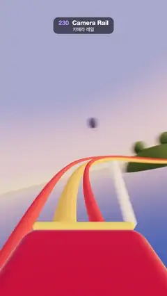

# 230 · Camera Rail · 카메라 레일



**EN** From the front of a red coaster car, the camera rides a closed spline track over three hills and banked turns around a sunset lagoon.  
**KO** 빨간 롤러코스터 차 앞자리에서, 카메라가 닫힌 스플라인 레일을 타고 노을 진 석호를 돌며 언덕 세 개와 기울어진 커브를 달린다.

[Video (mp4)](https://sueun-dev.github.io/motion-effects/videos/230-camera-rail.mp4) · [Code](../effects/230-camera-rail.js) · Camera & lens · 카메라·렌즈

## Prompt (English)

```text
Create a "Camera Rail" motion effect: a point-of-view ride on a roller coaster whose track is one closed spline, lapping a pastel sunset lagoon once per loop.

Look
- The track is a closed centripetal Catmull-Rom spline through 18 control points: for i = 0..17, angle q = i/18 · 2π, radius r = 27 + 3·cos(2q), point (r·cos q, 7 + 2.2·sin(3q) + 0.8·sin(q), r·sin q): a slightly squashed circle over three hills.
- Rails: two tubes of radius 0.13 at ±0.62 from the centre line, red #E8443A (roughness 0.7); a spine tube of radius 0.28 0.42 below them, yellow #F2B33D; ten white columns #F6F1E7 (radius 0.5–0.6) running down into the water.
- Sky: a dome shader from warm horizon (1.0, 0.7, 0.45) to pink (0.93, 0.55, 0.55) at 12 % height to violet-blue (0.3, 0.32, 0.62) at 60 %, with a soft glow round a low sun. The same sky, prefiltered, is the environment map.
- Water: a disc of radius 1100, colour #7FA6D6, metalness 1, roughness 0.14, so it mirrors the sky as a smooth gradient.
- Five round green islands (#86A86C half-spheres, radius 14–32, height 7–17) with big round canopy trees (radius 5–8, greens and a few orange ones), three hot-air balloons (envelopes of radius 6 in #E8443A, #F2B33D, #6F8CFF with brown baskets). Fog #F2B48C from 80 to 520. Hemisphere light #FFD8C0 / #3A5878 at 1.1, a low sun #FFC690 at 2.6. ACES Filmic.
- Our car, fixed to the camera along the bottom edge of the frame: a red rounded hood #C8282E (1.7 × 0.5 × 1.6) with a yellow trim bar.
- Camera: 100° vertical field of view, 1.35 above the track, looking at the point 10 m ahead (1.1 above the track there); its up vector is the track's up 1.5 m ahead.

Motion (0–5 s)
- The camera laps the whole circuit exactly once per loop, so frame 150 meets frame 0.
- Speed is set by height like a real coaster: v = √(64 + 2 · 9.8 · (top − y)), slow over the crests and fast in the dips. Integrate time = Σ ds / v along the track, scale it so the lap takes 5 s, and at time t place the camera where the accumulated time equals t.
- The track banks into the turns: "up" is world up tilted around the tangent by 5 × the turn rate (yaw per metre, averaged over ±6 m), clamped to ±0.5 rad, so the horizon tilts as the car leans.

Technique
- three.js. Sample the spline at 4000 points by arc length and smooth them with a running mean (±60 samples, applied twice) so the curvature has no kinks at the knots; tangents from neighbouring samples. Rails and spine are TubeGeometry along offset copies of the samples.
- A 360° shutter: each frame sums 12 renders spread across one frame into a float render target and tone maps once, so the scenery sweeping past is motion-blurred instead of stuttering.
- A lap means turning a full 360° in 5 s, so the scenery is built only from big soft shapes (no thin poles or fine textures) and stays smooth as the view sweeps.

Output and rules
- One self-contained HTML file with no external assets (three.js from a CDN is fine if you use it), drawing on a 1080 × 1920 canvas (9:16) scaled to fit the window.
- Write a function renderFrame(t) that draws the frame for time t in seconds, and preview it with requestAnimationFrame. Everything must be a pure function of t and fixed seeds: no Math.random(), Date or state carried between frames, so frame i = renderFrame(i / 30) can be exported to a 30 fps video.
- Loop seamlessly every 5 seconds: renderFrame(5) must look exactly like renderFrame(0).
- No flicker of any kind: no noise or grain that changes from frame to frame, no strobing or blinking, no z-fighting, no shimmering 1 px lines. Any grain or texture stays fixed to the screen or to the object.
- Keep the top 280 px free of important content (a title label goes there) and fill the whole frame with a designed background.
```

## 프롬프트 (한국어)

```text
"카메라 레일" 모션 효과를 만들어 줘: 레일 전체가 닫힌 스플라인 하나인 롤러코스터의 1인칭 탑승 장면. 파스텔 노을의 석호를 루프마다 한 바퀴 돈다.

모양
- 레일은 제어점 18개를 지나는 닫힌 centripetal Catmull-Rom 스플라인: i = 0..17, 각도 q = i/18 · 2π, 반지름 r = 27 + 3·cos(2q), 점 (r·cos q, 7 + 2.2·sin(3q) + 0.8·sin(q), r·sin q). 살짝 눌린 원 위에 언덕이 세 개.
- 레일: 중심선에서 ±0.62 떨어진 반지름 0.13 튜브 두 개(빨강 #E8443A, 거칠기 0.7), 그 0.42 아래 반지름 0.28 척추 튜브(노랑 #F2B33D), 물속으로 내려가는 흰 기둥 #F6F1E7 10개(반지름 0.5–0.6).
- 하늘: 따뜻한 지평선 (1.0, 0.7, 0.45) → 높이 12 %에서 분홍 (0.93, 0.55, 0.55) → 60 %에서 보랏빛 파랑 (0.3, 0.32, 0.62)인 돔 셰이더, 낮은 해 주위로 부드러운 빛무리. 같은 하늘을 프리필터해 환경맵으로 쓴다.
- 물: 반지름 1100 원판, 색 #7FA6D6, 금속성 1, 거칠기 0.14 → 하늘이 매끄러운 그라디언트로 비친다.
- 둥근 초록 섬 다섯 개(#86A86C 반구, 반지름 14–32, 높이 7–17)와 그 위의 큰 둥근 나무(반지름 5–8, 초록과 몇 그루 주황), 열기구 세 개(반지름 6 풍선 #E8443A, #F2B33D, #6F8CFF와 갈색 바구니). 안개 #F2B48C 80–520. 반구광 #FFD8C0 / #3A5878 1.1, 낮은 해 #FFC690 2.6. ACES Filmic.
- 우리 차: 화면 아래 가장자리에 카메라에 붙은 빨간 둥근 보닛 #C8282E(1.7 × 0.5 × 1.6)와 노란 테두리 막대.
- 카메라: 세로 시야각 100°, 레일 위 1.35, 10 m 앞 지점(그곳 레일 위 1.1)을 본다. 위 방향은 1.5 m 앞 레일의 위 방향.

움직임 (0–5초)
- 카메라는 루프마다 정확히 한 바퀴 돌아 150번째 프레임이 0번째 프레임과 이어진다.
- 속도는 진짜 코스터처럼 높이로 정한다: v = √(64 + 2 · 9.8 · (최고점 − y)), 꼭대기에서 느리고 골짜기에서 빠르다. 레일을 따라 시간 = Σ ds / v를 쌓고, 한 바퀴가 5초가 되게 비율을 맞춘 뒤, 시각 t에는 쌓인 시간이 t인 지점에 카메라를 둔다.
- 커브에서는 레일이 안쪽으로 기운다: "위"는 세계의 위를 접선 둘레로 회전율(미터당 방향 변화, ±6 m 평균)의 5배만큼 기울인 것, ±0.5 rad로 제한. 차가 기울면 지평선도 기운다.

기법
- three.js. 스플라인을 호 길이로 4000점 샘플링하고 이동 평균(±60점, 두 번)으로 다듬어 매듭에서 곡률이 꺾이지 않게 한다. 접선은 이웃 점에서 구한다. 레일과 척추는 샘플을 옮긴 사본을 따라가는 TubeGeometry.
- 360° 셔터: 매 프레임 한 프레임 구간에 걸쳐 12번 렌더해 float 렌더 타깃에 더하고 톤 매핑은 한 번만 → 스쳐 가는 풍경이 끊기지 않고 모션 블러로 흐른다.
- 한 바퀴는 5초에 360° 도는 것이라, 풍경은 크고 부드러운 형태로만 만든다(가는 기둥이나 잔 무늬 없음). 그래야 시야가 휩쓸려도 매끄럽다.

출력과 규칙
- 외부 파일 없는 HTML 파일 하나(three.js를 쓴다면 CDN은 괜찮다). 1080 × 1920(9:16) 캔버스에 그리고 창 크기에 맞춰 보이게 한다.
- 시간 t(초)의 프레임을 그리는 renderFrame(t) 함수를 만들고, 미리보기는 requestAnimationFrame으로 돌린다. 모든 것은 t와 고정 시드만으로 정해진다: Math.random(), Date, 프레임 사이에 쌓이는 상태 금지. 그래야 i번째 프레임 = renderFrame(i / 30)으로 30fps 영상을 뽑을 수 있다.
- 5초마다 끊김 없이 반복: renderFrame(5)는 renderFrame(0)과 똑같아 보여야 한다.
- 어떤 깜빡임도 금지: 프레임마다 바뀌는 노이즈·그레인, 번쩍임·깜빡임, z-fighting, 반짝이며 떨리는 1px 선 모두 금지. 그레인·질감은 화면이나 물체에 고정한다.
- 위쪽 280px에는 중요한 내용을 두지 않고(제목 라벨 자리), 화면 전체를 디자인된 배경으로 채운다.
```
