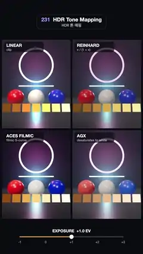

# 231 · HDR Tone Mapping · HDR 톤 매핑



**EN** One HDR scene with neon tubes, glossy spheres and a ladder of doubling emissive chips is tone mapped four ways as exposure sweeps −1 to +3 EV.  
**KO** 네온관, 광택 구, 두 배씩 밝아지는 발광 칩 사다리가 있는 HDR 장면 하나를 노출이 −1~+3 EV로 오가는 동안 네 가지 방식으로 톤 매핑한다.

[Video (mp4)](https://sueun-dev.github.io/motion-effects/videos/231-tone-mapping.mp4) · [Code](../effects/231-tone-mapping.js) · Rendering & stylization · 렌더링·스타일화

## Prompt (English)

```text
Create an "HDR Tone Mapping" motion effect: the same high-dynamic-range scene rendered four times side by side with different tone-mapping operators, while one shared exposure slides up and down.

Look
- Layout: a 2 × 2 grid of tiles, 519 × 670 px each with 14 px gaps, starting at y = 300, on #0B0C10. Tiles: LINEAR ("clip"), REINHARD ("x / (1 + x)"), ACES FILMIC ("filmic S-curve"), AGX ("desaturates to white"), each named in a dark rounded pill at its top-left (700 32 px white, note 24 px at 62 %).
- The scene in every tile (camera 38°, at (0, 1.7, 7.4), looking at (0, 1.25, 0)):
  - a glossy floor #2A2C33 (roughness 0.32) and a back wall #1E2233 at z = −2.6;
  - a pink neon ring (torus radius 1.15, tube 0.065) at (0, 2.45, −1.6), emissive colour (1, 0.16, 0.42) × 7, with a matching point light (intensity 11.2, range 8);
  - a cyan neon bar (capsule 2.6 long, radius 0.05) at (0, 0.95, −2.4), colour (0.15, 0.75, 1) × 6, with its own point light;
  - three glossy spheres of radius 0.48 at x = −1.15, 0, 1.15: saturated red #E01010, white #F2F2F2, saturated blue #1030E0 (roughness 0.25, clearcoat 1);
  - an exposure ladder: seven orange chips 0.36 × 0.36 in a row at z = 1.75 (spacing 0.44, tilted back 0.35 rad), colour (1, 0.32, 0.04) × 2^(k − 3), i.e. 1/8, 1/4, … 8× white;
  - a warm key spot #FFE2C0 (intensity 60) from (−3, 5.5, 4), ambient #8090B0 at 0.25, a room environment at 0.12.
- Under the grid (y = 1790): an exposure slider from x = 150 to 930 with ticks −1 … +3, an orange fill #FFB347, a white knob and the text "EXPOSURE +1.3 EV" above it.

Motion (0–5 s), a = 2π · t / 5
- Exposure EV = 1 + 2·sin(a), so it runs +1 → +3 → −1 → +1; the renderer exposure is 2^EV, shared by all four tiles.
- The neon ring turns about its vertical axis by 0.35·sin(a) rad.
- What to see: Linear clips the bright chips and the neon to flat, hue-shifted colour; Reinhard compresses smoothly but greys the image; ACES keeps contrast and pushes the hot orange to yellow-white; AgX rolls every hot colour gently to white.

Technique
- three.js with autoClear off and the scissor test on: for each tile set the viewport and scissor, set renderer.toneMapping (Linear, Reinhard, ACESFilmic, AgX) and render the scene; three.js recompiles each material once per operator and then reuses the programs.
- Emissive objects use plain colours above 1.0 (MeshBasicMaterial colour multiplied by the gain) so the scene really is HDR; no bloom, so only the tone curve differs.

Output and rules
- One self-contained HTML file with no external assets (three.js from a CDN is fine if you use it), drawing on a 1080 × 1920 canvas (9:16) scaled to fit the window.
- Write a function renderFrame(t) that draws the frame for time t in seconds, and preview it with requestAnimationFrame. Everything must be a pure function of t and fixed seeds: no Math.random(), Date or state carried between frames, so frame i = renderFrame(i / 30) can be exported to a 30 fps video.
- Loop seamlessly every 5 seconds: renderFrame(5) must look exactly like renderFrame(0).
- No flicker of any kind: no noise or grain that changes from frame to frame, no strobing or blinking, no z-fighting, no shimmering 1 px lines. Any grain or texture stays fixed to the screen or to the object.
- Keep the top 280 px free of important content (a title label goes there) and fill the whole frame with a designed background.
```

## 프롬프트 (한국어)

```text
"HDR 톤 매핑" 모션 효과를 만들어 줘: 같은 HDR 장면을 톤 매핑 연산자만 바꿔 네 번 나란히 렌더하고, 함께 쓰는 노출 하나를 오르내리게 한다.

모양
- 배치: 2 × 2 타일, 각 519 × 670 px, 간격 14 px, y = 300부터, 배경 #0B0C10. 타일: LINEAR("clip"), REINHARD("x / (1 + x)"), ACES FILMIC("filmic S-curve"), AGX("desaturates to white"). 각 타일 왼쪽 위 어두운 둥근 알약에 이름(700 32 px 흰색)과 설명(24 px, 62 %).
- 모든 타일의 장면(카메라 38°, 위치 (0, 1.7, 7.4), (0, 1.25, 0)을 본다):
  - 광택 바닥 #2A2C33(거칠기 0.32)과 z = −2.6의 뒷벽 #1E2233;
  - (0, 2.45, −1.6)의 분홍 네온 고리(토러스 반지름 1.15, 굵기 0.065), 발광색 (1, 0.16, 0.42) × 7, 같은 색 점광(세기 11.2, 범위 8);
  - (0, 0.95, −2.4)의 하늘색 네온 막대(길이 2.6, 반지름 0.05 캡슐), 색 (0.15, 0.75, 1) × 6, 자체 점광;
  - x = −1.15, 0, 1.15에 반지름 0.48 광택 구 세 개: 진한 빨강 #E01010, 흰색 #F2F2F2, 진한 파랑 #1030E0(거칠기 0.25, 클리어코트 1);
  - 노출 사다리: z = 1.75에 한 줄로 놓인 0.36 × 0.36 주황 칩 7개(간격 0.44, 뒤로 0.35 rad 기울임), 색 (1, 0.32, 0.04) × 2^(k − 3), 즉 흰색의 1/8, 1/4, … 8배;
  - (−3, 5.5, 4)에서 비추는 따뜻한 키 스포트 #FFE2C0(세기 60), 주변광 #8090B0 0.25, 룸 환경 0.12.
- 타일 아래(y = 1790): x = 150–930의 노출 슬라이더, 눈금 −1 … +3, 주황 채움 #FFB347, 흰 손잡이, 그 위에 "EXPOSURE +1.3 EV" 글자.

움직임 (0–5초), a = 2π · t / 5
- 노출 EV = 1 + 2·sin(a): +1 → +3 → −1 → +1. 렌더러 노출은 2^EV이고 네 타일이 함께 쓴다.
- 네온 고리는 세로축으로 0.35·sin(a) rad 돈다.
- 보이는 차이: Linear는 밝은 칩과 네온을 납작하고 색상이 틀어진 색으로 잘라 버리고, Reinhard는 부드럽게 눌러 주지만 화면이 회색빛이 되고, ACES는 대비를 지키며 뜨거운 주황을 노란 흰색으로 밀고, AgX는 뜨거운 색을 모두 흰색으로 부드럽게 넘긴다.

기법
- three.js에서 autoClear를 끄고 시저 테스트를 켠다. 타일마다 뷰포트와 시저를 정하고 renderer.toneMapping(Linear, Reinhard, ACESFilmic, AgX)을 바꿔 장면을 렌더한다. three.js는 연산자마다 재질을 한 번 컴파일하고 이후 재사용한다.
- 발광 물체는 1.0을 넘는 단색(MeshBasicMaterial 색 × 세기)이라 장면이 진짜 HDR이다. 블룸은 없어서 톤 곡선만 다르다.

출력과 규칙
- 외부 파일 없는 HTML 파일 하나(three.js를 쓴다면 CDN은 괜찮다). 1080 × 1920(9:16) 캔버스에 그리고 창 크기에 맞춰 보이게 한다.
- 시간 t(초)의 프레임을 그리는 renderFrame(t) 함수를 만들고, 미리보기는 requestAnimationFrame으로 돌린다. 모든 것은 t와 고정 시드만으로 정해진다: Math.random(), Date, 프레임 사이에 쌓이는 상태 금지. 그래야 i번째 프레임 = renderFrame(i / 30)으로 30fps 영상을 뽑을 수 있다.
- 5초마다 끊김 없이 반복: renderFrame(5)는 renderFrame(0)과 똑같아 보여야 한다.
- 어떤 깜빡임도 금지: 프레임마다 바뀌는 노이즈·그레인, 번쩍임·깜빡임, z-fighting, 반짝이며 떨리는 1px 선 모두 금지. 그레인·질감은 화면이나 물체에 고정한다.
- 위쪽 280px에는 중요한 내용을 두지 않고(제목 라벨 자리), 화면 전체를 디자인된 배경으로 채운다.
```
