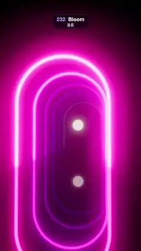

# 232 · Bloom · 블룸



**EN** Seven neon arches from magenta to cyan glow over a black mirror floor as a pulse of brightness runs down the corridor; brighter arches bloom wider.  
**KO** 자홍에서 청록으로 이어지는 네온 아치 일곱 개가 검은 거울 바닥 위에서 빛나고, 밝기 펄스가 복도를 따라 흐르며 밝은 아치일수록 번짐이 넓다.

[Video (mp4)](https://sueun-dev.github.io/motion-effects/videos/232-bloom.mp4) · [Code](../effects/232-bloom.js) · Rendering & stylization · 렌더링·스타일화

## Prompt (English)

```text
Create a "Bloom" motion effect: neon arches rendered in high dynamic range glow with a physically based bloom whose halo grows with each arch's brightness.

Look
- Seven arches in a row down a corridor, 2.7 apart starting at z = −3.6: each is two legs 2.2 tall, 3.2 apart, joined by a half circle of radius 1.6, swept as a tube of radius 0.055.
- Arch colours: HSL hue from 0.94 (magenta) through violet and blue to 0.50 (cyan), saturation 1, lightness 0.5, multiplied by the arch's emissive level (unlit MeshBasicMaterial, values well above 1).
- A glowing orb of radius 0.32 floats in the corridor at the fourth arch, colour (1, 0.86, 0.7) × (0.6 + 0.9 × the fourth arch's level), with a warm point light that follows it.
- The floor is a planar mirror (a Reflector at half resolution) tinted by (0.32, 0.3, 0.36) as a plain multiply, so the reflections keep their HDR hues. Background #05040A with fog from 8 to 26.
- Camera: 48° field of view, a little off to the right and low, looking down the corridor at (−0.25, 1.6, −9).

Motion (0–5 s), a = 2π · t / 5
- Each arch's level = 0.3 + 5.7 · (0.5 + 0.5·cos(a − 0.9k))^4 for arch k = 0..6: a pulse of brightness from 0.3× to 6× that runs from the front arch to the back once per loop.
- The orb bobs 0.12·sin(a) and brightens with the pulse.
- The camera drifts: position (1.25 + 0.3·sin a, 1.05 + 0.08·sin 2a, 5.6 + 0.4·cos a).
- What to see: dim arches have a thin glow; as the pulse reaches an arch its halo spreads wide and floods the mirror, then shrinks again.

Technique
- three.js EffectComposer: RenderPass into a half-float target (linear HDR) → UnrealBloomPass with strength 0.6, radius 0.65 and threshold 0 → OutputPass (ACES Filmic tone mapping and sRGB).
- Threshold 0 is the physically based choice: every pixel scatters a small share of its light through the blurred mip chain, so the glow grows smoothly with intensity. With a hard threshold of 1.0 a whole arch would pop into bloom the frame its brightness crossed 1.
- Patch the Reflector's fragment shader to multiply by its colour instead of the overlay blend, which bends HDR hues.

Output and rules
- One self-contained HTML file with no external assets (three.js from a CDN is fine if you use it), drawing on a 1080 × 1920 canvas (9:16) scaled to fit the window.
- Write a function renderFrame(t) that draws the frame for time t in seconds, and preview it with requestAnimationFrame. Everything must be a pure function of t and fixed seeds: no Math.random(), Date or state carried between frames, so frame i = renderFrame(i / 30) can be exported to a 30 fps video.
- Loop seamlessly every 5 seconds: renderFrame(5) must look exactly like renderFrame(0).
- No flicker of any kind: no noise or grain that changes from frame to frame, no strobing or blinking, no z-fighting, no shimmering 1 px lines. Any grain or texture stays fixed to the screen or to the object.
- Keep the top 280 px free of important content (a title label goes there) and fill the whole frame with a designed background.
```

## 프롬프트 (한국어)

```text
"블룸" 모션 효과를 만들어 줘: HDR로 렌더한 네온 아치들이 물리 기반 블룸으로 빛나고, 아치마다 밝기에 따라 빛번짐이 커진다.

모양
- 복도를 따라 z = −3.6부터 2.7 간격으로 놓인 아치 일곱 개: 높이 2.2의 다리 두 개(사이 3.2)를 반지름 1.6 반원으로 잇고, 반지름 0.055 튜브로 만든다.
- 아치 색: HSL 색상 0.94(자홍)에서 보라·파랑을 거쳐 0.50(청록)까지, 채도 1, 명도 0.5, 여기에 아치의 발광 세기를 곱한다(조명 없는 MeshBasicMaterial, 1을 훨씬 넘는 값).
- 네 번째 아치 근처 복도에 반지름 0.32의 빛나는 구가 떠 있다. 색 (1, 0.86, 0.7) × (0.6 + 0.9 × 네 번째 아치 세기), 따라다니는 따뜻한 점광.
- 바닥은 평면 거울(절반 해상도 Reflector)이고 (0.32, 0.3, 0.36)을 단순 곱으로 입혀 반사가 HDR 색상을 잃지 않게 한다. 배경 #05040A, 안개 8–26.
- 카메라: 시야각 48°, 오른쪽으로 조금 비켜 낮게 서서 복도 안쪽 (−0.25, 1.6, −9)을 본다.

움직임 (0–5초), a = 2π · t / 5
- 아치 k = 0..6의 세기 = 0.3 + 5.7 · (0.5 + 0.5·cos(a − 0.9k))^4: 0.3배에서 6배까지 오르는 밝기 펄스가 루프마다 한 번 앞 아치에서 뒤 아치로 흐른다.
- 구는 0.12·sin(a)로 떠오르내리며 펄스에 맞춰 밝아진다.
- 카메라는 천천히 흔들린다: 위치 (1.25 + 0.3·sin a, 1.05 + 0.08·sin 2a, 5.6 + 0.4·cos a).
- 보이는 것: 어두운 아치는 얇게만 빛나다가, 펄스가 닿으면 빛번짐이 넓게 퍼져 거울 바닥까지 물들이고 다시 줄어든다.

기법
- three.js EffectComposer: half-float 타깃(선형 HDR)으로 RenderPass → UnrealBloomPass(강도 0.6, 반경 0.65, 문턱값 0) → OutputPass(ACES Filmic 톤 매핑과 sRGB).
- 문턱값 0이 물리 기반 선택이다: 모든 픽셀이 빛의 일부를 흐린 밉 체인으로 흩뿌리므로 번짐이 세기에 따라 매끄럽게 커진다. 문턱값을 1.0으로 딱 자르면 밝기가 1을 넘는 프레임에 아치 하나 전체가 갑자기 번쩍 번진다.
- Reflector의 프래그먼트 셰이더를 고쳐 overlay 블렌드 대신 색을 곱하게 한다(overlay는 HDR 색상을 비튼다).

출력과 규칙
- 외부 파일 없는 HTML 파일 하나(three.js를 쓴다면 CDN은 괜찮다). 1080 × 1920(9:16) 캔버스에 그리고 창 크기에 맞춰 보이게 한다.
- 시간 t(초)의 프레임을 그리는 renderFrame(t) 함수를 만들고, 미리보기는 requestAnimationFrame으로 돌린다. 모든 것은 t와 고정 시드만으로 정해진다: Math.random(), Date, 프레임 사이에 쌓이는 상태 금지. 그래야 i번째 프레임 = renderFrame(i / 30)으로 30fps 영상을 뽑을 수 있다.
- 5초마다 끊김 없이 반복: renderFrame(5)는 renderFrame(0)과 똑같아 보여야 한다.
- 어떤 깜빡임도 금지: 프레임마다 바뀌는 노이즈·그레인, 번쩍임·깜빡임, z-fighting, 반짝이며 떨리는 1px 선 모두 금지. 그레인·질감은 화면이나 물체에 고정한다.
- 위쪽 280px에는 중요한 내용을 두지 않고(제목 라벨 자리), 화면 전체를 디자인된 배경으로 채운다.
```
