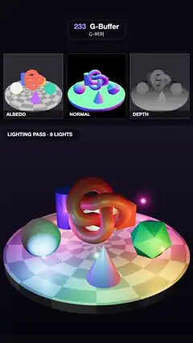

# 233 · G-Buffer · G-버퍼



**EN** A turntable of shapes is split into albedo, normal and depth buffers in three panels, and a deferred pass lights it below with eight orbiting coloured lights.  
**KO** 턴테이블 위 도형들을 알베도·노멀·깊이 버퍼 세 패널로 나눠 보여 주고, 아래에서는 디퍼드 패스가 그 버퍼만으로 도는 색 조명 여덟 개를 비춘다.

[Video (mp4)](https://sueun-dev.github.io/motion-effects/videos/233-g-buffer.mp4) · [Code](../effects/233-g-buffer.js) · Rendering & stylization · 렌더링·스타일화

## Prompt (English)

```text
Create a "G-Buffer" motion effect: deferred rendering laid open. The scene is drawn once into several buffers at the same time, the buffers are shown, and a separate full-screen pass lights the image from those buffers alone.

Look
- Layout: three panels of 333 × 364 px in a row at y = 300 (20 px gaps) labelled ALBEDO, NORMAL and DEPTH; below them the lit result, 1080 × 1180 px at y = 700, labelled "LIGHTING PASS · 8 LIGHTS". Background #0A0A10, thin light frames round the panels.
- The scene (camera 36°, at (0, 5.6, 9.6), looking at (0, 0.55, 0)): a turntable disc of radius 3.1 and thickness 0.3 with an antialiased polar checker (rings and 16 spokes) in (0.62, 0.6, 0.58) and (0.34, 0.33, 0.33); on it a coral torus knot #FF7A59 (radius 0.62, tube 0.22) raised in the middle, a white sphere #F4F1EA (r 0.62), a flat-shaded teal icosahedron #2EC4B6 (r 0.7), a yellow box #FFC93C (0.85), a blue cylinder #5B7CFA (r 0.4, height 1.4) and a violet cone #C77DFF (r 0.5, height 1.1).
- ALBEDO shows the flat surface colours; NORMAL shows view-space normals as rgb = n × 0.5 + 0.5 on black; DEPTH shows view distance as a ramp from white (near) to black (far).
- The lit view: almost no ambient (albedo × (0.025 + 0.02·N.y)), a dim key light (0.09 × N·L), and eight point lights #FF4D6D, #FFB627, #3DDC97, #4D9DFF, #B15CFF, #FF7B3D, #2EE6E6, #FF5CC8 that paint coloured pools on the table and objects; each light also shows as a small white-hot dot with a coloured glow, hidden when an object is in front of it. ACES Filmic.

Motion (0–5 s), a = 2π · t / 5
- The turntable swings: rotation 0.45·sin(a) rad.
- Light k (k = 0..7) orbits at angle ±a + k·2π/8 (even lights one way, odd lights the other), radius 2.1 + 0.6·sin(2a + k), height 0.45 + 0.3·(k mod 3) + 0.2·sin(a + k).

Technique
- three.js. Geometry pass: one WebGLRenderTarget with count = 3 (multiple render targets, half float) at twice the size of the lit view (2160 × 2360); every object uses one GLSL3 ShaderMaterial that writes layout(location = 0) albedo, (1) view-space normal, (2) view-space position (w = 1 marks geometry).
- Lighting pass: a full-screen quad in the lit view's viewport reads the three textures with texelFetch; for each output pixel it shades its 2 × 2 G-buffer samples and averages them (so edges are antialiased). Each light: attenuation (1 − (d/3.4)⁴)² / (0.3 + d²), Lambert plus 0.4 × Blinn-Phong specular (power 60), gain 3.2. Light positions are moved into view space on the CPU each frame.
- Panels: the same buffers drawn into small viewports with a 6 × 6 box filter so they stay smooth.

Output and rules
- One self-contained HTML file with no external assets (three.js from a CDN is fine if you use it), drawing on a 1080 × 1920 canvas (9:16) scaled to fit the window.
- Write a function renderFrame(t) that draws the frame for time t in seconds, and preview it with requestAnimationFrame. Everything must be a pure function of t and fixed seeds: no Math.random(), Date or state carried between frames, so frame i = renderFrame(i / 30) can be exported to a 30 fps video.
- Loop seamlessly every 5 seconds: renderFrame(5) must look exactly like renderFrame(0).
- No flicker of any kind: no noise or grain that changes from frame to frame, no strobing or blinking, no z-fighting, no shimmering 1 px lines. Any grain or texture stays fixed to the screen or to the object.
- Keep the top 280 px free of important content (a title label goes there) and fill the whole frame with a designed background.
```

## 프롬프트 (한국어)

```text
"G-버퍼" 모션 효과를 만들어 줘: 디퍼드 렌더링을 펼쳐 보이기. 장면을 한 번에 여러 버퍼로 그리고, 그 버퍼들을 보여 주고, 별도의 전체 화면 패스가 그 버퍼만으로 이미지를 비춘다.

모양
- 배치: y = 300에 333 × 364 px 패널 세 개(간격 20 px), 이름 ALBEDO, NORMAL, DEPTH. 그 아래 y = 700에 1080 × 1180 px 조명 결과, 이름 "LIGHTING PASS · 8 LIGHTS". 배경 #0A0A10, 패널 둘레에 얇고 밝은 테.
- 장면(카메라 36°, 위치 (0, 5.6, 9.6), (0, 0.55, 0)을 본다): 반지름 3.1, 두께 0.3 턴테이블에 안티에일리어싱된 극좌표 체크무늬(고리와 바큇살 16개), 색 (0.62, 0.6, 0.58)과 (0.34, 0.33, 0.33). 그 위 가운데에 띄운 산호색 토러스 매듭 #FF7A59(반지름 0.62, 굵기 0.22), 흰 구 #F4F1EA(r 0.62), 면이 각진 청록 정이십면체 #2EC4B6(r 0.7), 노란 상자 #FFC93C(0.85), 파란 원기둥 #5B7CFA(r 0.4, 높이 1.4), 보라 원뿔 #C77DFF(r 0.5, 높이 1.1).
- ALBEDO는 평평한 표면 색, NORMAL은 검은 바탕에 뷰 공간 노멀을 rgb = n × 0.5 + 0.5로, DEPTH는 거리를 흰색(가까움)에서 검정(멂)까지의 램프로 보여 준다.
- 조명 결과: 주변광은 거의 없고(알베도 × (0.025 + 0.02·N.y)), 약한 키 라이트(0.09 × N·L), 그리고 #FF4D6D, #FFB627, #3DDC97, #4D9DFF, #B15CFF, #FF7B3D, #2EE6E6, #FF5CC8 점광 여덟 개가 테이블과 물체에 색 웅덩이를 칠한다. 각 조명은 하얗게 달아오른 작은 점과 색 빛무리로도 보이고, 물체가 앞을 가리면 숨는다. ACES Filmic.

움직임 (0–5초), a = 2π · t / 5
- 턴테이블이 흔들린다: 회전 0.45·sin(a) rad.
- 조명 k(k = 0..7)는 각도 ±a + k·2π/8(짝수는 한쪽, 홀수는 반대쪽)로 돈다. 반지름 2.1 + 0.6·sin(2a + k), 높이 0.45 + 0.3·(k mod 3) + 0.2·sin(a + k).

기법
- three.js. 지오메트리 패스: count = 3인 WebGLRenderTarget 하나(다중 렌더 타깃, half float)를 조명 결과의 두 배 크기(2160 × 2360)로. 모든 물체가 GLSL3 ShaderMaterial 하나를 써서 layout(location = 0) 알베도, (1) 뷰 공간 노멀, (2) 뷰 공간 위치(w = 1은 물체가 있다는 표시)를 쓴다.
- 조명 패스: 조명 결과 뷰포트의 전체 화면 사각형이 texelFetch로 텍스처 세 장을 읽는다. 출력 픽셀마다 G-버퍼 2 × 2 샘플을 각각 셰이딩해 평균한다(가장자리 안티에일리어싱). 조명마다 감쇠 (1 − (d/3.4)⁴)² / (0.3 + d²), 램버트 + 0.4 × 블린-퐁 반사광(지수 60), 세기 3.2. 조명 위치는 매 프레임 CPU에서 뷰 공간으로 옮긴다.
- 패널: 같은 버퍼를 작은 뷰포트에 6 × 6 박스 필터로 그려 매끄럽게 한다.

출력과 규칙
- 외부 파일 없는 HTML 파일 하나(three.js를 쓴다면 CDN은 괜찮다). 1080 × 1920(9:16) 캔버스에 그리고 창 크기에 맞춰 보이게 한다.
- 시간 t(초)의 프레임을 그리는 renderFrame(t) 함수를 만들고, 미리보기는 requestAnimationFrame으로 돌린다. 모든 것은 t와 고정 시드만으로 정해진다: Math.random(), Date, 프레임 사이에 쌓이는 상태 금지. 그래야 i번째 프레임 = renderFrame(i / 30)으로 30fps 영상을 뽑을 수 있다.
- 5초마다 끊김 없이 반복: renderFrame(5)는 renderFrame(0)과 똑같아 보여야 한다.
- 어떤 깜빡임도 금지: 프레임마다 바뀌는 노이즈·그레인, 번쩍임·깜빡임, z-fighting, 반짝이며 떨리는 1px 선 모두 금지. 그레인·질감은 화면이나 물체에 고정한다.
- 위쪽 280px에는 중요한 내용을 두지 않고(제목 라벨 자리), 화면 전체를 디자인된 배경으로 채운다.
```
