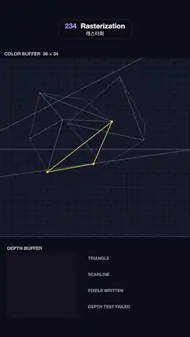

# 234 · Rasterization · 래스터화



**EN** A cube and an octahedron that cut into each other fill a 36 × 34 pixel grid triangle by triangle, scanline by scanline, with a live depth test.  
**KO** 서로 파고든 정육면체와 정팔면체가 36 × 34 픽셀 격자를 삼각형 하나씩, 스캔라인 한 줄씩 채우고, 깊이 테스트가 실시간으로 보인다.

[Video (mp4)](https://sueun-dev.github.io/motion-effects/videos/234-rasterization.mp4) · [Code](../effects/234-rasterization.js) · Rendering & stylization · 렌더링·스타일화

## Prompt (English)

```text
Create a "Rasterization" motion effect: a small 3D scene is turned into pixels the way a GPU does it, triangle by triangle and scanline by scanline, with a depth buffer deciding which pixel wins.

Look
- Background #0B0E18. The colour buffer: 36 columns × 34 rows of 30 px cells starting at y = 330 (labelled "COLOR BUFFER 36 × 34"); empty cells #141A2A with a 3 px dot at each cell centre (the sample point).
- The scene, projected with x = 18 + 31·x / −z and y = 13.5 − 31·y / −z (in cells): a coral cube (255, 122, 89), scale 0.82, rotated 0.55 rad about x and 0.7 about y, centred at (−0.85, −0.05, −5.2); a teal octahedron (46, 196, 182), scale 1.4, rotated 0.3 / 0.5, centred at (0.5, 0.15, −5.0), so the two cut into each other; a blue floor (91, 108, 255) at y = −1.25 from z = −1.9 to −10; a violet back wall (120, 92, 200) at z = −10 up to y = 7. Back faces are culled, leaving 13 triangles. Each triangle is flat-shaded: colour × (0.32 + 0.68·max(0, N·L)), L = normalize(−0.45, 0.75, 0.5).
- All triangles are drawn as thin vector outlines (white at 38 %), clipped to the grid; the triangle being filled is outlined in yellow #FFD84D (3.5 px) with dots on its vertices; its current scanline is a soft yellow band across the row plus a 2 px yellow line over the triangle's span.
- Below the grid: "DEPTH BUFFER", the same 36 × 34 buffer in 11 px cells at (40, 1440), near = light grey, far = dark; and counters at x = 500: TRIANGLE n / 13, SCANLINE y = …, PIXELS WRITTEN, DEPTH TEST FAILED (in red), labels 24 px, values 40 px monospace.

Motion (0–5 s)
- 0–0.2 s: the empty grid with the vector triangles.
- 0.2–3.7 s: triangles are filled in order cube, octahedron, floor, wall. Every covered row gets an equal slice of time (constant scanline speed) and its pixels appear left to right. A pixel is covered when its centre is inside all three edge functions; its depth is interpolated with barycentric weights and tested against the depth buffer: if nearer it writes colour and depth (and pops in 1.5× brighter for 0.12 s), otherwise it is rejected and a red frame rgba(255, 70, 90) flashes on the cell and fades over 0.35 s. The floor and wall come last, so they fill in only around the objects, with rows of red rejections behind them; the cube and octahedron resolve their intersection pixel by pixel.
- 3.7–4.1 s: hold the finished image.
- 4.1–5 s: pixels, depth view and counter values fade linearly back to the empty grid, which is frame 0.

Technique
- Canvas 2D, no WebGL: project the meshes once, cull back faces by screen-space winding, then precompute the ordered list of pixel writes with their depth-test result (which depends only on the writes before them). Each frame replays the writes up to time t into fresh colour and depth buffers and draws them.

Output and rules
- One self-contained HTML file with no external assets (three.js from a CDN is fine if you use it), drawing on a 1080 × 1920 canvas (9:16) scaled to fit the window.
- Write a function renderFrame(t) that draws the frame for time t in seconds, and preview it with requestAnimationFrame. Everything must be a pure function of t and fixed seeds: no Math.random(), Date or state carried between frames, so frame i = renderFrame(i / 30) can be exported to a 30 fps video.
- Loop seamlessly every 5 seconds: renderFrame(5) must look exactly like renderFrame(0).
- No flicker of any kind: no noise or grain that changes from frame to frame, no strobing or blinking, no z-fighting, no shimmering 1 px lines. Any grain or texture stays fixed to the screen or to the object.
- Keep the top 280 px free of important content (a title label goes there) and fill the whole frame with a designed background.
```

## 프롬프트 (한국어)

```text
"래스터화" 모션 효과를 만들어 줘: 작은 3D 장면이 GPU처럼 삼각형 하나씩, 스캔라인 한 줄씩 픽셀이 되고, 깊이 버퍼가 어느 픽셀이 이기는지 정한다.

모양
- 배경 #0B0E18. 컬러 버퍼: y = 330부터 30 px 칸 36열 × 34행("COLOR BUFFER 36 × 34" 표시). 빈 칸은 #141A2A이고 칸 중심마다 3 px 점(샘플 위치).
- 장면, x = 18 + 31·x / −z, y = 13.5 − 31·y / −z(칸 단위)로 투영: 산호색 정육면체 (255, 122, 89), 크기 0.82, x축 0.55 rad·y축 0.7 회전, 중심 (−0.85, −0.05, −5.2); 청록 정팔면체 (46, 196, 182), 크기 1.4, 회전 0.3 / 0.5, 중심 (0.5, 0.15, −5.0) → 둘이 서로 파고든다; y = −1.25에서 z = −1.9부터 −10까지의 파란 바닥 (91, 108, 255); z = −10에서 y = 7까지 솟은 보라 뒷벽 (120, 92, 200). 뒷면은 컬링해 삼각형 13개가 남는다. 삼각형마다 단색 셰이딩: 색 × (0.32 + 0.68·max(0, N·L)), L = normalize(−0.45, 0.75, 0.5).
- 모든 삼각형을 얇은 벡터 윤곽(흰색 38 %)으로 격자 안에만 그린다. 채우는 중인 삼각형은 노란 #FFD84D 윤곽(3.5 px)과 꼭짓점 점, 현재 스캔라인은 그 행을 가로지르는 부드러운 노란 띠와 삼각형 구간 위 2 px 노란 선.
- 격자 아래: "DEPTH BUFFER", (40, 1440)에 같은 36 × 34 버퍼를 11 px 칸으로(가까움 = 밝은 회색, 멂 = 어두움). x = 500에 카운터: TRIANGLE n / 13, SCANLINE y = …, PIXELS WRITTEN, DEPTH TEST FAILED(빨강). 이름 24 px, 값 40 px 고정폭.

움직임 (0–5초)
- 0–0.2초: 빈 격자와 벡터 삼각형.
- 0.2–3.7초: 정육면체, 정팔면체, 바닥, 벽 순서로 채운다. 덮이는 행마다 같은 시간을 받고(일정한 스캔라인 속도) 행 안의 픽셀은 왼쪽에서 오른쪽으로 나타난다. 픽셀 중심이 세 변 함수 모두의 안쪽이면 덮인 것이고, 깊이를 무게중심 좌표로 보간해 깊이 버퍼와 비교한다. 더 가까우면 색과 깊이를 쓰고(0.12초 동안 1.5배 밝게 튀어나옴), 아니면 버려지고 그 칸에 빨간 테두리 rgba(255, 70, 90)가 번쩍였다 0.35초에 걸쳐 사라진다. 바닥과 벽은 마지막이라 물체 둘레만 채워지고 뒤에 빨간 거절이 줄지어 나타난다. 정육면체와 정팔면체는 교차 부분을 픽셀 단위로 가른다.
- 3.7–4.1초: 완성된 그림 유지.
- 4.1–5초: 픽셀, 깊이 버퍼, 카운터 값이 직선적으로 흐려져 빈 격자(0번째 프레임)로 돌아간다.

기법
- WebGL 없이 Canvas 2D: 메시를 한 번 투영하고 화면에서의 감김 방향으로 뒷면을 컬링한 뒤, 깊이 테스트 결과를 포함한 픽셀 쓰기 목록을 순서대로 미리 계산한다(결과는 앞선 쓰기에만 달려 있다). 매 프레임 시각 t까지의 쓰기를 새 컬러·깊이 버퍼에 다시 적용해 그린다.

출력과 규칙
- 외부 파일 없는 HTML 파일 하나(three.js를 쓴다면 CDN은 괜찮다). 1080 × 1920(9:16) 캔버스에 그리고 창 크기에 맞춰 보이게 한다.
- 시간 t(초)의 프레임을 그리는 renderFrame(t) 함수를 만들고, 미리보기는 requestAnimationFrame으로 돌린다. 모든 것은 t와 고정 시드만으로 정해진다: Math.random(), Date, 프레임 사이에 쌓이는 상태 금지. 그래야 i번째 프레임 = renderFrame(i / 30)으로 30fps 영상을 뽑을 수 있다.
- 5초마다 끊김 없이 반복: renderFrame(5)는 renderFrame(0)과 똑같아 보여야 한다.
- 어떤 깜빡임도 금지: 프레임마다 바뀌는 노이즈·그레인, 번쩍임·깜빡임, z-fighting, 반짝이며 떨리는 1px 선 모두 금지. 그레인·질감은 화면이나 물체에 고정한다.
- 위쪽 280px에는 중요한 내용을 두지 않고(제목 라벨 자리), 화면 전체를 디자인된 배경으로 채운다.
```
