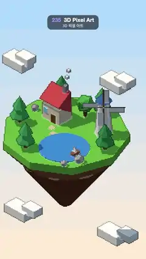

# 235 · 3D Pixel Art · 3D 픽셀 아트



**EN** A floating island with a cottage, windmill, pond and sailing boat is rendered at 180 × 320 with outlines, and the view glides without any pixel crawl.  
**KO** 오두막·풍차·연못·돛단배가 있는 떠 있는 섬을 180 × 320으로 렌더해 외곽선을 입히고, 시점이 미끄러져도 픽셀이 한 칸도 꿈틀대지 않는다.

[Video (mp4)](https://sueun-dev.github.io/motion-effects/videos/235-pixel-art-3d.mp4) · [Code](../effects/235-pixel-art-3d.js) · Rendering & stylization · 렌더링·스타일화

## Prompt (English)

```text
Create a "3D Pixel Art" motion effect: a 3D diorama rendered at very low resolution and blown up with hard pixels and outlines, with a camera that glides smoothly while every pixel stays locked to the world.

Look
- Orthographic camera looking from direction (1, 0.95, 1) (isometric-like), 0.075 world units per texel. Render target 182 × 322 (the 180 × 320 frame plus a 1-texel margin), nearest filtering; each texel becomes 6 × 6 screen pixels.
- The diorama (flat-shaded Lambert): a 9-sided grass slab of radius 6 #6DBE45 over a dirt layer #9B6B43 tapering into a rocky point #7A5235 (a floating island); a pond #3E8EDE (radius 2.4); a cottage (cream walls #F2E3C6 2.2 × 1.6 × 1.8, a red triangular roof #D9534F, a grey chimney, door and window); a windmill (white tower #F5F5F0, blue cap #3F6FB5, four brown-and-white sails); five two-tier pines #2F8F4E / #3FA35A, one round tree, three grey rocks, stepping stones; a little boat (brown hull, white sail); three smoke puffs; four box clouds placed by screen position around the island.
- Lights: hemisphere #CFE8FF / #6B5A4A at 1.4, sun #FFF0D6 at 2.6 from (−6, 12, 4) with hard 1024 shadows (crisp pixel shadow edges).
- The upscale pass adds the pixel-art look: a pixel whose 4-neighbour is more than 0.006 deeper is a silhouette pixel and is darkened to 38 %; a convex crease (neighbour normals differ by more than 0.25, at about the same depth) is brightened ×1.35 + 0.04. Where nothing was drawn, the sky is drawn in screen space: nine bands from warm (0.99, 0.84, 0.66) at the bottom to blue (0.42, 0.70, 0.98) at the top, in 6 px rows.

Motion (0–5 s), a = 2π · t / 5
- The view target glides on a small loop in the camera plane: 0.7·cos(a) along screen-right and 1.1·sin(a) along screen-up.
- Pixel snapping: the camera position is snapped to whole texels in its own plane before rendering, and the leftover fraction × 6 (rounded to whole screen pixels) is added as an offset when upscaling. The image moves smoothly but the world never re-rasterizes under the camera, so nothing crawls or shimmers.
- Windmill sails: one turn per loop in 32 discrete steps, like sprite frames.
- The boat circles the pond (radius 1.5) once per loop; its position snaps to the texel grid and its heading to 8 directions.
- Smoke: three puffs rise 2.2 above the chimney twice per loop, staggered by a third, snapped to texels, their size changing in quarter steps.

Technique
- three.js: render the scene to the low-resolution colour target with a DepthTexture, render it again with a flat MeshNormalMaterial override for normals, then draw a full-screen pass that texelFetches both, applies the outlines and the screen-space sky and outputs sRGB.

Output and rules
- One self-contained HTML file with no external assets (three.js from a CDN is fine if you use it), drawing on a 1080 × 1920 canvas (9:16) scaled to fit the window.
- Write a function renderFrame(t) that draws the frame for time t in seconds, and preview it with requestAnimationFrame. Everything must be a pure function of t and fixed seeds: no Math.random(), Date or state carried between frames, so frame i = renderFrame(i / 30) can be exported to a 30 fps video.
- Loop seamlessly every 5 seconds: renderFrame(5) must look exactly like renderFrame(0).
- No flicker of any kind: no noise or grain that changes from frame to frame, no strobing or blinking, no z-fighting, no shimmering 1 px lines. Any grain or texture stays fixed to the screen or to the object.
- Keep the top 280 px free of important content (a title label goes there) and fill the whole frame with a designed background.
```

## 프롬프트 (한국어)

```text
"3D 픽셀 아트" 모션 효과를 만들어 줘: 3D 디오라마를 아주 낮은 해상도로 렌더해 딱딱한 픽셀과 외곽선으로 키우고, 카메라는 매끄럽게 미끄러지지만 모든 픽셀이 세계에 고정된다.

모양
- (1, 0.95, 1) 방향에서 보는 직교 카메라(아이소메트릭 비슷하게), 텍셀당 월드 0.075. 렌더 타깃 182 × 322(180 × 320 화면에 사방 1텍셀 여유), 최근접 필터. 텍셀 하나가 화면 6 × 6 픽셀이 된다.
- 디오라마(면이 각진 램버트): 반지름 6의 9각 잔디판 #6DBE45, 그 아래 흙층 #9B6B43이 뾰족한 바위 끝 #7A5235로 좁아진다(떠 있는 섬). 연못 #3E8EDE(반지름 2.4). 오두막(크림색 벽 #F2E3C6 2.2 × 1.6 × 1.8, 빨간 삼각 지붕 #D9534F, 회색 굴뚝, 문과 창). 풍차(흰 탑 #F5F5F0, 파란 지붕 #3F6FB5, 갈색과 흰색 날개 네 장). 두 단 소나무 다섯 그루 #2F8F4E / #3FA35A, 둥근 나무 하나, 회색 바위 셋, 디딤돌. 작은 배(갈색 선체, 흰 돛). 연기 세 덩이. 섬 둘레에 화면 위치로 배치한 상자 구름 넷.
- 조명: 반구광 #CFE8FF / #6B5A4A 1.4, (−6, 12, 4)에서 비추는 해 #FFF0D6 2.6, 1024 하드 섀도(그림자 가장자리가 픽셀로 또렷하다).
- 확대 패스가 픽셀 아트 느낌을 만든다: 상하좌우 이웃 중 하나가 0.006보다 깊으면 실루엣 픽셀로 보고 38 %로 어둡게, 볼록한 모서리(깊이는 비슷하고 이웃 노멀 차이가 0.25 이상)는 ×1.35 + 0.04로 밝게. 아무것도 그려지지 않은 곳은 화면 공간에 하늘을 그린다: 아래 따뜻한 (0.99, 0.84, 0.66)에서 위 파랑 (0.42, 0.70, 0.98)까지 6 px 행 단위의 아홉 띠.

움직임 (0–5초), a = 2π · t / 5
- 시점 목표가 카메라 평면에서 작은 고리를 그린다: 화면 오른쪽으로 0.7·cos(a), 화면 위로 1.1·sin(a).
- 픽셀 스냅: 렌더 전에 카메라 위치를 자기 평면에서 텍셀 단위로 맞추고, 남은 소수 부분 × 6(정수 화면 픽셀로 반올림)을 확대할 때 오프셋으로 더한다. 그림은 매끄럽게 움직이지만 카메라 아래에서 세계가 다시 래스터화되지 않아 아무것도 꿈틀대거나 반짝이지 않는다.
- 풍차 날개: 루프마다 한 바퀴를 스프라이트 프레임처럼 32단계로.
- 배는 연못(반지름 1.5)을 루프마다 한 바퀴 돈다. 위치는 텍셀 격자에, 방향은 8방향으로 스냅.
- 연기: 세 덩이가 1/3씩 엇갈려 루프마다 두 번 굴뚝 위 2.2까지 오른다. 텍셀에 스냅하고 크기는 1/4 단계로 바뀐다.

기법
- three.js: 장면을 DepthTexture가 붙은 저해상도 컬러 타깃에 렌더하고, 각진 MeshNormalMaterial로 덮어 한 번 더 렌더해 노멀을 얻은 뒤, 둘을 texelFetch하는 전체 화면 패스에서 외곽선과 화면 공간 하늘을 입혀 sRGB로 출력한다.

출력과 규칙
- 외부 파일 없는 HTML 파일 하나(three.js를 쓴다면 CDN은 괜찮다). 1080 × 1920(9:16) 캔버스에 그리고 창 크기에 맞춰 보이게 한다.
- 시간 t(초)의 프레임을 그리는 renderFrame(t) 함수를 만들고, 미리보기는 requestAnimationFrame으로 돌린다. 모든 것은 t와 고정 시드만으로 정해진다: Math.random(), Date, 프레임 사이에 쌓이는 상태 금지. 그래야 i번째 프레임 = renderFrame(i / 30)으로 30fps 영상을 뽑을 수 있다.
- 5초마다 끊김 없이 반복: renderFrame(5)는 renderFrame(0)과 똑같아 보여야 한다.
- 어떤 깜빡임도 금지: 프레임마다 바뀌는 노이즈·그레인, 번쩍임·깜빡임, z-fighting, 반짝이며 떨리는 1px 선 모두 금지. 그레인·질감은 화면이나 물체에 고정한다.
- 위쪽 280px에는 중요한 내용을 두지 않고(제목 라벨 자리), 화면 전체를 디자인된 배경으로 채운다.
```
