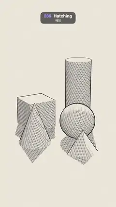

# 236 · Hatching · 해칭



**EN** Pencil hatching draws a cube, sphere, cylinder and cones on warm paper; as a lamp swings behind them, strokes thicken and cross-hatch into the shadows.  
**KO** 따뜻한 종이 위에 정육면체·구·원기둥·원뿔을 연필 해칭으로 그리고, 뒤에서 램프가 흔들리면 선이 굵어지며 그림자 속에서 교차 해칭이 된다.

[Video (mp4)](https://sueun-dev.github.io/motion-effects/videos/236-hatching.mp4) · [Code](../effects/236-hatching.js) · Rendering & stylization · 렌더링·스타일화

## Prompt (English)

```text
Create a "Hatching" motion effect: drawing-class solids rendered as a pencil drawing, where tone is made only of stroke density and width, and the strokes stay fixed to the objects.

Look
- On a ground plane: a cylinder (r 0.46, height 2.3) at (0.75, 1.15, −1.5), a cube (1) at (−0.8, 0.5, −0.9) turned 0.55 rad, a sphere (r 0.58) at (0.65, 0.58, 0.25), a cone (r 0.52, height 1.35) at (−0.75, 0.675, 0.75) and a four-sided pyramid (r 0.5, height 0.75) at (0.75, 0.375, 1.55). Camera 30° at (0, 5, 12.4) looking at (0, 1.2, 0.3).
- Lighting: ambient 0.22 and one directional lamp at 2.9 with soft 2048 shadows; the lit tone is tone = luminance^(1/2.2), and k = 1 − tone is the darkness.
- Strokes are the cuts of three families of parallel planes through the surface, in world space: directions (1, 0.55, 0.25), (−0.35, 0.6, 1) and (0.3, −1, 0.55), 34, 34 and 40 lines per unit. Each family switches on at a darker tone and its strokes widen with darkness: half-width in pixels 3.6·w with w = clamp((k − 0.22)·0.9, 0, 0.5), clamp((k − 0.45)·0.9, 0, 0.45), clamp((k − 0.66)·1.0, 0, 0.42). Light areas get single hatching, mid tones cross-hatching, the darkest a third set.
- Hand-drawn touches, all fixed in space: a slight wobble 0.18·sin(…·2.7) along each stroke, a pressure 0.7 + 0.3·sin(…·4 + stroke number·2.3) that varies per stroke, and a graphite grain from a fixed 3D hash.
- Colours (linear): paper (0.905, 0.87, 0.79), graphite (0.045, 0.045, 0.06). The ground's hatching fades into blank paper between radius 2.6 and 5 from the centre, so the drawing vignettes into the sheet.
- Outlines: an inverted hull, back faces pushed out 0.016 along smoothed normals, near-black (0.045, 0.04, 0.055).
- Paper: a fixed noise texture with 900 short fibre strokes, multiplied over the whole frame at 35 %.

Motion (0–5 s), a = 2π · t / 5
- Only the lamp moves: it swings left ↔ right behind the still life at azimuth −π/2 + 1.35·sin(a), radius 5, height 4.4. Shadows sweep across the ground and the hatching on every face thickens, crosses and thins as its tone changes.

Technique
- three.js MeshLambertMaterial patched with onBeforeCompile: pass the world position to the fragment shader and replace the final colour with the hatch function of the lit tone.
- Each stroke is antialiased in screen space: the distance to the stroke centre is measured in pixels with fwidth and the edge is smoothed over ±0.7 px, so the lines never shimmer and keep a constant pixel width where a surface is foreshortened.

Output and rules
- One self-contained HTML file with no external assets (three.js from a CDN is fine if you use it), drawing on a 1080 × 1920 canvas (9:16) scaled to fit the window.
- Write a function renderFrame(t) that draws the frame for time t in seconds, and preview it with requestAnimationFrame. Everything must be a pure function of t and fixed seeds: no Math.random(), Date or state carried between frames, so frame i = renderFrame(i / 30) can be exported to a 30 fps video.
- Loop seamlessly every 5 seconds: renderFrame(5) must look exactly like renderFrame(0).
- No flicker of any kind: no noise or grain that changes from frame to frame, no strobing or blinking, no z-fighting, no shimmering 1 px lines. Any grain or texture stays fixed to the screen or to the object.
- Keep the top 280 px free of important content (a title label goes there) and fill the whole frame with a designed background.
```

## 프롬프트 (한국어)

```text
"해칭" 모션 효과를 만들어 줘: 소묘 수업의 기본 입체들을 연필 소묘로 렌더한다. 명암은 선의 밀도와 굵기만으로 만들고, 선은 물체에 고정된다.

모양
- 바닥 위: (0.75, 1.15, −1.5)의 원기둥(r 0.46, 높이 2.3), (−0.8, 0.5, −0.9)의 정육면체(1, 0.55 rad 회전), (0.65, 0.58, 0.25)의 구(r 0.58), (−0.75, 0.675, 0.75)의 원뿔(r 0.52, 높이 1.35), (0.75, 0.375, 1.55)의 사각뿔(r 0.5, 높이 0.75). 카메라 30°, 위치 (0, 5, 12.4), (0, 1.2, 0.3)을 본다.
- 조명: 주변광 0.22와 방향광 램프 하나 2.9, 2048 부드러운 그림자. 밝기 tone = 휘도^(1/2.2), 어둠 k = 1 − tone.
- 선은 표면을 지나는 평행 평면 세 묶음의 단면이고 월드 공간에 있다: 방향 (1, 0.55, 0.25), (−0.35, 0.6, 1), (0.3, −1, 0.55), 단위당 34, 34, 40줄. 묶음마다 더 어두운 톤에서 켜지고 어두울수록 굵어진다: 픽셀 반폭 3.6·w, w = clamp((k − 0.22)·0.9, 0, 0.5), clamp((k − 0.45)·0.9, 0, 0.45), clamp((k − 0.66)·1.0, 0, 0.42). 밝은 곳은 한 방향 해칭, 중간 톤은 교차 해칭, 가장 어두운 곳은 세 번째 묶음까지.
- 손맛, 모두 공간에 고정: 선을 따라 살짝 흔들림 0.18·sin(…·2.7), 선마다 다른 필압 0.7 + 0.3·sin(…·4 + 선 번호·2.3), 고정된 3D 해시로 만든 흑연 알갱이.
- 색(선형): 종이 (0.905, 0.87, 0.79), 흑연 (0.045, 0.045, 0.06). 바닥 해칭은 중심에서 반지름 2.6–5 사이에서 빈 종이로 사라져 그림이 종이 속으로 번진다.
- 외곽선: 반전 헐. 뒷면을 매끄러운 노멀 방향으로 0.016 밀어내고, 거의 검정 (0.045, 0.04, 0.055).
- 종이: 짧은 섬유 900가닥을 넣은 고정 노이즈 텍스처를 화면 전체에 35 %로 곱한다.

움직임 (0–5초), a = 2π · t / 5
- 램프만 움직인다: 정물 뒤에서 방위각 −π/2 + 1.35·sin(a), 반지름 5, 높이 4.4로 좌우로 흔들린다. 그림자가 바닥을 쓸고 지나가며, 각 면의 해칭이 톤 변화에 따라 굵어지고 교차하고 다시 가늘어진다.

기법
- three.js MeshLambertMaterial을 onBeforeCompile로 고친다: 월드 위치를 프래그먼트 셰이더로 넘기고 최종 색을 조명된 톤의 해칭 함수로 바꾼다.
- 선마다 화면 공간에서 안티에일리어싱한다: 선 중심까지의 거리를 fwidth로 픽셀 단위로 재고 가장자리를 ±0.7 px로 부드럽게 해, 선이 반짝이지 않고 비스듬한 면에서도 픽셀 굵기가 일정하다.

출력과 규칙
- 외부 파일 없는 HTML 파일 하나(three.js를 쓴다면 CDN은 괜찮다). 1080 × 1920(9:16) 캔버스에 그리고 창 크기에 맞춰 보이게 한다.
- 시간 t(초)의 프레임을 그리는 renderFrame(t) 함수를 만들고, 미리보기는 requestAnimationFrame으로 돌린다. 모든 것은 t와 고정 시드만으로 정해진다: Math.random(), Date, 프레임 사이에 쌓이는 상태 금지. 그래야 i번째 프레임 = renderFrame(i / 30)으로 30fps 영상을 뽑을 수 있다.
- 5초마다 끊김 없이 반복: renderFrame(5)는 renderFrame(0)과 똑같아 보여야 한다.
- 어떤 깜빡임도 금지: 프레임마다 바뀌는 노이즈·그레인, 번쩍임·깜빡임, z-fighting, 반짝이며 떨리는 1px 선 모두 금지. 그레인·질감은 화면이나 물체에 고정한다.
- 위쪽 280px에는 중요한 내용을 두지 않고(제목 라벨 자리), 화면 전체를 디자인된 배경으로 채운다.
```
