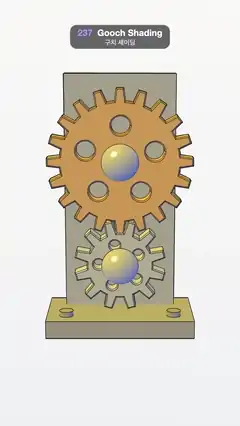

# 237 · Gooch Shading · 구치 셰이딩



**EN** A brass and steel gear train on an upright bracket is shaded from cool blue to warm yellow with black outlines and crease lines, like a technical manual.  
**KO** 세워진 브래킷 위 황동·강철 기어 한 쌍을 차가운 파랑에서 따뜻한 노랑으로 칠하고, 검은 외곽선과 모서리 선을 더해 기술 설명서처럼 그린다.

[Video (mp4)](https://sueun-dev.github.io/motion-effects/videos/237-gooch-shading.mp4) · [Code](../effects/237-gooch-shading.js) · Rendering & stylization · 렌더링·스타일화

## Prompt (English)

```text
Create a "Gooch Shading" motion effect: a mechanical part drawn like a technical illustration, where shading goes from cool to warm instead of dark to light, so shape reads clearly without black shadows.

Look
- The part: an upright bracket plate 2.6 × 5.6 × 0.32 (#AAB6C8) on a foot 3.4 × 0.4 × 1.8 (#8E9AAD) with two bolt heads; two horizontal shafts (r 0.2, #C9CED6) with domed caps (r 0.42, #B6BEC9); a 20-tooth gear (pitch radius 1.5, #E2A84B) above a 12-tooth gear (radius 0.9, #BFC7D2), 2.4 apart so they mesh. Gear teeth: addendum 0.13, dedendum 0.16, 0.36 thick with a 0.03 bevel, a bore and five round lightening holes in each web.
- Gooch shading (light fixed to the view, direction normalize(−0.55, 0.75, 0.45)): cool = (0.10, 0.20, 0.62) + 0.3·kd, warm = (0.68, 0.55, 0.12) + 0.5·kd, colour = mix(cool, warm, 0.5 + 0.5·N·L), plus a white highlight 0.8·(R·V)^36. Faces turned towards the light are warm yellow, faces turned away cool blue, never black.
- Silhouette: an inverted hull pushed out by a constant 3 px on screen, colour (0.07, 0.08, 0.10). Crease lines: every edge sharper than 30° drawn as a 2.4 px line #1C2028; the faces are polygon-offset slightly behind so the lines win.
- Background: a vertical gradient #F3F1EC → #DCDFE4. Camera 30° at (0, 1.4, 18.5) looking at (0, −0.05, 0).

Motion (0–5 s), a = 2π · t / 5
- The big gear turns a / 20 and the small one −a / 12 + π/12: exactly one tooth each per loop, meshing, so the loop is seamless.
- The whole part swings about the vertical axis 0.55·sin(a) and nods 0.12 + 0.06·sin(2a), so faces sweep through warm and cool and the domed caps show the full gradient.

Technique
- three.js ShaderMaterial for the Gooch colour, with the light direction in view space.
- The outline hull is pushed in clip space along the projected normal, scaled by smoothstep(0.05, 0.3, length) so faces seen head-on (normal pointing at the camera) are not pushed, and nudged slightly back in depth, so it never pokes through the front faces.
- Crease lines: EdgesGeometry (30°) turned into LineSegmentsGeometry and drawn with LineMaterial (fat, antialiased lines).

Output and rules
- One self-contained HTML file with no external assets (three.js from a CDN is fine if you use it), drawing on a 1080 × 1920 canvas (9:16) scaled to fit the window.
- Write a function renderFrame(t) that draws the frame for time t in seconds, and preview it with requestAnimationFrame. Everything must be a pure function of t and fixed seeds: no Math.random(), Date or state carried between frames, so frame i = renderFrame(i / 30) can be exported to a 30 fps video.
- Loop seamlessly every 5 seconds: renderFrame(5) must look exactly like renderFrame(0).
- No flicker of any kind: no noise or grain that changes from frame to frame, no strobing or blinking, no z-fighting, no shimmering 1 px lines. Any grain or texture stays fixed to the screen or to the object.
- Keep the top 280 px free of important content (a title label goes there) and fill the whole frame with a designed background.
```

## 프롬프트 (한국어)

```text
"구치 셰이딩" 모션 효과를 만들어 줘: 기계 부품을 기술 일러스트처럼 그린다. 명암을 어둠에서 밝음이 아니라 차가움에서 따뜻함으로 주어, 검은 그림자 없이도 형태가 또렷하다.

모양
- 부품: 받침 3.4 × 0.4 × 1.8(#8E9AAD)과 볼트 머리 두 개 위에 세운 브래킷 판 2.6 × 5.6 × 0.32(#AAB6C8); 가로 축 두 개(r 0.2, #C9CED6)와 둥근 덮개(r 0.42, #B6BEC9); 위에 톱니 20개 기어(피치 반지름 1.5, #E2A84B), 아래에 톱니 12개 기어(반지름 0.9, #BFC7D2), 2.4 떨어져 서로 물린다. 톱니: 이끝 높이 0.13, 이뿌리 깊이 0.16, 두께 0.36, 베벨 0.03, 몸판마다 축 구멍과 둥근 경량화 구멍 다섯 개.
- 구치 셰이딩(시점에 고정된 빛, 방향 normalize(−0.55, 0.75, 0.45)): 차가움 = (0.10, 0.20, 0.62) + 0.3·kd, 따뜻함 = (0.68, 0.55, 0.12) + 0.5·kd, 색 = mix(차가움, 따뜻함, 0.5 + 0.5·N·L), 여기에 흰 하이라이트 0.8·(R·V)^36. 빛을 향한 면은 따뜻한 노랑, 등진 면은 차가운 파랑이고 절대 검지 않다.
- 실루엣: 화면에서 일정하게 3 px 밀어낸 반전 헐, 색 (0.07, 0.08, 0.10). 모서리 선: 30°보다 날카로운 모든 모서리를 2.4 px 선 #1C2028로. 면은 폴리곤 오프셋으로 살짝 뒤로 밀어 선이 이기게 한다.
- 배경: 세로 그라디언트 #F3F1EC → #DCDFE4. 카메라 30°, 위치 (0, 1.4, 18.5), (0, −0.05, 0)을 본다.

움직임 (0–5초), a = 2π · t / 5
- 큰 기어는 a / 20, 작은 기어는 −a / 12 + π/12 돈다: 루프마다 정확히 톱니 하나씩 맞물려 돌아 끊김이 없다.
- 부품 전체가 세로축으로 0.55·sin(a) 흔들리고 0.12 + 0.06·sin(2a) 끄덕여, 면들이 따뜻함과 차가움 사이를 오가고 둥근 덮개가 그라디언트 전체를 보여 준다.

기법
- 구치 색은 three.js ShaderMaterial, 빛 방향은 뷰 공간.
- 외곽선 헐은 클립 공간에서 투영된 노멀 방향으로 밀되 smoothstep(0.05, 0.3, 길이)를 곱해 정면을 향한 면(노멀이 카메라를 향함)은 밀지 않고, 깊이도 살짝 뒤로 보내 앞면을 뚫고 나오지 않게 한다.
- 모서리 선: EdgesGeometry(30°)를 LineSegmentsGeometry로 바꿔 LineMaterial(굵고 안티에일리어싱된 선)로 그린다.

출력과 규칙
- 외부 파일 없는 HTML 파일 하나(three.js를 쓴다면 CDN은 괜찮다). 1080 × 1920(9:16) 캔버스에 그리고 창 크기에 맞춰 보이게 한다.
- 시간 t(초)의 프레임을 그리는 renderFrame(t) 함수를 만들고, 미리보기는 requestAnimationFrame으로 돌린다. 모든 것은 t와 고정 시드만으로 정해진다: Math.random(), Date, 프레임 사이에 쌓이는 상태 금지. 그래야 i번째 프레임 = renderFrame(i / 30)으로 30fps 영상을 뽑을 수 있다.
- 5초마다 끊김 없이 반복: renderFrame(5)는 renderFrame(0)과 똑같아 보여야 한다.
- 어떤 깜빡임도 금지: 프레임마다 바뀌는 노이즈·그레인, 번쩍임·깜빡임, z-fighting, 반짝이며 떨리는 1px 선 모두 금지. 그레인·질감은 화면이나 물체에 고정한다.
- 위쪽 280px에는 중요한 내용을 두지 않고(제목 라벨 자리), 화면 전체를 디자인된 배경으로 채운다.
```
