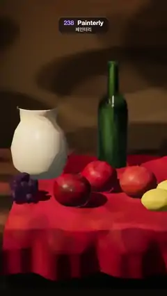

# 238 · Painterly · 페인터리



**EN** A lamp-lit still life of a jug, wine bottle, apples, lemons and grapes on a red cloth is repainted by an anisotropic Kuwahara filter into oil-paint dabs.  
**KO** 빨간 천 위 주전자·와인병·사과·레몬·포도의 정물을 램프로 비추고, 이방성 쿠와하라 필터가 이를 유화 붓자국으로 다시 칠한다.

[Video (mp4)](https://sueun-dev.github.io/motion-effects/videos/238-painterly-kuwahara.mp4) · [Code](../effects/238-painterly-kuwahara.js) · Rendering & stylization · 렌더링·스타일화

## Prompt (English)

```text
Create a "Painterly" motion effect: a 3D still life repainted as an oil painting by an anisotropic Kuwahara filter, with paint relief and a canvas weave.

Look
- The still life: a dark olive backdrop #3A3324 with a warm pool of light on it; a wooden table #5A3A22 (8 × 0.3 × 4.5); a deep red cloth #8E1B22 lying on it with soft folds and hanging over the front edge in vertical folds (with sheen); a cream glazed jug (lathe, #E8DCC2, clearcoat); a dark green wine bottle (lathe, #1F3B22); three apples (r 0.34; #B4231C, #C7432A, #8F1E18) with stems; two lemons #E9C43A; a cluster of 26 grapes #4B2A55.
- Every material carries a mottled colour texture (260 soft blotches, ±15 % lightness, small hue shifts), so there is paint for the filter to push around.
- Light: a warm key spot #FFD9A8 (intensity 260) from (−5, 6.5, 3.5) with soft shadows, a warm spot #E8A060 (90) on the wall behind, hemisphere #8090A0 / #2A2016 at 0.35, a faint room environment; ACES Filmic.
- Camera 30°, looking at (−0.05, 0.75, −0.5).

Motion (0–5 s), a = 2π · t / 5
- The camera drifts slowly: position (0.9·sin a, 3.9 + 0.12·sin 2a, 9.4 + 0.25·cos a), so the dabs re-form gently as the view changes.

Technique (paint made at half size, 540 × 960)
- Render the scene (MSAA 4, half float) and tone map it.
- Structure tensor: Sobel gradients of RGB → (gx·gx, gy·gy, gx·gy), blurred by a 13-tap Gaussian (σ = 3) horizontally, then vertically.
- Anisotropic Kuwahara: from the tensor's eigenvalues λ1 ≥ λ2 take the edge direction and the anisotropy A = (λ1 − λ2) / (λ1 + λ2). Average colour inside an ellipse with radii 8·(1 + A) along the edge and 8 / (1 + A) across it, split into 8 sectors with polynomial weights (ζ = 0.33, η = (ζ + cos(π/8)) / sin²(π/8)) and a Gaussian falloff; keep each sector's mean and variance σ², and output Σ mean·w / Σ w with w = 1 / (1 + (1000·σ²)⁴), so the calmest sectors win: flat areas become smooth dabs, edges stay crisp and strokes follow the forms.
- Full size: impasto, a normal from the paint's own luminance gradient (× 9), lit from (−0.5, 0.6, 0.65): × (0.86 + 0.32·diffuse); and a linen weave fixed to the frame, 0.5 + 0.25·sin(1.15x)·(0.6 + 0.4·sin 0.21y) + 0.25·sin(1.15y)·(0.6 + 0.4·sin 0.19x) plus a fixed hash, applied as × (0.93 + 0.1·weave).

Output and rules
- One self-contained HTML file with no external assets (three.js from a CDN is fine if you use it), drawing on a 1080 × 1920 canvas (9:16) scaled to fit the window.
- Write a function renderFrame(t) that draws the frame for time t in seconds, and preview it with requestAnimationFrame. Everything must be a pure function of t and fixed seeds: no Math.random(), Date or state carried between frames, so frame i = renderFrame(i / 30) can be exported to a 30 fps video.
- Loop seamlessly every 5 seconds: renderFrame(5) must look exactly like renderFrame(0).
- No flicker of any kind: no noise or grain that changes from frame to frame, no strobing or blinking, no z-fighting, no shimmering 1 px lines. Any grain or texture stays fixed to the screen or to the object.
- Keep the top 280 px free of important content (a title label goes there) and fill the whole frame with a designed background.
```

## 프롬프트 (한국어)

```text
"페인터리" 모션 효과를 만들어 줘: 3D 정물을 이방성 쿠와하라 필터로 유화처럼 다시 칠하고, 물감 두께감과 캔버스 결을 더한다.

모양
- 정물: 따뜻한 빛이 고인 어두운 올리브색 배경 #3A3324; 나무 탁자 #5A3A22(8 × 0.3 × 4.5); 그 위에 부드럽게 주름지고 앞 가장자리로 세로 주름을 지으며 늘어진 짙은 빨간 천 #8E1B22(쉰 광택); 크림색 유약 주전자(회전체, #E8DCC2, 클리어코트); 짙은 초록 와인병(회전체, #1F3B22); 꼭지 달린 사과 세 개(r 0.34; #B4231C, #C7432A, #8F1E18); 레몬 두 개 #E9C43A; 포도 26알 송이 #4B2A55.
- 모든 재질에 얼룩진 색 텍스처(부드러운 얼룩 260개, 명도 ±15 %, 약간의 색상 차이)를 입혀 필터가 밀어낼 물감이 있게 한다.
- 조명: (−5, 6.5, 3.5)에서 비추는 따뜻한 키 스포트 #FFD9A8(세기 260)와 부드러운 그림자, 뒷벽을 비추는 따뜻한 스포트 #E8A060(90), 반구광 #8090A0 / #2A2016 0.35, 희미한 룸 환경. ACES Filmic.
- 카메라 30°, (−0.05, 0.75, −0.5)를 본다.

움직임 (0–5초), a = 2π · t / 5
- 카메라가 천천히 흔들린다: 위치 (0.9·sin a, 3.9 + 0.12·sin 2a, 9.4 + 0.25·cos a). 시점이 바뀌면 붓자국이 부드럽게 다시 맺힌다.

기법 (물감은 절반 크기 540 × 960에서 만든다)
- 장면을 렌더(MSAA 4, half float)하고 톤 매핑한다.
- 구조 텐서: RGB의 소벨 기울기 → (gx·gx, gy·gy, gx·gy)를 13탭 가우시안(σ = 3)으로 가로, 다음 세로로 흐린다.
- 이방성 쿠와하라: 텐서의 고윳값 λ1 ≥ λ2에서 경계 방향과 이방성 A = (λ1 − λ2) / (λ1 + λ2)를 얻는다. 경계 방향 반지름 8·(1 + A), 가로 방향 8 / (1 + A)인 타원 안의 색을 다항식 가중치(ζ = 0.33, η = (ζ + cos(π/8)) / sin²(π/8))와 가우시안 감쇠로 8개 구역에 나눠 평균하고, 구역마다 평균과 분산 σ²을 구해 Σ 평균·w / Σ w, w = 1 / (1 + (1000·σ²)⁴)로 합친다. 가장 고른 구역이 이기므로 평평한 곳은 매끈한 붓자국이 되고 경계는 또렷하며 붓질이 형태를 따른다.
- 원래 크기: 임파스토 — 물감 자신의 밝기 기울기(× 9)로 노멀을 만들어 (−0.5, 0.6, 0.65)에서 비춘다: × (0.86 + 0.32·확산). 그리고 화면에 고정된 리넨 결 0.5 + 0.25·sin(1.15x)·(0.6 + 0.4·sin 0.21y) + 0.25·sin(1.15y)·(0.6 + 0.4·sin 0.19x)와 고정 해시를 × (0.93 + 0.1·결)로 곱한다.

출력과 규칙
- 외부 파일 없는 HTML 파일 하나(three.js를 쓴다면 CDN은 괜찮다). 1080 × 1920(9:16) 캔버스에 그리고 창 크기에 맞춰 보이게 한다.
- 시간 t(초)의 프레임을 그리는 renderFrame(t) 함수를 만들고, 미리보기는 requestAnimationFrame으로 돌린다. 모든 것은 t와 고정 시드만으로 정해진다: Math.random(), Date, 프레임 사이에 쌓이는 상태 금지. 그래야 i번째 프레임 = renderFrame(i / 30)으로 30fps 영상을 뽑을 수 있다.
- 5초마다 끊김 없이 반복: renderFrame(5)는 renderFrame(0)과 똑같아 보여야 한다.
- 어떤 깜빡임도 금지: 프레임마다 바뀌는 노이즈·그레인, 번쩍임·깜빡임, z-fighting, 반짝이며 떨리는 1px 선 모두 금지. 그레인·질감은 화면이나 물체에 고정한다.
- 위쪽 280px에는 중요한 내용을 두지 않고(제목 라벨 자리), 화면 전체를 디자인된 배경으로 채운다.
```
