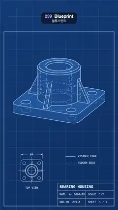

# 239 · Blueprint · 블루프린트



**EN** A flanged bearing housing turns on blueprint paper as a technical drawing: white visible edges, dashed hidden edges, a title block and a fixed top view.  
**KO** 플랜지 베어링 하우징이 청사진 종이 위 기술 도면으로 돈다: 흰 실선은 보이는 모서리, 점선은 숨은 모서리, 그리고 표제란과 고정된 평면도.

[Video (mp4)](https://sueun-dev.github.io/motion-effects/videos/239-blueprint.mp4) · [Code](../effects/239-blueprint.js) · Rendering & stylization · 렌더링·스타일화

## Prompt (English)

```text
Create a "Blueprint" motion effect: a turning machine part rendered as a technical drawing on blueprint paper, with visible edges solid and hidden edges dashed.

Look
- Paper: a diagonal gradient #0E3A78 → #0A2E63 with a fixed grid every 30 px (1 px lines, light blue at 8 %) and a heavier line every 150 px (2 px, 18 %).
- The part, a flanged bearing housing with four-fold symmetry: a square plate 3.2 × 3.2 × 0.4 with 0.35 rounded corners, four bolt holes (r 0.22) at (±1.1, ±1.1) and a bore (r 0.55); a hollow boss (outer r 0.95, inner r 0.55) from y = 0.4 to 1.92 with small chamfers at the top; four triangular gussets 0.18 thick from the boss out to r = 1.45. Faces are filled with a slightly lighter blue (Lambert #1D5BA6 with emissive #123F7C) so the solid reads.
- Lines: creases (faces meeting at more than 25°) plus silhouettes found again every frame on the curved walls (edges between a face turned towards the camera and a face turned away: the boss, the bore, the holes, the rounded corners). Visible lines: 2.6 px #F4FAFF. Hidden lines: 1.7 px #BFD9F7 at 85 %, dashed 0.11 on / 0.08 off (in part units, measured along each edge so the dashes stay fixed to the part).
- Orthographic camera (half-width 2.6) from (10, 6.2, 10) looking at (0, 0.55, 0), shifted down 0.5 so the part sits in the upper half.
- Sheet furniture, drawn in 2D: a border 36 px in from the edges (from y = 290); a title block 520 × 210 bottom right: "BEARING HOUSING", "MATL AL 6061-T6", "SCALE 1:2", "DWG NO 239-A", "SHEET 1 / 1" in monospace; a legend (solid "VISIBLE EDGE", dashed "HIDDEN EDGE"); a fixed TOP VIEW at the bottom left: plate outline, holes, boss circles, gussets, dash-dot centre lines and an overall-width dimension "64" with arrows.

Motion (0–5 s)
- The part turns about its vertical axis a quarter turn per loop (rotation π/2 · t / 5 + 0.35); with its four-fold symmetry the last frame meets the first.
- As it turns, hidden lines of the bore, the holes and the far gussets slide behind the solid while silhouettes of the curved walls move round.

Technique
- three.js. Draw the solids first (polygon offset back), then all lines (renderOrder 1, not writing depth): visible lines with the normal depth test, hidden lines with depthFunc = GreaterDepth, so a line behind the solid fails one test and passes the other.
- Crease edges come from EdgesGeometry (25°). For silhouettes, build an edge → two-faces table once; each frame put the view direction into the part's space and keep the edges whose two face normals point to different sides of it.
- Lines are LineSegments2 with LineMaterial (pixel widths, antialiased); for the dashes, set each segment's line distance from its own start projected on its direction, so the dash pattern stays put as silhouette edges change.

Output and rules
- One self-contained HTML file with no external assets (three.js from a CDN is fine if you use it), drawing on a 1080 × 1920 canvas (9:16) scaled to fit the window.
- Write a function renderFrame(t) that draws the frame for time t in seconds, and preview it with requestAnimationFrame. Everything must be a pure function of t and fixed seeds: no Math.random(), Date or state carried between frames, so frame i = renderFrame(i / 30) can be exported to a 30 fps video.
- Loop seamlessly every 5 seconds: renderFrame(5) must look exactly like renderFrame(0).
- No flicker of any kind: no noise or grain that changes from frame to frame, no strobing or blinking, no z-fighting, no shimmering 1 px lines. Any grain or texture stays fixed to the screen or to the object.
- Keep the top 280 px free of important content (a title label goes there) and fill the whole frame with a designed background.
```

## 프롬프트 (한국어)

```text
"블루프린트" 모션 효과를 만들어 줘: 도는 기계 부품을 청사진 종이 위 기술 도면으로 렌더한다. 보이는 모서리는 실선, 숨은 모서리는 점선.

모양
- 종이: 대각선 그라디언트 #0E3A78 → #0A2E63에 30 px마다 고정 격자(1 px, 밝은 파랑 8 %), 150 px마다 굵은 선(2 px, 18 %).
- 부품, 4회 대칭인 플랜지 베어링 하우징: 모서리 반지름 0.35의 정사각 판 3.2 × 3.2 × 0.4, (±1.1, ±1.1)의 볼트 구멍 네 개(r 0.22)와 가운데 구멍(r 0.55); y = 0.4에서 1.92까지 속이 빈 보스(바깥 r 0.95, 안 r 0.55), 위쪽에 작은 모따기; 보스에서 r = 1.45까지 뻗은 두께 0.18의 삼각 리브 네 개. 면은 조금 더 밝은 파랑(램버트 #1D5BA6, 발광 #123F7C)으로 채워 입체가 읽히게 한다.
- 선: 주름 모서리(면이 25°보다 크게 꺾이는 곳)와 매 프레임 곡면에서 새로 찾는 실루엣(카메라를 향한 면과 등진 면 사이의 모서리: 보스, 가운데 구멍, 볼트 구멍, 둥근 모서리). 보이는 선: 2.6 px #F4FAFF. 숨은 선: 1.7 px #BFD9F7, 85 %, 점선 0.11 켜짐 / 0.08 꺼짐(부품 단위, 각 모서리를 따라 재서 점선이 부품에 고정된다).
- 직교 카메라(반폭 2.6), (10, 6.2, 10)에서 (0, 0.55, 0)을 보고 0.5 아래로 옮겨 부품이 위쪽 절반에 놓이게 한다.
- 도면 요소, 2D로 그림: 가장자리에서 36 px 안쪽 테두리(y = 290부터); 오른쪽 아래 520 × 210 표제란: "BEARING HOUSING", "MATL AL 6061-T6", "SCALE 1:2", "DWG NO 239-A", "SHEET 1 / 1"(고정폭 글꼴); 범례(실선 "VISIBLE EDGE", 점선 "HIDDEN EDGE"); 왼쪽 아래 고정된 TOP VIEW: 판 윤곽, 구멍, 보스 원, 리브, 일점쇄선 중심선, 화살표 달린 전체 폭 치수 "64".

움직임 (0–5초)
- 부품이 세로축으로 루프마다 1/4바퀴 돈다(회전 π/2 · t / 5 + 0.35). 4회 대칭이라 마지막 프레임이 첫 프레임과 이어진다.
- 돌면서 가운데 구멍, 볼트 구멍, 뒤쪽 리브의 숨은 선이 입체 뒤로 미끄러지고, 곡면의 실루엣이 따라 돈다.

기법
- three.js. 입체를 먼저 그리고(폴리곤 오프셋으로 뒤로), 그다음 모든 선을 그린다(renderOrder 1, 깊이 쓰기 없음): 보이는 선은 보통 깊이 테스트, 숨은 선은 depthFunc = GreaterDepth. 입체 뒤의 선은 한쪽 테스트에 떨어지고 다른 쪽을 통과한다.
- 주름 모서리는 EdgesGeometry(25°). 실루엣은 모서리 → 두 면 표를 한 번 만들어 두고, 매 프레임 시선 방향을 부품 공간으로 옮겨 두 면의 노멀이 그 방향의 서로 다른 쪽을 향하는 모서리만 남긴다.
- 선은 LineMaterial을 쓴 LineSegments2(픽셀 굵기, 안티에일리어싱). 점선은 각 선분의 거리를 자기 시작점을 자기 방향에 투영한 값에서 시작하게 해, 실루엣 모서리가 바뀌어도 점선 무늬가 제자리에 있다.

출력과 규칙
- 외부 파일 없는 HTML 파일 하나(three.js를 쓴다면 CDN은 괜찮다). 1080 × 1920(9:16) 캔버스에 그리고 창 크기에 맞춰 보이게 한다.
- 시간 t(초)의 프레임을 그리는 renderFrame(t) 함수를 만들고, 미리보기는 requestAnimationFrame으로 돌린다. 모든 것은 t와 고정 시드만으로 정해진다: Math.random(), Date, 프레임 사이에 쌓이는 상태 금지. 그래야 i번째 프레임 = renderFrame(i / 30)으로 30fps 영상을 뽑을 수 있다.
- 5초마다 끊김 없이 반복: renderFrame(5)는 renderFrame(0)과 똑같아 보여야 한다.
- 어떤 깜빡임도 금지: 프레임마다 바뀌는 노이즈·그레인, 번쩍임·깜빡임, z-fighting, 반짝이며 떨리는 1px 선 모두 금지. 그레인·질감은 화면이나 물체에 고정한다.
- 위쪽 280px에는 중요한 내용을 두지 않고(제목 라벨 자리), 화면 전체를 디자인된 배경으로 채운다.
```
