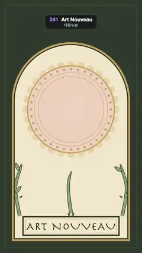

# 241 · Art Nouveau · 아르누보



**EN** Whiplash vines grow up a Mucha-style cream arch, curl into spirals and sprout leaves and dusty-rose blossoms while a tall lily opens in a gold halo.  
**KO** 무하풍 크림색 아치를 따라 채찍처럼 휘는 덩굴이 자라 소용돌이로 말리고 잎과 장밋빛 꽃을 틔우며, 금빛 후광 속에서 키 큰 백합이 피어난다.

[Video (mp4)](https://sueun-dev.github.io/motion-effects/videos/241-art-nouveau.mp4) · [Code](../effects/241-art-nouveau.js) · Art movements & styles · 예술 사조·스타일

## Prompt (English)

```text
Create an "Art Nouveau" motion effect: a Mucha-style decorative panel in which whiplash vines and a lily grow, bloom, hold, and draw back.

Look
- Palette (muted): deep olive #2E382C, cream #F1E6CC, dark contour #2E3426, sage #8BA07A, leaf #A6B78F, dusty rose #D69A8E, ochre #C9A35B, ivory #FBF4E4.
- Background deep olive with a fine 2 px gold rule (ochre at 35 %) inset 40 px.
- The arch panel: x 90–990, bottom y 1830, a semicircular top of radius 450 centred at (540, 770). Drawn as three nested fills: ochre, then dark contour inset 14 px, then cream inset 22 px; everything below is clipped to the cream.
- The halo, centred at (540, 830): a scalloped edge of 28 discs (radius 30, #E8D3A8) on a circle of radius 338; a pale rose disc #EED3BF of radius 330 with a 10 px ochre ring; thin ochre rings at radius 280 and 250; 36 beads (radius 9, alternating ochre and rose) on radius 305; 48 fine ochre rays from radius 120 to 240.
- Vines are tapered ribbons along Catmull-Rom splines through a few key points, drawn twice: dark contour 3.5 px wider, then sage on top. A stem ribbon narrows from its full width at the root to 20 % at the end; the growing tip tapers to a point over its last 60 px.
  - Two mirrored frame vines (20 px wide) from (150, 1640) up through (118, 1420), (170, 1200), (126, 980), (150, 800) to (230, 640), ending in a spiral (start radius 64, 1.4 turns, radius shrinking to 22 %) that curls toward the centre; five almond leaves (70–50 px, contour 3.5 px, a midrib) on alternate sides and three five-petal rose blossoms (34, 30 and 26 px) with ochre centres, the last on the spiral.
  - Two mirrored side tendrils (11 px) from (150, 1500) through (250, 1430), (270, 1330) to (220, 1270), curling into small spirals (radius 34, 1.2 turns), one leaf each.
  - The lily: a 22 px stem from (540, 1620) through (520, 1400), (565, 1200) to (540, 980), and two long leaf blades (54 px at their widest, a sine-shaped width profile pointed at both ends, a midrib) sweeping from the stem foot out to (318, 1250) and its mirror.
  - The flower at (540, 960): six petals 230 px long, three back petals (#F1DCCB, 44 px wide) at −60°, 60°, 180° and three front petals (ivory, 38 px) between them, each with a rose streak; six stamens fanning upward with ochre anthers.
- Lettering panel: dark box 740 × 150 at (170, 1640) with a cream inset and a 3 px ochre rule; "ART NOUVEAU" in Herculanum 84 px, 6 px letter spacing, centred at y 1718.

Motion (0–5 s): the growth runs on τ = (t + 0.9) mod 5, so the video opens mid-growth
- Each part grows over its window with a cubic ease in-out: frame vines τ 0.1–2.0, stem 0.25–1.55, tendrils and leaf blades 0.6–1.8, the lily 1.2–2.4. A ribbon is drawn up to length p · L, so the vine visibly creeps along its curve into the spiral.
- Leaves pop out (ease out-back over 120 px of growth) as the tip passes their spot; blossoms swell and turn open the same way.
- The lily starts as a closed bud of petals pointing up and opens to its six directions as it grows; petals lengthen from 90 to 230 px.
- From τ = 3.5 everything draws back in reverse order, each part over 0.6 × its growth time, and is gone by τ 4.8; the empty arch rests briefly, then growth starts again.
- The bead ring of the halo turns slowly, by exactly one bead spacing (10°) per 5 s, so the halo is never quite still. The arch, halo and lettering do not move.

Technique
- Canvas 2D. Paths are sampled once (20 points per spline segment, then the spiral); each frame a ribbon polygon is built from the samples up to the current length, offsetting by the normal times the width profile.
- Leaves, blossoms and the lily are small parametric shapes (quadratic and cubic Béziers) placed at fractions of the path length and scaled by their own eased progress.

Output and rules
- One self-contained HTML file with no external assets (three.js from a CDN is fine if you use it), drawing on a 1080 × 1920 canvas (9:16) scaled to fit the window.
- Write a function renderFrame(t) that draws the frame for time t in seconds, and preview it with requestAnimationFrame. Everything must be a pure function of t and fixed seeds: no Math.random(), Date or state carried between frames, so frame i = renderFrame(i / 30) can be exported to a 30 fps video.
- Loop seamlessly every 5 seconds: renderFrame(5) must look exactly like renderFrame(0).
- No flicker of any kind: no noise or grain that changes from frame to frame, no strobing or blinking, no z-fighting, no shimmering 1 px lines. Any grain or texture stays fixed to the screen or to the object.
- Keep the top 280 px free of important content (a title label goes there) and fill the whole frame with a designed background.
```

## 프롬프트 (한국어)

```text
"아르누보" 모션 효과를 만들어 줘: 무하 스타일의 장식 패널에서 채찍처럼 휘는 덩굴과 백합이 자라고, 꽃 피고, 머문 뒤, 다시 거둬들여지는 효과.

모양
- 팔레트(차분한 색): 짙은 올리브 #2E382C, 크림 #F1E6CC, 짙은 윤곽 #2E3426, 세이지 #8BA07A, 잎 #A6B78F, 더스티 로즈 #D69A8E, 황토 #C9A35B, 아이보리 #FBF4E4.
- 배경은 짙은 올리브, 40px 안쪽에 가는 2px 금색 선(황토 35 %).
- 아치 패널: x 90–990, 아래 y 1830, 위는 (540, 770) 중심 반지름 450의 반원. 황토 → 14px 안쪽 짙은 윤곽 → 22px 안쪽 크림, 세 겹으로 채운다. 그 아래 모든 것은 크림 안으로 클립한다.
- 후광, (540, 830) 중심: 반지름 338 원 위에 원판 28개(반지름 30, #E8D3A8)로 된 물결 테두리; 반지름 330의 연한 장밋빛 원 #EED3BF와 10px 황토 테; 반지름 280과 250의 가는 황토 테; 반지름 305 위의 구슬 36개(반지름 9, 황토와 장밋빛 번갈아); 반지름 120에서 240까지 가는 황토 방사선 48개.
- 덩굴은 몇 개의 기준점을 지나는 Catmull-Rom 스플라인을 따라가는 가늘어지는 리본이다. 두 번 그린다: 3.5px 더 넓은 짙은 윤곽, 그 위에 세이지. 줄기 리본은 뿌리의 전체 폭에서 끝의 20 %까지 좁아지고, 자라는 끝은 마지막 60px 동안 뾰족해진다.
  - 좌우 대칭 테두리 덩굴 두 개(폭 20px): (150, 1640)에서 (118, 1420), (170, 1200), (126, 980), (150, 800)을 지나 (230, 640)까지, 끝은 가운데 쪽으로 말리는 소용돌이(시작 반지름 64, 1.4바퀴, 반지름이 22 %까지 줄어듦). 번갈아 붙은 아몬드 모양 잎 다섯 장(70–50px, 윤곽 3.5px, 잎맥)과 황토 꽃술의 다섯 잎 장밋빛 꽃 세 송이(34, 30, 26px), 마지막 꽃은 소용돌이 위.
  - 좌우 대칭 곁덩굴 두 개(11px): (150, 1500)에서 (250, 1430), (270, 1330)을 지나 (220, 1270)까지, 작은 소용돌이(반지름 34, 1.2바퀴)로 말리고 잎 한 장씩.
  - 백합: (540, 1620)에서 (520, 1400), (565, 1200)을 지나 (540, 980)까지의 22px 줄기, 그리고 줄기 밑동에서 (318, 1250)과 그 대칭점으로 뻗는 긴 잎 두 장(가장 넓은 곳 54px, 양끝이 뾰족한 사인 모양 폭, 잎맥).
  - (540, 960)의 꽃: 길이 230px 꽃잎 여섯 장. 뒤쪽 꽃잎 셋(#F1DCCB, 폭 44px)은 −60°, 60°, 180°, 앞쪽 꽃잎 셋(아이보리, 38px)은 그 사이. 꽃잎마다 장밋빛 줄, 위로 부채처럼 퍼진 수술 여섯 개와 황토 꽃밥.
- 글자 패널: (170, 1640)의 740 × 150 짙은 상자, 안쪽 크림, 3px 황토 선. Herculanum 84px "ART NOUVEAU", 자간 6px, y 1718 가운데.

움직임 (0–5초): 성장 시간축은 τ = (t + 0.9) mod 5, 그래서 영상은 자라는 도중에 시작한다
- 각 부분은 자기 구간 동안 3차 ease in-out으로 자란다: 테두리 덩굴 τ 0.1–2.0, 줄기 0.25–1.55, 곁덩굴과 긴 잎 0.6–1.8, 백합 1.2–2.4. 리본은 길이 p · L까지 그려서, 덩굴이 곡선을 따라 기어올라 소용돌이로 말려 들어가는 것이 보인다.
- 잎은 자라는 끝이 제자리를 지날 때 튀어나온다(성장 120px 동안 ease out-back). 꽃도 같은 식으로 부풀며 돌아 피어난다.
- 백합은 위를 향해 모인 꽃봉오리에서 시작해 자라면서 여섯 방향으로 벌어진다. 꽃잎 길이는 90px에서 230px로.
- τ = 3.5부터 모든 것이 역순으로 거둬들여진다. 각 부분은 성장 시간의 0.6배 동안, τ 4.8이면 모두 사라진다. 빈 아치가 잠깐 머문 뒤 다시 자라기 시작한다.
- 후광의 구슬 고리는 5초에 정확히 구슬 한 칸(10°)만큼 천천히 돈다. 그래서 후광은 완전히 멈추지 않는다. 아치, 후광, 글자는 움직이지 않는다.

기법
- Canvas 2D. 경로는 한 번만 샘플링한다(스플라인 구간마다 20점, 그다음 소용돌이). 프레임마다 현재 길이까지의 샘플로 리본 다각형을 만든다: 법선 방향으로 폭 함수만큼 벌린다.
- 잎, 꽃, 백합은 작은 매개변수 도형(2차·3차 베지어)으로, 경로 길이의 비율 지점에 놓고 각자의 eased 진행도로 크기를 키운다.

출력과 규칙
- 외부 파일 없는 HTML 파일 하나(three.js를 쓴다면 CDN은 괜찮다). 1080 × 1920(9:16) 캔버스에 그리고 창 크기에 맞춰 보이게 한다.
- 시간 t(초)의 프레임을 그리는 renderFrame(t) 함수를 만들고, 미리보기는 requestAnimationFrame으로 돌린다. 모든 것은 t와 고정 시드만으로 정해진다: Math.random(), Date, 프레임 사이에 쌓이는 상태 금지. 그래야 i번째 프레임 = renderFrame(i / 30)으로 30fps 영상을 뽑을 수 있다.
- 5초마다 끊김 없이 반복: renderFrame(5)는 renderFrame(0)과 똑같아 보여야 한다.
- 어떤 깜빡임도 금지: 프레임마다 바뀌는 노이즈·그레인, 번쩍임·깜빡임, z-fighting, 반짝이며 떨리는 1px 선 모두 금지. 그레인·질감은 화면이나 물체에 고정한다.
- 위쪽 280px에는 중요한 내용을 두지 않고(제목 라벨 자리), 화면 전체를 디자인된 배경으로 채운다.
```
