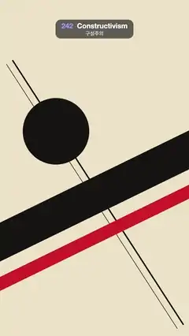

# 242 · Constructivism · 구성주의



**EN** Red, black and cream pieces slam onto a 26° diagonal: a slogan band, a red wedge into a black circle, a halftone factory and a megaphone, then fly out.  
**KO** 빨강·검정·크림 조각들이 26° 대각선 위로 쾅쾅 박힌다: 구호 띠, 검은 원을 찌르는 붉은 쐐기, 망점 공장 사진, 확성기. 그리고 왔던 길로 날아간다.

[Video (mp4)](https://sueun-dev.github.io/motion-effects/videos/242-constructivism.mp4) · [Code](../effects/242-constructivism.js) · Art movements & styles · 예술 사조·스타일

## Prompt (English)

```text
Create a "Constructivism" motion effect: a 1920s Soviet avant-garde poster (Rodchenko, Lissitzky) whose geometric pieces slam into place one after another along a hard diagonal, hold, and fly back out.

Look
- Palette: cream paper #ECE1C6, red #D2232A, ink black #151311. A fixed paper speckle over the cream (9,000 tiny 1–3 px specks, brown at 10 % and white at 18 %), drawn once.
- The axis: everything is rotated to −26° (rising to the right), with DX = cos(−26°), DY = sin(−26°).
- Two thin fixed construction rules crossing the axis (8 px and 3 px, 44 px apart, 1800 px long) through (560, 1100), at −26° + 90° − 7°.
- Pieces (centre, then shape in the piece's own rotated frame):
  - black band at (540, 1120): 2000 × 200 px;
  - red bar at (600, 1330): 1900 × 72 px;
  - black circle radius 190 at (320, 690) (not rotated);
  - red wedge with its tip at (330, 690), driving down-left into the circle: a triangle from the tip back 600 px to a 290 px base;
  - the slogan "ВПЕРЁД" ("forward") in Impact 168 px, cream, letters 14 px apart, centred in the black band;
  - the sub-headline "ИСКУССТВО В ЖИЗНЬ" ("art into life") in Impact 58 px, black, just above the band;
  - a photomontage block at (330, 1600): a 424 × 324 black frame holding a 400 × 300 halftone photo of a factory (three smokestacks with smoke, a saw-tooth hall, a big gear) and a red caption bar 300 × 56 with "ЗАВОД 1924" in cream Impact 40 px;
  - a megaphone at (820, 1560) pointing up and left at the slogan: a black truncated cone (narrow end 60 px, mouth 240 px, 260 px long), a 90 × 52 handle, a red rim 24 px at the mouth.
- The halftone: draw the factory scene in greys, then sample it every 8 px on offset rows and draw black dots of radius 4.7 · √(1 − brightness) on cream.

Motion (0–5 s): the timeline runs on τ = (t + 0.6) mod 5
- Each piece has an arrival time a and a progress p = slam(k) with k going 0 → 1 over 0.32 s, slam(k) = 1 + 2.4 (k − 1)³ + 1.4 (k − 1)²: a fast arrival that overshoots a little and snaps back.
- Arrivals: band a = 0 (from the lower left, along the axis, 1900 px away), red bar 0.22 (from the upper right, 1900 px), circle 0.42 (dropping 900 px from above), wedge 0.62 (from the upper right, 1100 px), slogan letters 0.8 + 0.07·i, photo block 1.1 (from the lower right, perpendicular to the axis, 900 px), megaphone 1.3 (along the axis, 900 px), sub-headline 1.45 (from the lower left, 1200 px).
- Each slogan letter is stamped: it scales from 1.9 to 1 and fades in during its first third of the slam.
- Hold: from about τ 1.8 to 3.9 nothing moves at all.
- Exit: from τ = 3.9 + 0.35 · (1.8 − a) each piece leaves along its arrival path, accelerating (cubic ease-in over 0.4 s), last-in first-out; by τ ≈ 4.9 only the cream paper and the two rules remain, then the next build begins.

Technique
- Canvas 2D. Each piece: translate to its centre plus its arrival direction × distance × (1 − p), rotate to the axis, draw flat shapes. No outlines, no gradients, no shadows: flat print colour only.
- The halftone photo and the paper speckle are offscreen canvases made once in setup, so they never change from frame to frame.

Output and rules
- One self-contained HTML file with no external assets (three.js from a CDN is fine if you use it), drawing on a 1080 × 1920 canvas (9:16) scaled to fit the window.
- Write a function renderFrame(t) that draws the frame for time t in seconds, and preview it with requestAnimationFrame. Everything must be a pure function of t and fixed seeds: no Math.random(), Date or state carried between frames, so frame i = renderFrame(i / 30) can be exported to a 30 fps video.
- Loop seamlessly every 5 seconds: renderFrame(5) must look exactly like renderFrame(0).
- No flicker of any kind: no noise or grain that changes from frame to frame, no strobing or blinking, no z-fighting, no shimmering 1 px lines. Any grain or texture stays fixed to the screen or to the object.
- Keep the top 280 px free of important content (a title label goes there) and fill the whole frame with a designed background.
```

## 프롬프트 (한국어)

```text
"구성주의" 모션 효과를 만들어 줘: 1920년대 소비에트 아방가르드 포스터(로드첸코, 리시츠키)의 기하 조각들이 강한 대각선을 따라 하나씩 쾅쾅 박히고, 머문 뒤, 다시 날아가는 효과.

모양
- 팔레트: 크림 종이 #ECE1C6, 빨강 #D2232A, 먹색 #151311. 크림 위에 고정된 종이 얼룩(1–3px 점 9,000개, 갈색 10 %와 흰색 18 %), 한 번만 그린다.
- 축: 모든 것을 −26°(오른쪽으로 올라감)로 돌린다. DX = cos(−26°), DY = sin(−26°).
- 축을 가로지르는 고정된 가는 구성선 두 개(8px와 3px, 44px 간격, 길이 1800px), (560, 1100)을 지나고 각도 −26° + 90° − 7°.
- 조각(중심, 그다음 조각 자체의 회전 좌표에서의 모양):
  - 검은 띠 (540, 1120): 2000 × 200px;
  - 빨간 막대 (600, 1330): 1900 × 72px;
  - 검은 원 반지름 190, (320, 690)(회전 없음);
  - 붉은 쐐기, 끝이 (330, 690)에서 왼쪽 아래로 원을 찌른다: 끝에서 600px 뒤 290px 밑변의 삼각형;
  - 구호 "ВПЕРЁД"("앞으로"), Impact 168px, 크림색, 글자 간격 14px, 검은 띠 가운데;
  - 부제 "ИСКУССТВО В ЖИЗНЬ"("예술을 삶 속으로"), Impact 58px, 검정, 띠 바로 위;
  - 포토몽타주 블록 (330, 1600): 424 × 324 검은 틀 안에 400 × 300 망점 공장 사진(연기 나는 굴뚝 셋, 톱니 지붕 공장, 큰 톱니바퀴), 그리고 300 × 56 빨간 캡션 막대에 크림색 Impact 40px "ЗАВОД 1924";
  - 확성기 (820, 1560), 왼쪽 위의 구호를 향한다: 검은 원뿔대(좁은 끝 60px, 입구 240px, 길이 260px), 90 × 52 손잡이, 입구에 24px 빨간 테.
- 망점: 공장 장면을 회색으로 그린 뒤 엇갈린 줄로 8px마다 샘플링해 크림 위에 반지름 4.7 · √(1 − 밝기)의 검은 점을 찍는다.

움직임 (0–5초): 시간축은 τ = (t + 0.6) mod 5
- 조각마다 도착 시각 a가 있고, 진행도 p = slam(k), k는 0.32초 동안 0 → 1, slam(k) = 1 + 2.4 (k − 1)³ + 1.4 (k − 1)²: 빠르게 도착해 살짝 지나쳤다가 제자리로 튕겨 온다.
- 도착: 띠 a = 0(왼쪽 아래에서 축을 따라 1900px), 빨간 막대 0.22(오른쪽 위에서 1900px), 원 0.42(위에서 900px 떨어짐), 쐐기 0.62(오른쪽 위에서 1100px), 구호 글자 0.8 + 0.07·i, 사진 블록 1.1(오른쪽 아래에서 축에 수직으로 900px), 확성기 1.3(축을 따라 900px), 부제 1.45(왼쪽 아래에서 1200px).
- 구호 글자는 도장처럼 찍힌다: slam의 처음 1/3 동안 크기 1.9에서 1로 줄며 나타난다.
- 머묾: τ 1.8쯤부터 3.9까지 아무것도 움직이지 않는다.
- 퇴장: τ = 3.9 + 0.35 · (1.8 − a)부터 각 조각이 들어온 길로 가속하며 나간다(0.4초 3차 ease-in). 나중에 온 것이 먼저 나간다. τ ≈ 4.9면 크림 종이와 구성선 두 개만 남고, 다음 조립이 시작된다.

기법
- Canvas 2D. 조각마다: 중심 + 도착 방향 × 거리 × (1 − p)로 옮기고, 축 각도로 돌리고, 평평한 도형을 그린다. 윤곽선·그라디언트·그림자 없이 인쇄 단색만.
- 망점 사진과 종이 얼룩은 setup에서 한 번 만든 오프스크린 캔버스라 프레임마다 바뀌지 않는다.

출력과 규칙
- 외부 파일 없는 HTML 파일 하나(three.js를 쓴다면 CDN은 괜찮다). 1080 × 1920(9:16) 캔버스에 그리고 창 크기에 맞춰 보이게 한다.
- 시간 t(초)의 프레임을 그리는 renderFrame(t) 함수를 만들고, 미리보기는 requestAnimationFrame으로 돌린다. 모든 것은 t와 고정 시드만으로 정해진다: Math.random(), Date, 프레임 사이에 쌓이는 상태 금지. 그래야 i번째 프레임 = renderFrame(i / 30)으로 30fps 영상을 뽑을 수 있다.
- 5초마다 끊김 없이 반복: renderFrame(5)는 renderFrame(0)과 똑같아 보여야 한다.
- 어떤 깜빡임도 금지: 프레임마다 바뀌는 노이즈·그레인, 번쩍임·깜빡임, z-fighting, 반짝이며 떨리는 1px 선 모두 금지. 그레인·질감은 화면이나 물체에 고정한다.
- 위쪽 280px에는 중요한 내용을 두지 않고(제목 라벨 자리), 화면 전체를 디자인된 배경으로 채운다.
```
