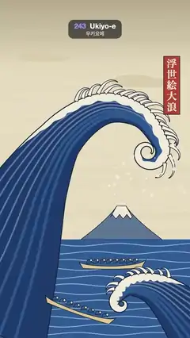

# 243 · Ukiyo-e · 우키요에



**EN** A Prussian-blue woodblock wave curls over a snowy peak, foam claws flexing and spray falling like snow, as boats ride the swell on fixed wood-grain paper.  
**KO** 프러시안 블루 목판화 파도가 눈 덮인 산 위로 말려들고, 거품 발톱이 꿈틀대며 물보라가 눈처럼 떨어지는 사이 배들이 너울을 탄다. 나뭇결 종이는 고정.

[Video (mp4)](https://sueun-dev.github.io/motion-effects/videos/243-ukiyo-e.mp4) · [Code](../effects/243-ukiyo-e.js) · Art movements & styles · 예술 사조·스타일

## Prompt (English)

```text
Create a "Ukiyo-e" motion effect: a Japanese woodblock print of a great wave (in the spirit of Hokusai) with flat colour blocks and a dark key line; the wave breathes and curls, its foam claws flex, spray falls and boats rock.

Look
- Palette: key line #1B2236, deep Prussian blue #1D3B6E, mid blue #2F5C97, light blue #8DAED3, foam #F5EFDF, sky #EADFC3, top band #B8AC90, mountain #5F7898, cartouche red #B8452F, boat hulls #E3C98F.
- Sky: a vertical gradient over the top 900 px, the darker band #B8AC90 at the top fading to sky colour by 45 % (the printed bokashi band); two flat pale clouds (#DCCFAE, each two overlapping ellipses about 380 × 52) at (820, 470) and (250, 330).
- The mountain on the horizon under the curl: base 460 px wide at (690, 1360), a flat top 52 px wide at y 1170, concave sides, blue-grey with a 3 px key line, and a snow cap down to y 1232 with a zigzag lower edge.
- The sea below y 1360 in mid blue, with light-blue 5 px wave lines every 46 px.
- The great wave is built on a spine: a Catmull-Rom curve through (−170, 1820), (30, 1420), (190, 1040), (370, 760), (590, 610), (790, 650), (900, 800), then a clockwise spiral off its end (start radius 92, about 1.05 turns, radius shrinking to 25 %). The body is a ribbon around the spine whose width falls from 940 px at the base through 560, 260, 130, 70 to 8 px at the spiral's centre.
  - Fill deep blue; inside it, offset copies of the spine as flow lines: three 16 px mid-blue lines on the face side and five 9 px light-blue lines (55 % opacity) on the back side.
  - Foam: a scalloped cream band along the back edge from the shoulder to the lip, up to 60 px thick.
  - A 5 px key line round the body.
  - Claws: 20 tapering foam fingers along the lip, each a small spine 85–150 px long that leaves the edge out and forward and bends harder toward its tip so it hooks down; 22 px wide at the root, pointed, with a 3 px key line.
- A smaller wave at the lower right curls the other way (spine (1260, 1990), (1060, 1790), (880, 1640), (740, 1620), (660, 1690), spiral radius 46, 0.9 turns; width 520 → 6 px; 9 claws 52–92 px).
- Two long narrow boats with eight crouching rowers each (blue backs, pale heads, key lines): 380 px at (640, 1500), drawn before the big wave; 420 px at (450, 1760) tilted 0.32 rad, in front of it.
- Spray: 70 cream drops (radius 4–11 px) falling from the lip area (x 520–1040, y 640–900).
- A red cartouche 92 × 330 at (930, 320) with the vertical title 浮世絵大浪 in Hiragino Mincho 58 px.
- Over everything, printed with multiply: a fixed wood-grain paper texture made once (horizontal grain lines every 5 px, warped by fbm noise, brown at 5–13 % opacity, plus 2,500 short fibres).

Motion (0–5 s), a = 2π · t / 5
- The big wave's spine points sway by 8–16 px with sin(a + phase); the lip curls in and out as the spiral's turns change by 1.05 + 0.12 · sin(a + 1.8).
- The claws flex: each one's angle changes by 0.15 · sin(a + 0.9j) rad and its curl by 0.4 · sin(a + 0.9j + 1), a ripple running along the lip.
- Spray: each drop moves 380 px down and 60 px right over one loop from its own random phase, sways 10 px sideways, and fades in and out with sin(π · q), so drops are born and vanish smoothly.
- The small wave sways the same way (phase + 2). The boats bob 10–12 px and rock ±0.05 rad. The sea lines undulate with sin(x / 70 + a).
- The sky, mountain, cartouche and the paper texture never move.

Technique
- Canvas 2D. Each wave is a ribbon polygon around a sampled spine (24 samples per spline segment plus 50 on the spiral), offset along the normal by half the width; the back edge (with foam and claws) is the outside of the curl.
- Flow lines are the spine offset by fractions of the half-width, clipped to the body. Claws are short tapered ribbons whose heading increases with the square of their length fraction.
- The paper texture is an offscreen canvas drawn once and laid over the frame with multiply, so the grain stays fixed while the water moves under it.

Output and rules
- One self-contained HTML file with no external assets (three.js from a CDN is fine if you use it), drawing on a 1080 × 1920 canvas (9:16) scaled to fit the window.
- Write a function renderFrame(t) that draws the frame for time t in seconds, and preview it with requestAnimationFrame. Everything must be a pure function of t and fixed seeds: no Math.random(), Date or state carried between frames, so frame i = renderFrame(i / 30) can be exported to a 30 fps video.
- Loop seamlessly every 5 seconds: renderFrame(5) must look exactly like renderFrame(0).
- No flicker of any kind: no noise or grain that changes from frame to frame, no strobing or blinking, no z-fighting, no shimmering 1 px lines. Any grain or texture stays fixed to the screen or to the object.
- Keep the top 280 px free of important content (a title label goes there) and fill the whole frame with a designed background.
```

## 프롬프트 (한국어)

```text
"우키요에" 모션 효과를 만들어 줘: 평평한 색판과 짙은 윤곽선(키 라인)으로 찍은 일본 목판화 속 큰 파도(호쿠사이 풍). 파도가 숨 쉬듯 말려들고, 거품 발톱이 꿈틀대고, 물보라가 떨어지고, 배가 흔들린다.

모양
- 팔레트: 키 라인 #1B2236, 짙은 프러시안 블루 #1D3B6E, 중간 파랑 #2F5C97, 연한 파랑 #8DAED3, 거품 #F5EFDF, 하늘 #EADFC3, 위쪽 띠 #B8AC90, 산 #5F7898, 제목 붉은색 #B8452F, 배 #E3C98F.
- 하늘: 위 900px에 세로 그라디언트, 맨 위의 짙은 띠 #B8AC90이 45 %에서 하늘색으로 옅어진다(목판의 보카시 띠). 납작한 연한 구름 두 개(#DCCFAE, 각각 약 380 × 52 타원 두 개 겹침), (820, 470)과 (250, 330).
- 파도 말림 아래 수평선 위의 산: (690, 1360)에서 밑변 460px, y 1170에 폭 52px의 평평한 꼭대기, 오목한 경사, 청회색에 3px 키 라인, y 1232까지 지그재그 아래끝의 눈 덮인 봉우리.
- y 1360 아래 바다는 중간 파랑, 46px마다 연한 파랑 5px 물결선.
- 큰 파도는 척추 곡선 위에 만든다: (−170, 1820), (30, 1420), (190, 1040), (370, 760), (590, 610), (790, 650), (900, 800)을 지나는 Catmull-Rom 곡선, 그리고 끝에서 시계 방향 소용돌이(시작 반지름 92, 약 1.05바퀴, 반지름이 25 %까지 줄어듦). 몸통은 척추를 감싼 리본이고 폭은 밑동 940px에서 560, 260, 130, 70을 거쳐 소용돌이 중심 8px까지 줄어든다.
  - 짙은 파랑으로 채우고, 안쪽에 척추를 평행 이동한 물결 줄: 앞면 쪽에 16px 중간 파랑 세 줄, 등 쪽에 9px 연한 파랑 다섯 줄(불투명도 55 %).
  - 거품: 어깨에서 입술까지 등 쪽 가장자리를 따라 최대 60px 두께의 물결 모양 크림색 띠.
  - 몸통 둘레 5px 키 라인.
  - 발톱: 입술을 따라 가늘어지는 거품 손가락 20개. 각각 길이 85–150px의 작은 척추로, 가장자리에서 바깥·앞쪽으로 나가며 끝으로 갈수록 세게 휘어 아래로 갈고리처럼 꺾인다. 뿌리 폭 22px, 끝은 뾰족, 3px 키 라인.
- 오른쪽 아래의 작은 파도는 반대로 말린다(척추 (1260, 1990), (1060, 1790), (880, 1640), (740, 1620), (660, 1690), 소용돌이 반지름 46, 0.9바퀴, 폭 520 → 6px, 발톱 9개 52–92px).
- 웅크린 노꾼 여덟 명씩 탄 길고 좁은 배 두 척(파란 등, 연한 머리, 키 라인): (640, 1500)의 380px 배는 큰 파도보다 먼저(뒤에), (450, 1760)의 420px 배는 0.32rad 기울어 그 앞.
- 물보라: 입술 부근(x 520–1040, y 640–900)에서 떨어지는 크림색 방울 70개(반지름 4–11px).
- (930, 320)에 92 × 330 붉은 제목 칸, 세로로 浮世絵大浪, Hiragino Mincho 58px.
- 맨 위에 multiply로 찍은, 한 번만 만든 고정 나뭇결 종이 질감(5px마다 가로 결, fbm 노이즈로 휨, 갈색 불투명도 5–13 %, 짧은 섬유 2,500개).

움직임 (0–5초), a = 2π · t / 5
- 큰 파도의 척추 점들이 sin(a + 위상)으로 8–16px 흔들린다. 소용돌이 바퀴 수가 1.05 + 0.12 · sin(a + 1.8)로 바뀌며 입술이 말렸다 풀렸다 한다.
- 발톱이 꿈틀댄다: 각 발톱의 방향이 0.15 · sin(a + 0.9j)rad, 휨이 0.4 · sin(a + 0.9j + 1)만큼 바뀌어 입술을 따라 물결이 흐른다.
- 물보라: 방울마다 자기 무작위 위상에서 한 루프 동안 아래로 380px, 오른쪽으로 60px 움직이고, 옆으로 10px 흔들리며, sin(π · q)로 나타났다 사라진다. 그래서 방울이 부드럽게 생기고 없어진다.
- 작은 파도도 같은 식으로 흔들린다(위상 + 2). 배는 10–12px 오르내리고 ±0.05rad 기우뚱한다. 바다 물결선은 sin(x / 70 + a)로 일렁인다.
- 하늘, 산, 제목 칸, 종이 질감은 움직이지 않는다.

기법
- Canvas 2D. 파도마다 샘플링한 척추(스플라인 구간마다 24점, 소용돌이 50점)를 법선 방향으로 반폭만큼 벌린 리본 다각형이다. 거품과 발톱이 붙는 등 쪽 가장자리는 말림의 바깥쪽이다.
- 물결 줄은 반폭의 일부만큼 척추를 옮긴 선이고 몸통 안으로 클립한다. 발톱은 길이 비율의 제곱에 따라 방향이 꺾이는 짧은 가늘어지는 리본이다.
- 종이 질감은 한 번 그린 오프스크린 캔버스를 multiply로 덮어서, 물이 그 아래서 움직여도 결은 고정된다.

출력과 규칙
- 외부 파일 없는 HTML 파일 하나(three.js를 쓴다면 CDN은 괜찮다). 1080 × 1920(9:16) 캔버스에 그리고 창 크기에 맞춰 보이게 한다.
- 시간 t(초)의 프레임을 그리는 renderFrame(t) 함수를 만들고, 미리보기는 requestAnimationFrame으로 돌린다. 모든 것은 t와 고정 시드만으로 정해진다: Math.random(), Date, 프레임 사이에 쌓이는 상태 금지. 그래야 i번째 프레임 = renderFrame(i / 30)으로 30fps 영상을 뽑을 수 있다.
- 5초마다 끊김 없이 반복: renderFrame(5)는 renderFrame(0)과 똑같아 보여야 한다.
- 어떤 깜빡임도 금지: 프레임마다 바뀌는 노이즈·그레인, 번쩍임·깜빡임, z-fighting, 반짝이며 떨리는 1px 선 모두 금지. 그레인·질감은 화면이나 물체에 고정한다.
- 위쪽 280px에는 중요한 내용을 두지 않고(제목 라벨 자리), 화면 전체를 디자인된 배경으로 채운다.
```
