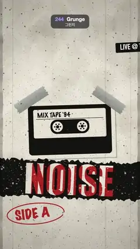

# 244 · Grunge · 그런지



**EN** A photocopied gig poster: label strips slide in, duct tape peels so a xeroxed cassette swings down, a NOISE strip slides over its red misprint, ink splats.  
**KO** 복사기로 뽑은 공연 포스터: 라벨 띠가 미끄러져 들어오고, 덕트 테이프가 벗겨지며 복사된 카세트가 아래로 흔들리고, NOISE 띠가 빨간 어긋난 인쇄 위를 밀리고, 잉크가 튄다.

[Video (mp4)](https://sueun-dev.github.io/motion-effects/videos/244-grunge.mp4) · [Code](../effects/244-grunge.js) · Art movements & styles · 예술 사조·스타일

## Prompt (English)

```text
Create a "Grunge" motion effect: a 1990s photocopied gig poster with distressed type, duct tape, label-maker strips and ink, whose pieces slide and peel. Every texture is fixed: nothing boils or crawls from frame to frame.

Look
- Palette: paper #E7E2D4, toner #141312, dirty red #B42A20, tape grey rgba(158, 158, 152, 0.94).
- The page (made once): paper colour with 260 faint blotches (30–170 px ellipses, brown or white at 5 %) and a radial darkening toward the edges (to rgba(40, 32, 20, 0.35) at radius 1250).
- The copier overlay (made once, drawn last with multiply over everything, fixed to the screen): 7,000 toner specks (1–3 px, a few 3–9 px, 20–70 % black), six faint vertical streaks (2–4 px at 10 %) and ragged dark bands down the left and right edges.
- Three label-maker strips (DIN Condensed 58 px, raised off-white letters with a 2 px dark offset, on rounded black/red/black tape 76 px tall): "LIVE @ THE BASEMENT" at (90, 370), "FRI 13 · 9PM · $5" at (300, 470), "ALL AGES" at (520, 570), tilted −0.05, 0.03, −0.02 rad.
- A xeroxed cassette (700 × 440, rotated −0.03 rad, centred at (540, 1000), a 25 % dark offset shadow): drawn clean in greys (rounded body, label with "MIX TAPE '94" in Marker Felt, window, two toothed reels, the trapezoid at the bottom), then thresholded pixel by pixel with fbm noise plus fixed per-pixel noise into toner black, a mid grey or paper.
- Two duct-tape strips 300 × 86 (woven texture of fine lines, a soft top-light gradient, torn zigzag ends) over its top corners: at (840, 770) turned 0.6 rad and at (240, 770) turned −0.6 rad.
- The NOISE strip: a 1500 × 330 torn black strip (ragged top and bottom edges, ±14 px) with "NOISE" in Impact 300 px cut right through it, worn by 1,600 rubbed-off specks; at (540, 1384) tilted 0.035 rad. Under it, a red "NOISE" (the same type, also worn) at (556, 1396) tilted 0.05 rad, so the cut-out letters show red slivers and paper like a misregistered print.
- "SIDE A" in red Marker Felt 96 px at (120, 1700), tilted −0.12 rad, circled with a 7 px red marker ellipse.
- A red ink splat (made once: a ragged blob of radius about 90–150 px with 26 thrown droplets and streaks) at (800, 1660), turned 0.4 rad, 92 % opacity.

Motion (0–5 s): the timeline runs on τ = (t + 0.15) mod 5, a = 2π · τ / 5
- Labels slide in from 1100 px to the right (ease out over 0.5 s) at τ 0.1, 0.25, 0.4 and slide back out (ease in) at τ 4.15, 4.25, 4.35.
- The left tape peels (τ 0.9–1.6, ease in-out): its outer end folds back over itself; the fold line moves 120 px along the tape and the flap turns through 2.6 rad, drawn as the same tape mirrored and squashed by cos(angle), lightened (the sticky side) once it is past vertical, with a soft shadow on the page.
- Released at τ 1.2, the cassette (with the left tape on it) swings down about the right tape at (840, 770): angle −0.13 · (1 − e^(−4s) (cos 9s + 4/9 sin 9s)), s = τ − 1.2, a damped swing that starts from rest and settles. At τ 3.0–3.6 the tape is pressed flat again and the cassette eases back up (3.1–3.7).
- The NOISE strip slides ±40 px with −sin(a), the red misprint ±30 px with sin(a + 0.6), so the red shifts inside the cut letters.
- The splat lands at τ 2.1 (scale 0 → 1 with ease out-back in 0.2 s) and soaks away (fades out) over τ 4.2–4.9.
- The page and the copier overlay never move or change.

Technique
- Canvas 2D. Every textured piece (labels, tape, the thresholded cassette, both NOISE layers, the splat, the page and the copier overlay) is an offscreen canvas generated once in setup with a seeded random generator; each frame only moves, rotates and composites them, so the distress travels with its piece and never re-rolls.
- The peel is a clip (the stuck part) plus a mirrored, horizontally scaled draw of the free part about the fold line.

Output and rules
- One self-contained HTML file with no external assets (three.js from a CDN is fine if you use it), drawing on a 1080 × 1920 canvas (9:16) scaled to fit the window.
- Write a function renderFrame(t) that draws the frame for time t in seconds, and preview it with requestAnimationFrame. Everything must be a pure function of t and fixed seeds: no Math.random(), Date or state carried between frames, so frame i = renderFrame(i / 30) can be exported to a 30 fps video.
- Loop seamlessly every 5 seconds: renderFrame(5) must look exactly like renderFrame(0).
- No flicker of any kind: no noise or grain that changes from frame to frame, no strobing or blinking, no z-fighting, no shimmering 1 px lines. Any grain or texture stays fixed to the screen or to the object.
- Keep the top 280 px free of important content (a title label goes there) and fill the whole frame with a designed background.
```

## 프롬프트 (한국어)

```text
"그런지" 모션 효과를 만들어 줘: 거친 글자, 덕트 테이프, 라벨 프린터 띠, 잉크가 있는 1990년대 복사기 공연 포스터. 조각들이 미끄러지고 벗겨진다. 모든 질감은 고정되어 프레임마다 끓거나 기어다니지 않는다.

모양
- 팔레트: 종이 #E7E2D4, 토너 #141312, 탁한 빨강 #B42A20, 테이프 회색 rgba(158, 158, 152, 0.94).
- 종이(한 번만 만듦): 종이색 위에 옅은 얼룩 260개(30–170px 타원, 갈색이나 흰색 5 %), 가장자리로 갈수록 어두워짐(반지름 1250에서 rgba(40, 32, 20, 0.35)).
- 복사기 덮개(한 번만 만들고 맨 마지막에 multiply로 전체 위에, 화면에 고정): 토너 점 7,000개(1–3px, 일부 3–9px, 검정 20–70 %), 옅은 세로 줄 여섯 개(2–4px, 10 %), 좌우 가장자리의 들쭉날쭉한 어두운 띠.
- 라벨 프린터 띠 세 개(DIN Condensed 58px, 2px 어두운 그림자가 진 돋을새김 흰 글자, 높이 76px 둥근 검정/빨강/검정 테이프): (90, 370) "LIVE @ THE BASEMENT", (300, 470) "FRI 13 · 9PM · $5", (520, 570) "ALL AGES", 기울기 −0.05, 0.03, −0.02rad.
- 복사된 카세트(700 × 440, −0.03rad 회전, 중심 (540, 1000), 25 % 어두운 그림자): 회색으로 깔끔하게 그린 뒤(둥근 몸체, Marker Felt "MIX TAPE '94" 라벨, 창, 톱니 릴 두 개, 아래 사다리꼴) 픽셀마다 fbm 노이즈와 고정 픽셀 노이즈를 더해 토너 검정, 중간 회색, 종이색으로 문턱값 처리한다.
- 위 두 모서리의 덕트 테이프 두 장(300 × 86, 가는 선의 직조 질감, 위에서 오는 부드러운 빛 그라디언트, 지그재그로 찢긴 끝): (840, 770)에서 0.6rad, (240, 770)에서 −0.6rad.
- NOISE 띠: 1500 × 330 찢긴 검은 띠(위아래 가장자리 ±14px 들쭉날쭉), Impact 300px "NOISE"를 뚫어 오려 내고, 문질러 벗겨진 점 1,600개로 닳게 한다. (540, 1384), 기울기 0.035rad. 그 아래 빨간 "NOISE"(같은 글꼴, 역시 닳음)가 (556, 1396)에 0.05rad로 놓여, 오려 낸 글자 속에 빨간 조각과 종이가 비쳐 어긋난 인쇄처럼 보인다.
- (120, 1700)에 빨간 Marker Felt 96px "SIDE A", −0.12rad 기울기, 7px 빨간 마커 타원으로 동그라미.
- 빨간 잉크 튄 자국(한 번만 만듦: 반지름 약 90–150px의 들쭉날쭉한 덩어리와 튀어 나간 방울·줄기 26개), (800, 1660), 0.4rad 회전, 불투명도 92 %.

움직임 (0–5초): 시간축은 τ = (t + 0.15) mod 5, a = 2π · τ / 5
- 라벨이 오른쪽 1100px에서 미끄러져 들어오고(0.5초 ease out) τ 0.1, 0.25, 0.4, 다시 나간다(ease in) τ 4.15, 4.25, 4.35.
- 왼쪽 테이프가 벗겨진다(τ 0.9–1.6, ease in-out): 바깥 끝이 자기 위로 접혀 넘어간다. 접힌 선이 테이프를 따라 120px 움직이고 날개는 2.6rad 돈다. 같은 테이프를 거울처럼 뒤집어 cos(각도)로 납작하게 그리고, 수직을 넘으면 밝게(끈끈한 면), 종이 위에 부드러운 그림자.
- τ 1.2에 풀려난 카세트(왼쪽 테이프와 함께)가 (840, 770)의 오른쪽 테이프를 축으로 아래로 흔들린다: 각도 −0.13 · (1 − e^(−4s) (cos 9s + 4/9 sin 9s)), s = τ − 1.2. 정지 상태에서 시작해 잦아드는 감쇠 진동이다. τ 3.0–3.6에 테이프를 다시 눌러 붙이고 카세트가 제자리로 올라간다(3.1–3.7).
- NOISE 띠는 −sin(a)로 ±40px, 빨간 어긋남은 sin(a + 0.6)로 ±30px 미끄러져, 오린 글자 속의 빨강이 움직인다.
- 잉크는 τ 2.1에 튄다(0.2초 동안 크기 0 → 1, ease out-back). τ 4.2–4.9 동안 스며들 듯 사라진다(서서히 투명).
- 종이와 복사기 덮개는 움직이지도 바뀌지도 않는다.

기법
- Canvas 2D. 질감 있는 조각(라벨, 테이프, 문턱값 처리한 카세트, NOISE 두 겹, 잉크, 종이, 복사기 덮개)은 모두 setup에서 시드 난수로 한 번 만든 오프스크린 캔버스다. 프레임마다 옮기고 돌리고 합성만 하므로 거친 질감이 조각에 붙어 다니고 다시 뽑히지 않는다.
- 벗겨짐은 붙은 부분의 클립과, 접힌 선을 기준으로 거울 뒤집고 가로로 줄인 떨어진 부분의 그리기로 만든다.

출력과 규칙
- 외부 파일 없는 HTML 파일 하나(three.js를 쓴다면 CDN은 괜찮다). 1080 × 1920(9:16) 캔버스에 그리고 창 크기에 맞춰 보이게 한다.
- 시간 t(초)의 프레임을 그리는 renderFrame(t) 함수를 만들고, 미리보기는 requestAnimationFrame으로 돌린다. 모든 것은 t와 고정 시드만으로 정해진다: Math.random(), Date, 프레임 사이에 쌓이는 상태 금지. 그래야 i번째 프레임 = renderFrame(i / 30)으로 30fps 영상을 뽑을 수 있다.
- 5초마다 끊김 없이 반복: renderFrame(5)는 renderFrame(0)과 똑같아 보여야 한다.
- 어떤 깜빡임도 금지: 프레임마다 바뀌는 노이즈·그레인, 번쩍임·깜빡임, z-fighting, 반짝이며 떨리는 1px 선 모두 금지. 그레인·질감은 화면이나 물체에 고정한다.
- 위쪽 280px에는 중요한 내용을 두지 않고(제목 라벨 자리), 화면 전체를 디자인된 배경으로 채운다.
```
