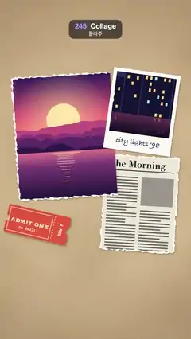

# 245 · Collage · 콜라주



**EN** Paper scraps land on a kraft scrapbook page (a torn photo, a Polaroid, stamps, a ticket, washi tape, ransom letters COLLAGE) and are swept off as new ones land.  
**KO** 크라프트 스크랩북 페이지에 찢긴 사진, 폴라로이드, 우표, 입장권, 마스킹 테이프, COLLAGE 오린 글자가 내려앉고, 새 조각이 올 때 옛 조각은 쓸려 나간다.

[Video (mp4)](https://sueun-dev.github.io/motion-effects/videos/245-collage.mp4) · [Code](../effects/245-collage.js) · Art movements & styles · 예술 사조·스타일

## Prompt (English)

```text
Create a "Collage" motion effect: a scrapbook page that fills up with cut and torn paper pieces tossed onto it one after another; they shift gently, then they are swept off to the left, last one first, while the first new pieces already land, so the page is never empty.

Look
- The page (static): kraft #CDB28A with soft mottling (fbm at a 420 px scale, light or dark at up to 22 %) and a darker rim (radial, to rgba(80, 50, 20, 0.3) at radius 1200).
- Paper fibres, fixed to the screen and laid over everything with multiply: 9,000 short 1 px strokes (3–17 px long, brown at 10 % or cream at 14 %), drawn once.
- Pieces (each made once as its own canvas; final centre and rotation):
  - a torn newspaper scrap 420 × 540 (torn on all sides, a white fibrous rim, "The Morning" in Didot bold 52 px, a 4 px rule, two columns of grey text bars, a grey picture box) at (790, 1150), 0.06 rad;
  - a torn magazine photo 560 × 700 of a purple-pink sunset over mountains and a lake (torn on three sides, straight on the right) at (360, 770), −0.07 rad;
  - a Polaroid 380 × 460 (white frame, a 340 × 340 night-city picture, "city lights '98" in Bradley Hand 40 px) at (790, 640), 0.12 rad;
  - a red ticket stub 360 × 160 (#E4573D, semicircle notches, a dashed tear line, "ADMIT ONE" in Copperplate 38 px, "No 004217", "ROW F") at (330, 1240), 0.28 rad;
  - two perforated stamps 210 × 260 (white with 7 px holes every 21 px): a "25" landscape (sky, sun, green hills) at (180, 1450), −0.16 rad, and a red AIR MAIL bird stamp at (880, 1520), 0.1 rad, with a postmark (two rings, "PARIS 12·06·98", four wavy cancel lines) running off it onto the page;
  - three washi tapes 70 px wide with zigzag ends and diagonal stripes (pink 240 px at (150, 430), mint 220 px at (790, 410), mustard 260 px at (600, 1120)), about 80 % opaque;
  - ransom-note letters C O L L A G E, each on its own cut quadrilateral scrap about 140 × 170 in a different colour and font (Didot, Futura, Impact, Rockwell, Bodoni, Arial Black, American Typewriter, 132 px), along y ≈ 1720 every 136 px from x 132, alternately 12 px higher and lower, tilted ±0.05–0.14 rad.
- Each piece casts a soft shadow rgba(40, 25, 5, 0.35): offset 2.4, 4 px and blur 8 px when lying on the page.

Motion (0–5 s): the toss timeline runs on τ = (t + 0.93) mod 5
- Each scrap lives on its own 5 s cycle, age = (τ − a) mod 5. Toss-in times a: newspaper 0, photo 0.2, Polaroid 0.4, ticket 0.55, stamps 0.7 and 0.82, tapes 0.94, 1.06, 1.18, letters 1.3 + 0.1·i.
- Toss-in: over 0.6 s each piece flies in from 900 px away along its own outward direction with a quadratic ease-out, its extra spin (0.3–0.55 rad) unwinding until it lands at its final angle. While it flies its shadow is lifted: offset 4 + 30 · (1 − p) px, blur 8 + 30 · (1 − p) px, tightening as it settles.
- Every landed piece keeps shifting gently: ±4 px in x and y and ±0.012 rad, on whole-loop sines of t with its own phase.
- Sweep: last in, first out. Piece i leaves at τ = 3.35 + 0.75 · (1.9 − a) (the last letter at 3.35, the newspaper at 4.78): over 0.7 s it slides 1400 px to the left with a quadratic ease-in, turning −0.1 rad, its shadow lifting the same way.
- The newspaper's and photo's sweeps run past τ = 5, so the old copy is still sliding out while the new one flies in: draw a piece twice (ages age and age + 5) whenever its previous sweep has not finished. The page is never empty, and the full collage holds from about τ 2.5 to 3.35.

Technique
- Canvas 2D. Torn edges are jagged polygons (points every 12 px jittered by a seeded random generator); a slightly larger jagged white shape under a smaller jagged clip gives the white torn rim. Perforations are destination-out circles.
- Everything is drawn once in setup; per frame each piece is only translated, rotated and drawn with a canvas shadow. The fine paper fibres are a fixed overlay, not part of any moving piece.

Output and rules
- One self-contained HTML file with no external assets (three.js from a CDN is fine if you use it), drawing on a 1080 × 1920 canvas (9:16) scaled to fit the window.
- Write a function renderFrame(t) that draws the frame for time t in seconds, and preview it with requestAnimationFrame. Everything must be a pure function of t and fixed seeds: no Math.random(), Date or state carried between frames, so frame i = renderFrame(i / 30) can be exported to a 30 fps video.
- Loop seamlessly every 5 seconds: renderFrame(5) must look exactly like renderFrame(0).
- No flicker of any kind: no noise or grain that changes from frame to frame, no strobing or blinking, no z-fighting, no shimmering 1 px lines. Any grain or texture stays fixed to the screen or to the object.
- Keep the top 280 px free of important content (a title label goes there) and fill the whole frame with a designed background.
```

## 프롬프트 (한국어)

```text
"콜라주" 모션 효과를 만들어 줘: 스크랩북 페이지에 오리고 찢은 종이 조각들이 하나씩 던져져 쌓이고, 살짝살짝 움직이다가, 나중에 온 것부터 왼쪽으로 쓸려 나가는 동안 첫 새 조각들이 벌써 내려앉아 페이지가 비는 순간이 없는 효과.

모양
- 페이지(움직이지 않음): 크라프트 #CDB28A에 부드러운 얼룩(420px 크기의 fbm, 밝거나 어둡게 최대 22 %), 가장자리가 더 어둡다(원형, 반지름 1200에서 rgba(80, 50, 20, 0.3)).
- 종이 섬유는 화면에 고정해 맨 위에 multiply로 덮는다: 짧은 1px 선 9,000개(길이 3–17px, 갈색 10 % 또는 크림 14 %), 한 번만 그린다.
- 조각(각각 한 번만 만든 자기 캔버스, 최종 중심과 회전):
  - 찢긴 신문 조각 420 × 540(사방이 찢김, 흰 섬유 가장자리, Didot bold 52px "The Morning", 4px 줄, 회색 글줄 두 단, 회색 사진 칸), (790, 1150), 0.06rad;
  - 찢긴 잡지 사진 560 × 700, 산과 호수 위의 보라·분홍 노을(세 변은 찢기고 오른쪽은 곧음), (360, 770), −0.07rad;
  - 폴라로이드 380 × 460(흰 테두리, 340 × 340 밤 도시 사진, Bradley Hand 40px "city lights '98"), (790, 640), 0.12rad;
  - 빨간 입장권 360 × 160(#E4573D, 반원 홈, 점선 절취선, Copperplate 38px "ADMIT ONE", "No 004217", "ROW F"), (330, 1240), 0.28rad;
  - 톱니 우표 두 장 210 × 260(흰 바탕, 21px마다 7px 구멍): "25" 풍경 우표(하늘, 해, 초록 언덕) (180, 1450), −0.16rad, 그리고 빨간 AIR MAIL 새 우표 (880, 1520), 0.1rad. 소인(고리 두 개, "PARIS 12·06·98", 물결 소인선 네 줄)이 우표 밖 페이지까지 이어진다;
  - 폭 70px 마스킹 테이프 세 개, 지그재그 끝과 사선 줄무늬(분홍 240px (150, 430), 민트 220px (790, 410), 겨자색 260px (600, 1120)), 불투명도 약 80 %;
  - 몸값 편지 글자 C O L L A G E, 글자마다 약 140 × 170의 오려 낸 사각 조각에 다른 색과 글꼴(Didot, Futura, Impact, Rockwell, Bodoni, Arial Black, American Typewriter, 132px). x 132부터 136px 간격으로 y ≈ 1720을 따라, 번갈아 12px 위아래, ±0.05–0.14rad 기울기.
- 조각마다 부드러운 그림자 rgba(40, 25, 5, 0.35): 페이지 위에 놓이면 오프셋 2.4, 4px, 흐림 8px.

움직임 (0–5초): 던지기 시간축은 τ = (t + 0.93) mod 5
- 조각마다 자기 5초 주기가 있다. age = (τ − a) mod 5. 던지는 시각 a: 신문 0, 사진 0.2, 폴라로이드 0.4, 입장권 0.55, 우표 0.7과 0.82, 테이프 0.94, 1.06, 1.18, 글자 1.3 + 0.1·i.
- 던지기: 조각마다 자기 바깥 방향 900px 밖에서 0.6초 동안 2차 ease-out으로 날아 들어오며, 더 돌던 회전(0.3–0.55rad)이 풀려 최종 각도로 내려앉는다. 날아오는 동안 그림자가 들려 있다: 오프셋 4 + 30 · (1 − p)px, 흐림 8 + 30 · (1 − p)px, 내려앉으며 좁아진다.
- 내려앉은 조각도 계속 살짝 움직인다: 각자 위상의 t에 대한 한 루프짜리 사인으로 x, y ±4px, 회전 ±0.012rad.
- 쓸어 내기: 나중에 온 것이 먼저 나간다. 조각 i는 τ = 3.35 + 0.75 · (1.9 − a)에 떠난다(마지막 글자 3.35, 신문 4.78). 0.7초 동안 2차 ease-in으로 왼쪽으로 1400px 미끄러지며 −0.1rad 돌고, 그림자도 같은 식으로 들린다.
- 신문과 사진의 쓸려 나감은 τ = 5를 넘어 이어져서, 옛 조각이 아직 나가는 동안 새 조각이 날아 들어온다: 이전 쓸어 내기가 끝나지 않았으면 그 조각을 두 번(age와 age + 5) 그린다. 페이지는 비는 순간이 없고, 완성된 콜라주는 τ 2.5쯤부터 3.35까지 머문다.

기법
- Canvas 2D. 찢긴 가장자리는 들쭉날쭉한 다각형(12px마다 점, 시드 난수로 흔듦)이다. 조금 큰 흰 들쭉날쭉 도형 위에 조금 작은 들쭉날쭉 클립으로 그림을 그리면 흰 찢긴 테두리가 생긴다. 우표 구멍은 destination-out 원이다.
- 모든 것은 setup에서 한 번 그린다. 프레임마다 조각을 옮기고 돌리고 캔버스 그림자와 함께 그리기만 한다. 고운 종이 섬유는 움직이는 조각이 아니라 고정된 덮개다.

출력과 규칙
- 외부 파일 없는 HTML 파일 하나(three.js를 쓴다면 CDN은 괜찮다). 1080 × 1920(9:16) 캔버스에 그리고 창 크기에 맞춰 보이게 한다.
- 시간 t(초)의 프레임을 그리는 renderFrame(t) 함수를 만들고, 미리보기는 requestAnimationFrame으로 돌린다. 모든 것은 t와 고정 시드만으로 정해진다: Math.random(), Date, 프레임 사이에 쌓이는 상태 금지. 그래야 i번째 프레임 = renderFrame(i / 30)으로 30fps 영상을 뽑을 수 있다.
- 5초마다 끊김 없이 반복: renderFrame(5)는 renderFrame(0)과 똑같아 보여야 한다.
- 어떤 깜빡임도 금지: 프레임마다 바뀌는 노이즈·그레인, 번쩍임·깜빡임, z-fighting, 반짝이며 떨리는 1px 선 모두 금지. 그레인·질감은 화면이나 물체에 고정한다.
- 위쪽 280px에는 중요한 내용을 두지 않고(제목 라벨 자리), 화면 전체를 디자인된 배경으로 채운다.
```
