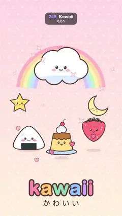

# 246 · Kawaii · 카와이



**EN** Flat pastel food and sky stickers with dot eyes and pink cheeks bounce with squash and stretch, blush, squeeze into happy smiles and sparkle.  
**KO** 점 눈과 분홍 볼의 납작한 파스텔 음식·하늘 스티커들이 찌그러졌다 늘어나며 통통 튀고, 볼을 붉히고, 눈웃음을 짓고, 반짝인다.

[Video (mp4)](https://sueun-dev.github.io/motion-effects/videos/246-kawaii.mp4) · [Code](../effects/246-kawaii.js) · Art movements & styles · 예술 사조·스타일

## Prompt (English)

```text
Create a "Kawaii" motion effect: Japanese-cute flat vector stickers (not 3D clay) with faces, bouncing, blushing, smiling and sparkling on a pastel background.

Look
- Background: a vertical gradient #FFD9E6 → #FFF1DC with white polka dots (radius 9, 55 %) every 80 px on rows 64 px apart, alternate rows offset 40 px.
- Style: flat fills, thick rounded dark-brown outlines #5A3B3B (8–9 px, 18 px round the cloud), one small white shine per shape, no gradients or 3D shading.
- Faces: two dot eyes (radius 11 · s, 25 % taller than wide) 68 · s apart with a white shine; pink blush ovals #FF8FAE beside them; a small mouth (a "ω", a smile arc, or an open mouth filled #E8607A), 5.5 · s px strokes.
- Cast:
  - a pastel rainbow (six 30 px bands #FFB3C7 #FFD8A8 #FFF3B0 #C8F0C8 #BFE3FF #D9C8FF, radii 380 down to 230, centred (540, 800)) with a white cloud on it at (540, 600): six overlapping puffs under one outline, a pale-blue belly #DDEBFF, a "ω" face;
  - a yellow star #FFE070 (outer radius 118, inner 58, scaled 0.75) at (175, 905);
  - a sleepy crescent moon #FFF0A6 (a radius-110 circle with a radius-92 circle bitten out at (48, −34), scaled 0.8) at (870, 930), eyes always closed in arcs;
  - on the ground line: an onigiri (white rice triangle with rounded corners, dark nori band #2F3B3A) at (255, 1330), scale 0.8; a purin (custard #FFE08A with dripping caramel #C47A3A, whipped cream, a cherry, on a pale-blue plate) at (545, 1400), scale 0.78; a strawberry (#FF6F7D with cream seeds and mint leaves #7ED6A0) at (830, 1330), scale 0.78.
- "kawaii" in Arial Rounded MT Bold 170 px, each letter a different pastel (#FF8FB1 #FFC56E #8ED8B5 #8FC3FF #C9A7FF #FF8FB1) with a 22 px brown outline, baseline 1730; "か わ い い" in Hiragino Maru Gothic 64 px below at y 1830.

Motion (0–5 s), a = 2π · t / 5
- The three ground stickers hop: a parabola every 1.25 s (four hops per loop), heights 70, 50 and 80 px, phases 0, 1/3, 2/3. At contact they squash (height × 0.87, width × 1/0.87, a Gaussian bump of width 0.07 of the hop) and in fast flight they stretch slightly (up to 6 %); the anchor is their bottom. A soft pink ground shadow shrinks to 65 % at the top of each hop.
- Blush: on the hoppers the cheeks grow and deepen at each landing (opacity 0.35 + 0.5 · contact); the cloud's and star's blush pulse with sin².
- Happy eyes: once per loop each character squeezes its eyes shut into "^ ^" arcs (0.35 s ease in-out), holds 0.55 s and opens again (cloud at 0.1 s, onigiri 1.0, purin 2.3, star 2.9, strawberry 3.6). The eye's height shrinks while the arc fades in, so it is a smooth smile, never a blink.
- The cloud floats ±14 px and tilts ±0.03 rad; the star bobs ±16 px and swings ±0.22 rad twice per loop; the moon bobs ±14 px and rocks ±0.15 rad.
- 12 sparkles (white four-point stars with a pink edge) at fixed random spots each swell from nothing to 30 px (their pink edge thickening with them), turn a quarter turn and shrink away once every 1.25 s from their own phase (size ∝ sin²).
- Six pink hearts float up 420 px from y 1500 over 2.5 s each, swaying 20 px and fading in and out with sin(π · q).
- The letters bob up to 26 px in a wave running along the word (max(0, sin(2a − 0.6 i))², twice per loop).

Technique
- Canvas 2D, everything redrawn each frame from parametric shapes (arcs, ellipses, quadratic and cubic Béziers). Squash and stretch is a scale about the sticker's base; all timing comes from sines with whole-number frequencies and fract(t / 1.25), so the loop is seamless.

Output and rules
- One self-contained HTML file with no external assets (three.js from a CDN is fine if you use it), drawing on a 1080 × 1920 canvas (9:16) scaled to fit the window.
- Write a function renderFrame(t) that draws the frame for time t in seconds, and preview it with requestAnimationFrame. Everything must be a pure function of t and fixed seeds: no Math.random(), Date or state carried between frames, so frame i = renderFrame(i / 30) can be exported to a 30 fps video.
- Loop seamlessly every 5 seconds: renderFrame(5) must look exactly like renderFrame(0).
- No flicker of any kind: no noise or grain that changes from frame to frame, no strobing or blinking, no z-fighting, no shimmering 1 px lines. Any grain or texture stays fixed to the screen or to the object.
- Keep the top 280 px free of important content (a title label goes there) and fill the whole frame with a designed background.
```

## 프롬프트 (한국어)

```text
"카와이" 모션 효과를 만들어 줘: 얼굴이 있는 일본식 귀여운 납작한 벡터 스티커(3D 점토가 아님)들이 파스텔 배경 위에서 통통 튀고, 볼을 붉히고, 웃고, 반짝이는 효과.

모양
- 배경: 세로 그라디언트 #FFD9E6 → #FFF1DC, 흰 물방울무늬(반지름 9, 55 %)가 80px 간격, 줄 간격 64px, 한 줄씩 40px 어긋남.
- 스타일: 평평한 색, 굵고 둥근 짙은 갈색 윤곽선 #5A3B3B(8–9px, 구름은 18px), 도형마다 작은 흰 반사광 하나, 그라디언트나 3D 음영 없음.
- 얼굴: 68 · s 간격의 점 눈 두 개(반지름 11 · s, 세로가 25 % 더 김)와 흰 반사광, 옆에 분홍 볼 #FF8FAE 타원, 작은 입("ω", 웃는 호, 또는 #E8607A로 채운 벌린 입), 선 굵기 5.5 · s px.
- 등장인물:
  - 파스텔 무지개(30px 띠 여섯 개 #FFB3C7 #FFD8A8 #FFF3B0 #C8F0C8 #BFE3FF #D9C8FF, 반지름 380에서 230, 중심 (540, 800)) 위의 흰 구름 (540, 600): 겹친 뭉게 여섯 개를 윤곽선 하나로 감싸고, 연파랑 배 #DDEBFF, "ω" 얼굴;
  - 노란 별 #FFE070(바깥 반지름 118, 안 58, 0.75배) (175, 905);
  - 졸린 초승달 #FFF0A6(반지름 110 원에서 (48, −34)의 반지름 92 원을 베어 냄, 0.8배) (870, 930), 눈은 늘 감은 호;
  - 땅 위: 오니기리(모서리가 둥근 흰 밥 삼각형, 짙은 김 띠 #2F3B3A) (255, 1330), 0.8배; 푸딩(커스터드 #FFE08A에 흘러내리는 캐러멜 #C47A3A, 휘핑크림, 체리, 연파랑 접시) (545, 1400), 0.78배; 딸기(#FF6F7D에 크림색 씨, 민트 잎 #7ED6A0) (830, 1330), 0.78배.
- Arial Rounded MT Bold 170px "kawaii", 글자마다 다른 파스텔(#FF8FB1 #FFC56E #8ED8B5 #8FC3FF #C9A7FF #FF8FB1)과 22px 갈색 윤곽, 기준선 1730. 그 아래 y 1830에 Hiragino Maru Gothic 64px "か わ い い".

움직임 (0–5초), a = 2π · t / 5
- 땅 위 스티커 셋이 뛴다: 1.25초마다 포물선(루프당 네 번), 높이 70, 50, 80px, 위상 0, 1/3, 2/3. 닿는 순간 찌그러지고(높이 × 0.87, 폭 × 1/0.87, 점프의 0.07 폭 가우스 혹), 빠르게 날 때는 살짝 늘어난다(최대 6 %). 기준점은 바닥. 분홍 그림자는 점프 꼭대기에서 65 %로 줄어든다.
- 볼: 뛰는 셋은 내려앉을 때마다 볼이 커지고 진해진다(불투명도 0.35 + 0.5 · 닿음). 구름과 별의 볼은 sin²으로 맥동한다.
- 눈웃음: 루프마다 한 번씩 각자 눈을 "^ ^" 호로 감는다(0.35초 ease in-out), 0.55초 머문 뒤 다시 뜬다(구름 0.1초, 오니기리 1.0, 푸딩 2.3, 별 2.9, 딸기 3.6). 눈 높이가 줄어드는 동안 호가 서서히 나타나므로 깜빡임이 아니라 부드러운 웃음이다.
- 구름은 ±14px 떠오르고 ±0.03rad 기운다. 별은 루프당 두 번 ±16px 오르내리며 ±0.22rad 흔들리고, 달은 ±14px 오르내리며 ±0.15rad 흔들린다.
- 반짝이 12개(분홍 테의 흰 네 갈래 별)가 고정된 무작위 자리에서 자기 위상으로 1.25초마다 0에서 30px까지 부풀고(분홍 테도 함께 굵어짐), 90도 돌고, 사라진다(크기 ∝ sin²).
- 분홍 하트 여섯 개가 y 1500에서 2.5초 동안 420px 떠오르며 20px 흔들리고 sin(π · q)로 나타났다 사라진다.
- 글자는 단어를 따라 흐르는 물결로 최대 26px 오르내린다(max(0, sin(2a − 0.6 i))², 루프당 두 번).

기법
- Canvas 2D, 매 프레임 매개변수 도형(호, 타원, 2차·3차 베지어)으로 모두 다시 그린다. 찌그러짐과 늘어남은 스티커 바닥을 기준으로 한 크기 변환이다. 모든 타이밍은 정수 주파수의 사인과 fract(t / 1.25)에서 나오므로 끊김 없이 반복된다.

출력과 규칙
- 외부 파일 없는 HTML 파일 하나(three.js를 쓴다면 CDN은 괜찮다). 1080 × 1920(9:16) 캔버스에 그리고 창 크기에 맞춰 보이게 한다.
- 시간 t(초)의 프레임을 그리는 renderFrame(t) 함수를 만들고, 미리보기는 requestAnimationFrame으로 돌린다. 모든 것은 t와 고정 시드만으로 정해진다: Math.random(), Date, 프레임 사이에 쌓이는 상태 금지. 그래야 i번째 프레임 = renderFrame(i / 30)으로 30fps 영상을 뽑을 수 있다.
- 5초마다 끊김 없이 반복: renderFrame(5)는 renderFrame(0)과 똑같아 보여야 한다.
- 어떤 깜빡임도 금지: 프레임마다 바뀌는 노이즈·그레인, 번쩍임·깜빡임, z-fighting, 반짝이며 떨리는 1px 선 모두 금지. 그레인·질감은 화면이나 물체에 고정한다.
- 위쪽 280px에는 중요한 내용을 두지 않고(제목 라벨 자리), 화면 전체를 디자인된 배경으로 채운다.
```
