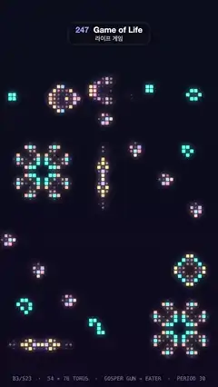

# 247 · Game of Life · 라이프 게임



**EN** On a 54 × 76 torus a Gosper gun fires gliders that wrap round the edge into an eater; cells glow up when born and fade slowly, so pulsars breathe.  
**KO** 54 × 76 토러스에서 고스퍼 총이 쏜 글라이더가 가장자리를 넘어 돌아와 이터에게 먹히고, 세포는 태어나며 밝아지고 천천히 사그라들어 펄서가 숨 쉬듯 빛난다.

[Video (mp4)](https://sueun-dev.github.io/motion-effects/videos/247-game-of-life.mp4) · [Code](../effects/247-game-of-life.js) · Generative math · 제너러티브 수학

## Prompt (English)

```text
Create a "Game of Life" motion effect: Conway's cellular automaton on a wrapping board, with a glider gun, an eater, classic oscillators and still lifes, where every cell glows with an afterglow (so nothing blinks) and the whole board returns to its start every 5 seconds.

Look
- Background: a vertical gradient #0A0E1C → #0E0A1E. The board is 54 × 76 cells of 20 px, filling the width from y 320 to 1840, with faint 2 × 2 px dots (rgba 160, 180, 255, 0.10) on the cell corners.
- Each cell is drawn from its glow g (0..1): a rounded square 6 + 11g px (corner radius 3 + 2(1 − g)) centred in its cell, opacity min(1, 1.2g), skipped below 0.01.
- Its colour comes from a colour value c on a scale: 0 violet (130, 95, 255) for a dead cell's afterglow, 0.25 newborn amber (255, 200, 110), 0.5 rose (255, 112, 150), 0.75 sky (110, 170, 255), 1 settled teal (63, 214, 201) for cells alive 3 generations or more.
- Glow: the cells drawn into a quarter-size canvas (one 4 × 4 px block per cell), blurred 14 px, scaled back up and added with "lighter" at 55 %.
- Caption at y 1880 in Menlo 26 px, 55 % blue-white: "B3/S23 · 54 × 76 TORUS · GOSPER GUN → EATER · PERIOD 30".

The board (B3/S23 on a torus: the left edge wraps to the right, the top to the bottom)
- A Gosper glider gun at (2, 3) firing gliders down and to the right every 30 generations. The stream leaves through the right edge, comes back on the left (the torus) and is swallowed by an eater (fishhook: OO / O.O / ..O / ..OO) at (22, 63).
- Around it, out of the stream's way: pulsars (period 3) at (4, 20) and (38, 59), a vertical row of ten cells at (25, 23) and a horizontal one at (5, 69) (each settles into a pentadecathlon, period 15), an octagon (period 5) at (43, 47), and still lifes: a loaf at (4, 58), a boat at (45, 20), a beehive at (46, 6). No period-2 oscillators.
- Every period divides 30, so after its start-up the whole board repeats exactly every 30 generations.

Motion (0–5 s)
- Precompute: step the board 600 generations to get past the start-up, record generations 590–630, and check that generation 630 equals 600. Per cell and generation store alive (0/1) and age (capped at 3).
- 30 generations in 5 s (6 per second): u = 30 · t / 5 + 0.4, k = floor(u) mod 30, f = smoothstep(u − floor(u)); a cell's aliveness v is interpolated between generation k and k + 1 with f.
- Afterglow, from the cyclic history: run two one-pole filters frame by frame (1/30 s steps) over three loops and keep the last 150 frames, so they are periodic. The glow g follows v quickly upward (time constant 0.08 s, so a newborn cell eases up over about 0.2 s) and slowly downward (0.2 s, so a dead cell fades over about 0.5 s). The colour value c eases toward v · (0.25 + 0.25 · age) with a 0.25 s time constant, so colours drift instead of jumping and a dying cell's glow turns violet.
- Result: pulsars and pentadecathlons breathe softly (a pulsar cell's brightness swings by about a third and never goes dark), gliders leave short violet comet tails, nothing blinks. Between stored frames the values are interpolated linearly.
- Because generation 30 equals generation 0 and the filters run over the periodic history, t = 5 matches t = 0 exactly.

Technique
- Canvas 2D. The simulation is a plain double loop with wrapped neighbour indices; it and the two filters run once in setup (the filtered values stored as bytes, 150 frames × 4,104 cells), and drawing is a pure function of t. The quarter-size glow canvas and the fixed dot grid keep the look soft without any per-frame noise.

Output and rules
- One self-contained HTML file with no external assets (three.js from a CDN is fine if you use it), drawing on a 1080 × 1920 canvas (9:16) scaled to fit the window.
- Write a function renderFrame(t) that draws the frame for time t in seconds, and preview it with requestAnimationFrame. Everything must be a pure function of t and fixed seeds: no Math.random(), Date or state carried between frames, so frame i = renderFrame(i / 30) can be exported to a 30 fps video.
- Loop seamlessly every 5 seconds: renderFrame(5) must look exactly like renderFrame(0).
- No flicker of any kind: no noise or grain that changes from frame to frame, no strobing or blinking, no z-fighting, no shimmering 1 px lines. Any grain or texture stays fixed to the screen or to the object.
- Keep the top 280 px free of important content (a title label goes there) and fill the whole frame with a designed background.
```

## 프롬프트 (한국어)

```text
"라이프 게임" 모션 효과를 만들어 줘: 가장자리가 이어지는 판 위의 콘웨이 세포 자동자. 글라이더 총, 이터, 고전 진동자, 정물이 있고, 모든 세포가 잔광으로 빛나서(그래서 아무것도 깜빡이지 않음) 판 전체가 5초마다 처음 상태로 돌아온다.

모양
- 배경: 세로 그라디언트 #0A0E1C → #0E0A1E. 판은 20px 칸 54 × 76개로 폭을 꽉 채우고 y 320에서 1840까지, 칸 모서리마다 희미한 2 × 2px 점(rgba 160, 180, 255, 0.10).
- 세포는 빛 g(0..1)로 그린다: 칸 가운데의 6 + 11g px 둥근 사각형(모서리 반지름 3 + 2(1 − g)), 불투명도 min(1, 1.2g), 0.01 미만이면 그리지 않는다.
- 색은 색 값 c의 눈금에서 정한다: 0은 죽은 세포 잔광의 보라 (130, 95, 255), 0.25는 갓 태어난 호박색 (255, 200, 110), 0.5 장미색 (255, 112, 150), 0.75 하늘색 (110, 170, 255), 1은 3세대 이상 산 세포의 청록 (63, 214, 201).
- 빛 번짐: 세포를 1/4 크기 캔버스에 그리고(세포마다 4 × 4px), 14px 흐리고, 다시 키워 "lighter"로 55 % 더한다.
- y 1880에 Menlo 26px, 55 % 푸른 흰색 캡션: "B3/S23 · 54 × 76 TORUS · GOSPER GUN → EATER · PERIOD 30".

판 (토러스 위의 B3/S23: 왼쪽 끝은 오른쪽으로, 위는 아래로 이어진다)
- (2, 3)에 고스퍼 글라이더 총, 30세대마다 오른쪽 아래로 글라이더를 쏜다. 글라이더 줄은 오른쪽 끝으로 나가 왼쪽으로 다시 들어오고(토러스) (22, 63)의 이터(낚싯바늘: OO / O.O / ..O / ..OO)에게 먹힌다.
- 주변, 글라이더 길을 피해: 펄서(주기 3) (4, 20)과 (38, 59), (25, 23)의 세로 10칸 줄과 (5, 69)의 가로 10칸 줄(각각 펜타데카슬론, 주기 15가 된다), 옥타곤(주기 5) (43, 47), 그리고 정물: 로프 (4, 58), 보트 (45, 20), 비하이브 (46, 6). 주기 2 진동자는 없다.
- 모든 주기가 30의 약수라서, 초기 과정이 지나면 판 전체가 30세대마다 정확히 반복된다.

움직임 (0–5초)
- 미리 계산: 초기 과정을 넘기려고 판을 600세대 돌리고, 590–630세대를 기록하고, 630세대가 600세대와 같은지 확인한다. 세포와 세대마다 생존(0/1)과 나이(최대 3)를 저장한다.
- 5초에 30세대(초당 6세대): u = 30 · t / 5 + 0.4, k = floor(u) mod 30, f = smoothstep(u − floor(u)). 세포의 생존도 v는 k세대와 k + 1세대 사이에서 f로 보간한다.
- 순환 기록에서 얻는 잔광: 1차 필터 두 개를 프레임 단위(1/30초)로 세 루프 동안 돌리고 마지막 150프레임을 남겨서 주기적으로 만든다. 빛 g는 올라갈 때 v를 빠르게(시간 상수 0.08초, 그래서 갓 태어난 세포는 약 0.2초에 걸쳐 밝아짐), 내려갈 때 천천히(0.2초, 그래서 죽은 세포는 약 0.5초에 걸쳐 사그라짐) 따라간다. 색 값 c는 0.25초 시간 상수로 v · (0.25 + 0.25 · 나이)를 향해 움직여, 색이 튀지 않고 흘러가며 죽는 세포의 빛은 보라로 바뀐다.
- 결과: 펄서와 펜타데카슬론은 부드럽게 숨 쉬고(펄서 세포의 밝기는 3분의 1쯤만 오르내리고 어두워지지 않음), 글라이더는 짧은 보라 꼬리를 남기며, 아무것도 깜빡이지 않는다. 저장한 프레임 사이 값은 선형 보간한다.
- 30세대가 0세대와 같고 필터가 주기적인 기록 위에서 돌므로 t = 5는 t = 0과 정확히 같다.

기법
- Canvas 2D. 시뮬레이션은 이웃 인덱스를 감싼 단순한 이중 반복문이고, 시뮬레이션과 두 필터는 setup에서 한 번만 돌린다(필터 값은 바이트로, 150프레임 × 4,104칸). 그리기는 t의 순수 함수다. 1/4 크기 빛 번짐 캔버스와 고정된 점 격자로, 프레임마다 바뀌는 노이즈 없이 부드러운 느낌을 낸다.

출력과 규칙
- 외부 파일 없는 HTML 파일 하나(three.js를 쓴다면 CDN은 괜찮다). 1080 × 1920(9:16) 캔버스에 그리고 창 크기에 맞춰 보이게 한다.
- 시간 t(초)의 프레임을 그리는 renderFrame(t) 함수를 만들고, 미리보기는 requestAnimationFrame으로 돌린다. 모든 것은 t와 고정 시드만으로 정해진다: Math.random(), Date, 프레임 사이에 쌓이는 상태 금지. 그래야 i번째 프레임 = renderFrame(i / 30)으로 30fps 영상을 뽑을 수 있다.
- 5초마다 끊김 없이 반복: renderFrame(5)는 renderFrame(0)과 똑같아 보여야 한다.
- 어떤 깜빡임도 금지: 프레임마다 바뀌는 노이즈·그레인, 번쩍임·깜빡임, z-fighting, 반짝이며 떨리는 1px 선 모두 금지. 그레인·질감은 화면이나 물체에 고정한다.
- 위쪽 280px에는 중요한 내용을 두지 않고(제목 라벨 자리), 화면 전체를 디자인된 배경으로 채운다.
```
