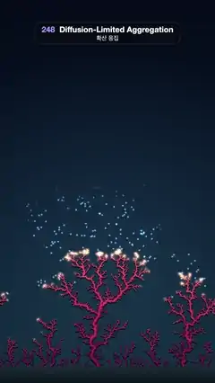

# 248 · Diffusion-Limited Aggregation · 확산 응집



**EN** Coral-pink branches grow up from a seabed as wandering particles stick to their tips one by one, the growth front glowing, then fade back to seedlings.  
**KO** 떠돌던 입자가 끝에 하나씩 달라붙으며 바닥에서 산호빛 가지가 자라 오르고, 자라는 끝이 빛나다가 다시 새싹만 남는다.

[Video (mp4)](https://sueun-dev.github.io/motion-effects/videos/248-dla.mp4) · [Code](../effects/248-dla.js) · Generative math · 제너러티브 수학

## Prompt (English)

```text
Create a "Diffusion-Limited Aggregation" motion effect: a coral reef that grows from a seabed because random walkers wander in and stick wherever they first touch it, so branches screen each other and only the tips keep growing.

Look
- Background: a vertical gradient #040A18 (top) → #08182A (55 %) → #0E2636 (bottom), plus a soft radial glow rgba(60, 110, 150, 0.28) centred at (540, 1340), fading to nothing at radius 1100. A seabed band from y = 1838 to the bottom, #1B2C36 → #0A141B.
- The cluster is built once with off-lattice DLA (seed 248) in a strip 540 units wide (wrapping left to right) and 760 units tall, drawn at 2 px per unit with the seabed at y = 1840; particles have radius 1 unit.
  - Each walker starts 6 units above the highest stuck particle at a random x. Each step it moves in a random direction: by (height above the cluster top − 2) when it is more than 3 units above the top, by 5 units when no particle sits in the 3 × 3 block of 8-unit grid cells around it, otherwise by 1 unit. If it wanders more than 40 units above the top it restarts at a new random x.
  - It sticks when its centre comes within 2 units of a stuck particle (placed at exactly 2 units from it, which becomes its parent) or when it reaches the seabed (y < 1, no parent). It stops when the cluster reaches the top: about 14,950 particles.
  - Every 16th particle keeps the last 40 positions of its walk, smoothed with a 9-point moving average (the last point pinned to where it stuck).
- Branches: each particle is a round-capped line from its parent (or straight up from the seabed) to itself.
  - Width = 1.7 + 0.6 · load^0.42 px, rounded to 0.25 px, where load is the number of shown particles it carries (itself plus everything grown on it), so trunks thicken as the reef fills in.
  - Colour by birth order in 10 bands: #5E0B2E, #86133A, #B02145, #D9374F, #F2575A, #FF7A66, #FF9C78, #FFBC90, #FFD7AE, #FFEBD0 (old and deep red at the base, pale peach at the tips).
  - Three passes: a contact shadow #050D1A (width + 3 px, 4 px lower), the body, then a lighter ridge 36 % as wide, offset (−0.6, −0.8) px, in a lighter version of each band colour (#8A2A4C … #FFF5E6).
- Growth front: the newest 600 particles glow, each with a warm radial sprite 26 px wide (white-gold core, orange edge) drawn additively at alpha 0.55 · (1 − age / 600)².
- Walkers: each recorded walk appears for its last 0.6 s before the particle sticks, as a 14 px cyan-white glow sprite moving along the smoothed path, with a 1.5 px #9FE3FF trail over its previous 16 steps at alpha 0.16; it lands exactly when its particle appears.

Motion (one 5 s cycle; the video starts 1.4 s into it)
- A replay clock orders the particles: clock = 0.3 · (index / count) + 0.7 · (highest particle so far / final height), so the front climbs at a steady pace.
- 0–4.2 s: with k = t / 4.2 the clock runs from the value of the first 3 % of particles (seedlings on the seabed) to 1 along 0.75 k − 0.25 cos(π k) + 0.25. Each new segment extends out of its parent over 25 particles, and its load fades in over 60 particles, so nothing pops.
- 4.2–5 s: the full reef cross-fades (smoothstep from 4.25 to 4.95 s) away, leaving the seedlings, which is where the cycle starts.

Technique
- Canvas 2D. The aggregation runs once in setup with a seeded random generator and two grids (2-unit cells for the contact test, 8-unit cells for the long-step test). Each frame sums the loads down the tree (one backwards pass over the particle list), groups segments by width and colour band, and strokes one path per group.
- The full reef for the fade is drawn on an off-screen canvas and composited with globalAlpha.

Output and rules
- One self-contained HTML file with no external assets (three.js from a CDN is fine if you use it), drawing on a 1080 × 1920 canvas (9:16) scaled to fit the window.
- Write a function renderFrame(t) that draws the frame for time t in seconds, and preview it with requestAnimationFrame. Everything must be a pure function of t and fixed seeds: no Math.random(), Date or state carried between frames, so frame i = renderFrame(i / 30) can be exported to a 30 fps video.
- Loop seamlessly every 5 seconds: renderFrame(5) must look exactly like renderFrame(0).
- No flicker of any kind: no noise or grain that changes from frame to frame, no strobing or blinking, no z-fighting, no shimmering 1 px lines. Any grain or texture stays fixed to the screen or to the object.
- Keep the top 280 px free of important content (a title label goes there) and fill the whole frame with a designed background.
```

## 프롬프트 (한국어)

```text
"확산 응집(DLA)" 모션 효과를 만들어 줘: 무작위로 떠도는 입자가 처음 닿는 곳에 달라붙으면서 바닥에서 산호초가 자라는 효과. 가지끼리 서로 가려서 끝만 계속 자란다.

모양
- 배경: 세로 그라디언트 #040A18(위) → #08182A(55 %) → #0E2636(아래), 그리고 (540, 1340)을 중심으로 반지름 1100에서 사라지는 부드러운 원형 빛 rgba(60, 110, 150, 0.28). y = 1838부터 아래까지 바닥 띠 #1B2C36 → #0A141B.
- 덩어리는 격자 없는 DLA로 한 번만 만든다(시드 248). 폭 540단위(좌우가 이어짐), 높이 760단위의 띠에서 계산하고 1단위 = 2 px로 그리며, 바닥은 y = 1840. 입자 반지름은 1단위.
  - 각 입자는 가장 높이 붙은 입자보다 6단위 위, 무작위 x에서 출발한다. 매 걸음 무작위 방향으로 움직인다: 덩어리 꼭대기보다 3단위 넘게 위면 (꼭대기 위 높이 − 2)만큼, 주변 8단위 격자 3 × 3칸에 입자가 하나도 없으면 5단위, 그 밖에는 1단위. 꼭대기보다 40단위 넘게 올라가면 새 무작위 x에서 다시 출발한다.
  - 붙은 입자와 중심 거리가 2단위 안으로 들어오면(그 입자에서 정확히 2단위 떨어진 곳에 붙고, 그 입자가 부모가 된다) 또는 바닥(y < 1, 부모 없음)에 닿으면 붙는다. 덩어리가 꼭대기에 닿으면 멈춘다: 약 14,950개.
  - 16번째 입자마다 걸음의 마지막 40개 위치를 9점 이동평균으로 다듬어 기억한다(마지막 점은 붙은 자리에 고정).
- 가지: 입자마다 부모에서(부모가 없으면 바닥에서 곧게 위로) 자기까지 끝이 둥근 선 하나.
  - 굵기 = 1.7 + 0.6 · load^0.42 px(0.25 px 단위로 반올림). load는 그 입자가 받치고 있는 보이는 입자 수(자기 + 그 위에 자란 모든 것)라서, 산호가 채워질수록 줄기가 굵어진다.
  - 색은 태어난 순서로 10단계: #5E0B2E, #86133A, #B02145, #D9374F, #F2575A, #FF7A66, #FF9C78, #FFBC90, #FFD7AE, #FFEBD0(밑동은 오래되고 짙은 빨강, 끝은 옅은 복숭아색).
  - 세 번 그린다: 접촉 그림자 #050D1A(굵기 + 3 px, 4 px 아래), 몸통, 그 위에 36 % 굵기의 밝은 능선을 (−0.6, −0.8) px 옮겨 각 단계의 밝은 색(#8A2A4C … #FFF5E6)으로.
- 자라는 끝: 가장 새로운 입자 600개가 빛난다. 폭 26 px의 따뜻한 원형 스프라이트(흰 금빛 중심, 주황 가장자리)를 알파 0.55 · (1 − 나이 / 600)²로 더하기 합성.
- 떠도는 입자: 기록된 걸음은 그 입자가 붙기 전 마지막 0.6초 동안 보인다. 다듬은 경로를 따라 움직이는 14 px 하늘빛 흰 스프라이트와, 앞선 16걸음을 따라가는 1.5 px #9FE3FF 꼬리(알파 0.16). 그 입자가 나타나는 순간 정확히 그 자리에 닿는다.

움직임 (한 주기 5초, 영상은 주기의 1.4초에서 시작)
- 재생 시계로 입자 순서를 정한다: 시계 = 0.3 · (번호 / 개수) + 0.7 · (지금까지 가장 높은 입자 / 최종 높이). 그래서 자라는 끝이 일정한 속도로 올라간다.
- 0–4.2초: k = t / 4.2일 때 시계가 처음 3 % 입자(바닥의 새싹)의 값에서 1까지 0.75 k − 0.25 cos(π k) + 0.25를 따라 간다. 새 선분은 25입자에 걸쳐 부모에서 뻗어 나오고 load는 60입자에 걸쳐 차오르므로 툭 튀어나오는 것이 없다.
- 4.2–5초: 다 자란 산호가 사라지고(4.25초에서 4.95초까지 smoothstep) 새싹만 남는다. 주기는 거기서 다시 시작한다.

기법
- Canvas 2D. 응집은 setup에서 시드 난수와 격자 두 개(접촉 검사용 2단위 칸, 긴 걸음 검사용 8단위 칸)로 한 번만 돌린다. 매 프레임 나무를 따라 load를 더하고(입자 목록을 거꾸로 한 번 훑기), 선분을 굵기와 색 단계로 묶어 묶음마다 경로 하나를 긋는다.
- 사라지는 다 자란 산호는 화면 밖 캔버스에 그려 globalAlpha로 합성한다.

출력과 규칙
- 외부 파일 없는 HTML 파일 하나(three.js를 쓴다면 CDN은 괜찮다). 1080 × 1920(9:16) 캔버스에 그리고 창 크기에 맞춰 보이게 한다.
- 시간 t(초)의 프레임을 그리는 renderFrame(t) 함수를 만들고, 미리보기는 requestAnimationFrame으로 돌린다. 모든 것은 t와 고정 시드만으로 정해진다: Math.random(), Date, 프레임 사이에 쌓이는 상태 금지. 그래야 i번째 프레임 = renderFrame(i / 30)으로 30fps 영상을 뽑을 수 있다.
- 5초마다 끊김 없이 반복: renderFrame(5)는 renderFrame(0)과 똑같아 보여야 한다.
- 어떤 깜빡임도 금지: 프레임마다 바뀌는 노이즈·그레인, 번쩍임·깜빡임, z-fighting, 반짝이며 떨리는 1px 선 모두 금지. 그레인·질감은 화면이나 물체에 고정한다.
- 위쪽 280px에는 중요한 내용을 두지 않고(제목 라벨 자리), 화면 전체를 디자인된 배경으로 채운다.
```
