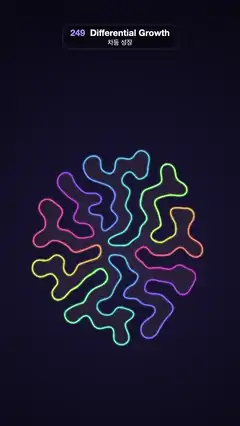

# 249 · Differential Growth · 차등 성장



**EN** A glowing rainbow ring of nodes keeps growing longer, buckles and folds into a dense brain-coral maze, then dissolves back into the small ring.  
**KO** 무지갯빛으로 빛나는 고리가 계속 길어지며 구부러지고 접혀 뇌산호 같은 빽빽한 미로가 된 뒤, 다시 작은 고리로 녹아든다.

[Video (mp4)](https://sueun-dev.github.io/motion-effects/videos/249-differential-growth.mp4) · [Code](../effects/249-differential-growth.js) · Generative math · 제너러티브 수학

## Prompt (English)

```text
Create a "Differential Growth" motion effect: a closed line that keeps getting longer inside the same space, so it has to buckle and fold into brain-coral meanders.

Look
- Background: a radial gradient centred at (540, 1100), #1B1838 at radius 100 to #090814 at radius 1150.
- The line is a closed loop of nodes, simulated once in setup (seed 249), 2,000 steps:
  - Start: 64 nodes on a circle of radius 70 px around (540, 1100).
  - Each step every node is pulled 0.4 of the way toward the midpoint of its two neighbours (smoothing), and pushed away from every other non-neighbour node closer than 26 px by (26 − d) / 26 · 0.6 px along the line between them (use a 26 px grid to find them). A soft oval wall (semi-axes 450 × 740 px around the centre) pushes back by 60 × the overshoot.
  - Then every edge longer than 10 px gets a new node at its midpoint, and while the loop has fewer than 16,000 nodes each edge also splits with probability 0.004 per step (the growth). It ends near 16,000 nodes.
  - Keep a snapshot of the node positions and ids every 8 steps (251 snapshots).
- Colour: every node carries u, the spot on the first ring its material came from (a new node takes the midpoint of its neighbours' u). The line is cut into 96 runs by u, each coloured from a cosine palette that goes round twice along the loop: rgb = 0.62 + 0.38 · cos(2π (2u + (0, 0.3, 0.62))). So the colours stay attached to the material as it stretches and folds.
- Drawing: a smooth closed curve through the edge midpoints (quadratic curves with the nodes as control points). The inside is filled faintly with rgba(255, 190, 150, 0.07). Each run is stroked twice, a 15 px glow at alpha 0.22 and a 6.5 px line, round caps and joins; then the whole loop gets a 1.6 px white core at alpha 0.35.
- Camera: zoom about the centre by (final rms radius / current rms radius)^0.8, so the small ring starts about 3.7× larger and the camera pulls back as the maze grows; line widths stay the same on screen.

Motion (one 5 s cycle; the video starts 1.4 s into it)
- 0–4.3 s: the growth plays from the ring to the full maze. Between two snapshots, nodes move linearly from their old to their new positions; a node born between them starts on the line between the old nodes on either side of it.
- The replay is paced by how much the picture changes: a clock adds up, snapshot by snapshot, the on-screen movement of the nodes divided by the fold width (26 px × zoom), weighted by (0.15 + (on-screen size / final size)²). With k = t / 4.3 the clock runs along 0.7 k + 0.3 (0.5 − 0.5 cos π k).
- 4.3–5 s: the grown maze cross-fades (smoothstep) into the first ring, where the cycle starts again.

Technique
- Canvas 2D. The simulation (a grid of linked lists for the neighbour search) and the replay clock are computed in setup; each frame only blends two snapshots and draws them with Path2D (one path per colour run). The final maze for the cross-fade is drawn on an off-screen canvas.

Output and rules
- One self-contained HTML file with no external assets (three.js from a CDN is fine if you use it), drawing on a 1080 × 1920 canvas (9:16) scaled to fit the window.
- Write a function renderFrame(t) that draws the frame for time t in seconds, and preview it with requestAnimationFrame. Everything must be a pure function of t and fixed seeds: no Math.random(), Date or state carried between frames, so frame i = renderFrame(i / 30) can be exported to a 30 fps video.
- Loop seamlessly every 5 seconds: renderFrame(5) must look exactly like renderFrame(0).
- No flicker of any kind: no noise or grain that changes from frame to frame, no strobing or blinking, no z-fighting, no shimmering 1 px lines. Any grain or texture stays fixed to the screen or to the object.
- Keep the top 280 px free of important content (a title label goes there) and fill the whole frame with a designed background.
```

## 프롬프트 (한국어)

```text
"차등 성장" 모션 효과를 만들어 줘: 닫힌 선이 같은 공간 안에서 계속 길어져서, 구부러지고 접히며 뇌산호 같은 구불구불한 무늬가 되는 효과.

모양
- 배경: (540, 1100)을 중심으로 한 원형 그라디언트, 반지름 100에서 #1B1838, 반지름 1150에서 #090814.
- 선은 노드로 이루어진 닫힌 고리이고 setup에서 한 번만 시뮬레이션한다(시드 249), 2,000스텝:
  - 시작: (540, 1100) 둘레 반지름 70 px 원 위의 노드 64개.
  - 매 스텝 각 노드는 두 이웃의 중점 쪽으로 0.4만큼 당겨지고(매끄럽게), 26 px보다 가까운 이웃 아닌 노드마다 둘을 잇는 방향으로 (26 − d) / 26 · 0.6 px씩 밀려난다(26 px 격자로 찾는다). 중심 둘레의 부드러운 타원 벽(반축 450 × 740 px)이 넘친 거리의 60배로 되민다.
  - 그다음 10 px보다 긴 변은 중점에 새 노드를 넣고, 노드가 16,000개보다 적은 동안은 모든 변이 스텝마다 0.004 확률로도 나뉜다(성장). 끝에는 노드가 약 16,000개.
  - 8스텝마다 노드 위치와 id를 스냅숏으로 남긴다(251개).
- 색: 노드마다 u를 가진다. 처음 고리에서 그 노드의 재료가 온 자리다(새 노드는 이웃 u의 중점). 선을 u에 따라 96구간으로 나누고, 고리를 따라 두 바퀴 도는 코사인 팔레트로 칠한다: rgb = 0.62 + 0.38 · cos(2π (2u + (0, 0.3, 0.62))). 그래서 늘어나고 접혀도 색이 재료에 붙어 다닌다.
- 그리기: 변의 중점을 지나는 매끄러운 닫힌 곡선(노드를 조절점으로 한 2차 곡선). 안쪽은 rgba(255, 190, 150, 0.07)로 옅게 채운다. 구간마다 두 번 긋는다: 알파 0.22의 15 px 빛과 6.5 px 선, 끝과 이음은 둥글게. 그 위에 고리 전체를 알파 0.35의 1.6 px 흰 심으로.
- 카메라: 중심을 기준으로 (최종 rms 반지름 / 현재 rms 반지름)^0.8만큼 확대한다. 작은 고리는 약 3.7배로 시작하고 미로가 자라면서 카메라가 물러난다. 선 굵기는 화면에서 그대로.

움직임 (한 주기 5초, 영상은 주기의 1.4초에서 시작)
- 0–4.3초: 고리에서 다 자란 미로까지 성장을 재생한다. 두 스냅숏 사이에서 노드는 옛 위치에서 새 위치로 직선으로 움직이고, 그 사이에 태어난 노드는 양옆 옛 노드를 잇는 선 위에서 출발한다.
- 재생 속도는 화면이 얼마나 바뀌는지로 맞춘다: 스냅숏마다 노드의 화면 이동량을 접힘 폭(26 px × 확대율)으로 나누고 (0.15 + (화면 크기 / 최종 크기)²)를 곱해 시계에 더한다. k = t / 4.3일 때 시계는 0.7 k + 0.3 (0.5 − 0.5 cos π k)를 따른다.
- 4.3–5초: 다 자란 미로가 처음 고리로 크로스페이드(smoothstep)되고, 주기는 거기서 다시 시작한다.

기법
- Canvas 2D. 시뮬레이션(이웃 찾기는 연결 리스트 격자)과 재생 시계는 setup에서 계산하고, 매 프레임은 스냅숏 두 개를 섞어 Path2D로 그린다(색 구간마다 경로 하나). 크로스페이드용 최종 미로는 화면 밖 캔버스에 그린다.

출력과 규칙
- 외부 파일 없는 HTML 파일 하나(three.js를 쓴다면 CDN은 괜찮다). 1080 × 1920(9:16) 캔버스에 그리고 창 크기에 맞춰 보이게 한다.
- 시간 t(초)의 프레임을 그리는 renderFrame(t) 함수를 만들고, 미리보기는 requestAnimationFrame으로 돌린다. 모든 것은 t와 고정 시드만으로 정해진다: Math.random(), Date, 프레임 사이에 쌓이는 상태 금지. 그래야 i번째 프레임 = renderFrame(i / 30)으로 30fps 영상을 뽑을 수 있다.
- 5초마다 끊김 없이 반복: renderFrame(5)는 renderFrame(0)과 똑같아 보여야 한다.
- 어떤 깜빡임도 금지: 프레임마다 바뀌는 노이즈·그레인, 번쩍임·깜빡임, z-fighting, 반짝이며 떨리는 1px 선 모두 금지. 그레인·질감은 화면이나 물체에 고정한다.
- 위쪽 280px에는 중요한 내용을 두지 않고(제목 라벨 자리), 화면 전체를 디자인된 배경으로 채운다.
```
