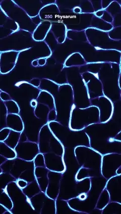

# 250 · Physarum · 점균



**EN** Slime-mould agents sniff and follow each other's trails, so a fine glowing mesh coarsens into thick blue veins and relaxes back, agents streaming along.  
**KO** 점균 에이전트들이 서로 남긴 흔적을 맡고 따라가며, 빛나는 촘촘한 그물이 굵은 푸른 관으로 뭉쳤다가 다시 풀리고, 그 위로 에이전트가 흐른다.

[Video (mp4)](https://sueun-dev.github.io/motion-effects/videos/250-physarum.mp4) · [Code](../effects/250-physarum.js) · Generative math · 제너러티브 수학

## Prompt (English)

```text
Create a "Physarum" motion effect: the slime-mould transport network model (Jeff Jones), where many simple agents that follow each other's scent trails build glowing vein networks.

Look
- Simulation (once, fixed seed 250): a 360 × 640 trail map that wraps at the edges, drawn at 3 px per cell to fill the 1080 × 1920 frame, and 150,000 agents scattered evenly with random headings.
  - Each step every agent reads the trail at three sensors 9 cells ahead: straight on, 45° left and 45° right. If straight is strongest it keeps going; if straight is weakest it turns 45° left or right at random; otherwise it turns 45° toward the stronger side. Then it moves 1 cell and adds 5 to the trail under it.
  - After all agents move, the map is blurred with a 3 × 3 box and multiplied by 0.9.
  - Keep the map every 3 steps from step 45 to step 180 (46 maps): a fine mesh at first, coarsening into a few thick veins. Store each on a log scale, 255 · ln(1 + 8 T / top) / ln 9, where top is the 99.5th percentile of the map, smoothed over the neighbouring ±4 maps.
  - Also record the positions of every 25th agent (6,000 agents) at every step.
- Shading (a fragment shader on the stored map): a cubic B-spline upsample of the map for smooth veins, and a halo from a 7 × 7 Gaussian of every second cell.
  - Background: (0.015, 0.02, 0.06) at the bottom to (0.035, 0.05, 0.13) at the top, plus violet glow (0.25, 0.18, 0.75) · halo^1.5 · 0.8.
  - Map value v: a faint film (0.20, 0.14, 0.48) from v 0.3 to 0.55, veins (0.20, 0.72, 1.0) from 0.52 to 0.76, bright cores (0.88, 0.98, 1.0) from 0.78 to 1.
- Agents on top: each recorded agent is a short streak through its positions 3, 1.5 and 0 steps ago, 1.8 px wide, round caps, added with additive blending: rgba(200, 245, 255, 0.42) when it rides a vein (map value above 170 of 255), rgba(170, 160, 255, 0.16) when it is exploring. Skip a streak that crosses the wrap.

Motion (0–5 s; the video starts 1.25 s into the cycle)
- The map plays forward and back as a cosine ping-pong, c = 0.5 − 0.5 cos(2π t / 5): fine mesh at c = 0, thick veins at c = 1.
- Pace it by how much the picture changes: a clock adds up the mean absolute difference between consecutive stored maps, and c is mapped through it. Between two stored maps, blend them linearly; the agents move along their recorded steps at the same fractional step.

Technique
- A full-screen fragment shader. The simulation runs once in plain JavaScript (on the first frame); each frame writes the blended map into the top-left 360 × 640 corner of a canvas that the shader reads, and the agent streaks are drawn with Canvas 2D on top.

Output and rules
- One self-contained HTML file with no external assets (three.js from a CDN is fine if you use it), drawing on a 1080 × 1920 canvas (9:16) scaled to fit the window.
- Write a function renderFrame(t) that draws the frame for time t in seconds, and preview it with requestAnimationFrame. Everything must be a pure function of t and fixed seeds: no Math.random(), Date or state carried between frames, so frame i = renderFrame(i / 30) can be exported to a 30 fps video.
- Loop seamlessly every 5 seconds: renderFrame(5) must look exactly like renderFrame(0).
- No flicker of any kind: no noise or grain that changes from frame to frame, no strobing or blinking, no z-fighting, no shimmering 1 px lines. Any grain or texture stays fixed to the screen or to the object.
- Keep the top 280 px free of important content (a title label goes there) and fill the whole frame with a designed background.
```

## 프롬프트 (한국어)

```text
"점균(Physarum)" 모션 효과를 만들어 줘: 점균 수송망 모델(Jeff Jones). 서로의 냄새 흔적을 따라가는 단순한 에이전트들이 빛나는 관 그물을 만든다.

모양
- 시뮬레이션(한 번만, 고정 시드 250): 가장자리가 이어지는 360 × 640 흔적 지도를 한 칸 = 3 px로 그려 1080 × 1920 화면을 채운다. 에이전트 150,000개를 고르게 흩뿌리고 방향은 무작위로.
  - 매 스텝 각 에이전트는 9칸 앞의 센서 세 개(정면, 왼쪽 45°, 오른쪽 45°)에서 흔적을 읽는다. 정면이 가장 세면 그대로 가고, 정면이 가장 약하면 무작위로 왼쪽이나 오른쪽으로 45° 돌고, 그 밖에는 더 센 쪽으로 45° 돈다. 그다음 1칸 움직이고 그 자리 흔적에 5를 더한다.
  - 모두 움직인 뒤 지도를 3 × 3 상자 블러하고 0.9를 곱한다.
  - 45스텝부터 180스텝까지 3스텝마다 지도를 남긴다(46장): 처음엔 촘촘한 그물이고 점점 굵은 관 몇 개로 뭉친다. 로그 스케일 255 · ln(1 + 8 T / top) / ln 9로 저장하고, top은 지도의 99.5 백분위수를 앞뒤 ±4장에 걸쳐 고른 값.
  - 25번째 에이전트마다(6,000개) 매 스텝 위치도 기록한다.
- 셰이딩(저장된 지도를 읽는 프래그먼트 셰이더): 매끄러운 관을 위해 지도를 3차 B-스플라인으로 확대하고, 두 칸 간격 7 × 7 가우시안으로 후광을 만든다.
  - 배경: 아래 (0.015, 0.02, 0.06)에서 위 (0.035, 0.05, 0.13)으로, 여기에 보랏빛 후광 (0.25, 0.18, 0.75) · 후광^1.5 · 0.8.
  - 지도 값 v: v 0.3–0.55에서 옅은 막 (0.20, 0.14, 0.48), 0.52–0.76에서 관 (0.20, 0.72, 1.0), 0.78–1에서 밝은 심 (0.88, 0.98, 1.0).
- 위에 그리는 에이전트: 기록된 에이전트마다 3, 1.5, 0스텝 전 위치를 잇는 짧은 줄(1.8 px, 둥근 끝)을 더하기 합성으로. 관 위에 있으면(지도 값 170/255 초과) rgba(200, 245, 255, 0.42), 탐색 중이면 rgba(170, 160, 255, 0.16). 가장자리를 넘어가는 줄은 건너뛴다.

움직임 (0–5초, 영상은 주기의 1.25초에서 시작)
- 지도를 코사인 왕복으로 앞뒤로 재생한다: c = 0.5 − 0.5 cos(2π t / 5). c = 0이 촘촘한 그물, c = 1이 굵은 관.
- 속도는 화면이 바뀌는 양으로 맞춘다: 이웃한 저장 지도 사이의 평균 절대 차이를 더해 시계를 만들고 c를 그 시계로 바꾼다. 두 저장 지도 사이는 선형으로 섞고, 에이전트도 같은 분수 스텝만큼 기록된 위치를 따라 움직인다.

기법
- 전체 화면 프래그먼트 셰이더. 시뮬레이션은 일반 JavaScript로 첫 프레임에 한 번 돌리고, 매 프레임 섞은 지도를 캔버스 왼쪽 위 360 × 640 구석에 써서 셰이더가 읽는다. 에이전트 줄은 그 위에 Canvas 2D로 그린다.

출력과 규칙
- 외부 파일 없는 HTML 파일 하나(three.js를 쓴다면 CDN은 괜찮다). 1080 × 1920(9:16) 캔버스에 그리고 창 크기에 맞춰 보이게 한다.
- 시간 t(초)의 프레임을 그리는 renderFrame(t) 함수를 만들고, 미리보기는 requestAnimationFrame으로 돌린다. 모든 것은 t와 고정 시드만으로 정해진다: Math.random(), Date, 프레임 사이에 쌓이는 상태 금지. 그래야 i번째 프레임 = renderFrame(i / 30)으로 30fps 영상을 뽑을 수 있다.
- 5초마다 끊김 없이 반복: renderFrame(5)는 renderFrame(0)과 똑같아 보여야 한다.
- 어떤 깜빡임도 금지: 프레임마다 바뀌는 노이즈·그레인, 번쩍임·깜빡임, z-fighting, 반짝이며 떨리는 1px 선 모두 금지. 그레인·질감은 화면이나 물체에 고정한다.
- 위쪽 280px에는 중요한 내용을 두지 않고(제목 라벨 자리), 화면 전체를 디자인된 배경으로 채운다.
```
