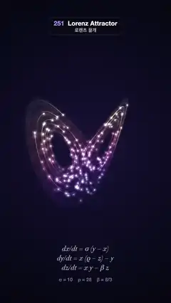

# 251 · Lorenz Attractor · 로렌츠 끌개



**EN** Hundreds of glowing particles race round the two wings of the Lorenz butterfly with fading tails as the camera circles it, its equations printed below.  
**KO** 빛나는 입자 수백 개가 꼬리를 끌며 로렌츠 나비의 두 날개를 돌고, 카메라가 그 둘레를 돌며, 아래에 방정식이 적혀 있다.

[Video (mp4)](https://sueun-dev.github.io/motion-effects/videos/251-lorenz-attractor.mp4) · [Code](../effects/251-lorenz-attractor.js) · Generative math · 제너러티브 수학

## Prompt (English)

```text
Create a "Lorenz Attractor" motion effect: the butterfly-shaped strange attractor of the Lorenz system, traced by glowing particles while the camera circles it.

Look
- The system: dx/dt = σ(y − x), dy/dt = x(ρ − z) − y, dz/dt = xy − βz with σ = 10, ρ = 28, β = 8/3. Integrate once in setup with RK4, step 0.004, from (1, 1, 20): 2,000 steps of burn-in, then keep 40,000 steps.
- Background: a radial gradient centred at (540, 940), #181336 → #0A0A1C (60 %) → #05050D at radius 1200.
- Colour by height z, in 8 bands from z = 6 to 44: #5B3BD6, #8A44E0, #C24FD2, #EE5FA8, #FF7F7F, #FFA46B, #FFC873, #FFE6A8 (violet low, amber high).
- The attractor itself: the first 26,000 steps (every 3rd point) and their mirror image (x, y) → (−x, −y), which is also a solution, drawn on a half-size canvas as 1.5 px lines at alpha 0.1, added in the band colours, then laid over the frame additively with a 5 px blur, a soft glowing haze rather than sharp hairlines.
- Particles: 240 comets. Each rides a stretch of the stored orbit at 0.08 orbit-time units per second, with a tail 0.09 time units long drawn in 10 pieces, widths 2 + 2.6 · k / 10 px and alpha 0.06 + 0.5 · (k / 10)² (k = 1 … 10, toward the head), butt line caps, all in the band colour of its head. The head is a white radial glow 34 px (× the perspective scale) at alpha 0.9 plus a coloured dot of radius 6 px at alpha 0.5. Everything is added with additive blending.
- Projection: shift z by −26, turn by the camera angle about the vertical z axis, tilt 0.2 rad, perspective with the eye 105 units away and a focal length of 1,750 px, centred at (540, 940); the butterfly fills the middle of the frame.
- Below it, centred: "dx/dt = σ (y − x)", "dy/dt = x (ρ − z) − y", "dz/dt = x y − β z" in italic 44 px Didot, rgba(235, 228, 255, 0.82), at y = 1590, 1650 and 1710, and "σ = 10    ρ = 28    β = 8/3" in 30 px sans, rgba(200, 190, 255, 0.6), at y = 1782.

Motion (0–5 s)
- The camera turns 180° about the vertical axis in 5 s. The Lorenz system is symmetric under that half turn, so the last frame meets the first.
- Each comet lives 2.5 s (lives staggered by c / 240 of a life), fading as sin(π u)^1.5 over its life u. It has two random start points on the orbit (seed 251) for lives 1 and 2; lives 3 and 4 ride the mirror images (−x, −y) of lives 1 and 2, so after 5 s every comet is the half-turned image of where it began, exactly matching the half-turned camera.

Technique
- Canvas 2D with its own 3D projection. Tail pieces are grouped by colour band and brightness into Path2D objects and stroked with globalCompositeOperation 'lighter'; the haze is drawn on an off-screen canvas and composited with filter blur(5px).

Output and rules
- One self-contained HTML file with no external assets (three.js from a CDN is fine if you use it), drawing on a 1080 × 1920 canvas (9:16) scaled to fit the window.
- Write a function renderFrame(t) that draws the frame for time t in seconds, and preview it with requestAnimationFrame. Everything must be a pure function of t and fixed seeds: no Math.random(), Date or state carried between frames, so frame i = renderFrame(i / 30) can be exported to a 30 fps video.
- Loop seamlessly every 5 seconds: renderFrame(5) must look exactly like renderFrame(0).
- No flicker of any kind: no noise or grain that changes from frame to frame, no strobing or blinking, no z-fighting, no shimmering 1 px lines. Any grain or texture stays fixed to the screen or to the object.
- Keep the top 280 px free of important content (a title label goes there) and fill the whole frame with a designed background.
```

## 프롬프트 (한국어)

```text
"로렌츠 끌개" 모션 효과를 만들어 줘: 로렌츠 계의 나비 모양 이상한 끌개를 빛나는 입자들이 따라 그리고, 카메라가 그 둘레를 도는 효과.

모양
- 계: dx/dt = σ(y − x), dy/dt = x(ρ − z) − y, dz/dt = xy − βz, σ = 10, ρ = 28, β = 8/3. setup에서 한 번 RK4로 적분한다. 간격 0.004, 시작점 (1, 1, 20), 처음 2,000스텝은 버리고 40,000스텝을 남긴다.
- 배경: (540, 940)을 중심으로 한 원형 그라디언트 #181336 → #0A0A1C(60 %) → 반지름 1200에서 #05050D.
- 색은 높이 z로, z = 6–44를 8단계로: #5B3BD6, #8A44E0, #C24FD2, #EE5FA8, #FF7F7F, #FFA46B, #FFC873, #FFE6A8(낮으면 보라, 높으면 호박색).
- 끌개 자체: 처음 26,000스텝(3점마다 하나)과 그 거울상 (x, y) → (−x, −y)(이것도 해다)를 절반 크기 캔버스에 1.5 px 선, 알파 0.1로 단계 색을 더해 그리고, 5 px 블러를 걸어 화면에 더하기 합성한다. 날카로운 가는 선이 아니라 부드럽게 빛나는 안개.
- 입자: 혜성 240개. 각자 저장된 궤도의 한 구간을 초당 궤도 시간 0.08만큼 달리고, 꼬리는 궤도 시간 0.09 길이를 10조각으로 그린다: 굵기 2 + 2.6 · k / 10 px, 알파 0.06 + 0.5 · (k / 10)²(k = 1 … 10, 머리 쪽으로), 선 끝은 butt, 색은 머리의 단계 색. 머리는 34 px(× 원근 배율) 흰 원형 빛(알파 0.9)과 반지름 6 px 색 점(알파 0.5). 모두 더하기 합성.
- 투영: z를 −26 옮기고, 카메라 각도만큼 세로축 z를 기준으로 돌리고, 0.2 rad 기울이고, 눈은 105단위 떨어져 초점 거리 1,750 px의 원근으로 (540, 940)에 맞춘다. 나비가 화면 가운데를 채운다.
- 그 아래 가운데: "dx/dt = σ (y − x)", "dy/dt = x (ρ − z) − y", "dz/dt = x y − β z"를 기울인 44 px Didot, rgba(235, 228, 255, 0.82)로 y = 1590, 1650, 1710에, "σ = 10    ρ = 28    β = 8/3"를 30 px 산세리프, rgba(200, 190, 255, 0.6)로 y = 1782에.

움직임 (0–5초)
- 카메라가 5초 동안 세로축을 기준으로 180° 돈다. 로렌츠 계는 이 반 바퀴 회전에 대칭이라 마지막 프레임이 첫 프레임과 이어진다.
- 혜성마다 수명은 2.5초(수명은 c / 240씩 어긋남)이고, 수명 u 동안 sin(π u)^1.5로 나타났다 사라진다. 혜성마다 궤도 위 무작위 시작점 두 개(시드 251)가 수명 1과 2용이고, 수명 3과 4는 수명 1과 2의 거울상 (−x, −y)을 달린다. 그래서 5초 뒤 모든 혜성은 처음 자리를 반 바퀴 돌린 곳에 있고, 반 바퀴 돈 카메라와 정확히 맞는다.

기법
- 직접 만든 3D 투영의 Canvas 2D. 꼬리 조각은 색 단계와 밝기별로 Path2D에 모아 globalCompositeOperation 'lighter'로 긋고, 안개는 화면 밖 캔버스에 그려 filter blur(5px)로 합성한다.

출력과 규칙
- 외부 파일 없는 HTML 파일 하나(three.js를 쓴다면 CDN은 괜찮다). 1080 × 1920(9:16) 캔버스에 그리고 창 크기에 맞춰 보이게 한다.
- 시간 t(초)의 프레임을 그리는 renderFrame(t) 함수를 만들고, 미리보기는 requestAnimationFrame으로 돌린다. 모든 것은 t와 고정 시드만으로 정해진다: Math.random(), Date, 프레임 사이에 쌓이는 상태 금지. 그래야 i번째 프레임 = renderFrame(i / 30)으로 30fps 영상을 뽑을 수 있다.
- 5초마다 끊김 없이 반복: renderFrame(5)는 renderFrame(0)과 똑같아 보여야 한다.
- 어떤 깜빡임도 금지: 프레임마다 바뀌는 노이즈·그레인, 번쩍임·깜빡임, z-fighting, 반짝이며 떨리는 1px 선 모두 금지. 그레인·질감은 화면이나 물체에 고정한다.
- 위쪽 280px에는 중요한 내용을 두지 않고(제목 라벨 자리), 화면 전체를 디자인된 배경으로 채운다.
```
