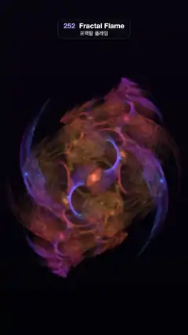

# 252 · Fractal Flame · 프랙탈 플레임



**EN** An ember, violet and blue fractal flame swirls in two-fold symmetry, its smoky veils and glowing arcs slowly morphing as its transforms drift.  
**KO** 불씨빛·보랏빛·푸른 프랙탈 플레임이 2겹 대칭으로 소용돌이치고, 변환이 천천히 바뀌면서 연기 같은 베일과 빛나는 호가 부드럽게 모양을 바꾼다.

[Video (mp4)](https://sueun-dev.github.io/motion-effects/videos/252-fractal-flame.mp4) · [Code](../effects/252-fractal-flame.js) · Generative math · 제너러티브 수학

## Prompt (English)

```text
Create a "Fractal Flame" motion effect: an Electric Sheep–style IFS flame (Scott Draves' algorithm) with log-density colouring, its transforms drifting so the flame morphs smoothly.

Look
- Three transforms, each an affine map followed by nonlinear variations, picked with fixed weights 0.5 / 0.3 / 0.2 (a = 2π t / 5):
  1. x' = (0.55 + 0.04 cos a) x + (−0.3 + 0.05 sin a) y + 0.35 + 0.06 sin a, y' = (0.3 + 0.05 sin 2a) x + 0.55 y + 0.1 + 0.06 cos 2a; then 0.6 · horseshoe + 0.4 · linear; colour index c ← c / 2.
  2. rotate by 1.6 + 0.18 sin a rad and scale by 0.65 + 0.03 cos 2a, then add (−0.3 + 0.05 cos a, 0.4 + 0.05 sin 2a); then julia (square root of the radius, half the angle, plus π for half the points); c ← (c + 0.55) / 2.
  3. x' = 0.35 x + 0.5 y + 0.1 + 0.08 sin 2a, y' = (−0.5 + 0.06 cos a) x + (0.35 + 0.04 sin a) y − 0.5 + 0.05 cos a; then 0.5 · swirl + 0.5 · disc; c ← (c + 1) / 2.
  - After every transform, half the points turn by 180° (p → −p), keeping their colour: a 2-fold symmetry.
  - Variations: horseshoe (x² − y², 2xy) / r; julia √r (cos(θ/2 + kπ), sin(θ/2 + kπ)); swirl (x sin r² − y cos r², x cos r² + y sin r²); disc (θ/π)(sin πr, cos πr) with θ = atan2(x, y).
- Colour palette over c: gold (1, 0.78, 0.28) → ember (1, 0.36, 0.16) at 0.3 → violet (0.62, 0.22, 0.78) at 0.55 → blue (0.16, 0.38, 1) at 0.8 → ice (0.45, 0.9, 1) at 1.
- Placement: x_screen = 1.04 x, y_screen = 0.585 y − 0.06 in clip space, so the flame (about 1,000 × 1,450 px) sits in the middle below the label.
- Accumulation: 537 million points per frame (128 passes of 2^22). Every point starts from its own fixed hash (point id and pass), at a random spot in [−1, 1]² with a random c, applies 22 transforms whose choices also come from that hash, and adds (colour, 1) to a 432 × 768 float buffer.
- Tone mapping per pixel: density estimation, a 5 × 5 Gaussian over the bins whose radius shrinks from 2.6 bins where the flame is sparse to 0.8 bins where it is dense; then alpha = ln(1 + density) / ln(501), faded in from 0.5 to 4 hits per bin so stray points vanish; colour = average colour · alpha^1.25 · 2.9 + warm white (1, 0.95, 0.85) · alpha^4 · 0.6, over a near-black background (0.010, 0.008, 0.025) → (0.03, 0.02, 0.06) upward.

Motion (0–5 s)
- Only the affine coefficients move, on sines and cosines of a and 2a, so the flame's veils slide, curl and breathe and the loop closes exactly.
- The random choices are fixed per point, so each point's final position moves continuously with the coefficients: the density changes smoothly and nothing sparkles from frame to frame.

Technique
- three.js as a WebGL2 host: the chaos game runs in a vertex shader (gl_VertexID → hash → 22 iterations → gl_Position, gl_PointSize = 1) drawing 2^22 points per pass with additive blending (ONE, ONE) into a FloatType render target (EXT_float_blend), then a full-screen pass does the density estimation and log-density tone mapping.

Output and rules
- One self-contained HTML file with no external assets (three.js from a CDN is fine if you use it), drawing on a 1080 × 1920 canvas (9:16) scaled to fit the window.
- Write a function renderFrame(t) that draws the frame for time t in seconds, and preview it with requestAnimationFrame. Everything must be a pure function of t and fixed seeds: no Math.random(), Date or state carried between frames, so frame i = renderFrame(i / 30) can be exported to a 30 fps video.
- Loop seamlessly every 5 seconds: renderFrame(5) must look exactly like renderFrame(0).
- No flicker of any kind: no noise or grain that changes from frame to frame, no strobing or blinking, no z-fighting, no shimmering 1 px lines. Any grain or texture stays fixed to the screen or to the object.
- Keep the top 280 px free of important content (a title label goes there) and fill the whole frame with a designed background.
```

## 프롬프트 (한국어)

```text
"프랙탈 플레임" 모션 효과를 만들어 줘: Electric Sheep 스타일의 IFS 플레임(Scott Draves의 알고리즘)을 로그 밀도로 칠하고, 변환이 천천히 바뀌며 불꽃이 부드럽게 모양을 바꾸는 효과.

모양
- 변환 세 개. 각각 아핀 변환 뒤에 비선형 변형(variation)을 붙이고, 고정 가중치 0.5 / 0.3 / 0.2로 고른다(a = 2π t / 5):
  1. x' = (0.55 + 0.04 cos a) x + (−0.3 + 0.05 sin a) y + 0.35 + 0.06 sin a, y' = (0.3 + 0.05 sin 2a) x + 0.55 y + 0.1 + 0.06 cos 2a. 그다음 0.6 · horseshoe + 0.4 · linear. 색 지수 c ← c / 2.
  2. 1.6 + 0.18 sin a rad 돌리고 0.65 + 0.03 cos 2a배 한 뒤 (−0.3 + 0.05 cos a, 0.4 + 0.05 sin 2a)를 더한다. 그다음 julia(반지름의 제곱근, 각도의 절반, 점의 절반은 π 더함). c ← (c + 0.55) / 2.
  3. x' = 0.35 x + 0.5 y + 0.1 + 0.08 sin 2a, y' = (−0.5 + 0.06 cos a) x + (0.35 + 0.04 sin a) y − 0.5 + 0.05 cos a. 그다음 0.5 · swirl + 0.5 · disc. c ← (c + 1) / 2.
  - 변환마다 그 뒤에 점의 절반을 180° 돌린다(p → −p, 색은 그대로): 2겹 대칭.
  - 변형: horseshoe (x² − y², 2xy) / r, julia √r (cos(θ/2 + kπ), sin(θ/2 + kπ)), swirl (x sin r² − y cos r², x cos r² + y sin r²), disc (θ/π)(sin πr, cos πr), θ = atan2(x, y).
- c에 따른 팔레트: 금색 (1, 0.78, 0.28) → 0.3에서 불씨 (1, 0.36, 0.16) → 0.55에서 보라 (0.62, 0.22, 0.78) → 0.8에서 파랑 (0.16, 0.38, 1) → 1에서 얼음색 (0.45, 0.9, 1).
- 배치: 클립 공간에서 x_화면 = 1.04 x, y_화면 = 0.585 y − 0.06. 불꽃(약 1,000 × 1,450 px)이 라벨 아래 가운데에 놓인다.
- 누적: 프레임마다 점 5억 3,700만 개(2^22개씩 128번). 점마다 자기 고정 해시(점 번호와 패스)에서 시작해 [−1, 1]² 안 무작위 자리, 무작위 c로 출발하고, 선택도 그 해시로 정해지는 변환 22번을 거친 뒤 432 × 768 float 버퍼에 (색, 1)을 더한다.
- 픽셀별 톤 매핑: 밀도 추정. 빈 위 5 × 5 가우시안의 반지름이 불꽃이 성긴 곳은 2.6빈, 빽빽한 곳은 0.8빈으로 줄어든다. 그다음 alpha = ln(1 + 밀도) / ln(501), 빈당 0.5번에서 4번 사이에서 서서히 나타나게 해 떠도는 점은 사라진다. 색 = 평균 색 · alpha^1.25 · 2.9 + 따뜻한 흰색 (1, 0.95, 0.85) · alpha^4 · 0.6, 배경은 거의 검정 (0.010, 0.008, 0.025)에서 위로 (0.03, 0.02, 0.06).

움직임 (0–5초)
- 아핀 계수만 a와 2a의 사인·코사인으로 움직인다. 그래서 불꽃의 베일이 미끄러지고 말리고 숨 쉬듯 바뀌며, 루프가 정확히 닫힌다.
- 무작위 선택은 점마다 고정이라 각 점의 최종 위치가 계수를 따라 연속으로 움직인다: 밀도가 매끄럽게 바뀌고 프레임마다 반짝이는 것이 없다.

기법
- WebGL2 호스트로 쓰는 three.js: 카오스 게임은 버텍스 셰이더에서 돈다(gl_VertexID → 해시 → 22번 반복 → gl_Position, gl_PointSize = 1). 패스마다 점 2^22개를 더하기 블렌딩(ONE, ONE)으로 FloatType 렌더 타깃(EXT_float_blend)에 그리고, 전체 화면 패스가 밀도 추정과 로그 밀도 톤 매핑을 한다.

출력과 규칙
- 외부 파일 없는 HTML 파일 하나(three.js를 쓴다면 CDN은 괜찮다). 1080 × 1920(9:16) 캔버스에 그리고 창 크기에 맞춰 보이게 한다.
- 시간 t(초)의 프레임을 그리는 renderFrame(t) 함수를 만들고, 미리보기는 requestAnimationFrame으로 돌린다. 모든 것은 t와 고정 시드만으로 정해진다: Math.random(), Date, 프레임 사이에 쌓이는 상태 금지. 그래야 i번째 프레임 = renderFrame(i / 30)으로 30fps 영상을 뽑을 수 있다.
- 5초마다 끊김 없이 반복: renderFrame(5)는 renderFrame(0)과 똑같아 보여야 한다.
- 어떤 깜빡임도 금지: 프레임마다 바뀌는 노이즈·그레인, 번쩍임·깜빡임, z-fighting, 반짝이며 떨리는 1px 선 모두 금지. 그레인·질감은 화면이나 물체에 고정한다.
- 위쪽 280px에는 중요한 내용을 두지 않고(제목 라벨 자리), 화면 전체를 디자인된 배경으로 채운다.
```
