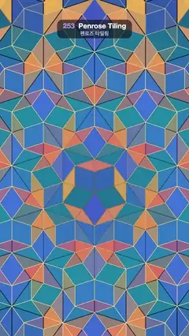

# 253 · Penrose Tiling · 펜로즈 타일링



**EN** Gold, coral and teal Penrose rhombi split into smaller rhombi in waves from the centre, twice, then merge back, a gold flash marking every new edge.  
**KO** 금색·산호색·청록 펜로즈 마름모가 중심에서 퍼지는 물결을 따라 두 번 더 작은 마름모로 쪼개졌다가 다시 합쳐지고, 새 변마다 금빛이 번쩍인다.

[Video (mp4)](https://sueun-dev.github.io/motion-effects/videos/253-penrose-tiling.mp4) · [Code](../effects/253-penrose-tiling.js) · Generative math · 제너러티브 수학

## Prompt (English)

```text
Create a "Penrose Tiling" motion effect: the aperiodic P3 rhombus tiling built by substitution (deflation), with the tiles visibly splitting into smaller tiles and merging back.

Look
- Background #0B1120. The tiling is centred at (540, 1100) at 1,300 px per unit and fills the frame.
- Build it from Robinson half-tiles (triangles A, B, C):
  - Start with a wheel of 10 thin half-tiles around the origin: A = (0, 0), B and C on the unit circle at angles (2i − 1)·18° and (2i + 1)·18°, B and C swapped for even i.
  - Thin half-tile (A, B, C) → P = A + (B − A)/φ; children: thin (C, P, B) and thick (P, C, A).
  - Thick half-tile (A, B, C) → Q = B + (A − B)/φ, R = B + (C − B)/φ; children: thick (R, C, A), thick (Q, R, B), thin (R, Q, A).
  - Each step shrinks the tiles by φ = 1.618. Keep generations 4, 5 and 6 (edges about 190, 117 and 73 px) and remember each child's parent.
- Drawing: fill each half-tile (and stroke it 1 px in the same colour so the two halves of a rhombus meet without a seam), then draw only its two legs C–A–B, #0B1120, 4 px, round joins, so whole rhombi appear.
- Colours (r = distance of the tile's centre from (540, 1100), ang = the direction of the tile's apex):
  - shade = 0.5 + 0.5 cos(2 · ang), wave = 0.5 + 0.5 cos(r / 260 − 2π · 2t / 5) (a colour wave rolling outward twice per loop).
  - Thin rhombi: rgb(242 − 20 · wave, 178 − 70 · shade · wave − 20 · wave, 74 + 30 · shade): gold to coral.
  - Thick rhombi: rgb(24 + 40 · shade, 96 + 40 · wave − 20 · shade, 128 + 60 · shade + 30 · wave): teal to blue.

Motion (one 5 s cycle; the video starts 0.8 s into it)
- 0–0.3 s generation 4; 0.3–1.3 s split 4 → 5; 1.3–2.3 s split 5 → 6; 2.3–2.8 s hold; 2.8–3.8 s merge 6 → 5; 3.8–4.8 s merge 5 → 4; 4.8–5 s hold.
- Each split runs as a wave from the centre: w = smoothstep(0, 1, 1.8 p − r / 1600), p = time into the step (0–1 s). The fine tiles are always drawn; a fine tile's colour blends from its parent's colour to its own by w; the coarse outlines fade out (alpha 1 − w) and the fine outlines fade in (alpha w); a gold flash, #FFE7A3, 3 px at alpha 4 w (1 − w), runs along the fine edges as the wave front passes. A merge is the same with w running from 1 back to 0.
- The camera and the tiles never move; only colours and outlines change, so nothing flickers.

Technique
- Canvas 2D; the three generations are computed once in setup (2,330 half-tiles at generation 6 are plenty to cover the frame).

Output and rules
- One self-contained HTML file with no external assets (three.js from a CDN is fine if you use it), drawing on a 1080 × 1920 canvas (9:16) scaled to fit the window.
- Write a function renderFrame(t) that draws the frame for time t in seconds, and preview it with requestAnimationFrame. Everything must be a pure function of t and fixed seeds: no Math.random(), Date or state carried between frames, so frame i = renderFrame(i / 30) can be exported to a 30 fps video.
- Loop seamlessly every 5 seconds: renderFrame(5) must look exactly like renderFrame(0).
- No flicker of any kind: no noise or grain that changes from frame to frame, no strobing or blinking, no z-fighting, no shimmering 1 px lines. Any grain or texture stays fixed to the screen or to the object.
- Keep the top 280 px free of important content (a title label goes there) and fill the whole frame with a designed background.
```

## 프롬프트 (한국어)

```text
"펜로즈 타일링" 모션 효과를 만들어 줘: 치환(디플레이션)으로 만드는 비주기 P3 마름모 타일링. 타일이 더 작은 타일로 쪼개졌다가 다시 합쳐지는 것이 보인다.

모양
- 배경 #0B1120. 타일링은 (540, 1100)에 중심을 두고 1단위 = 1,300 px로 화면을 채운다.
- 로빈슨 반쪽 타일(삼각형 A, B, C)로 만든다:
  - 원점 둘레에 가는 반쪽 타일 10개로 바퀴를 만든다: A = (0, 0), B와 C는 단위원 위 각도 (2i − 1)·18°와 (2i + 1)·18°, i가 짝수면 B와 C를 바꾼다.
  - 가는 반쪽 (A, B, C) → P = A + (B − A)/φ. 자식: 가는 (C, P, B), 굵은 (P, C, A).
  - 굵은 반쪽 (A, B, C) → Q = B + (A − B)/φ, R = B + (C − B)/φ. 자식: 굵은 (R, C, A), 굵은 (Q, R, B), 가는 (R, Q, A).
  - 한 번 치환할 때마다 타일이 φ = 1.618배 작아진다. 4, 5, 6세대(변 약 190, 117, 73 px)를 남기고 자식마다 부모를 기억한다.
- 그리기: 반쪽 타일을 채우고(같은 색으로 1 px 테두리도 그어 마름모의 두 반쪽이 이음매 없이 붙게), 다리 두 개 C–A–B만 #0B1120, 4 px, 둥근 이음으로 그어 온전한 마름모가 보이게 한다.
- 색(r = 타일 중심과 (540, 1100)의 거리, ang = 타일 꼭짓점 방향):
  - shade = 0.5 + 0.5 cos(2 · ang), wave = 0.5 + 0.5 cos(r / 260 − 2π · 2t / 5)(한 루프에 두 번 바깥으로 구르는 색 물결).
  - 가는 마름모: rgb(242 − 20 · wave, 178 − 70 · shade · wave − 20 · wave, 74 + 30 · shade): 금색에서 산호색.
  - 굵은 마름모: rgb(24 + 40 · shade, 96 + 40 · wave − 20 · shade, 128 + 60 · shade + 30 · wave): 청록에서 파랑.

움직임 (한 주기 5초, 영상은 주기의 0.8초에서 시작)
- 0–0.3초 4세대, 0.3–1.3초 4 → 5 쪼개기, 1.3–2.3초 5 → 6 쪼개기, 2.3–2.8초 멈춤, 2.8–3.8초 6 → 5 합치기, 3.8–4.8초 5 → 4 합치기, 4.8–5초 멈춤.
- 쪼개기는 중심에서 퍼지는 물결로 진행한다: w = smoothstep(0, 1, 1.8 p − r / 1600), p = 그 단계에 들어선 시간(0–1초). 고운 타일은 늘 그리되 색이 부모 색에서 자기 색으로 w만큼 섞이고, 굵은 쪽 윤곽은 사라지고(알파 1 − w) 고운 쪽 윤곽은 나타나며(알파 w), 물결 앞이 지나갈 때 고운 변을 따라 금빛 #FFE7A3, 3 px, 알파 4 w (1 − w)가 번쩍인다. 합치기는 w가 1에서 0으로 돌아가는 같은 과정.
- 카메라와 타일 자리는 움직이지 않고 색과 윤곽만 바뀌므로 깜빡임이 없다.

기법
- Canvas 2D. 세 세대를 setup에서 한 번 계산한다(6세대 반쪽 타일 2,330개면 화면을 덮기에 충분하다).

출력과 규칙
- 외부 파일 없는 HTML 파일 하나(three.js를 쓴다면 CDN은 괜찮다). 1080 × 1920(9:16) 캔버스에 그리고 창 크기에 맞춰 보이게 한다.
- 시간 t(초)의 프레임을 그리는 renderFrame(t) 함수를 만들고, 미리보기는 requestAnimationFrame으로 돌린다. 모든 것은 t와 고정 시드만으로 정해진다: Math.random(), Date, 프레임 사이에 쌓이는 상태 금지. 그래야 i번째 프레임 = renderFrame(i / 30)으로 30fps 영상을 뽑을 수 있다.
- 5초마다 끊김 없이 반복: renderFrame(5)는 renderFrame(0)과 똑같아 보여야 한다.
- 어떤 깜빡임도 금지: 프레임마다 바뀌는 노이즈·그레인, 번쩍임·깜빡임, z-fighting, 반짝이며 떨리는 1px 선 모두 금지. 그레인·질감은 화면이나 물체에 고정한다.
- 위쪽 280px에는 중요한 내용을 두지 않고(제목 라벨 자리), 화면 전체를 디자인된 배경으로 채운다.
```
