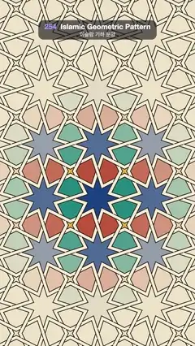

# 254 · Islamic Geometric Pattern · 이슬람 기하 문양



**EN** Rays sprout from a compass-and-grid construction and weave into interlaced ivory strapwork, then eight-pointed stars glaze in lapis, saffron and terracotta.  
**KO** 컴퍼스 원과 격자 작도에서 선이 뻗어 나와 서로 엮인 상아색 띠 장식이 되고, 팔각별과 조각들이 청금석·사프란·테라코타 유약으로 채워진다.

[Video (mp4)](https://sueun-dev.github.io/motion-effects/videos/254-islamic-pattern.mp4) · [Code](../effects/254-islamic-pattern.js) · Generative math · 제너러티브 수학

## Prompt (English)

```text
Create an "Islamic Geometric Pattern" motion effect: an eight-pointed star pattern constructed with Hankin's "polygons in contact" method from compass circles and a polygon grid, turning into interlaced strapwork with glazed tiles.

Look
- Paper #EFE3C8. The construction grid is the 4.8.8 tiling: regular octagons on a square lattice of spacing 300 px (side 300 / (1 + √2) ≈ 124 px, flat sides facing up and sideways), centred on (540, 1100), with squares turned 45° in the gaps.
- Hankin's method: from the midpoint of every polygon edge, two rays leave at 72° to the edge, one leaning toward each end of the edge, into the polygon. The ray leaning toward a corner meets the ray from the next edge that leans toward the same corner: each pair forms a V. Eight V's make an eight-pointed star in each octagon, four make a small four-pointed star in each square, and the rays run straight on through every edge midpoint into the next polygon.
- Strapwork: each line becomes a band 16 px wide, ivory #F7EDD6 with dark edges #2B2118 (total width 16 + 7 px), miter joins, butt ends. Interlacing: find every crossing (inside the polygons and at the edge midpoints), walk each strand (a straight line through a midpoint, then the V, and on), and alternate over / under along it, keeping any crossing another strand has already decided. At every "over" crossing, redraw a short piece of the over band, (16 / 2 + 4) / sin(crossing angle) + 2 px to each side, on top.
- Tiles: the regions between the lines (found once by a flood fill of the line drawing on a canvas 300 px larger all round, so no shape is cut by the frame) are glazed by kind: octagon stars lapis rgb(26, 66, 132), square stars saffron rgb(228, 172, 62), pieces beside the vertical gaps terracotta rgb(190, 82, 56), pieces beside the horizontal gaps turquoise rgb(30, 132, 126).
- Construction lines: a compass circle through the corners of every octagon and square, and the polygon edges, 2 px, rgba(150, 105, 55, 0.7).

Motion (one 5 s cycle; the video starts 2.4 s into it). late(r) = 0.5 · min(1, r / 1250 px), with r the distance from (540, 1100), so everything spreads out from the centre.
- 0–1.3 s the construction is on the paper; it fades out over 1.3–1.9 s.
- 0.15 s + late: the rays grow out of the midpoints toward their meeting points over 0.6 s (ease-out), as thin 2.5 px dark lines.
- 1.0–2.5 s: the lines widen to 16 px bands (smoothstep); the ivory face fades in as the width passes 3–9 px.
- Tiles fade in over 0.5 s each from s = 1.8 + 1.1 · min(1, r / 1250) s (r = the region's centre).
- 2.7–4.2 s: a soft diagonal sheen, a linear gradient band peaking at rgba(255, 250, 235, 0.22), sweeps across the glaze from the top left to the bottom right.
- Undoing: each tile fades out from 3.7 + 0.5 (s − 1.8) over 0.6 s; the strapwork fades out in a ring from the centre to the corners, starting at 4.1 + 0.7 · late(r) for 0.5 s; meanwhile the construction returns (fade 3.9–4.3 s), each circle and polygon sweeping in from 4.0 s + late over 0.5 s. At 5 s the paper shows only the construction again.

Technique
- Canvas 2D. Geometry, crossings, the over / under walk and the flood-filled region map are computed once in setup. Each frame writes the tile colours with one putImageData pass over the region map, draws the construction, and draws the strapwork on an off-screen layer, whose fade is a radial-gradient mask applied with 'destination-in'.

Output and rules
- One self-contained HTML file with no external assets (three.js from a CDN is fine if you use it), drawing on a 1080 × 1920 canvas (9:16) scaled to fit the window.
- Write a function renderFrame(t) that draws the frame for time t in seconds, and preview it with requestAnimationFrame. Everything must be a pure function of t and fixed seeds: no Math.random(), Date or state carried between frames, so frame i = renderFrame(i / 30) can be exported to a 30 fps video.
- Loop seamlessly every 5 seconds: renderFrame(5) must look exactly like renderFrame(0).
- No flicker of any kind: no noise or grain that changes from frame to frame, no strobing or blinking, no z-fighting, no shimmering 1 px lines. Any grain or texture stays fixed to the screen or to the object.
- Keep the top 280 px free of important content (a title label goes there) and fill the whole frame with a designed background.
```

## 프롬프트 (한국어)

```text
"이슬람 기하 문양" 모션 효과를 만들어 줘: 컴퍼스 원과 다각형 격자에서 행킨(Hankin)의 "맞닿은 다각형" 방법으로 팔각별 문양을 작도하고, 서로 엮인 띠 장식과 유약 타일로 바뀌는 효과.

모양
- 종이 #EFE3C8. 작도 격자는 4.8.8 타일링: 간격 300 px 정사각 격자 위의 정팔각형(변 300 / (1 + √2) ≈ 124 px, 평평한 변이 위와 옆을 향함)을 (540, 1100)에 맞추고, 틈에는 45° 돌린 정사각형.
- 행킨 방법: 다각형의 모든 변 중점에서 변과 72°를 이루는 선 두 개가 다각형 안쪽으로 뻗는다. 하나는 변의 한쪽 끝, 하나는 다른 쪽 끝으로 기운다. 어떤 꼭짓점 쪽으로 기운 선은 이웃 변에서 같은 꼭짓점 쪽으로 기운 선과 만나 V를 이룬다. 팔각형마다 V 여덟 개가 팔각별을, 정사각형마다 V 네 개가 작은 사각별을 만들고, 선은 변 중점을 곧게 지나 이웃 다각형으로 이어진다.
- 띠 장식: 선마다 폭 16 px 띠가 된다. 상아색 #F7EDD6에 어두운 테두리 #2B2118(전체 폭 16 + 7 px), 이음은 miter, 끝은 butt. 엮기: 모든 교차점(다각형 안과 변 중점)을 찾고, 가닥(중점을 지나는 직선, 그다음 V, 또 그다음)을 따라 걸으며 위/아래를 번갈아 정한다. 다른 가닥이 이미 정한 교차점은 그대로 둔다. "위"인 교차점마다 위 띠를 양쪽으로 (16 / 2 + 4) / sin(교차각) + 2 px만큼 짧게 다시 그려 덮는다.
- 타일: 선 사이 영역(선 그림을 사방으로 300 px 더 큰 캔버스에서 한 번 플러드 필해 찾으므로 화면 가장자리에서 잘리는 모양이 없다)을 종류별로 칠한다: 팔각별은 청금석 rgb(26, 66, 132), 사각별은 사프란 rgb(228, 172, 62), 세로 틈 옆 조각은 테라코타 rgb(190, 82, 56), 가로 틈 옆 조각은 청록 rgb(30, 132, 126).
- 작도선: 팔각형과 정사각형마다 꼭짓점을 지나는 컴퍼스 원과 다각형 변, 2 px, rgba(150, 105, 55, 0.7).

움직임 (한 주기 5초, 영상은 주기의 2.4초에서 시작). late(r) = 0.5 · min(1, r / 1250 px), r은 (540, 1100)에서의 거리라서 모든 것이 중심에서 바깥으로 퍼진다.
- 0–1.3초 종이에 작도선이 있고, 1.3–1.9초에 사라진다.
- 0.15초 + late: 선이 중점에서 만나는 점 쪽으로 0.6초 동안(ease-out) 2.5 px 어두운 가는 선으로 자란다.
- 1.0–2.5초: 선이 16 px 띠로 넓어지고(smoothstep), 폭이 3–9 px를 지날 때 상아색 면이 나타난다.
- 타일은 s = 1.8 + 1.1 · min(1, r / 1250)초부터 각자 0.5초 동안 채워진다(r = 영역 중심).
- 2.7–4.2초: 부드러운 대각선 광택(가운데가 rgba(255, 250, 235, 0.22)인 선형 그라디언트 띠)이 왼쪽 위에서 오른쪽 아래로 유약 위를 쓸고 지나간다.
- 되돌리기: 타일은 3.7 + 0.5 (s − 1.8)초부터 0.6초 동안 사라지고, 띠 장식은 중심에서 모서리로 퍼지는 고리를 따라 4.1 + 0.7 · late(r)초부터 0.5초 동안 사라진다. 그동안 작도선이 돌아오고(3.9–4.3초에 나타남), 원과 다각형은 4.0초 + late부터 0.5초 동안 쓸 듯이 다시 그려진다. 5초에는 종이에 작도선만 남는다.

기법
- Canvas 2D. 도형, 교차점, 위/아래 걷기, 플러드 필 영역 지도는 setup에서 한 번 계산한다. 매 프레임 영역 지도를 한 번 훑어 putImageData로 타일 색을 쓰고, 작도선을 그리고, 띠 장식은 화면 밖 레이어에 그린 뒤 원형 그라디언트 마스크를 'destination-in'으로 씌워 사라지게 한다.

출력과 규칙
- 외부 파일 없는 HTML 파일 하나(three.js를 쓴다면 CDN은 괜찮다). 1080 × 1920(9:16) 캔버스에 그리고 창 크기에 맞춰 보이게 한다.
- 시간 t(초)의 프레임을 그리는 renderFrame(t) 함수를 만들고, 미리보기는 requestAnimationFrame으로 돌린다. 모든 것은 t와 고정 시드만으로 정해진다: Math.random(), Date, 프레임 사이에 쌓이는 상태 금지. 그래야 i번째 프레임 = renderFrame(i / 30)으로 30fps 영상을 뽑을 수 있다.
- 5초마다 끊김 없이 반복: renderFrame(5)는 renderFrame(0)과 똑같아 보여야 한다.
- 어떤 깜빡임도 금지: 프레임마다 바뀌는 노이즈·그레인, 번쩍임·깜빡임, z-fighting, 반짝이며 떨리는 1px 선 모두 금지. 그레인·질감은 화면이나 물체에 고정한다.
- 위쪽 280px에는 중요한 내용을 두지 않고(제목 라벨 자리), 화면 전체를 디자인된 배경으로 채운다.
```
