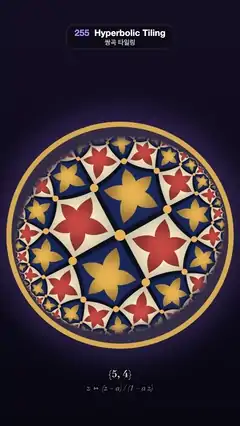

# 255 · Hyperbolic Tiling · 쌍곡 타일링



**EN** Pentagons holding gold and red stars tile a Poincaré disk, four at every corner, shrinking toward the rim and flowing from one edge to the other.  
**KO** 금색·주홍 별을 품은 오각형이 꼭짓점마다 넷씩 모여 푸앵카레 원판을 채우고, 가장자리로 갈수록 작아지며 한쪽 끝에서 반대쪽으로 흘러간다.

[Video (mp4)](https://sueun-dev.github.io/motion-effects/videos/255-hyperbolic-tiling.mp4) · [Code](../effects/255-hyperbolic-tiling.js) · Generative math · 제너러티브 수학

## Prompt (English)

```text
Create a "Hyperbolic Tiling" motion effect: the {5,4} tiling of the hyperbolic plane (regular pentagons, four at every corner) shown in the Poincaré disk in the spirit of Escher's Circle Limit prints, flowing under a Möbius translation.

Look
- Background: a vertical gradient (0.03, 0.03, 0.07) at the bottom to (0.08, 0.06, 0.14) at the top, with a soft violet glow (0.10, 0.08, 0.16) hugging the disk's rim. The disk: centre (540, 1060), radius 500 px, ringed by a gold band (0.86, 0.66, 0.30) about 20 px wide centred on its edge.
- Geometry (disk coordinates, a corner of the tiling at the centre): the fundamental triangle has a corner V = 0 (angle 45°), the edge midpoint M = 0.2593 on the real axis (right angle) and the face centre F = 0.3980 · e^(i·45°) (angle 36°). Its mirrors are the real axis (an edge line), the line at 45°, and the circle with centre 2.0582 and radius 1.7989 on the real axis, orthogonal to the rim.
- For each pixel: rotate by 0.5 rad (the flow direction), undo the Möbius translation z → (z − a) / (1 − a z), then fold into the triangle: repeat (up to 80 times) — if y < 0 reflect in the real axis and flip the tile parity; if beyond the 45° line reflect in it; if inside the circle invert in it — until nothing changes. The parity gives a checkerboard of the two tile colours.
- Measure everything in hyperbolic distance in the folded triangle: to the edge, dE = asinh(2y / (1 − |z|²)); to the face centre dF; to the corner dV = 2 atanh|z|; and φ, the angle round F from the corner (0) to the edge midpoint (1), read after moving F to the origin with a Möbius map.
  - Tile bodies: navy (0.10, 0.17, 0.38) or cream (0.95, 0.89, 0.76), × (1.12 − 0.3 · smoothstep(0, 0.85, dF)) for a soft dome.
  - A five-pointed star, points toward the corners: dF < mix(0.62, 0.27, φ^0.8); gold (0.93, 0.70, 0.30) on navy tiles, vermilion (0.82, 0.33, 0.25) on cream ones, darkening by 35 % toward its points.
  - Tile edges: dE < 0.05 in (0.05, 0.06, 0.12). Gold studs at the corners: dV < 0.1.
  - Antialias every edge over one pixel measured in hyperbolic units, 2 / (500 (1 − r²)), and use 3 × 3 supersamples, so lines and stars stay crisp all the way to the rim.
  - Fade the tiles to a dusky (0.20, 0.18, 0.28) where they are only a few pixels wide (that pixel size from 0.02 to 0.07) or where they slide too far per frame (cosh of the distance to the flow axis from 3.5 to 9), so the finest rows near the rim melt into a vignette instead of shimmering.
- Below the disk, centred: "{5, 4}" in 44 px semibold serif at y = 1700, and "z ↦ (z − a) / (1 − a z)" in italic 34 px serif at y = 1760, both warm cream.

Motion (0–5 s)
- a = tanh(ℓ · t / 5) with ℓ = 1.0613, the edge length: the tiling slides along an edge line by two edge lengths every 5 s (a reaches 0.786). Tiles are born small at one end of the axis, swell as they cross the middle and shrink away at the other end, at constant hyperbolic speed.
- Moving by two edge lengths along an edge line is a symmetry of the coloured tiling (one edge length would swap the colours), so frame 150 is exactly frame 0.

Technique
- A single full-screen fragment shader (the reflection-folding loop per sample); the caption is drawn on top with Canvas 2D.

Output and rules
- One self-contained HTML file with no external assets (three.js from a CDN is fine if you use it), drawing on a 1080 × 1920 canvas (9:16) scaled to fit the window.
- Write a function renderFrame(t) that draws the frame for time t in seconds, and preview it with requestAnimationFrame. Everything must be a pure function of t and fixed seeds: no Math.random(), Date or state carried between frames, so frame i = renderFrame(i / 30) can be exported to a 30 fps video.
- Loop seamlessly every 5 seconds: renderFrame(5) must look exactly like renderFrame(0).
- No flicker of any kind: no noise or grain that changes from frame to frame, no strobing or blinking, no z-fighting, no shimmering 1 px lines. Any grain or texture stays fixed to the screen or to the object.
- Keep the top 280 px free of important content (a title label goes there) and fill the whole frame with a designed background.
```

## 프롬프트 (한국어)

```text
"쌍곡 타일링" 모션 효과를 만들어 줘: 쌍곡 평면의 {5,4} 타일링(정오각형이 꼭짓점마다 넷씩)을 에셔의 〈원의 극한〉처럼 푸앵카레 원판에 보여 주고, 뫼비우스 평행이동으로 흘러가게 하는 효과.

모양
- 배경: 아래 (0.03, 0.03, 0.07)에서 위 (0.08, 0.06, 0.14)로 가는 세로 그라디언트, 원판 가장자리를 감싸는 부드러운 보랏빛 (0.10, 0.08, 0.16). 원판: 중심 (540, 1060), 반지름 500 px, 가장자리를 중심으로 폭 약 20 px의 금색 띠 (0.86, 0.66, 0.30).
- 기하(원판 좌표, 타일링의 꼭짓점 하나가 중심): 기본 삼각형은 꼭짓점 V = 0(각 45°), 실수축 위 변 중점 M = 0.2593(직각), 면 중심 F = 0.3980 · e^(i·45°)(각 36°). 거울은 실수축(변이 놓인 선), 45° 직선, 그리고 실수축 위 중심 2.0582, 반지름 1.7989의 원(가장자리와 직교).
- 픽셀마다: 0.5 rad 돌리고(흐르는 방향), 뫼비우스 평행이동 z → (z − a) / (1 − a z)를 되돌린 뒤 삼각형 안으로 접는다. (최대 80번) y < 0이면 실수축에 반사하고 타일 홀짝을 뒤집고, 45° 선 너머면 그 선에 반사하고, 원 안이면 원에 대해 반전하기를 더 바뀌지 않을 때까지 반복한다. 홀짝이 두 타일 색의 체크무늬를 정한다.
- 접힌 삼각형에서 모든 것을 쌍곡 거리로 잰다: 변까지 dE = asinh(2y / (1 − |z|²)), 면 중심까지 dF, 꼭짓점까지 dV = 2 atanh|z|, 그리고 φ = F 둘레의 각도(꼭짓점 쪽 0, 변 중점 쪽 1). φ는 뫼비우스 변환으로 F를 원점에 옮겨 읽는다.
  - 타일 몸통: 남색 (0.10, 0.17, 0.38) 또는 크림색 (0.95, 0.89, 0.76), 부드러운 볼록함을 위해 × (1.12 − 0.3 · smoothstep(0, 0.85, dF)).
  - 꼭짓점을 향하는 오각별: dF < mix(0.62, 0.27, φ^0.8). 남색 타일에는 금색 (0.93, 0.70, 0.30), 크림색 타일에는 주홍 (0.82, 0.33, 0.25), 끝으로 갈수록 35 % 어두워진다.
  - 타일 변: dE < 0.05를 (0.05, 0.06, 0.12)로. 꼭짓점의 금색 징: dV < 0.1.
  - 모든 경계는 쌍곡 단위로 잰 1픽셀, 2 / (500 (1 − r²))에 걸쳐 안티에일리어싱하고 3 × 3 슈퍼샘플을 써서, 선과 별이 가장자리까지 또렷하다.
  - 타일이 몇 픽셀밖에 안 되는 곳(그 픽셀 크기 0.02–0.07)이나 프레임마다 너무 멀리 미끄러지는 곳(흐름 축까지 거리의 cosh가 3.5–9)은 어스름한 (0.20, 0.18, 0.28)로 녹여서, 가장자리의 가장 고운 줄이 반짝이지 않고 비네트로 스며든다.
- 원판 아래 가운데: "{5, 4}"를 44 px 세미볼드 세리프로 y = 1700에, "z ↦ (z − a) / (1 − a z)"를 기울인 34 px 세리프로 y = 1760에, 둘 다 따뜻한 크림색.

움직임 (0–5초)
- a = tanh(ℓ · t / 5), ℓ = 1.0613(변 길이): 타일링이 변이 놓인 선을 따라 5초마다 변 두 개 길이만큼 미끄러진다(a는 0.786까지). 타일은 축의 한쪽 끝에서 작게 태어나 가운데를 지나며 커졌다가 반대쪽 끝으로 작아지며 사라지고, 쌍곡 속도는 일정하다.
- 변이 놓인 선을 따라 변 두 개만큼 옮기는 것은 색칠된 타일링의 대칭이라(변 하나만큼이면 색이 바뀐다) 150번째 프레임이 정확히 0번째와 같다.

기법
- 전체 화면 프래그먼트 셰이더 하나(샘플마다 반사 접기 반복). 글자는 그 위에 Canvas 2D로 그린다.

출력과 규칙
- 외부 파일 없는 HTML 파일 하나(three.js를 쓴다면 CDN은 괜찮다). 1080 × 1920(9:16) 캔버스에 그리고 창 크기에 맞춰 보이게 한다.
- 시간 t(초)의 프레임을 그리는 renderFrame(t) 함수를 만들고, 미리보기는 requestAnimationFrame으로 돌린다. 모든 것은 t와 고정 시드만으로 정해진다: Math.random(), Date, 프레임 사이에 쌓이는 상태 금지. 그래야 i번째 프레임 = renderFrame(i / 30)으로 30fps 영상을 뽑을 수 있다.
- 5초마다 끊김 없이 반복: renderFrame(5)는 renderFrame(0)과 똑같아 보여야 한다.
- 어떤 깜빡임도 금지: 프레임마다 바뀌는 노이즈·그레인, 번쩍임·깜빡임, z-fighting, 반짝이며 떨리는 1px 선 모두 금지. 그레인·질감은 화면이나 물체에 고정한다.
- 위쪽 280px에는 중요한 내용을 두지 않고(제목 라벨 자리), 화면 전체를 디자인된 배경으로 채운다.
```
