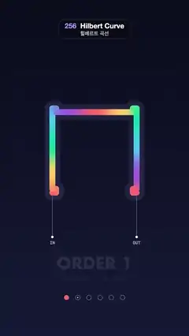

# 256 · Hilbert Curve · 힐베르트 곡선



**EN** A rainbow Hilbert curve unfolds order by order from a simple arch to one line through 4,096 cells, its colours flowing along it, then folds back.  
**KO** 무지개색 힐베르트 곡선이 단순한 아치에서 4,096칸을 지나는 한 줄로 한 차수씩 펼쳐지고, 색이 선을 따라 흐르다가 다시 접힌다.

[Video (mp4)](https://sueun-dev.github.io/motion-effects/videos/256-hilbert-curve.mp4) · [Code](../effects/256-hilbert-curve.js) · Generative math · 제너러티브 수학

## Prompt (English)

```text
Create a "Hilbert Curve" motion effect: the space-filling Hilbert curve refines from order 1 to order 6 inside a square, every new order unfolding smoothly out of the one before, with a colour gradient flowing along the single line; then it folds back to order 1.

Look
- Background: a vertical gradient, #0A0C1C at the top to #161A36 at the bottom.
- The square: 920 × 920 px with its top-left corner at (80, 400). A faint grid of the current order's cells (2 px lines, rgba(150, 165, 255, 0.09)); while the curve unfolds, the next order's grid fades in as the current one fades out.
- The line: round caps and joins, width = min(34, 0.38 × cell size) px with cell size = 920 / 2^L, so 34 px up to order 3, about 11 px at order 5 and 5.5 px at order 6. Under it a soft halo: the whole curve as one path, 2.6 × the width, rgba(170, 160, 255, 0.13) (one path, so overlaps do not add up).
- Colour by arc length: #FF6B6B, #FFD166, #06D6A0, #4CC9F0, #9B5DE5 blended smoothly in a loop, repeated twice along the whole line. Segments longer than 30 px are drawn with a linear gradient with a stop every 30 px, so the long lines of the low orders blend too.
- The curve enters at the bottom-left cell and leaves at the bottom-right: white 7 px dots labelled IN and OUT (24 px mono) under the square at y = 1354, joined to the ends of the line by thin white lines.
- Below: "ORDER n" (Futura bold 92 px, white, y = 1560) and "4ⁿ cells · one line" (4, 16, 64, 256, 1,024, 4,096; 34 px mono), shown one title at a time: during each refining step the old title fades out and slides 24 px up over the first 0.15 s, the new one fades in rising 24 px from below over the last 0.15 s, so they never overlap; during the fold the order-6 title fades out in its first 0.15 s and "ORDER 1" fades back in over its last 0.15 s. Under them six 13 px pips that fill as each order is reached.

Motion (0–5 s, a continuous level L from 1 to 6)
- Use u = (t + 0.12) mod 5, so the loop starts a little way into the first step.
- Refine: L rises by 1 at u = 0, 0.48, 0.96, 1.44 and 1.92 s, each step taking 0.42 s with an ease-in-out cubic; order 6 is reached at 2.34 s.
- Hold at order 6 until 3.3 s while the gradient flows.
- Fold: from 3.3 to 4.75 s, L goes from 6 back to 1 in one cosine-eased move, passing through every order; then order 1 holds until the loop restarts.
- The gradient slides one colour cycle (one of the two along the line) per loop: colour position = 2 × arc length / total length − t / 5.

Technique
- Build the order-6 curve once: 4,096 points on a 64 × 64 grid with the classic d2xy conversion (Hilbert index → cell); flip y so it opens downward.
- At order m, point d sits on the centre of its cell at that order, (x >> (6 − m), y >> (6 − m)); the polyline through all 4,096 such centres is exactly the order-m curve (4^(6 − m) points stack on each centre).
- At a level L between n and n + 1, every point is at lerp(its order-n centre, its order-(n + 1) centre, k), with k = the eased fraction while refining and the plain fraction while folding. Each corner of the coarse curve splits into four and the line unfolds without ever breaking.
- Every frame: place the points, accumulate the arc length, skip zero-length segments and draw the line segment by segment in its gradient colours.

Output and rules
- One self-contained HTML file with no external assets (three.js from a CDN is fine if you use it), drawing on a 1080 × 1920 canvas (9:16) scaled to fit the window.
- Write a function renderFrame(t) that draws the frame for time t in seconds, and preview it with requestAnimationFrame. Everything must be a pure function of t and fixed seeds: no Math.random(), Date or state carried between frames, so frame i = renderFrame(i / 30) can be exported to a 30 fps video.
- Loop seamlessly every 5 seconds: renderFrame(5) must look exactly like renderFrame(0).
- No flicker of any kind: no noise or grain that changes from frame to frame, no strobing or blinking, no z-fighting, no shimmering 1 px lines. Any grain or texture stays fixed to the screen or to the object.
- Keep the top 280 px free of important content (a title label goes there) and fill the whole frame with a designed background.
```

## 프롬프트 (한국어)

```text
"힐베르트 곡선" 모션 효과를 만들어 줘: 공간을 채우는 힐베르트 곡선이 정사각형 안에서 1차부터 6차까지 세밀해지는데, 차수마다 이전 곡선에서 부드럽게 펼쳐져 나오고, 한 줄을 따라 색 그라디언트가 흐른다. 그다음 1차로 다시 접힌다.

모양
- 배경: 세로 그라디언트, 위 #0A0C1C에서 아래 #161A36.
- 정사각형: 920 × 920px, 왼쪽 위 모서리 (80, 400). 현재 차수의 칸을 보여 주는 흐린 격자(2px 선, rgba(150, 165, 255, 0.09)). 곡선이 펼쳐지는 동안 다음 차수의 격자가 나타나고 현재 격자는 사라진다.
- 선: 끝과 꺾임은 둥글게, 굵기 = min(34, 0.38 × 칸 크기)px(칸 크기 = 920 / 2^L). 3차까지 34px, 5차 약 11px, 6차 5.5px. 그 아래 부드러운 후광: 곡선 전체를 한 경로로 굵기 2.6배, rgba(170, 160, 255, 0.13)(한 경로라 겹쳐도 진해지지 않는다).
- 색은 선의 길이(호 길이)를 따라: #FF6B6B, #FFD166, #06D6A0, #4CC9F0, #9B5DE5를 부드럽게 이어 순환시키고, 선 전체에 두 번 반복한다. 30px보다 긴 선분은 30px마다 색 정지점을 둔 선형 그라디언트로 그려 낮은 차수의 긴 선도 매끄럽게 섞인다.
- 곡선은 왼쪽 아래 칸으로 들어와 오른쪽 아래 칸으로 나간다: 정사각형 아래 y = 1354에 IN, OUT(24px 고정폭) 표시가 붙은 흰 7px 점, 가는 흰 선으로 선의 양 끝과 이어진다.
- 아래쪽: "ORDER n"(Futura 굵게 92px, 흰색, y = 1560)과 "4ⁿ cells · one line"(4, 16, 64, 256, 1,024, 4,096; 34px 고정폭). 제목은 한 번에 하나만: 세분 단계마다 처음 0.15초 동안 이전 제목이 옅어지며 24px 위로 빠지고, 마지막 0.15초 동안 새 제목이 아래에서 24px 올라오며 나타나 둘이 겹치지 않는다. 접을 때는 처음 0.15초에 6차 제목이 사라지고 마지막 0.15초에 "ORDER 1"이 다시 나타난다. 그 아래 13px 점 여섯 개가 차수에 도달할 때마다 채워진다.

움직임 (0–5초, 1에서 6까지 연속인 단계 L)
- u = (t + 0.12) mod 5를 쓴다. 루프가 첫 단계에 조금 들어간 상태에서 시작한다.
- 세분: u = 0, 0.48, 0.96, 1.44, 1.92초에 L이 1씩 오르고, 각 단계는 0.42초 동안 ease-in-out 3차로 움직인다. 2.34초에 6차.
- 3.3초까지 6차를 유지하고 그라디언트가 흐른다.
- 접기: 3.3초부터 4.75초까지 L이 6에서 1로 코사인 이징 한 번에 내려가며 모든 차수를 거친다. 이후 루프가 다시 시작할 때까지 1차를 유지한다.
- 그라디언트는 루프마다 색 한 주기(선을 따라 있는 두 주기 중 하나)만큼 미끄러진다: 색 위치 = 2 × 호 길이 / 전체 길이 − t / 5.

기법
- 6차 곡선을 한 번 만든다: 고전적인 d2xy 변환(힐베르트 인덱스 → 칸)으로 64 × 64 격자 위 4,096개 점. 아래로 열리도록 y를 뒤집는다.
- m차에서 점 d는 그 차수에서 자기가 속한 칸 (x >> (6 − m), y >> (6 − m))의 중심에 놓인다. 4,096개의 이런 중심을 잇는 꺾은선이 정확히 m차 곡선이다(중심마다 4^(6 − m)개 점이 겹친다).
- L이 n과 n + 1 사이면 모든 점을 lerp(n차 중심, n + 1차 중심, k)에 둔다. k는 세분할 때는 이징한 비율, 접을 때는 그대로의 비율. 거친 곡선의 꼭짓점이 넷으로 갈라지며 선이 끊기지 않고 펼쳐진다.
- 매 프레임: 점을 배치하고, 호 길이를 누적하고, 길이 0인 선분은 건너뛰고, 선분마다 그라디언트 색으로 그린다.

출력과 규칙
- 외부 파일 없는 HTML 파일 하나(three.js를 쓴다면 CDN은 괜찮다). 1080 × 1920(9:16) 캔버스에 그리고 창 크기에 맞춰 보이게 한다.
- 시간 t(초)의 프레임을 그리는 renderFrame(t) 함수를 만들고, 미리보기는 requestAnimationFrame으로 돌린다. 모든 것은 t와 고정 시드만으로 정해진다: Math.random(), Date, 프레임 사이에 쌓이는 상태 금지. 그래야 i번째 프레임 = renderFrame(i / 30)으로 30fps 영상을 뽑을 수 있다.
- 5초마다 끊김 없이 반복: renderFrame(5)는 renderFrame(0)과 똑같아 보여야 한다.
- 어떤 깜빡임도 금지: 프레임마다 바뀌는 노이즈·그레인, 번쩍임·깜빡임, z-fighting, 반짝이며 떨리는 1px 선 모두 금지. 그레인·질감은 화면이나 물체에 고정한다.
- 위쪽 280px에는 중요한 내용을 두지 않고(제목 라벨 자리), 화면 전체를 디자인된 배경으로 채운다.
```
