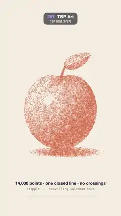

# 257 · TSP Art · TSP 한붓그리기



**EN** An apple stippled in 14,000 coral dots is drawn as one closed line that never crosses itself, a coral tail leading the pen, then turns back into dots.  
**KO** 산호색 점 14,000개로 찍은 사과를 한 번도 교차하지 않는 닫힌 한 줄이 산호색 꼬리를 앞세워 이어 그리고, 다시 점으로 돌아간다.

[Video (mp4)](https://sueun-dev.github.io/motion-effects/videos/257-tsp-art.mp4) · [Code](../effects/257-tsp-art.js) · Generative math · 제너러티브 수학

## Prompt (English)

```text
Create a "TSP Art" motion effect: a shaded apple is turned into stipple dots, and a single closed travelling-salesman tour through all the dots draws the picture as one continuous line that never crosses itself.

Look
- Paper: #F4EDE1 with 14,000 fixed specks, rgba(110, 80, 50, 0.015–0.05), 1–3 px (fixed seed).
- The subject is a darkness map (0 = paper, 1 = darkest), never drawn directly:
  - an apple centred at (540, 1010), outline radius r(θ) = 335 (1 + 0.1 cos θ + 0.04 cos 2θ) − 46 e^(−(θ / 0.32)²), θ measured from straight up (the dip is the stem hollow);
  - shaded as a dome lit from the upper left, light (−0.6, 0.55, 0.58): darkness = 0.16 + 0.84 (1 − lambert)^1.2, + 0.4 in the stem hollow, + faint vertical streaks (±0.09), − 0.25 bounced light near the lower-right rim, − a small specular spot (power 320);
  - a curved stem 24 → 16 px wide and 120 px tall at darkness 1; a leaf, an almond 260 × 124 px tilted −0.45 rad up to the right, its halves 0.3 and 0.62 with a light vein (0.04);
  - a cast shadow, an ellipse centred at (600, 1352) with radii 360 × 52 px, 0.85 at the contact, fading toward the right.
- The dots: 14,000 circles, radius 2.4 px, #D9734E.
- The line: #1F2238, 1.8 px, round caps and joins. The last 5,000 px the pen has drawn is drawn over in #E8603C, 2.2 px, in six pieces of rising opacity (up to 0.9), a glowing tail behind the pen.
- Caption: "14,000 points · one closed line · no crossings" (38 px semibold, #1F2238) at y = 1640, "stipple → travelling-salesman tour" (28 px mono, 55 %) at y = 1688, and a 600 × 6 px rule at y = 1730 that fills in #E8603C as the pen goes.

Motion (0–5 s)
- 0–3.2 s: the pen runs the whole tour by arc length with an ease-in-out cubic; each dot disappears as the line reaches it (fading over the last 60 px before).
- 3.2–3.9 s: the finished one-line drawing holds.
- 3.9–5 s: a linear crossfade: the line fades out while every dot fades back in, so 5 s is the same as 0 s (all dots, no line).

Technique
- Sample the darkness map on a 360 × 400 grid of 3 px cells covering y 380–1580.
- Stipple: rejection-sample 14,000 points with probability = darkness (fixed seed), then 10 rounds of weighted Lloyd relaxation: every grid cell goes to its nearest point (a 24 px bucket grid makes this fast), and every point moves to the darkness-weighted centroid of its cells. Dark areas end up with dense, evenly spaced dots.
- Tour: start with nearest neighbour (always walk to the closest unvisited dot), then 2-opt using each dot's 10 nearest neighbours until no swap shortens it. Then remove every crossing: sort the edges by x, sweep for pairs that intersect, and reverse the stretch between them (uncrossing always shortens the tour); repeat until none are left. The tour is closed (it returns to its first dot).
- All of it runs once at load with fixed seeds (well under a second); each frame only draws the path up to the pen's arc length.

Output and rules
- One self-contained HTML file with no external assets (three.js from a CDN is fine if you use it), drawing on a 1080 × 1920 canvas (9:16) scaled to fit the window.
- Write a function renderFrame(t) that draws the frame for time t in seconds, and preview it with requestAnimationFrame. Everything must be a pure function of t and fixed seeds: no Math.random(), Date or state carried between frames, so frame i = renderFrame(i / 30) can be exported to a 30 fps video.
- Loop seamlessly every 5 seconds: renderFrame(5) must look exactly like renderFrame(0).
- No flicker of any kind: no noise or grain that changes from frame to frame, no strobing or blinking, no z-fighting, no shimmering 1 px lines. Any grain or texture stays fixed to the screen or to the object.
- Keep the top 280 px free of important content (a title label goes there) and fill the whole frame with a designed background.
```

## 프롬프트 (한국어)

```text
"TSP 한붓그리기" 모션 효과를 만들어 줘: 음영 진 사과를 점묘 점으로 바꾸고, 모든 점을 지나는 닫힌 외판원(TSP) 경로 하나가 스스로 한 번도 교차하지 않는 한 줄로 그림을 그린다.

모양
- 종이: #F4EDE1, 고정된 티끌 14,000개, rgba(110, 80, 50, 0.015–0.05), 1–3px(고정 시드).
- 대상은 어둡기 지도(0 = 종이, 1 = 가장 어두움)이고 직접 그리지는 않는다:
  - (540, 1010)에 중심을 둔 사과, 외곽 반지름 r(θ) = 335 (1 + 0.1 cos θ + 0.04 cos 2θ) − 46 e^(−(θ / 0.32)²), θ는 정위쪽에서 잰다(움푹한 곳이 꼭지 자리);
  - 왼쪽 위에서 빛 (−0.6, 0.55, 0.58)을 받는 돔처럼 음영: 어둡기 = 0.16 + 0.84 (1 − 램버트)^1.2, 꼭지 오목한 곳 + 0.4, 세로 줄무늬 ±0.09, 오른쪽 아래 가장자리 반사광 − 0.25, 작은 반사 하이라이트(지수 320)는 뺀다;
  - 폭 24 → 16px, 높이 120px로 휜 꼭지, 어둡기 1. 잎은 260 × 124px 아몬드 모양을 −0.45 rad 기울여 오른쪽 위로, 두 반쪽 0.3과 0.62, 잎맥은 밝게(0.04);
  - 그림자: 중심 (600, 1352), 반지름 360 × 52px 타원, 닿는 곳 0.85에서 오른쪽으로 옅어진다.
- 점: 14,000개, 반지름 2.4px, #D9734E.
- 선: #1F2238, 1.8px, 끝과 꺾임은 둥글게. 펜이 마지막으로 그린 5,000px는 #E8603C, 2.2px로 덧그리되 불투명도가 올라가는(최대 0.9) 여섯 조각으로 나눠, 펜 뒤에서 빛나는 꼬리가 된다.
- 글: "14,000 points · one closed line · no crossings"(38px 세미볼드, #1F2238) y = 1640, "stipple → travelling-salesman tour"(28px 고정폭, 55 %) y = 1688, 그리고 y = 1730에 600 × 6px 막대가 펜이 나아가는 만큼 #E8603C로 찬다.

움직임 (0–5초)
- 0–3.2초: 펜이 호 길이를 따라 경로 전체를 ease-in-out 3차로 달린다. 선이 닿는 점은 사라진다(닿기 전 60px 동안 옅어짐).
- 3.2–3.9초: 완성된 한붓그리기가 머문다.
- 3.9–5초: 선형 크로스페이드: 선이 사라지는 동안 모든 점이 다시 나타나, 5초가 0초와 같아진다(점만 있고 선은 없음).

기법
- 어둡기 지도를 y 380–1580을 덮는 3px 칸 360 × 400 격자에서 샘플링한다.
- 점묘: 어둡기를 확률로 삼아 14,000개 점을 기각 샘플링(고정 시드)한 뒤, 가중 Lloyd 완화를 10번: 격자 칸마다 가장 가까운 점에 배정하고(24px 버킷 격자로 빠르게), 각 점을 자기 칸들의 어둡기 가중 무게중심으로 옮긴다. 어두운 곳일수록 점이 촘촘하고 고르게 놓인다.
- 경로: 최근접 이웃(가장 가까운 안 간 점으로 가기)으로 시작해, 점마다 가장 가까운 이웃 10개로 2-opt를 더는 짧아지지 않을 때까지 돌린다. 그다음 교차를 모두 없앤다: 간선을 x로 정렬해 쓸어 가며 서로 교차하는 쌍을 찾고, 그 사이 구간을 뒤집는다(교차를 풀면 경로는 항상 짧아진다). 남은 교차가 없을 때까지 반복. 경로는 닫혀 있다(첫 점으로 돌아온다).
- 모두 불러올 때 고정 시드로 한 번 계산한다(1초도 안 걸린다). 매 프레임은 펜의 호 길이까지 경로를 그리기만 한다.

출력과 규칙
- 외부 파일 없는 HTML 파일 하나(three.js를 쓴다면 CDN은 괜찮다). 1080 × 1920(9:16) 캔버스에 그리고 창 크기에 맞춰 보이게 한다.
- 시간 t(초)의 프레임을 그리는 renderFrame(t) 함수를 만들고, 미리보기는 requestAnimationFrame으로 돌린다. 모든 것은 t와 고정 시드만으로 정해진다: Math.random(), Date, 프레임 사이에 쌓이는 상태 금지. 그래야 i번째 프레임 = renderFrame(i / 30)으로 30fps 영상을 뽑을 수 있다.
- 5초마다 끊김 없이 반복: renderFrame(5)는 renderFrame(0)과 똑같아 보여야 한다.
- 어떤 깜빡임도 금지: 프레임마다 바뀌는 노이즈·그레인, 번쩍임·깜빡임, z-fighting, 반짝이며 떨리는 1px 선 모두 금지. 그레인·질감은 화면이나 물체에 고정한다.
- 위쪽 280px에는 중요한 내용을 두지 않고(제목 라벨 자리), 화면 전체를 디자인된 배경으로 채운다.
```
