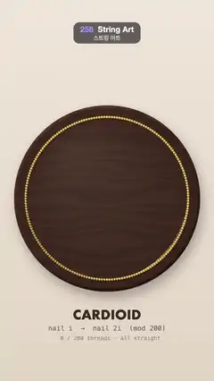

# 258 · String Art · 스트링 아트



**EN** On a dark walnut board, threads are wound one by one from nail i to nail 2i of 200 brass nails, and the straight threads glow into a heart-shaped cardioid.  
**KO** 어두운 호두나무 판의 황동 못 200개에 실이 i번 못에서 2i번 못으로 하나씩 감기고, 곧은 실들이 모여 하트 모양 카디오이드로 빛난다.

[Video (mp4)](https://sueun-dev.github.io/motion-effects/videos/258-string-art.mp4) · [Code](../effects/258-string-art.js) · Generative math · 제너러티브 수학

## Prompt (English)

```text
Create a "String Art" motion effect: threads wound between nails on a round board, each one a straight line from nail i to nail 2i, until their envelope glows as a cardioid; then they come off again in the same order.

Look
- Wall: a vertical gradient #EFE6DA → #E2D5C4 with 9,000 fixed 2 px specks (rgba(90, 60, 30, 0.02–0.05)).
- Board: a circle of radius 470 centred at (540, 1000), dark walnut RGB (52, 33, 26) × (1 + 0.18 grain + 0.08 fine noise), the grain wavy lines sin((y + 40 noise) × 0.11 + 6 noise); a 14 px bevel round the edge, lit at the top left and dark at the bottom right; a warm sheen from the upper left; a soft drop shadow (28 px blur, offset 14, 30).
- 200 nails on a circle of radius 410, nail 0 at the bottom, numbered clockwise: brass heads 7 px in radius (radial gradient #FFF3C4 → #D9A441 → #6B4A16) with a small dark shadow.
- Thread i: a straight 2.4 px line from nail i to nail (2i mod 200), opacity 0.55, its colour running with i from #FF4D6D through #FF8C5A to #FFD166, drawn with additive ("lighter") blending so crowded threads glow. The envelope is a cardioid with its cusp at the top, so it reads as a heart.
- A warm-white dot (3.5 px) rides the running end of every thread going on (opacity 0.8 sin(π × progress)).
- Caption: "CARDIOID" (Futura bold 64 px, #3B2A22) at y = 1610, "nail i → nail 2i (mod 200)" (34 px mono, 70 %) at y = 1666, and "n / 200 threads · all straight" (28 px mono, 50 %) at y = 1714, counting the threads fully on.

Motion (0–5 s)
- Winding: thread i starts at 2.4 × i / 200 s and stretches from nail i to nail 2i in 0.32 s (ease-out cubic), so about two threads start every frame and the figure sweeps round; all are on by about 2.7 s.
- Hold the finished cardioid.
- Unwinding: thread i starts coming off at 3.35 + 1.6 × i / 200 s, in 0.32 s (ease-in-out cubic): its start slides along to nail 2i until the thread is gone.
- Each thread's time is measured from its own start, modulo 5 s, so the last threads are still coming off just after the loop wraps while the first ones go back on; the board is never still at the seam.

Technique
- Canvas 2D. The wall, the board (per-pixel walnut grain) and one nail head are drawn once into off-screen canvases; each frame draws them, then the visible piece of every thread (between its unwind and wind fractions along nail i → nail 2i), then the nails on top.
- Every thread is just a straight segment: the curve is only the envelope of the times-two table on a circle, which is why it is called a cardioid.

Output and rules
- One self-contained HTML file with no external assets (three.js from a CDN is fine if you use it), drawing on a 1080 × 1920 canvas (9:16) scaled to fit the window.
- Write a function renderFrame(t) that draws the frame for time t in seconds, and preview it with requestAnimationFrame. Everything must be a pure function of t and fixed seeds: no Math.random(), Date or state carried between frames, so frame i = renderFrame(i / 30) can be exported to a 30 fps video.
- Loop seamlessly every 5 seconds: renderFrame(5) must look exactly like renderFrame(0).
- No flicker of any kind: no noise or grain that changes from frame to frame, no strobing or blinking, no z-fighting, no shimmering 1 px lines. Any grain or texture stays fixed to the screen or to the object.
- Keep the top 280 px free of important content (a title label goes there) and fill the whole frame with a designed background.
```

## 프롬프트 (한국어)

```text
"스트링 아트" 모션 효과를 만들어 줘: 둥근 판의 못 사이에 실을 감는데, 실 하나하나는 i번 못에서 2i번 못까지 곧은 선이고, 실들의 테두리가 카디오이드로 빛날 때까지 감는다. 그다음 같은 순서로 다시 풀린다.

모양
- 벽: 세로 그라디언트 #EFE6DA → #E2D5C4, 고정된 2px 티끌 9,000개(rgba(90, 60, 30, 0.02–0.05)).
- 판: (540, 1000)에 중심을 둔 반지름 470 원, 어두운 호두나무 RGB (52, 33, 26) × (1 + 0.18 나뭇결 + 0.08 잔무늬). 나뭇결은 sin((y + 40 노이즈) × 0.11 + 6 노이즈)의 물결 선. 가장자리 14px 베벨은 왼쪽 위가 밝고 오른쪽 아래가 어둡다. 왼쪽 위에서 따뜻한 광택, 부드러운 그림자(블러 28px, 오프셋 14, 30).
- 못 200개를 반지름 410 원 위에, 0번 못은 아래, 시계 방향으로 번호: 반지름 7px 황동 머리(방사 그라디언트 #FFF3C4 → #D9A441 → #6B4A16)와 작은 어두운 그림자.
- i번 실: i번 못에서 (2i mod 200)번 못까지 곧은 2.4px 선, 불투명도 0.55, 색은 i에 따라 #FF4D6D → #FF8C5A → #FFD166. 더하기("lighter") 합성으로 그려 실이 몰린 곳이 빛난다. 실들의 테두리는 꼭짓점이 위에 있는 카디오이드라 하트처럼 보인다.
- 감기는 중인 실마다 끝에 따뜻한 흰 점(3.5px, 불투명도 0.8 sin(π × 진행도))이 따라간다.
- 글: "CARDIOID"(Futura 굵게 64px, #3B2A22) y = 1610, "nail i → nail 2i (mod 200)"(34px 고정폭, 70 %) y = 1666, "n / 200 threads · all straight"(28px 고정폭, 50 %) y = 1714. 다 감긴 실의 수를 센다.

움직임 (0–5초)
- 감기: i번 실은 2.4 × i / 200초에 시작해 0.32초 동안(ease-out 3차) i번 못에서 2i번 못으로 뻗는다. 프레임마다 실이 두 개쯤 새로 시작해 그림이 원을 따라 돌며 차오르고, 2.7초쯤 모두 감긴다.
- 완성된 카디오이드가 머문다.
- 풀기: i번 실은 3.35 + 1.6 × i / 200초에 풀리기 시작해 0.32초 동안(ease-in-out 3차) 시작점이 2i번 못 쪽으로 미끄러지며 사라진다.
- 실마다 자기 시작 시각부터 잰 시간을 5초로 나눈 나머지로 쓰므로, 루프가 넘어간 직후에도 마지막 실들이 풀리는 동안 첫 실들이 다시 감긴다. 이음매에서도 판이 멈추지 않는다.

기법
- Canvas 2D. 벽, 판(픽셀마다 호두나무 결), 못 머리 하나는 화면 밖 캔버스에 한 번만 그린다. 매 프레임 그것들을 그린 뒤, 실마다 보이는 부분(i번 → 2i번 못 선 위에서 풀린 비율과 감긴 비율 사이)을 그리고, 맨 위에 못을 찍는다.
- 실은 모두 곧은 선분일 뿐이다. 곡선은 원 위 2배 곱셈표의 포락선이고, 그래서 카디오이드라 부른다.

출력과 규칙
- 외부 파일 없는 HTML 파일 하나(three.js를 쓴다면 CDN은 괜찮다). 1080 × 1920(9:16) 캔버스에 그리고 창 크기에 맞춰 보이게 한다.
- 시간 t(초)의 프레임을 그리는 renderFrame(t) 함수를 만들고, 미리보기는 requestAnimationFrame으로 돌린다. 모든 것은 t와 고정 시드만으로 정해진다: Math.random(), Date, 프레임 사이에 쌓이는 상태 금지. 그래야 i번째 프레임 = renderFrame(i / 30)으로 30fps 영상을 뽑을 수 있다.
- 5초마다 끊김 없이 반복: renderFrame(5)는 renderFrame(0)과 똑같아 보여야 한다.
- 어떤 깜빡임도 금지: 프레임마다 바뀌는 노이즈·그레인, 번쩍임·깜빡임, z-fighting, 반짝이며 떨리는 1px 선 모두 금지. 그레인·질감은 화면이나 물체에 고정한다.
- 위쪽 280px에는 중요한 내용을 두지 않고(제목 라벨 자리), 화면 전체를 디자인된 배경으로 채운다.
```
