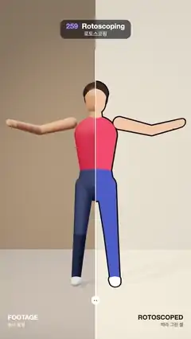

# 259 · Rotoscoping · 로토스코핑



**EN** A dancer filmed in a warm studio and the same dancer traced as flat cels with ink outlines on paper; a wipe slides across and the two line up exactly.  
**KO** 따뜻한 스튜디오에서 춤추는 사람과, 그 사람을 종이 위에 잉크 윤곽선과 납작한 색으로 따라 그린 셀이 와이프로 오가며 정확히 겹친다.

[Video (mp4)](https://sueun-dev.github.io/motion-effects/videos/259-rotoscoping.mp4) · [Code](../effects/259-rotoscoping.js) · Film & animation craft · 영상·애니메이션 기법

## Prompt (English)

```text
Create a "Rotoscoping" motion effect: a dancer as live-action footage and the same dancer traced frame by frame as flat colour cels with an ink outline, with a wipe sliding back and forth so you see the tracing match the footage exactly.

Look
- Camera: perspective, 30° vertical field of view, at (0, 1.1, 5.6) looking at (0, 1.02, 0). The figure is about 1.75 units tall and fills the middle of the frame (roughly y 330–1600 px).
- The figure: tapered capsules (two hemispheres joined by a cone, built with a lathe) on a joint hierarchy, each part reaching into the next joint so there are no gaps: pelvis (radii 0.13 → 0.15) with the hips at height 0.93–0.95; torso 0.17 at the chest narrowing to 0.125 at the waist (0.3 long, squashed to 1.1 wide × 0.72 deep); neck; head (radius 0.1) with a hair cap; upper arms 0.052 → 0.04 (0.29), forearms 0.04 → 0.032 (0.27), small flat hands; thighs 0.085 → 0.056 (0.44), shins 0.056 → 0.042 (0.42); shoes pointing forward.
- Footage (left of the wipe): a floor #B9A58E and a back wall #A8937C at z = −2.2; a warm spotlight #FFE2C2 (intensity 60, cone 0.55 rad, penumbra 0.6) from (−2.4, 3.6, 3.2) casting soft shadows (PCF, 2048 map, radius 6), a cool rim light #9CC8FF (2.2) from (3, 3, −3), a hemisphere light (#FFF1E0 / #5A4A3C, 0.5) and a room environment map at 0.35. Skin #C98A66 (physical, a little sheen), a red tank top #C8384D, denim trousers #2E3D63, white shoes, dark hair #2A1B14. ACES tone mapping, a soft vignette and a fixed film grain of ±3 % (it also hides banding).
- Rotoscoped (right of the wipe): the same figure in flat unlit colours: skin #F6C9A6, top #FF5D6C, trousers #4B62C9, shoes white, hair #3B2A22. Every part has an ink outline: the back faces of a copy 0.011 units fatter, in #15121A. It sits on warm paper (about #EFE7D7) with a fixed 2 px tooth, and the footage shows faintly through the paper, as on a light box (paper × (0.72 + 0.28 × the footage's brightness / 0.45)).
- The wipe: a 4 px white line from y = 280 to the bottom with a round white handle (24 px) at y = 1700. Labels, each clipped to its own side: "FOOTAGE / 실사 촬영" in white at the bottom left, "ROTOSCOPED / 따라 그린 셀" in dark brown #2B241E at the bottom right (36 px bold over 26 px).

Motion (0–5 s), a = 2π t / 5, f = 2a (a step-touch groove, two cycles per loop)
- The whole figure turns 0.45 sin a about the vertical axis.
- Hips: sway x = 0.09 sin f, dip 0.035 twice per cycle, tilt 0.08 sin f. Torso: twist 0.25 sin f, lean −0.12 sin f; chest 0.1 sin f; head turns −0.2 sin f and nods 0.08 sin(2f + 0.6).
- Arms in opposition: up = 0.5 ± 0.5 sin f; the shoulder lifts the arm sideways by 0.25 + 2.1 × up rad and forward by 0.3 + 0.5 × up; the elbow bends 0.25 + 1.0 × (1 − up).
- Feet: targets at x = ±0.17 + 0.05 sin f on the floor; the free foot taps up 0.09 sin² f. Each leg is solved by two-bone IK (law of cosines, thigh 0.44, shin 0.42, knees forward) and the shoes stay flat.
- The wipe: x = 540 + 330 sin a px, sweeping over the dancer both ways.

Technique
- three.js. Build the rig twice from one function, once with lit materials (the footage scene) and once with flat materials plus ink hulls (the cel scene); one pose(t) drives both, so they match exactly.
- Render the footage into a multisampled half-float target, and the cel scene into a second one cleared to transparent. A full-screen shader composites them: left of the wipe the tone-mapped footage, right of it the paper (with the footage showing through) and the cel layer over it by its alpha; the output is converted to sRGB.

Output and rules
- One self-contained HTML file with no external assets (three.js from a CDN is fine if you use it), drawing on a 1080 × 1920 canvas (9:16) scaled to fit the window.
- Write a function renderFrame(t) that draws the frame for time t in seconds, and preview it with requestAnimationFrame. Everything must be a pure function of t and fixed seeds: no Math.random(), Date or state carried between frames, so frame i = renderFrame(i / 30) can be exported to a 30 fps video.
- Loop seamlessly every 5 seconds: renderFrame(5) must look exactly like renderFrame(0).
- No flicker of any kind: no noise or grain that changes from frame to frame, no strobing or blinking, no z-fighting, no shimmering 1 px lines. Any grain or texture stays fixed to the screen or to the object.
- Keep the top 280 px free of important content (a title label goes there) and fill the whole frame with a designed background.
```

## 프롬프트 (한국어)

```text
"로토스코핑" 모션 효과를 만들어 줘: 실사 촬영처럼 보이는 춤추는 사람과, 그 사람을 프레임마다 따라 그린 납작한 색 셀과 잉크 윤곽선을 와이프가 앞뒤로 오가며 보여 주어, 따라 그린 그림이 촬영본과 정확히 겹치는 것을 보여 준다.

모양
- 카메라: 원근, 세로 시야각 30°, (0, 1.1, 5.6)에서 (0, 1.02, 0)을 본다. 인물은 키 약 1.75이고 화면 가운데(대략 y 330–1600px)를 채운다.
- 인물: 관절 계층 위의 가늘어지는 캡슐(반구 두 개를 원뿔로 이은 것, 선반(lathe)으로 만든다). 부위마다 다음 관절까지 이어져 틈이 없다: 골반(반지름 0.13 → 0.15), 엉덩이 높이 0.93–0.95; 몸통은 가슴 0.17에서 허리 0.125로 좁아짐(길이 0.3, 너비 1.1 × 깊이 0.72로 납작하게); 목; 머리(반지름 0.1)와 머리카락 덮개; 위팔 0.052 → 0.04(0.29), 아래팔 0.04 → 0.032(0.27), 작고 납작한 손; 넓적다리 0.085 → 0.056(0.44), 정강이 0.056 → 0.042(0.42); 앞을 향한 신발.
- 촬영본(와이프 왼쪽): 바닥 #B9A58E, z = −2.2에 뒷벽 #A8937C; 따뜻한 스포트라이트 #FFE2C2(세기 60, 원뿔 0.55 rad, 반그림자 0.6)가 (−2.4, 3.6, 3.2)에서 부드러운 그림자(PCF, 2048 맵, 반지름 6)를 드리우고, 차가운 림 라이트 #9CC8FF(2.2)가 (3, 3, −3)에서, 반구광(#FFF1E0 / #5A4A3C, 0.5), 룸 환경맵 0.35. 피부 #C98A66(물리 기반, 약간의 sheen), 빨간 민소매 #C8384D, 청바지 #2E3D63, 흰 신발, 어두운 머리 #2A1B14. ACES 톤 매핑, 부드러운 비네트, ±3 % 고정 필름 그레인(띠 무늬도 가린다).
- 로토스코핑(와이프 오른쪽): 같은 인물을 빛을 받지 않는 납작한 색으로: 피부 #F6C9A6, 상의 #FF5D6C, 바지 #4B62C9, 신발 흰색, 머리 #3B2A22. 부위마다 잉크 윤곽선: 0.011만큼 두꺼운 복제본의 뒷면을 #15121A로. 따뜻한 종이(약 #EFE7D7, 2px 고정 결) 위에 있고, 라이트박스처럼 종이 너머로 촬영본이 흐리게 비친다(종이 × (0.72 + 0.28 × 촬영본 밝기 / 0.45)).
- 와이프: y = 280부터 아래 끝까지 4px 흰 선, y = 1700에 둥근 흰 손잡이(24px). 글은 각자 자기 쪽에만 보이게 잘라서: 왼쪽 아래에 흰색 "FOOTAGE / 실사 촬영", 오른쪽 아래에 짙은 갈색 #2B241E "ROTOSCOPED / 따라 그린 셀"(36px 굵게, 아래 26px).

움직임 (0–5초), a = 2π t / 5, f = 2a (스텝 터치 그루브, 루프마다 두 번)
- 인물 전체가 세로축으로 0.45 sin a 돌아간다.
- 엉덩이: 좌우 x = 0.09 sin f, 한 주기에 두 번 0.035 내려앉음, 기울기 0.08 sin f. 몸통: 비틀기 0.25 sin f, 기울기 −0.12 sin f; 가슴 0.1 sin f; 머리는 −0.2 sin f로 돌고 0.08 sin(2f + 0.6)으로 끄덕인다.
- 팔은 서로 반대로: up = 0.5 ± 0.5 sin f. 어깨가 팔을 옆으로 0.25 + 2.1 × up rad, 앞으로 0.3 + 0.5 × up만큼 들고, 팔꿈치는 0.25 + 1.0 × (1 − up) 굽힌다.
- 발: 바닥 위 x = ±0.17 + 0.05 sin f가 목표, 쉬는 발은 0.09 sin² f만큼 톡 든다. 다리는 투 본 IK(코사인 법칙, 넓적다리 0.44, 정강이 0.42, 무릎은 앞으로)로 풀고 신발은 바닥과 평평하게 유지한다.
- 와이프: x = 540 + 330 sin a px로 인물 위를 양쪽으로 쓸고 지나간다.

기법
- three.js. 한 함수로 리그를 두 번 만든다: 한 번은 빛을 받는 재질(촬영 장면), 한 번은 납작한 재질에 잉크 외피(셀 장면). pose(t) 하나가 둘을 함께 움직이니 정확히 겹친다.
- 촬영 장면은 멀티샘플 half-float 렌더 타깃에, 셀 장면은 투명으로 지운 두 번째 타깃에 그린다. 전체 화면 셰이더가 합성한다: 와이프 왼쪽은 톤 매핑한 촬영본, 오른쪽은 (촬영본이 비치는) 종이 위에 셀 층을 알파로 얹고, 출력은 sRGB로 바꾼다.

출력과 규칙
- 외부 파일 없는 HTML 파일 하나(three.js를 쓴다면 CDN은 괜찮다). 1080 × 1920(9:16) 캔버스에 그리고 창 크기에 맞춰 보이게 한다.
- 시간 t(초)의 프레임을 그리는 renderFrame(t) 함수를 만들고, 미리보기는 requestAnimationFrame으로 돌린다. 모든 것은 t와 고정 시드만으로 정해진다: Math.random(), Date, 프레임 사이에 쌓이는 상태 금지. 그래야 i번째 프레임 = renderFrame(i / 30)으로 30fps 영상을 뽑을 수 있다.
- 5초마다 끊김 없이 반복: renderFrame(5)는 renderFrame(0)과 똑같아 보여야 한다.
- 어떤 깜빡임도 금지: 프레임마다 바뀌는 노이즈·그레인, 번쩍임·깜빡임, z-fighting, 반짝이며 떨리는 1px 선 모두 금지. 그레인·질감은 화면이나 물체에 고정한다.
- 위쪽 280px에는 중요한 내용을 두지 않고(제목 라벨 자리), 화면 전체를 디자인된 배경으로 채운다.
```
