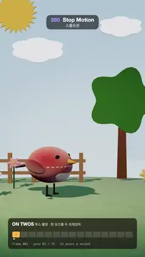

# 260 · Stop Motion · 스톱모션



**EN** A felt robin puppet hops across a felt-and-cardboard tabletop set, pecks and turns round, every pose held for exactly two frames, as in real stop motion.  
**KO** 펠트 울새 인형이 펠트와 판지로 만든 탁상 세트를 깡충 건너고 쪼고 돌아서며, 진짜 스톱모션처럼 모든 포즈가 정확히 두 프레임씩 멈춘다.

[Video (mp4)](https://sueun-dev.github.io/motion-effects/videos/260-stop-motion.mp4) · [Code](../effects/260-stop-motion.js) · Film & animation craft · 영상·애니메이션 기법

## Prompt (English)

```text
Create a "Stop Motion" motion effect: a felt puppet on a handmade tabletop set, animated "on twos": the puppet only moves between exposures, and every pose is held for exactly two video frames, with clean held poses and no random boil or jitter.

Look
- Camera: perspective, 30° vertical field of view, at (0, 1.8, 10) looking at (0, 1.3, 0); it never moves.
- Backdrop: a painted sky card 9 × 16 at z = −3.2, gradient #7FB4E0 → #CFE6F0 (70 %) → #F3E9D2, lit and a little self-lit (emissive 0.55) so it reads as a bright painted card.
- Ground: a felt hill (a sphere of radius 9 scaled (1, 0.18, 0.6) at (0, −1.62, −0.6)) in green #5E9A3A.
- Props: four felt flowers (six petals each, white #F7F2E6, pink #F59AB5 or yellow #F7D046, gold bead centres, 0.38–0.55 tall); a wooden fence behind (five posts 0.09 × 0.75 every 0.55 from x = −2.0, two rails) at z ≈ −1.1; a cardboard tree at (1.2, 0, −1.6) (a brown trunk and a wavy green canopy, radius 0.75 ± 0.12 cos 5θ, cut 4–5 cm thick with pale card edges); two white card clouds and a card sun with 24 rays on a thin wire, all cut-outs (extruded outlines) with pale edges.
- Felt: a canvas texture of 6,000 tiny fibre strokes (light and dark, 3–9 × 1 px, random angles, fixed seed) used as both colour and bump map, roughness 1, sheen 1 (sheen roughness 0.7).
- The puppet: a round body (sphere radius 0.42 scaled 0.95 × 0.9 × 1.08) in red felt #C9412F with a cream running stitch round its middle; a cream felt belly #F1DDBE; a wooden cone beak (radius 0.075, 0.22 long, #E8A23A); glossy black bead eyes; dark red felt wings and a fan tail #9C2F22; dark wire legs 0.2 long with three toes.
- Light: a warm spotlight #FFE7C4 (intensity 90) from (−3.2, 5.5, 4.5) casting soft shadows (PCF, 2048 map), a hemisphere light (#DCEBFF / #7A5A3A, 0.9) and a cool fill #BFD6FF (0.6) from the right. ACES tone mapping.
- The exposure sheet at the bottom: a rounded panel 960 × 230 at (60, 1630), rgba(20, 16, 12, 0.72); "ON TWOS" (34 px bold) and "투스 촬영 · 한 포즈를 두 프레임씩"; fifteen cells for one second, each 60 px wide (= two frames, split by a thin line), the current pose's cell lit #FFB547, a white tick under the current video frame; "frame 031 · pose 16 / 75 · 15 poses a second" in 22 px mono.

Motion (0–5 s)
- Stepped time: ts = floor(t × 15) / 15, so each pose lasts exactly 2 of the 30 frames; 75 poses per loop. The performance runs on u = (ts + 0.25) mod 5.
- Four hops, taking off at u = 0.35, 1.05, 2.95 and 3.65 s (x: −0.45 → 0 → 0.45, then 0.45 → 0 → −0.45): a 0.15 s crouch (squash to 0.84), a 0.4 s flight (an arc 0.42 high, x eased in-out, stretch to 1.12, wings flapping 0.9 |sin 6πu|, legs tucked 0.6 rad), a 0.15 s landing (squash 0.84 and back). The body keeps its volume (sideways scale 1 / √squash).
- Two pecks between 1.7 and 2.15 s (the body pitches forward up to 0.55 rad, the tail lifts).
- Turns: 2.25–2.75 s from facing right (yaw +1.05 rad) to facing left (−1.05), passing through facing the camera; 4.35–4.85 s back to the right.
- The set, the camera and the light never move; only the puppet changes, and only every second frame.

Technique
- three.js. Everything about the puppet is a function of the stepped time ts alone: no noise, no random offsets, so held frames are pixel-identical and each new pose is a clean step.
- The props are simple meshes (spheres, cylinders, boxes and extruded cardboard outlines); felt comes from the fixed fibre texture and the sheen term, not from anything that changes per frame.

Output and rules
- One self-contained HTML file with no external assets (three.js from a CDN is fine if you use it), drawing on a 1080 × 1920 canvas (9:16) scaled to fit the window.
- Write a function renderFrame(t) that draws the frame for time t in seconds, and preview it with requestAnimationFrame. Everything must be a pure function of t and fixed seeds: no Math.random(), Date or state carried between frames, so frame i = renderFrame(i / 30) can be exported to a 30 fps video.
- Loop seamlessly every 5 seconds: renderFrame(5) must look exactly like renderFrame(0).
- No flicker of any kind: no noise or grain that changes from frame to frame, no strobing or blinking, no z-fighting, no shimmering 1 px lines. Any grain or texture stays fixed to the screen or to the object.
- Keep the top 280 px free of important content (a title label goes there) and fill the whole frame with a designed background.
```

## 프롬프트 (한국어)

```text
"스톱모션" 모션 효과를 만들어 줘: 손으로 만든 탁상 세트 위의 펠트 인형을 "투스(on twos)"로 움직인다. 인형은 촬영과 촬영 사이에만 움직이고 모든 포즈는 정확히 영상 두 프레임씩 머문다. 깨끗하게 멈춘 포즈만 있고, 무작위 떨림(boil)이나 흔들림은 없다.

모양
- 카메라: 원근, 세로 시야각 30°, (0, 1.8, 10)에서 (0, 1.3, 0)을 본다. 움직이지 않는다.
- 배경: z = −3.2에 9 × 16 크기의 하늘 그림 판, 그라디언트 #7FB4E0 → #CFE6F0(70 %) → #F3E9D2. 조명을 받고 스스로도 조금 빛나(emissive 0.55) 밝게 칠한 판처럼 보인다.
- 땅: 펠트 언덕(반지름 9 구를 (1, 0.18, 0.6)으로 납작하게, 위치 (0, −1.62, −0.6)), 초록 #5E9A3A.
- 소품: 펠트 꽃 네 송이(꽃잎 여섯 장, 흰색 #F7F2E6·분홍 #F59AB5·노랑 #F7D046, 금색 구슬 가운데, 높이 0.38–0.55); 뒤쪽 나무 울타리(x = −2.0부터 0.55 간격으로 0.09 × 0.75 기둥 다섯 개, 가로대 두 개, z ≈ −1.1); (1.2, 0, −1.6)에 판지 나무(갈색 줄기와 반지름 0.75 ± 0.12 cos 5θ의 물결 모양 초록 수관, 두께 4–5cm, 가장자리는 연한 판지색); 흰 판지 구름 두 개와 가는 철사에 달린 빛살 24개짜리 판지 해. 모두 외곽선을 돌출시킨 오려 낸 판이고 가장자리가 연하다.
- 펠트: 아주 작은 섬유 획 6,000개(밝고 어두운 3–9 × 1px, 무작위 각도, 고정 시드)를 그린 캔버스 텍스처를 색과 범프 맵으로 함께 쓰고, 거칠기 1, sheen 1(sheen 거칠기 0.7).
- 인형: 둥근 몸통(반지름 0.42 구를 0.95 × 0.9 × 1.08로)은 빨간 펠트 #C9412F에 허리를 도는 크림색 홈질 땀; 크림색 펠트 배 #F1DDBE; 나무 원뿔 부리(반지름 0.075, 길이 0.22, #E8A23A); 반짝이는 검은 구슬 눈; 짙은 빨강 펠트 날개와 부채꼴 꼬리 #9C2F22; 길이 0.2의 어두운 철사 다리와 발가락 세 개.
- 조명: 따뜻한 스포트라이트 #FFE7C4(세기 90)가 (−3.2, 5.5, 4.5)에서 부드러운 그림자(PCF, 2048 맵), 반구광(#DCEBFF / #7A5A3A, 0.9), 오른쪽에서 차가운 보조광 #BFD6FF(0.6). ACES 톤 매핑.
- 아래 노출표(exposure sheet): (60, 1630)에 960 × 230 둥근 패널, rgba(20, 16, 12, 0.72); "ON TWOS"(34px 굵게)와 "투스 촬영 · 한 포즈를 두 프레임씩"; 1초 분량 칸 15개, 칸마다 폭 60px(= 두 프레임, 가는 선으로 나뉨), 지금 포즈의 칸은 #FFB547로 켜지고 지금 영상 프레임 아래 흰 표시; 22px 고정폭으로 "frame 031 · pose 16 / 75 · 15 poses a second".

움직임 (0–5초)
- 계단 시간: ts = floor(t × 15) / 15. 포즈마다 30프레임 중 정확히 2프레임, 루프마다 75포즈. 연기는 u = (ts + 0.25) mod 5로 돌린다.
- 뜀 네 번, u = 0.35, 1.05, 2.95, 3.65초에 이륙(x: −0.45 → 0 → 0.45, 그다음 0.45 → 0 → −0.45): 0.15초 웅크림(0.84로 찌그러짐), 0.4초 비행(높이 0.42의 호, x는 ease-in-out, 1.12로 늘어남, 날개 0.9 |sin 6πu|로 퍼덕임, 다리 0.6 rad 접음), 0.15초 착지(0.84로 찌그러졌다 돌아옴). 몸통은 부피를 지킨다(옆 방향 배율 1 / √찌그러짐).
- 1.7–2.15초에 두 번 쪼기(몸이 앞으로 최대 0.55 rad 숙고 꼬리가 들림).
- 돌기: 2.25–2.75초에 오른쪽(요 +1.05 rad)에서 왼쪽(−1.05)으로, 중간에 카메라를 정면으로 본다; 4.35–4.85초에 다시 오른쪽으로.
- 세트, 카메라, 조명은 움직이지 않는다. 인형만, 그것도 두 프레임마다 한 번만 바뀐다.

기법
- three.js. 인형에 관한 모든 것은 계단 시간 ts만의 함수다: 노이즈도 무작위 오프셋도 없으니 멈춘 두 프레임은 픽셀까지 똑같고 새 포즈는 깨끗한 한 걸음이다.
- 소품은 단순한 메시(구, 원기둥, 상자, 돌출한 판지 외곽선)다. 펠트 느낌은 고정된 섬유 텍스처와 sheen에서 나오고, 프레임마다 바뀌는 것은 없다.

출력과 규칙
- 외부 파일 없는 HTML 파일 하나(three.js를 쓴다면 CDN은 괜찮다). 1080 × 1920(9:16) 캔버스에 그리고 창 크기에 맞춰 보이게 한다.
- 시간 t(초)의 프레임을 그리는 renderFrame(t) 함수를 만들고, 미리보기는 requestAnimationFrame으로 돌린다. 모든 것은 t와 고정 시드만으로 정해진다: Math.random(), Date, 프레임 사이에 쌓이는 상태 금지. 그래야 i번째 프레임 = renderFrame(i / 30)으로 30fps 영상을 뽑을 수 있다.
- 5초마다 끊김 없이 반복: renderFrame(5)는 renderFrame(0)과 똑같아 보여야 한다.
- 어떤 깜빡임도 금지: 프레임마다 바뀌는 노이즈·그레인, 번쩍임·깜빡임, z-fighting, 반짝이며 떨리는 1px 선 모두 금지. 그레인·질감은 화면이나 물체에 고정한다.
- 위쪽 280px에는 중요한 내용을 두지 않고(제목 라벨 자리), 화면 전체를 디자인된 배경으로 채운다.
```
