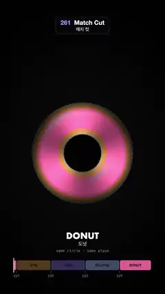

# 261 · Match Cut · 매치 컷



**EN** An eye, a camera lens, an eclipse and a donut share one circle in one place; each spins a full turn, blurs into rings and hard-cuts to the next at top speed.  
**KO** 눈, 카메라 렌즈, 일식, 도넛이 같은 자리의 같은 원을 나눠 갖고, 한 바퀴 돌며 고리로 번지다 가장 빠른 순간 다음 장면으로 딱 잘린다.

[Video (mp4)](https://sueun-dev.github.io/motion-effects/videos/261-match-cut.mp4) · [Code](../effects/261-match-cut.js) · Film & animation craft · 영상·애니메이션 기법

## Prompt (English)

```text
Create a "Match Cut" motion effect: four shots whose main shape is the same circle in the same place, an eye, a camera lens, a solar eclipse and a glazed donut, joined by hard cuts that each land in the middle of the same move, so the shape carries straight on across every cut.

Look
- Every shot: a circle centred at (540, 1000), a dark disc of radius 120 px inside a bright ring out to 330 px. Low-key light: the whole frame is multiplied by 0.1 + 0.9 × smoothstep(1000, 300, length(d × (1.2, 0.9))), d = pixel − centre, so the edges fall to black.
- Eye: a tilted almond opening (upper lid at 290 (1 − x²)^0.75, lower lid at 300 (1 − x²)^0.9, x = dx / 560, both tilted a little), dim skin with a lid crease and a dark lash line, a dim sclera with the upper lid's shadow on it; the iris goes from amber #D98C2E round the pupil to teal #388C9E outside (a wavy boundary, 9 waves), with radial fibres from two phase-modulated sines (29 and 17 repeats round the circle), a dark limbal ring and a black pupil; a soft window catchlight up and to the left of the pupil.
- Lens: black around; a barrel ring out to 470 px with a knurled grip (160 ridges) and a bright bevel at 364 px; nine brushed-grey aperture blades (#5C5E66, each shaded across its width) making a nine-sided opening of radius 120; glass from 0.76 × 330 outwards with a green coating ring, a white ring-light reflection and a violet ring.
- Eclipse: a black sky with fixed stars, a black moon disc, a pale blue-white corona #DBE6FF of brightness 1.3 (120 / r)^(1.6 + 1.6 (1 − streak)) with streaks from sines of 10 and 23 repeats, a thin pink limb and a few pink prominences.
- Donut: a dark slate table with the donut's soft shadow; a top-down torus (tube from 120 to 330 px) shaded by its normal with the light from the upper left; golden dough #C77A38 with a pale band at the outer edge; pink icing #F56B9E with a wavy edge (7 and 23 waves) and a gloss highlight; sprinkles in 70 × 8 cells (70 % filled), white, yellow, blue and green capsules about 22 × 6 px at random angles.
- On top of every shot, two dashed guide circles (radius 120 and 330, 2 px, dashes 10 / 14, 22 % white): the same circle, the same place.
- Below: the shot's name (Futura 54 px) at y = 1560, its Korean name (32 px) at 1604, "same circle · same place" (24 px mono) at 1646; an edit timeline from x = 90 to 990 at y = 1700, 64 px tall, with the clips in amber, violet, pale blue and pink (the current one bright, the others at 40 %), a white playhead and "CUT" marks under the cuts.

Motion (0–5 s)
- Hard cuts at 0.1, 1.35, 2.6 and 3.85 s: donut → eye → lens → eclipse → donut.
- Around each cut the ring spins one full turn over 0.8 s with a smoothstep ease centred on the cut, so the cut falls at the fastest moment (about 22° per frame); between spins the ring holds still. Four turns per loop.
- Motion blur, done analytically: every angular pattern with k repeats round the circle is multiplied by exp(−(k × w / 2.2)⁴), w = how far the ring turns in one frame (rad). Fine detail fades first and coarse detail later, so nothing ever moves more than about a third of its own repeat in a frame (no wagon-wheel strobing); the nine-sided aperture rounds into a circle the same way.
- As the speed rises (spin = smoothstep(0.04, 0.3, w)), each shot's brightness is rescaled toward the same profile (0.5 in the ring falling to 0.16 at its rim, 0.01 in the disc, 0.03 outside), the catchlight fades out, and three broad streaks (× (1 + 0.35 sin 3θ)) turn with the ring. At the cut the two frames differ only in colour, then the new shot's detail comes back as it slows down.

Technique
- One full-screen fragment shader. Uniforms: the shot index (0–3), the spin angle, and the turn per frame (the angle at t + 1/60 minus the angle at t − 1/60).
- Each shot is split into a still part (lids, barrel, stars, table) and a spinning part evaluated at angle θ − spin; the cut is just the shot index switching between two frames.
- Every value is a pure function of t; a spin that runs past the end of the loop is carried on by evaluating it one loop later as well.

Output and rules
- One self-contained HTML file with no external assets (three.js from a CDN is fine if you use it), drawing on a 1080 × 1920 canvas (9:16) scaled to fit the window.
- Write a function renderFrame(t) that draws the frame for time t in seconds, and preview it with requestAnimationFrame. Everything must be a pure function of t and fixed seeds: no Math.random(), Date or state carried between frames, so frame i = renderFrame(i / 30) can be exported to a 30 fps video.
- Loop seamlessly every 5 seconds: renderFrame(5) must look exactly like renderFrame(0).
- No flicker of any kind: no noise or grain that changes from frame to frame, no strobing or blinking, no z-fighting, no shimmering 1 px lines. Any grain or texture stays fixed to the screen or to the object.
- Keep the top 280 px free of important content (a title label goes there) and fill the whole frame with a designed background.
```

## 프롬프트 (한국어)

```text
"매치 컷" 모션 효과를 만들어 줘: 주된 모양이 같은 자리의 같은 원인 네 장면, 눈, 카메라 렌즈, 개기일식, 유약 바른 도넛을 하드 컷으로 잇는데, 컷마다 같은 움직임의 한가운데에서 잘려 모양이 컷을 넘어 그대로 이어진다.

모양
- 모든 장면: (540, 1000)에 중심을 둔 원, 반지름 120px의 어두운 원판과 그 바깥 330px까지 밝은 고리. 로우키 조명: 화면 전체에 0.1 + 0.9 × smoothstep(1000, 300, length(d × (1.2, 0.9)))를 곱해(d = 픽셀 − 중심) 가장자리가 검게 떨어진다.
- 눈: 기울어진 아몬드 모양 눈매(윗눈꺼풀 290 (1 − x²)^0.75, 아랫눈꺼풀 300 (1 − x²)^0.9, x = dx / 560, 둘 다 살짝 기울임), 쌍꺼풀 주름과 짙은 속눈썹 선이 있는 어두운 피부, 윗눈꺼풀 그림자가 진 어두운 흰자위. 홍채는 동공 둘레 호박색 #D98C2E에서 바깥 청록 #388C9E로(경계는 물결 9개), 위상 변조한 사인 두 개(원 둘레 29번, 17번 반복)로 만든 방사형 섬유, 어두운 테두리 고리, 검은 동공; 동공 왼쪽 위에 부드러운 창문 반사.
- 렌즈: 주변은 검정; 470px까지 경통 고리, 널링 손잡이(돌기 160개), 364px에 밝은 베벨; 회색 금속 조리개 날 아홉 장(#5C5E66, 날마다 폭을 따라 음영)이 반지름 120의 구각형 구멍을 만든다; 0.76 × 330부터 바깥은 유리, 초록 코팅 고리, 흰 링 라이트 반사, 보라 고리.
- 일식: 고정된 별이 있는 검은 하늘, 검은 달, 밝기 1.3 (120 / r)^(1.6 + 1.6 (1 − 줄기))의 연푸른 흰색 코로나 #DBE6FF(줄기는 10번, 23번 반복하는 사인), 가는 분홍 테두리와 분홍 홍염 몇 개.
- 도넛: 도넛의 부드러운 그림자가 진 어두운 슬레이트 탁자; 위에서 본 토러스(관이 120에서 330px), 왼쪽 위에서 오는 빛으로 법선 음영; 금빛 반죽 #C77A38, 바깥 가장자리에 옅은 띠; 물결 테두리(7, 23개 물결)와 광택이 있는 분홍 아이싱 #F56B9E; 70 × 8칸(70 % 채움)의 스프링클, 흰·노랑·파랑·초록 캡슐 약 22 × 6px, 무작위 각도.
- 모든 장면 위에 점선 안내 원 두 개(반지름 120과 330, 2px, 점선 10 / 14, 흰색 22 %): 같은 원, 같은 자리.
- 아래: 장면 이름(Futura 54px) y = 1560, 한국어 이름(32px) 1604, "same circle · same place"(24px 고정폭) 1646; x = 90에서 990, y = 1700에 높이 64px 편집 타임라인, 클립은 호박·보라·연파랑·분홍(지금 장면은 밝게, 나머지 40 %), 흰 플레이헤드, 컷 아래 "CUT" 표시.

움직임 (0–5초)
- 하드 컷: 0.1, 1.35, 2.6, 3.85초: 도넛 → 눈 → 렌즈 → 일식 → 도넛.
- 컷마다 그 컷을 가운데에 둔 0.8초 동안 고리가 smoothstep 이징으로 한 바퀴 돌아, 컷이 가장 빠른 순간(프레임당 약 22°)에 떨어진다. 회전과 회전 사이에는 고리가 멈춰 있다. 루프마다 네 바퀴.
- 모션 블러는 해석적으로: 원 둘레에 k번 반복하는 각도 무늬마다 exp(−(k × w / 2.2)⁴)를 곱한다(w = 한 프레임에 고리가 도는 각, rad). 잔 무늬가 먼저, 굵은 무늬가 나중에 사라지니 어떤 무늬도 한 프레임에 자기 반복 간격의 3분의 1 넘게 움직이지 않는다(마차 바퀴처럼 거꾸로 도는 깜빡임 없음). 구각형 조리개도 같은 방식으로 둥글어진다.
- 속도가 오르면(spin = smoothstep(0.04, 0.3, w)) 장면마다 밝기를 같은 분포(고리 0.5에서 테두리 0.16으로, 원판 0.01, 바깥 0.03)로 맞춰 가고, 창문 반사는 사라지고, 굵은 줄기 세 개(× (1 + 0.35 sin 3θ))가 고리와 함께 돈다. 그래서 컷의 앞뒤 두 프레임은 색만 다르고, 속도가 줄며 새 장면의 디테일이 돌아온다.

기법
- 전체 화면 프래그먼트 셰이더 하나. 유니폼: 장면 번호(0–3), 회전각, 프레임당 회전(t + 1/60의 각 − t − 1/60의 각).
- 장면마다 멈춰 있는 부분(눈꺼풀, 경통, 별, 탁자)과 각 θ − 회전각에서 계산하는 도는 부분으로 나눈다. 컷은 두 프레임 사이에 장면 번호가 바뀌는 것뿐이다.
- 모든 값은 t만의 순수 함수다. 루프 끝을 넘어가는 회전은 한 루프 뒤의 시각으로도 계산해 이어 준다.

출력과 규칙
- 외부 파일 없는 HTML 파일 하나(three.js를 쓴다면 CDN은 괜찮다). 1080 × 1920(9:16) 캔버스에 그리고 창 크기에 맞춰 보이게 한다.
- 시간 t(초)의 프레임을 그리는 renderFrame(t) 함수를 만들고, 미리보기는 requestAnimationFrame으로 돌린다. 모든 것은 t와 고정 시드만으로 정해진다: Math.random(), Date, 프레임 사이에 쌓이는 상태 금지. 그래야 i번째 프레임 = renderFrame(i / 30)으로 30fps 영상을 뽑을 수 있다.
- 5초마다 끊김 없이 반복: renderFrame(5)는 renderFrame(0)과 똑같아 보여야 한다.
- 어떤 깜빡임도 금지: 프레임마다 바뀌는 노이즈·그레인, 번쩍임·깜빡임, z-fighting, 반짝이며 떨리는 1px 선 모두 금지. 그레인·질감은 화면이나 물체에 고정한다.
- 위쪽 280px에는 중요한 내용을 두지 않고(제목 라벨 자리), 화면 전체를 디자인된 배경으로 채운다.
```
