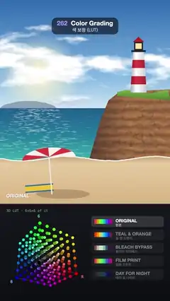

# 262 · Color Grading · 색 보정 (LUT)



**EN** A sunny lighthouse beach is wiped through teal & orange, bleach bypass, film print and day for night, while a 6 × 6 × 6 RGB lattice below warps with each look.  
**KO** 햇살 가득한 등대 해변이 틸 앤 오렌지, 블리치 바이패스, 필름 프린트, 데이 포 나이트로 차례로 와이프되고, 아래 6 × 6 × 6 RGB 격자가 룩마다 휜다.

[Video (mp4)](https://sueun-dev.github.io/motion-effects/videos/262-color-grading.mp4) · [Code](../effects/262-color-grading.js) · Film & animation craft · 영상·애니메이션 기법

## Prompt (English)

```text
Create a "Color Grading" motion effect: one daylight picture graded through five looks in turn (original, teal & orange, bleach bypass, film print, day for night), each new look carried across by a wipe line, with the look shown below as a 3D LUT: a lattice of the RGB cube pushed through the same grade.

Look
- The picture fills y 0–1300 (painted once):
  - sky: gradient #2C69B0 → #7FB6E3 (70 %) → #CFE6F2 at the horizon (y = 690); a warm sun glow at (250, 470), radius 260; cumulus clouds from fbm noise (white tops, blue-grey undersides);
  - a pale blue far headland on the left; the sea from #1F5C8E through #21809F to turquoise #3BB3AE at the shore, with 420 fixed glints gathered in the sun's path;
  - a cliff on the right: ochre rock with bent strata, grit and a few soft cracks, in shade on its left face, a grass cap #7DB04A → #4A7A2C; on top a lighthouse at x = 880 (y 330–590, radius 34 → 52, shaded as a cylinder): white with red bands #E0393E every 52 px, a black lantern with a warm light #FFE7A0 and a red roof #B5262B;
  - a beach: sand #C9A57A → #E6CBA0 → #D9B482 with fixed specks, a white foam line along the water, a red-and-white striped umbrella (#E2373F / #F5F1E8) with its shadow and a yellow towel #F2C230 with blue stripes #2B6CB0.
- The grades (on 0–1 sRGB values, luma L = 0.2126 R + 0.7152 G + 0.0722 B; clamp at the end):
  - Original: unchanged.
  - Teal & orange: split each colour into luma + chroma; keep only the chroma along the orange–teal axis A = (0.667, −0.123, −0.737), boosted 1.6×, plus A × (L − 0.45) × 0.22 (shadows teal, highlights orange), and 30 % of the rest; then an S-curve mix(c, smoothstep-curve(c), 0.4).
  - Bleach bypass: saturation 0.32, then overlay-blend it with its own luma at 85 % (high contrast, silvery), × (0.97, 1, 1.03).
  - Film print: S-curve 0.5, saturation 0.82, red × 1.07, green + 0.02 (1 − L), blue × 0.84 + 0.05 (1 − L), then 0.06 + 0.88 × c (lifted blacks, soft highlights).
  - Day for night: saturation 0.35, c^1.4 × 0.6 (about two stops down), the bright sky pulled down another 45 %, × (0.5, 0.72, 1.12) + (0, 0.01, 0.03).
- Below the picture a dark grading panel (#16171D → #0D0E12):
  - the LUT cube at (290, 1640): the 216 points of a 6 × 6 × 6 lattice of RGB, each placed at its graded colour inside the cube and drawn in that colour (radius 9 − 3 z, sorted back to front), the 12 cube edges (2 px, 22 % white), R / G / B at the corners, "3D LUT · 6×6×6 of it" (22 px mono) at the top left; the cube turns one full turn per loop (pitch 0.5 rad, slight perspective);
  - a list of the five looks on the right (x 580–1040, rows 84 px apart from y = 1420): each a 460 × 70 rounded row with an 8-colour hue strip run through that look, the English name (28 px bold) and the Korean name (22 px); the look on screen is lit, the incoming one brightening as the wipe crosses.
- The wipe: a 4 px white line down the picture with a round white handle (radius 22) at y = 1150. The look's name (30 px heavy, white with a soft shadow) is always whole and inside the frame at y = 1260: the old name sits at x = 40 until the line pushes it along 40 px ahead of itself, and it fades out over its last 80 px before the right margin (40 px); the new name fades in at x = 40 once the line is 40 px past its end, and stays there through the next hold.

Motion (0–5 s)
- Every second: the look holds for 0.4 s, then the next one wipes across from left to right in 0.6 s (x from −40 to 1120 px, smoothstep); the new look is left of the line.
- Order: original → teal & orange → bleach bypass → film print → day for night → original, so 5 s is the same as 0 s.
- The lattice points move with the wipe, lerping from the old look's positions to the new look's; the cube keeps turning.
- The picture itself never moves: only its colours change.

Technique
- A full-screen fragment shader reads the picture as a texture and applies grade(colour, look), choosing the look by which side of the wipe the pixel is on. The same grade function is written in JS for the cube and the swatches, so the cube shows exactly what the picture does: a 3D LUT is this function sampled on a lattice.

Output and rules
- One self-contained HTML file with no external assets (three.js from a CDN is fine if you use it), drawing on a 1080 × 1920 canvas (9:16) scaled to fit the window.
- Write a function renderFrame(t) that draws the frame for time t in seconds, and preview it with requestAnimationFrame. Everything must be a pure function of t and fixed seeds: no Math.random(), Date or state carried between frames, so frame i = renderFrame(i / 30) can be exported to a 30 fps video.
- Loop seamlessly every 5 seconds: renderFrame(5) must look exactly like renderFrame(0).
- No flicker of any kind: no noise or grain that changes from frame to frame, no strobing or blinking, no z-fighting, no shimmering 1 px lines. Any grain or texture stays fixed to the screen or to the object.
- Keep the top 280 px free of important content (a title label goes there) and fill the whole frame with a designed background.
```

## 프롬프트 (한국어)

```text
"색 보정 (LUT)" 모션 효과를 만들어 줘: 낮 풍경 그림 한 장을 다섯 가지 룩(원본, 틸 앤 오렌지, 블리치 바이패스, 필름 프린트, 데이 포 나이트)으로 차례로 보정하고, 새 룩마다 와이프 선이 화면을 가로지르며, 아래에는 그 룩을 3D LUT로 보여 준다: 같은 보정을 거친 RGB 정육면체 격자.

모양
- 그림은 y 0–1300을 채운다(한 번만 그림):
  - 하늘: 그라디언트 #2C69B0 → #7FB6E3(70 %) → 수평선(y = 690)에서 #CFE6F2; (250, 470)에 반지름 260의 따뜻한 해 빛무리; fbm 노이즈로 만든 뭉게구름(위는 흰색, 아래는 푸른 회색);
  - 왼쪽에 옅은 파란 먼 곶; 바다는 #1F5C8E에서 #21809F를 거쳐 물가의 청록 #3BB3AE로, 해가 비추는 길에 모인 고정된 반짝임 420개;
  - 오른쪽 절벽: 휘어진 지층·모래알·옅은 균열이 있는 황토색 바위, 왼쪽 면은 그늘, 위에 풀 #7DB04A → #4A7A2C; 그 위 x = 880에 등대(y 330–590, 반지름 34 → 52, 원기둥 음영): 흰색에 52px마다 빨간 띠 #E0393E, 따뜻한 불빛 #FFE7A0이 든 검은 등실, 빨간 지붕 #B5262B;
  - 해변: 고정된 알갱이가 있는 모래 #C9A57A → #E6CBA0 → #D9B482, 물가를 따라 흰 거품 선, 그림자가 있는 빨강·흰색 줄무늬 파라솔(#E2373F / #F5F1E8), 파란 줄 #2B6CB0이 있는 노란 수건 #F2C230.
- 보정(0–1 sRGB 값, 휘도 L = 0.2126 R + 0.7152 G + 0.0722 B, 마지막에 0–1로 자름):
  - 원본: 그대로.
  - 틸 앤 오렌지: 색을 휘도 + 채도로 나누고, 주황–청록 축 A = (0.667, −0.123, −0.737) 방향의 채도만 1.6배로 남기고 A × (L − 0.45) × 0.22를 더하고(어두운 곳은 청록, 밝은 곳은 주황), 나머지 채도는 30 %만; 그다음 S 곡선 mix(c, smoothstep 곡선(c), 0.4).
  - 블리치 바이패스: 채도 0.32, 그것을 자기 휘도와 오버레이 블렌드해 85 % 섞고(고대비, 은빛), × (0.97, 1, 1.03).
  - 필름 프린트: S 곡선 0.5, 채도 0.82, 빨강 × 1.07, 초록 + 0.02 (1 − L), 파랑 × 0.84 + 0.05 (1 − L), 그다음 0.06 + 0.88 × c(들뜬 검정, 부드러운 하이라이트).
  - 데이 포 나이트: 채도 0.35, c^1.4 × 0.6(약 2스톱 어둡게), 밝은 하늘은 45 % 더 내리고, × (0.5, 0.72, 1.12) + (0, 0.01, 0.03).
- 그림 아래 어두운 보정 패널(#16171D → #0D0E12):
  - (290, 1640)의 LUT 정육면체: RGB 6 × 6 × 6 격자의 점 216개를 각각 보정된 색의 위치에 두고 그 색으로 그린다(반지름 9 − 3 z, 뒤에서 앞으로 정렬). 정육면체 모서리 12개(2px, 흰색 22 %), 모서리에 R / G / B, 왼쪽 위에 "3D LUT · 6×6×6 of it"(22px 고정폭). 정육면체는 루프마다 한 바퀴 돈다(피치 0.5 rad, 약한 원근).
  - 오른쪽에 다섯 룩 목록(x 580–1040, y = 1420부터 84px 간격): 줄마다 460 × 70 둥근 칸에 그 룩을 거친 8색 색상 띠, 영어 이름(28px 굵게)과 한국어 이름(22px). 화면에 나온 룩은 밝게, 들어오는 룩은 와이프가 지나가는 만큼 밝아진다.
- 와이프: 그림을 세로로 지나는 4px 흰 선, y = 1150에 둥근 흰 손잡이(반지름 22). 룩 이름(30px 아주 굵게, 흰색에 부드러운 그림자)은 y = 1260에서 언제나 잘리지 않고 화면 안에 있다: 이전 이름은 x = 40에 있다가 선이 다가오면 선보다 40px 앞에서 밀려가고, 오른쪽 여백(40px)에 닿기 전 마지막 80px 동안 사라진다. 새 이름은 선이 자기 끝을 40px 지나면 x = 40에 나타나 다음 머무는 동안 그 자리에 있다.

움직임 (0–5초)
- 매초: 룩이 0.4초 머문 뒤 다음 룩이 0.6초 동안 왼쪽에서 오른쪽으로 와이프된다(x −40에서 1120px, smoothstep). 새 룩은 선의 왼쪽.
- 순서: 원본 → 틸 앤 오렌지 → 블리치 바이패스 → 필름 프린트 → 데이 포 나이트 → 원본. 그래서 5초가 0초와 같다.
- 격자 점은 와이프와 함께 이전 룩의 위치에서 새 룩의 위치로 보간되고, 정육면체는 계속 돈다.
- 그림 자체는 움직이지 않는다: 색만 바뀐다.

기법
- 전체 화면 프래그먼트 셰이더가 그림을 텍스처로 읽어 grade(색, 룩)를 적용하고, 픽셀이 와이프의 어느 쪽인지로 룩을 고른다. 같은 grade 함수를 JS로도 써서 정육면체와 색 띠를 그리므로, 정육면체는 그림이 겪는 것과 정확히 같은 변환을 보여 준다: 3D LUT는 이 함수를 격자에서 샘플링한 것이다.

출력과 규칙
- 외부 파일 없는 HTML 파일 하나(three.js를 쓴다면 CDN은 괜찮다). 1080 × 1920(9:16) 캔버스에 그리고 창 크기에 맞춰 보이게 한다.
- 시간 t(초)의 프레임을 그리는 renderFrame(t) 함수를 만들고, 미리보기는 requestAnimationFrame으로 돌린다. 모든 것은 t와 고정 시드만으로 정해진다: Math.random(), Date, 프레임 사이에 쌓이는 상태 금지. 그래야 i번째 프레임 = renderFrame(i / 30)으로 30fps 영상을 뽑을 수 있다.
- 5초마다 끊김 없이 반복: renderFrame(5)는 renderFrame(0)과 똑같아 보여야 한다.
- 어떤 깜빡임도 금지: 프레임마다 바뀌는 노이즈·그레인, 번쩍임·깜빡임, z-fighting, 반짝이며 떨리는 1px 선 모두 금지. 그레인·질감은 화면이나 물체에 고정한다.
- 위쪽 280px에는 중요한 내용을 두지 않고(제목 라벨 자리), 화면 전체를 디자인된 배경으로 채운다.
```
