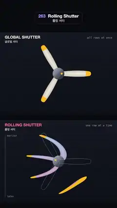

# 263 · Rolling Shutter · 롤링 셔터



**EN** One three-blade propeller twice: a global shutter keeps its blades straight, while a slow read-out line sweeping down bends them into curved bananas.  
**KO** 같은 세 날개 프로펠러를 두 번: 글로벌 셔터는 날개를 곧게 담고, 위에서 아래로 천천히 내려가는 판독선은 날개를 바나나처럼 휜 곡선으로 담는다.

[Video (mp4)](https://sueun-dev.github.io/motion-effects/videos/263-rolling-shutter.mp4) · [Code](../effects/263-rolling-shutter.js) · Film & animation craft · 영상·애니메이션 기법

## Prompt (English)

```text
Create a "Rolling Shutter" motion effect, slowed down so you can watch it: the same spinning propeller in two panels. The top panel is a global shutter (every row of the picture taken at the same instant), the bottom one a rolling shutter: a read-out line sweeps down the frame and each row keeps the propeller as it was when the line passed it, so the blades bend into curves.

Look
- Background #090A0F. Two panels, each 1080 × 760 px: the top one from y = 300, the bottom one from y = 1110. Each panel: a dark gradient rgb(19, 23, 33) → rgb(13, 15, 23) with a fixed 40 px grid (2 px lines, +0.025).
- The propeller, centred in each panel: three blades 300 px long, each a paddle along its own axis with half-width 16 + 40 s (1 − s)^0.7 px (s = 0 at the hub to 1 at the tip; widest about a third of the way out), drawn as a rounded box with 14 px corners; cream rgb(242, 235, 219) shaded slightly across the blade, the outer 16 % painted yellow rgb(255, 184, 26); a grey hub, radius 54 px, with a yellow mark 30 px off-centre that turns with it.
- Bottom panel: the blades are tinted by the time their row was read, light blue rgb(158, 219, 255) at the top row to pink rgb(255, 158, 199) at the bottom. Below the line, the live propeller is drawn as a faint pale-blue outline (45 %), so you see what the line is about to read. The line: a coral-pink glow rgb(255, 77, 107) (Gaussian, 7 px) with a 3 px core, fading in and out over the first and last 5 % of each sweep.
- Labels: "GLOBAL SHUTTER" (#F2EBDD) and "ROLLING SHUTTER" (#FF7A93), 36 px heavy at the top left of each panel, with "글로벌 셔터" / "롤링 셔터" (26 px) under them and "all rows at once" / "one row at a time" (24 px mono, 50 %) at the top right. At the left edge of the bottom panel, a 10 px time bar (580 px tall) filled down to the line with the same blue-to-pink gradient, labelled "earlier" and "later".

Motion (0–5 s)
- The propeller turns clockwise at 1/3 turn per second (5/3 turns per loop; with three identical blades that comes back to the start at 5 s).
- Top panel: the propeller as it is at t: straight blades turning steadily.
- Bottom panel: the line sweeps down the 760 px panel in 2.5 s (two sweeps per loop). A row at fraction f of the panel shows the propeller at the time the line last passed it: tc = (k + f) × 2.5 s, where k is the current sweep if the line is already below that row and the previous sweep if not. In one sweep the propeller turns 5/6 of a turn, so each new picture differs from the last and you watch the line rewrite it.
- The blades come out as curved bananas and loose yellow tip slivers; the bend changes smoothly as the line moves, never strobing.

Technique
- One full-screen fragment shader. For each pixel: work out which panel it is in; in the top panel use the angle at t; in the bottom panel use the angle at the row's own read time tc. Then draw the propeller with signed distance functions in the blades' frame (the min of three rotated paddles, anti-aliased over one pixel).
- The labels and the time bar are drawn in 2D on top.

Output and rules
- One self-contained HTML file with no external assets (three.js from a CDN is fine if you use it), drawing on a 1080 × 1920 canvas (9:16) scaled to fit the window.
- Write a function renderFrame(t) that draws the frame for time t in seconds, and preview it with requestAnimationFrame. Everything must be a pure function of t and fixed seeds: no Math.random(), Date or state carried between frames, so frame i = renderFrame(i / 30) can be exported to a 30 fps video.
- Loop seamlessly every 5 seconds: renderFrame(5) must look exactly like renderFrame(0).
- No flicker of any kind: no noise or grain that changes from frame to frame, no strobing or blinking, no z-fighting, no shimmering 1 px lines. Any grain or texture stays fixed to the screen or to the object.
- Keep the top 280 px free of important content (a title label goes there) and fill the whole frame with a designed background.
```

## 프롬프트 (한국어)

```text
"롤링 셔터" 모션 효과를 지켜볼 수 있게 느리게 만들어 줘: 같은 회전 프로펠러를 두 패널에 보여 준다. 위 패널은 글로벌 셔터(그림의 모든 줄을 같은 순간에 찍음), 아래 패널은 롤링 셔터: 판독선이 화면을 위에서 아래로 쓸고 내려가며 각 줄은 선이 지나간 순간의 프로펠러를 담기 때문에 날개가 곡선으로 휜다.

모양
- 배경 #090A0F. 패널 두 개, 각각 1080 × 760px: 위 패널은 y = 300부터, 아래 패널은 y = 1110부터. 패널마다 어두운 그라디언트 rgb(19, 23, 33) → rgb(13, 15, 23)과 고정된 40px 격자(2px 선, +0.025).
- 프로펠러는 패널마다 가운데: 길이 300px 날개 세 개, 날개마다 자기 축을 따라 반폭 16 + 40 s (1 − s)^0.7px인 노 모양(s는 허브 0에서 끝 1; 3분의 1쯤에서 가장 넓다), 모서리 14px 둥근 상자로 그린다; 크림색 rgb(242, 235, 219)에 날개 폭을 따라 살짝 음영, 바깥 16 %는 노란색 rgb(255, 184, 26); 반지름 54px 회색 허브와 중심에서 30px 떨어져 함께 도는 노란 표시.
- 아래 패널: 날개는 그 줄을 읽은 시각에 따라 물든다. 맨 위 줄 연파랑 rgb(158, 219, 255)에서 맨 아래 줄 분홍 rgb(255, 158, 199)로. 선 아래에는 지금 프로펠러를 옅은 하늘색 윤곽선(45 %)으로 그려 선이 곧 읽을 것을 보여 준다. 선: 산호 분홍 빛 rgb(255, 77, 107)(가우시안 7px)과 3px 심, 쓸기마다 처음과 끝 5 % 동안 나타나고 사라진다.
- 글: 패널마다 왼쪽 위에 "GLOBAL SHUTTER"(#F2EBDD)와 "ROLLING SHUTTER"(#FF7A93), 36px 아주 굵게, 그 아래 "글로벌 셔터" / "롤링 셔터"(26px), 오른쪽 위에 "all rows at once" / "one row at a time"(24px 고정폭, 50 %). 아래 패널 왼쪽 끝에 10px 시간 막대(높이 580px)가 같은 파랑→분홍 그라디언트로 선 높이까지 차고, "earlier", "later" 표시.

움직임 (0–5초)
- 프로펠러는 시계 방향으로 초당 1/3바퀴 돈다(루프당 5/3바퀴; 똑같은 날개가 셋이라 5초에 처음 모습으로 돌아온다).
- 위 패널: t 순간의 프로펠러, 곧은 날개가 일정하게 돈다.
- 아래 패널: 선이 760px 패널을 2.5초에 쓸고 내려간다(루프당 두 번). 패널의 f 위치에 있는 줄은 선이 마지막으로 지나간 순간의 프로펠러를 보여 준다: tc = (k + f) × 2.5초, k는 선이 이미 그 줄 아래에 있으면 이번 쓸기, 아니면 이전 쓸기. 한 번 쓰는 동안 프로펠러가 5/6바퀴 돌아서 새 그림이 이전 그림과 달라지고, 선이 그림을 다시 쓰는 것이 보인다.
- 날개는 휜 바나나 모양과 떨어져 나온 노란 날개 끝 조각으로 찍힌다. 선이 움직이는 대로 휨이 부드럽게 바뀌고, 깜빡이지 않는다.

기법
- 전체 화면 프래그먼트 셰이더 하나. 픽셀마다: 어느 패널인지 정하고, 위 패널은 t의 각도, 아래 패널은 그 줄의 판독 시각 tc의 각도를 쓴다. 그다음 날개 좌표계에서 부호 거리 함수로 프로펠러를 그린다(회전한 노 세 개의 최솟값, 1픽셀 안티에일리어싱).
- 글과 시간 막대는 위에 2D로 그린다.

출력과 규칙
- 외부 파일 없는 HTML 파일 하나(three.js를 쓴다면 CDN은 괜찮다). 1080 × 1920(9:16) 캔버스에 그리고 창 크기에 맞춰 보이게 한다.
- 시간 t(초)의 프레임을 그리는 renderFrame(t) 함수를 만들고, 미리보기는 requestAnimationFrame으로 돌린다. 모든 것은 t와 고정 시드만으로 정해진다: Math.random(), Date, 프레임 사이에 쌓이는 상태 금지. 그래야 i번째 프레임 = renderFrame(i / 30)으로 30fps 영상을 뽑을 수 있다.
- 5초마다 끊김 없이 반복: renderFrame(5)는 renderFrame(0)과 똑같아 보여야 한다.
- 어떤 깜빡임도 금지: 프레임마다 바뀌는 노이즈·그레인, 번쩍임·깜빡임, z-fighting, 반짝이며 떨리는 1px 선 모두 금지. 그레인·질감은 화면이나 물체에 고정한다.
- 위쪽 280px에는 중요한 내용을 두지 않고(제목 라벨 자리), 화면 전체를 디자인된 배경으로 채운다.
```
