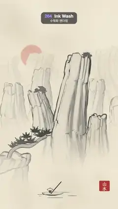

# 264 · Ink Wash · 수묵화 렌더링



**EN** Stone spires, a pine on a cliff and a fisherman's boat, all built in 3D, are rendered as an ink painting on rice paper while the camera drifts and mist moves.  
**KO** 돌기둥 봉우리, 절벽의 소나무, 낚싯배를 3D로 만들어 쌀 종이 위의 수묵화로 그리고, 카메라가 옆으로 흐르는 동안 겹겹의 산이 엇갈리고 안개가 흐른다.

[Video (mp4)](https://sueun-dev.github.io/motion-effects/videos/264-ink-wash.mp4) · [Code](../effects/264-ink-wash.js) · Film & animation craft · 영상·애니메이션 기법

## Prompt (English)

```text
Create an "Ink Wash" motion effect: a real 3D landscape rendered as an East Asian ink painting (sumi-e / 수묵화): wet washes, swelling outlines and texture strokes on rice paper, with a slow camera drift that proves it is 3D.

Look
- Paper: warm rice paper #EFE6D1 with soft lighter and darker blotches, 2,600 faint curved fibres (20–110 px long) and a fine 1 px tooth. It is made once and fixed to the screen. Ink is a warm black #0F0E0D; light ink is a grey #5C5E61.
- Scene (three.js, units are metres-ish):
  - three near stone spires 19, 13.5 and 10 tall (radius 3.0, 2.3, 2.0) around x = 2.6, −1.6, 6.0;
  - a middle range of four spires 11–18 tall at z −30 to −42, paler and with thinner lines;
  - a far range of eight broad spires 18–34 tall at z ≈ −100 to −115, a pale wash with no outline;
  - a near cliff at the lower left with a crooked pine leaning out over the water: a tube trunk and seven half-wheel fans of 17 tapered needles each;
  - small trees on the crowns of the two tallest spires: a dark upright dab and three flat tiers of foliage;
  - a fisherman's boat on the water (a flat hull, a seated figure in a conical hat, a long pole) with five tapered ripple strokes;
  - a pale vermilion sun (radius 8) far behind the peaks at (−20, 30, −200), under the ink.
- Spire shape: a cylinder (128 × 160 segments) whose radius tapers from 1 to 0.5, with a lobed, blocky cross-section, deep vertical fissures (1 − |noise|), two or three set-backs where it narrows, a bend along its height and a broken, rounded crown.
- A red seal 96 × 96 px with "山水" in white at the bottom right (x 908, y 1660).
- Camera: perspective 34°, at (1.5, 14, 48) looking at (0.8, 7.6, −40).

Motion (0–5 s), a = 2π · t / 5
- The camera drifts: x = 1.5 + 1.4 · sin(a), y = 14 + 0.5 · cos(a); the target moves 0.5 · sin(a). Near rock slides about 90 px, the middle range about 20 px, the far range stays: the layers separate in depth.
- The mist edge drifts: its noise is read on a circle of radius 1.2 that goes round once.
- The boat glides 0.6 · sin(a) and rocks 0.03 · sin(2a); the pine fans sway 0.05 rad.

Technique
- Every object renders ink, not colour, into a half-float target (4× MSAA): R = wash, B = outline, A = vermilion.
- Wash per pixel: dark = 0.75 · (1 − lit)^1.3 + 0.45 · rim², with lit = max(n · L, 0), L = (−0.7, 0.35, 0.6), rim = 1 − |n · view|. The wash is laid in three tones: 0.13, then +0.27 where dark + 0.4 · (noise − 0.5) > 0.32, then +0.3 where it passes 0.66 (noise fixed to the object, edges anti-aliased with fwidth), like separate brush passes. Texture strokes: dark broken streaks down the fissures (a per-vertex crease weight) and fainter vertical streaks, only where the surface is nearer than 45–90 units.
- Mist: the ink fades to paper from y = 1.5 + m to 8.5 + m above the water (m = 3 · noise), and with distance by exp(−0.0095 · d).
- Outlines: an inverted hull per object (back faces pushed out along the normal by 0.08 × a pressure of 0.45–1.65 from noise fixed to the object), drawn into B. The line swells and thins along the stroke but never boils, because nothing is random per frame.
- Post: a 19-tap Gaussian blur of the ink; wash = mix(ink, blur, 0.45) + 1.1 · max(0, ink − blur) (ink pools at the drying edge), a little bleed along the fibres, a dry-brush skip in mid tones where the fibre map is dense; then mixed onto the paper. The sun is mixed in under the ink.

Output and rules
- One self-contained HTML file with no external assets (three.js from a CDN is fine if you use it), drawing on a 1080 × 1920 canvas (9:16) scaled to fit the window.
- Write a function renderFrame(t) that draws the frame for time t in seconds, and preview it with requestAnimationFrame. Everything must be a pure function of t and fixed seeds: no Math.random(), Date or state carried between frames, so frame i = renderFrame(i / 30) can be exported to a 30 fps video.
- Loop seamlessly every 5 seconds: renderFrame(5) must look exactly like renderFrame(0).
- No flicker of any kind: no noise or grain that changes from frame to frame, no strobing or blinking, no z-fighting, no shimmering 1 px lines. Any grain or texture stays fixed to the screen or to the object.
- Keep the top 280 px free of important content (a title label goes there) and fill the whole frame with a designed background.
```

## 프롬프트 (한국어)

```text
"수묵화 렌더링" 모션 효과를 만들어 줘: 진짜 3D 풍경을 동아시아 수묵화로 그리는 효과. 젖은 담묵, 굵어졌다 가늘어지는 윤곽선, 준법 같은 질감 붓질이 쌀 종이 위에 그려지고, 카메라가 천천히 흘러 3D임을 보여 준다.

모양
- 종이: 따뜻한 쌀 종이 #EFE6D1, 밝고 어두운 얼룩, 희미하게 휜 섬유 2,600개(20–110px), 1px의 고운 결. 한 번 만들어 화면에 고정한다. 먹은 따뜻한 검정 #0F0E0D, 엷은 먹은 회색 #5C5E61.
- 장면(three.js):
  - 가까운 돌기둥 봉우리 셋, 높이 19, 13.5, 10(반지름 3.0, 2.3, 2.0), x = 2.6, −1.6, 6.0 근처;
  - 가운데 층: z −30~−42의 봉우리 넷, 높이 11–18, 더 옅고 선이 가늘다;
  - 먼 층: z ≈ −100~−115의 넓은 봉우리 여덟, 높이 18–34, 윤곽선 없는 옅은 담묵;
  - 왼쪽 아래 가까운 절벽과 물 위로 기운 굽은 소나무: 튜브 줄기와, 가늘어지는 솔잎 17개로 된 반원 부채 일곱;
  - 가장 높은 두 봉우리 꼭대기의 작은 나무들: 짙은 세로 붓점 하나와 납작한 잎 층 셋;
  - 물 위 낚싯배(납작한 배, 삿갓 쓴 사람, 긴 장대)와 가늘어지는 물결 붓질 다섯;
  - 봉우리 뒤 멀리 (−20, 30, −200)의 옅은 주홍 해(반지름 8), 먹 아래에 깔린다.
- 봉우리 모양: 원기둥(128 × 160 분할)의 반지름이 1에서 0.5로 좁아지고, 단면은 울퉁불퉁 각지며, 깊은 세로 균열(1 − |노이즈|), 좁아지는 단 두세 개, 높이에 따른 휨, 부서진 둥근 꼭대기.
- 오른쪽 아래(x 908, y 1660)에 흰 "山水"가 새겨진 96 × 96px 붉은 낙관.
- 카메라: 원근 34°, (1.5, 14, 48)에서 (0.8, 7.6, −40)을 본다.

움직임 (0–5초), a = 2π · t / 5
- 카메라가 흐른다: x = 1.5 + 1.4 · sin(a), y = 14 + 0.5 · cos(a), 시선 목표는 0.5 · sin(a). 가까운 바위는 약 90px, 가운데 층은 약 20px 움직이고 먼 층은 그대로라 층들이 깊이로 갈라진다.
- 안개 가장자리가 흐른다: 노이즈를 반지름 1.2의 원을 따라 한 바퀴 읽는다.
- 배는 0.6 · sin(a)로 미끄러지고 0.03 · sin(2a)로 흔들리며, 솔잎 부채는 0.05 rad 흔들린다.

기법
- 모든 물체는 색 대신 먹을 반정밀 부동소수 타깃(4× MSAA)에 그린다: R = 담묵, B = 윤곽선, A = 주홍.
- 픽셀마다 담묵: dark = 0.75 · (1 − lit)^1.3 + 0.45 · rim², lit = max(n · L, 0), L = (−0.7, 0.35, 0.6), rim = 1 − |n · 시선|. 담묵은 세 톤으로 칠한다: 0.13, dark + 0.4 · (노이즈 − 0.5)가 0.32를 넘으면 +0.27, 0.66을 넘으면 +0.3(노이즈는 물체에 고정, 경계는 fwidth로 안티에일리어싱). 붓을 여러 번 겹친 것처럼 보인다. 질감 붓질: 균열을 따라 끊기는 짙은 줄(정점마다 균열 가중치)과 더 옅은 세로 줄, 표면이 45–90보다 가까울 때만.
- 안개: 먹이 물 위 y = 1.5 + m에서 8.5 + m 사이에서 종이로 사라지고(m = 3 · 노이즈), 거리에 따라 exp(−0.0095 · d)로 옅어진다.
- 윤곽선: 물체마다 뒤집힌 껍질(inverted hull), 뒷면을 법선 방향으로 0.08 × 필압(0.45–1.65, 물체에 고정된 노이즈)만큼 밀어 B에 그린다. 선이 붓질을 따라 굵어졌다 가늘어지지만 프레임마다 바뀌는 무작위가 없으니 끓지 않는다.
- 후처리: 먹을 19탭 가우시안으로 흐리고, 담묵 = mix(먹, 흐림, 0.45) + 1.1 · max(0, 먹 − 흐림)(마르는 가장자리에 먹이 고인다), 섬유를 따라 살짝 번지고, 섬유가 빽빽한 중간 톤에서는 갈필처럼 비게 한 뒤 종이에 섞는다. 해는 먹 아래에 섞는다.

출력과 규칙
- 외부 파일 없는 HTML 파일 하나(three.js를 쓴다면 CDN은 괜찮다). 1080 × 1920(9:16) 캔버스에 그리고 창 크기에 맞춰 보이게 한다.
- 시간 t(초)의 프레임을 그리는 renderFrame(t) 함수를 만들고, 미리보기는 requestAnimationFrame으로 돌린다. 모든 것은 t와 고정 시드만으로 정해진다: Math.random(), Date, 프레임 사이에 쌓이는 상태 금지. 그래야 i번째 프레임 = renderFrame(i / 30)으로 30fps 영상을 뽑을 수 있다.
- 5초마다 끊김 없이 반복: renderFrame(5)는 renderFrame(0)과 똑같아 보여야 한다.
- 어떤 깜빡임도 금지: 프레임마다 바뀌는 노이즈·그레인, 번쩍임·깜빡임, z-fighting, 반짝이며 떨리는 1px 선 모두 금지. 그레인·질감은 화면이나 물체에 고정한다.
- 위쪽 280px에는 중요한 내용을 두지 않고(제목 라벨 자리), 화면 전체를 디자인된 배경으로 채운다.
```
