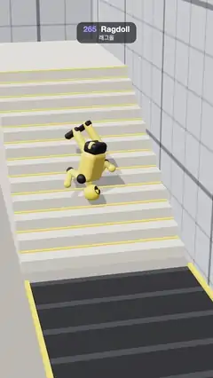

# 265 · Ragdoll · 래그돌



**EN** A crash-test dummy of capsules held by joint limits drops onto a staircase, tumbles down twelve steps, lies perfectly still, then a conveyor carries it off.  
**KO** 캡슐과 관절 제한으로 만든 충돌 시험 더미가 계단 위로 떨어져 열두 칸을 굴러 내려오고, 완전히 멈춰 누웠다가 컨베이어에 실려 나간다.

[Video (mp4)](https://sueun-dev.github.io/motion-effects/videos/265-ragdoll.mp4) · [Code](../effects/265-ragdoll.js) · Physics & characters · 물리·캐릭터

## Prompt (English)

```text
Create a "Ragdoll" motion effect: a limp crash-test dummy, simulated as particles with bone and joint-limit constraints, falls down a flight of stairs and comes to rest exactly still.

Look
- A test lab: a straight flight of 12 concrete steps (#CFCAC2, rise 0.17 m, run 0.30 m) from a top landing 2.04 m high down to the floor, with a thin yellow strip (#F2C230) on every nosing. Walls on the far side and above the top landing are blue-grey #B4BAC4 with a 25 cm measuring grid (thicker line every metre).
- At the foot of the stairs a conveyor: a dark ribbed rubber belt (#26282D with lighter ribs) between yellow rails, running away towards the camera.
- The dummy, about 1.7 m: a yellow #EDBE45 chest block (0.24 × 0.44 × 0.4, rounded), a black pelvis, capsule limbs (thigh radius 0.075, shin 0.06, upper arm 0.05, forearm 0.045), black ball joints at shoulders, elbows, hips and knees, black feet, and a round head with black-and-yellow crash-test target decals on both sides.
- Light: a warm key light (3.0) from the front right with soft shadows, a hemisphere fill and a room environment (0.4). Camera: perspective 30° at (11.8, 4.5, 1.9) looking up the stairs at (2.5, 0.8, −0.2), so the flight climbs the frame from the conveyor at the bottom to the landing under the title.

Motion (0–5 s)
- The dummy is dropped 1.8 m above the top landing 1.0 s before the loop starts, pitched forward 0.25 rad, its upper body moving faster (1.2 + 1.5 · height m/s) and a slight twist, so it pitches head first over the edge.
- 0–2 s: it cartwheels and slides down the steps, limbs flailing and catching on the nosings, and lands face down at the bottom.
- About 2.0 s: nothing moves faster than 3 cm/s for 0.3 s, so the body is put to sleep: it lies exactly still until 3.5 s.
- 3.5–5 s: the conveyor starts (ease up to 3.6 m/s in 0.4 s, run, ease down by 5 s, 3.48 m in all) and carries the limp body out of the bottom of the frame; meanwhile the next dummy is already falling in from above, so 5 s matches 0 s. The belt's ribs move exactly 6 spacings per loop.

Technique
- A Verlet ragdoll of 16 particles (head, neck, both shoulders, elbows, hands, hips, knees, feet, plus belly and back points that give the torso depth), each with a radius. The torso's seven particles are held as a rigid cluster (every pair at its distance); limbs are bones of fixed length.
- Joint limits as distance constraints between non-neighbours: the head stays within −5 to +3 cm of its rest distance to the chest points; a hand stays 15 cm from the torso; an elbow cannot come within 30 cm of the other shoulder; hip to foot at least 30 cm (the knee folds no further); a knee at least 32 cm from its shoulder; knees and feet keep apart. A hinge rule keeps each knee in front of the hip-to-foot line (forward = towards the belly).
- Collisions: the solid under the stairs is a union of quadrants {x ≤ k · run, y ≤ top − k · rise}; each particle is pushed out of them, and each bone is pushed off any nosing corner it would cut. Friction cancels sliding up to 1.2 × the push depth (sliding is measured against the belt on the conveyor).
- 600 steps a second, 8 constraint passes, 0.05 % air drag; the whole run is simulated once in setup and played back; a second copy of the dummy draws the next drop during the last second.

Output and rules
- One self-contained HTML file with no external assets (three.js from a CDN is fine if you use it), drawing on a 1080 × 1920 canvas (9:16) scaled to fit the window.
- Write a function renderFrame(t) that draws the frame for time t in seconds, and preview it with requestAnimationFrame. Everything must be a pure function of t and fixed seeds: no Math.random(), Date or state carried between frames, so frame i = renderFrame(i / 30) can be exported to a 30 fps video.
- Loop seamlessly every 5 seconds: renderFrame(5) must look exactly like renderFrame(0).
- No flicker of any kind: no noise or grain that changes from frame to frame, no strobing or blinking, no z-fighting, no shimmering 1 px lines. Any grain or texture stays fixed to the screen or to the object.
- Keep the top 280 px free of important content (a title label goes there) and fill the whole frame with a designed background.
```

## 프롬프트 (한국어)

```text
"래그돌" 모션 효과를 만들어 줘: 뼈와 관절 제한 구속 조건을 가진 입자로 시뮬레이션한 축 늘어진 충돌 시험 더미가 계단을 굴러 내려와 완전히 멈춘다.

모양
- 시험실: 높이 2.04m의 위층 단에서 바닥까지 이어지는 콘크리트 계단 12칸(#CFCAC2, 단 높이 0.17m, 너비 0.30m), 모든 계단 코에 가는 노란 띠(#F2C230). 먼 쪽 벽과 위층 단 뒤 벽은 푸른 회색 #B4BAC4에 25cm 측정 격자(1m마다 굵은 선).
- 계단 아래에는 컨베이어: 노란 레일 사이 어두운 골진 고무 벨트(#26282D, 밝은 골), 카메라 쪽으로 흘러간다.
- 더미(약 1.7m): 노란 #EDBE45 가슴 블록(0.24 × 0.44 × 0.4, 둥근 모서리), 검은 골반, 캡슐 팔다리(허벅지 반지름 0.075, 정강이 0.06, 위팔 0.05, 아래팔 0.045), 어깨·팔꿈치·엉덩이·무릎의 검은 공 관절, 검은 발, 양옆에 검정·노랑 충돌 시험 표적 무늬가 있는 둥근 머리.
- 조명: 오른쪽 앞에서 오는 따뜻한 키 라이트(3.0)와 부드러운 그림자, 반구광, 룸 환경맵(0.4). 카메라: 원근 30°, (11.8, 4.5, 1.9)에서 계단 위쪽 (2.5, 0.8, −0.2)을 올려다본다. 계단이 아래쪽 컨베이어에서 제목 아래 위층 단까지 화면을 타고 올라간다.

움직임 (0–5초)
- 더미는 루프 시작 1.0초 전에 위층 단 1.8m 위에서 떨어진다. 앞으로 0.25 rad 기울어 있고 윗몸이 더 빨리 움직이며(1.2 + 1.5 · 높이 m/s) 살짝 비틀려, 머리부터 계단 끝으로 넘어간다.
- 0–2초: 옆으로 굴러 미끄러지며 계단을 내려오고, 팔다리가 휘둘리고 계단 코에 걸렸다가 아래에 엎드려 떨어진다.
- 약 2.0초: 0.3초 동안 3cm/s보다 빠른 곳이 없으면 몸을 잠재운다. 3.5초까지 정확히 멈춰 있다.
- 3.5–5초: 컨베이어가 움직여(0.4초에 3.6m/s까지 가속, 유지, 5초까지 감속, 모두 3.48m) 축 늘어진 몸을 화면 아래로 실어 낸다. 그동안 다음 더미가 이미 위에서 떨어져 들어오므로 5초가 0초와 맞물린다. 벨트 골은 루프마다 정확히 6칸 움직인다.

기법
- 입자 16개의 Verlet 래그돌(머리, 목, 양 어깨·팔꿈치·손·엉덩이·무릎·발, 그리고 몸통 두께를 주는 배·등 점), 입자마다 반지름이 있다. 몸통 입자 7개는 강체 묶음(모든 쌍의 거리를 고정)이고 팔다리는 길이가 고정된 뼈다.
- 관절 제한은 이웃이 아닌 입자 사이의 거리 제약: 머리는 가슴 점들과의 휴지 거리에서 −5~+3cm 안, 손은 몸통에서 15cm 이상, 팔꿈치는 반대쪽 어깨에서 30cm 이상, 엉덩이–발은 30cm 이상(무릎이 더 접히지 않음), 무릎은 같은 쪽 어깨에서 32cm 이상, 무릎끼리·발끼리 떨어진다. 경첩 규칙으로 무릎은 엉덩이–발 선보다 앞(배 쪽)에 있다.
- 충돌: 계단 아래 고체는 사분면 {x ≤ k · 너비, y ≤ 꼭대기 − k · 높이}의 합집합이다. 입자를 그 밖으로 밀어내고, 뼈가 계단 코 모서리를 가로지르면 뼈를 밀어낸다. 마찰은 밀어낸 깊이의 1.2배까지 미끄러짐을 없앤다(컨베이어 위에서는 벨트에 대한 미끄러짐).
- 초당 600스텝, 구속 조건 8회 반복, 공기 저항 0.05 %. 전체를 설정 단계에서 한 번 시뮬레이션해 재생하고, 마지막 1초 동안은 더미 사본 하나가 다음 낙하를 그린다.

출력과 규칙
- 외부 파일 없는 HTML 파일 하나(three.js를 쓴다면 CDN은 괜찮다). 1080 × 1920(9:16) 캔버스에 그리고 창 크기에 맞춰 보이게 한다.
- 시간 t(초)의 프레임을 그리는 renderFrame(t) 함수를 만들고, 미리보기는 requestAnimationFrame으로 돌린다. 모든 것은 t와 고정 시드만으로 정해진다: Math.random(), Date, 프레임 사이에 쌓이는 상태 금지. 그래야 i번째 프레임 = renderFrame(i / 30)으로 30fps 영상을 뽑을 수 있다.
- 5초마다 끊김 없이 반복: renderFrame(5)는 renderFrame(0)과 똑같아 보여야 한다.
- 어떤 깜빡임도 금지: 프레임마다 바뀌는 노이즈·그레인, 번쩍임·깜빡임, z-fighting, 반짝이며 떨리는 1px 선 모두 금지. 그레인·질감은 화면이나 물체에 고정한다.
- 위쪽 280px에는 중요한 내용을 두지 않고(제목 라벨 자리), 화면 전체를 디자인된 배경으로 채운다.
```
