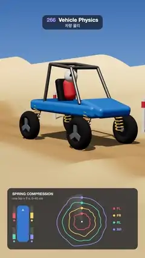

# 266 · Vehicle Physics · 차량 물리



**EN** A dune buggy on spring-damper struts drives over whoops, side bumps and a jump; coils squash, the body pitches and rolls, and a dial logs every spring.  
**KO** 스프링·댐퍼 서스펜션의 버기가 연속 둔덕, 한쪽 둔덕, 점프대를 지나며 코일이 눌리고 차체가 앞뒤·좌우로 기울며, 다이얼이 바퀴마다 압축을 기록한다.

[Video (mp4)](https://sueun-dev.github.io/motion-effects/videos/266-vehicle-physics.mp4) · [Code](../effects/266-vehicle-physics.js) · Physics & characters · 물리·캐릭터

## Prompt (English)

```text
Create a "Vehicle Physics" motion effect: a dune buggy whose body and four wheels are simulated with spring-damper suspension and tyre springs, driving a bumpy desert track, with live suspension telemetry.

Look
- A desert under a sky gradient (#3B6FB6 → #9CC3E6 → #F6D9AE at the horizon), sand #D9B27C with a darker track #B98B57 and two tyre ruts, dunes rising beside the track, haze from 25 to 70 units. Red-and-white marker posts every 5 m on the far side.
- The buggy: a blue clear-coated tub #2F7DE1 (3.0 × 0.32 × 1.25, rounded) with a raised nose, a steel roll cage of 4.5 cm tubes, a dark seat, a driver in a red suit #E2483C with a white helmet and dark visor. Fat balloon tyres (radius 0.434) with a dark rim and three broad grey spokes. At each corner a yellow coil spring (#F2B632, 7 turns, coil radius 0.1, wire 0.022) round a dark damper, and a steel arm from the body to the hub.
- Camera: perspective 30°, low, ahead of the buggy and to its side at (x + 11, 2.2, 8.4) looking back at (x − 0.3, 0.3, −0.15), following it.
- Telemetry panel at the bottom (x 54–1026, y 1400–1856, rgba(16, 20, 30, 0.74), radius 30): "SPRING COMPRESSION", "one lap = 5 s, 0–40 cm"; a top view of the body with a bar beside each corner that fills with its compression and a dot that is filled while that tyre touches the ground and hollow in the air; and a dial (centre 610, 1650): each spring's compression over the whole lap is a closed ring (radius 62 + 40 i px, pushed out 0.45 px per cm above 20 cm), time runs clockwise from the top, a soft sweep marks now with a dot on each ring. Colours FL #FF6B6B, FR #FFD166, RL #4ECDC4, RR #8E9BFF.

Motion (0–5 s)
- The buggy drives at 6 m/s, 30 m per loop; the track repeats every 30 m: three whoops 0.22 high (at 3.5, 5.3 and 7.1 m), a 0.3 bump under the left wheels at 12 m and one under the right wheels at 15.5 m (the body rolls), then a 0.62 kicker from 19.5 to 22.6 m with a sharp lip (the buggy flies, the wheels hang down on their straps, then it lands nose first and the springs squash) and a shallow dip at 25.5 m.
- The wheels turn exactly 11 times per loop, so the spokes line up at 5 s.

Technique
- The classic car model, solved at 600 steps a second: the body (420 kg, pitch inertia 520, roll inertia 160) has heave, pitch and roll; each wheel is its own 28 kg mass.
- Each strut is a spring-damper between the body corner (±0.82 to the side, 1.25 ahead and 1.15 behind the centre) and the hub: stiffness 5,700 N/m, damping 850 N·s/m, free length 0.62, a stiff bump stop below 0.2 and a top-out strap above 0.58.
- Each tyre is a stiffer spring (45,000 N/m, damping 2,200) that only pushes while it touches: its contact height is the highest point of the ground under the round tyre (17 samples across it), so it rolls over bumps instead of poking into them.
- The ground is periodic and the body is damped, so after three warm-up laps the motion repeats; the last lap is stored and played back. The springs are drawn stretched to the real strut length every frame.

Output and rules
- One self-contained HTML file with no external assets (three.js from a CDN is fine if you use it), drawing on a 1080 × 1920 canvas (9:16) scaled to fit the window.
- Write a function renderFrame(t) that draws the frame for time t in seconds, and preview it with requestAnimationFrame. Everything must be a pure function of t and fixed seeds: no Math.random(), Date or state carried between frames, so frame i = renderFrame(i / 30) can be exported to a 30 fps video.
- Loop seamlessly every 5 seconds: renderFrame(5) must look exactly like renderFrame(0).
- No flicker of any kind: no noise or grain that changes from frame to frame, no strobing or blinking, no z-fighting, no shimmering 1 px lines. Any grain or texture stays fixed to the screen or to the object.
- Keep the top 280 px free of important content (a title label goes there) and fill the whole frame with a designed background.
```

## 프롬프트 (한국어)

```text
"차량 물리" 모션 효과를 만들어 줘: 차체와 네 바퀴를 스프링·댐퍼 서스펜션과 타이어 스프링으로 시뮬레이션한 버기가 울퉁불퉁한 사막 길을 달리고, 서스펜션 계측이 실시간으로 보이는 효과.

모양
- 하늘 그라디언트(#3B6FB6 → #9CC3E6 → 지평선 #F6D9AE) 아래의 사막. 모래 #D9B27C, 더 짙은 주행로 #B98B57과 타이어 자국 두 줄, 길옆으로 솟는 모래 언덕, 25~70 거리의 안개. 먼 쪽에 5m마다 빨강·흰색 표지 기둥.
- 버기: 클리어코트 파란 차체 #2F7DE1(3.0 × 0.32 × 1.25, 둥근 모서리)와 솟은 앞부분, 4.5cm 강철 관 롤케이지, 어두운 좌석, 빨간 옷 #E2483C에 흰 헬멧·어두운 바이저를 쓴 운전자. 반지름 0.434의 뚱뚱한 벌룬 타이어, 어두운 림과 넓은 회색 바퀴살 셋. 모서리마다 어두운 댐퍼를 감싼 노란 코일 스프링(#F2B632, 7바퀴, 코일 반지름 0.1, 선 0.022)과 차체에서 허브로 가는 강철 암.
- 카메라: 원근 30°, 낮게, 버기 앞쪽 옆 (x + 11, 2.2, 8.4)에서 (x − 0.3, 0.3, −0.15)를 뒤돌아보며 따라간다.
- 아래쪽 계측 패널(x 54–1026, y 1400–1856, rgba(16, 20, 30, 0.74), 반지름 30): "SPRING COMPRESSION", "one lap = 5 s, 0–40 cm". 차체 윗모습 옆 모서리마다 압축만큼 차오르는 막대와, 그 타이어가 땅에 닿아 있으면 채워지고 공중이면 비는 점. 다이얼(중심 610, 1650): 각 스프링의 한 바퀴(5초) 압축이 닫힌 고리(반지름 62 + 40 i px, 20cm보다 1cm마다 0.45px 바깥으로)가 되고, 시간은 위에서부터 시계 방향, 부드러운 스윕과 고리마다 점이 지금을 표시한다. 색: FL #FF6B6B, FR #FFD166, RL #4ECDC4, RR #8E9BFF.

움직임 (0–5초)
- 버기는 6m/s로 루프마다 30m 달리고, 길은 30m마다 반복된다: 높이 0.22의 연속 둔덕 셋(3.5, 5.3, 7.1m), 12m에 왼쪽 바퀴 밑에만 0.3 둔덕, 15.5m에 오른쪽 바퀴 밑 둔덕(차체가 좌우로 기운다), 19.5–22.6m에 날카로운 끝을 가진 0.62 점프대(버기가 날고 바퀴는 스트랩에 매달려 처졌다가 앞부터 착지하며 스프링이 눌린다), 25.5m의 얕은 패임.
- 바퀴는 루프마다 정확히 11바퀴 돌아 5초에 바퀴살이 다시 맞는다.

기법
- 고전적인 차량 모델을 초당 600스텝으로 푼다: 차체(420kg, 피치 관성 520, 롤 관성 160)는 상하·피치·롤, 바퀴는 각각 28kg의 질량.
- 스트럿마다 차체 모서리(옆으로 ±0.82, 중심 앞 1.25·뒤 1.15)와 허브 사이의 스프링·댐퍼: 강성 5,700 N/m, 감쇠 850 N·s/m, 자유 길이 0.62, 0.2 아래 단단한 범프 스톱, 0.58 위 톱아웃 스트랩.
- 타이어는 땅에 닿을 때만 미는 더 단단한 스프링(45,000 N/m, 감쇠 2,200). 접촉 높이는 둥근 타이어 아래 땅의 가장 높은 점(타이어 폭에 걸쳐 17점)이라, 둔덕을 찌르지 않고 타고 넘는다.
- 땅은 주기적이고 차체는 감쇠되므로 세 바퀴 예열 뒤에는 움직임이 반복된다. 마지막 한 바퀴를 저장해 재생한다. 스프링은 매 프레임 실제 스트럿 길이로 늘여 그린다.

출력과 규칙
- 외부 파일 없는 HTML 파일 하나(three.js를 쓴다면 CDN은 괜찮다). 1080 × 1920(9:16) 캔버스에 그리고 창 크기에 맞춰 보이게 한다.
- 시간 t(초)의 프레임을 그리는 renderFrame(t) 함수를 만들고, 미리보기는 requestAnimationFrame으로 돌린다. 모든 것은 t와 고정 시드만으로 정해진다: Math.random(), Date, 프레임 사이에 쌓이는 상태 금지. 그래야 i번째 프레임 = renderFrame(i / 30)으로 30fps 영상을 뽑을 수 있다.
- 5초마다 끊김 없이 반복: renderFrame(5)는 renderFrame(0)과 똑같아 보여야 한다.
- 어떤 깜빡임도 금지: 프레임마다 바뀌는 노이즈·그레인, 번쩍임·깜빡임, z-fighting, 반짝이며 떨리는 1px 선 모두 금지. 그레인·질감은 화면이나 물체에 고정한다.
- 위쪽 280px에는 중요한 내용을 두지 않고(제목 라벨 자리), 화면 전체를 디자인된 배경으로 채운다.
```
